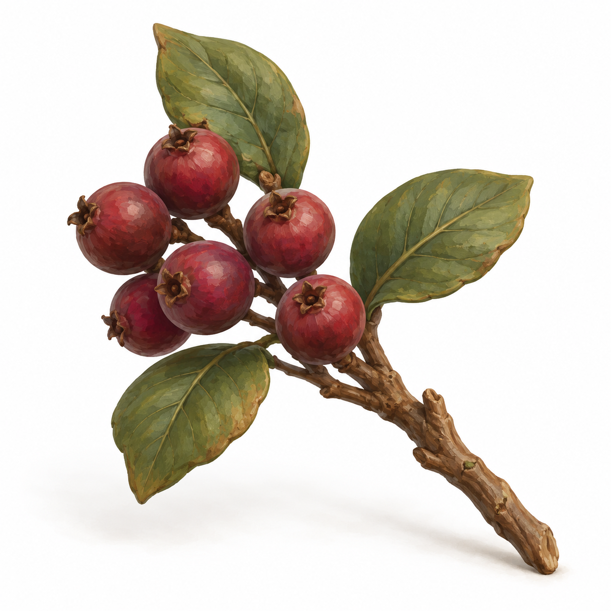
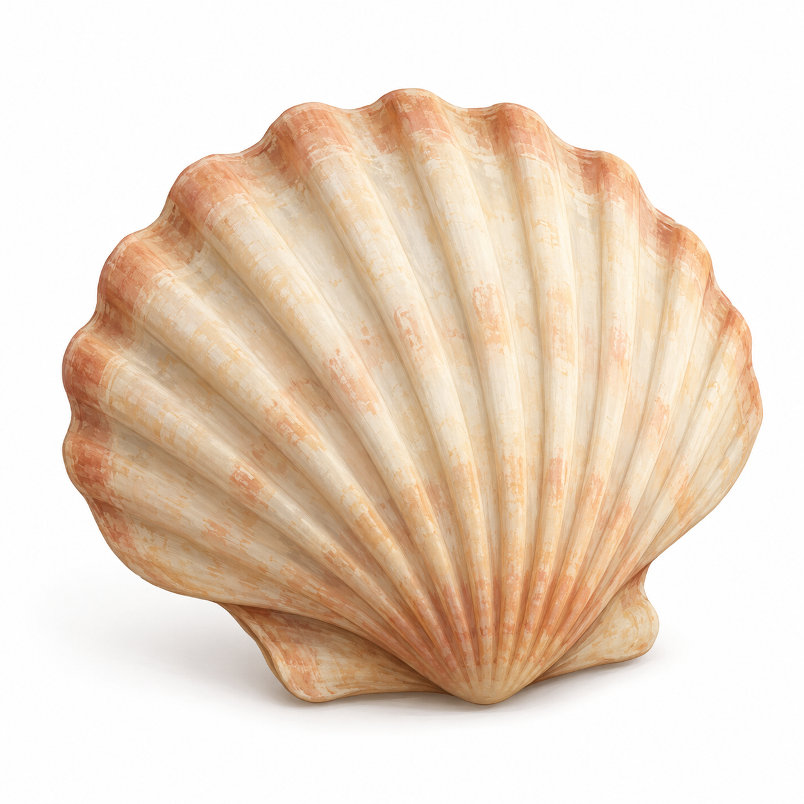
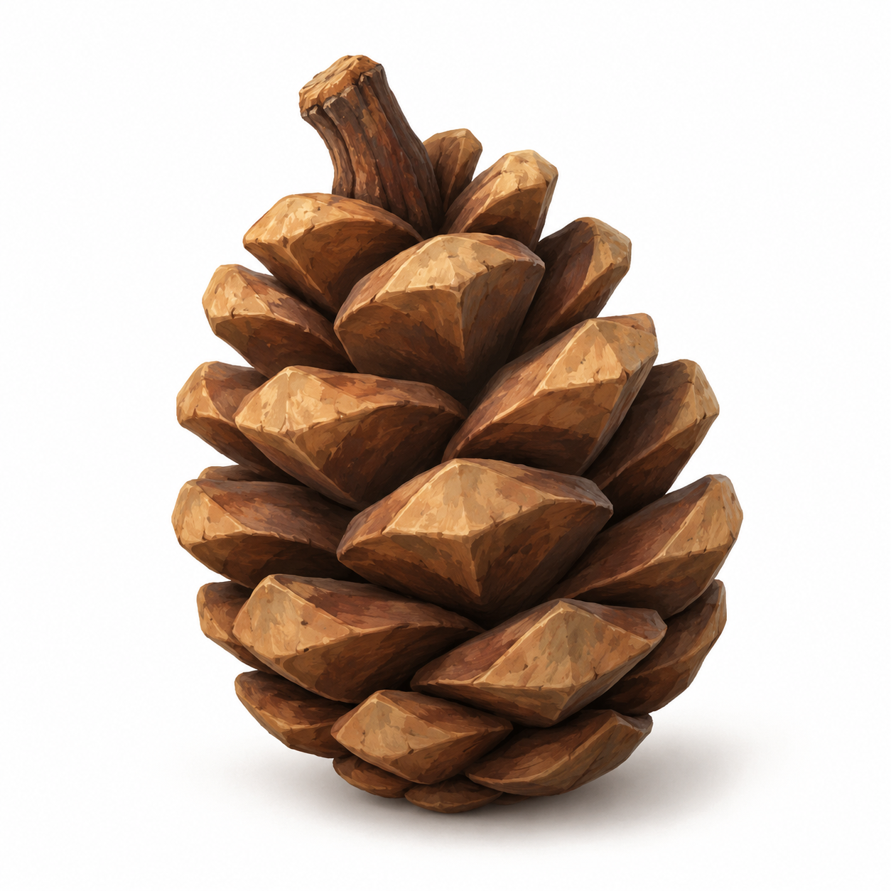
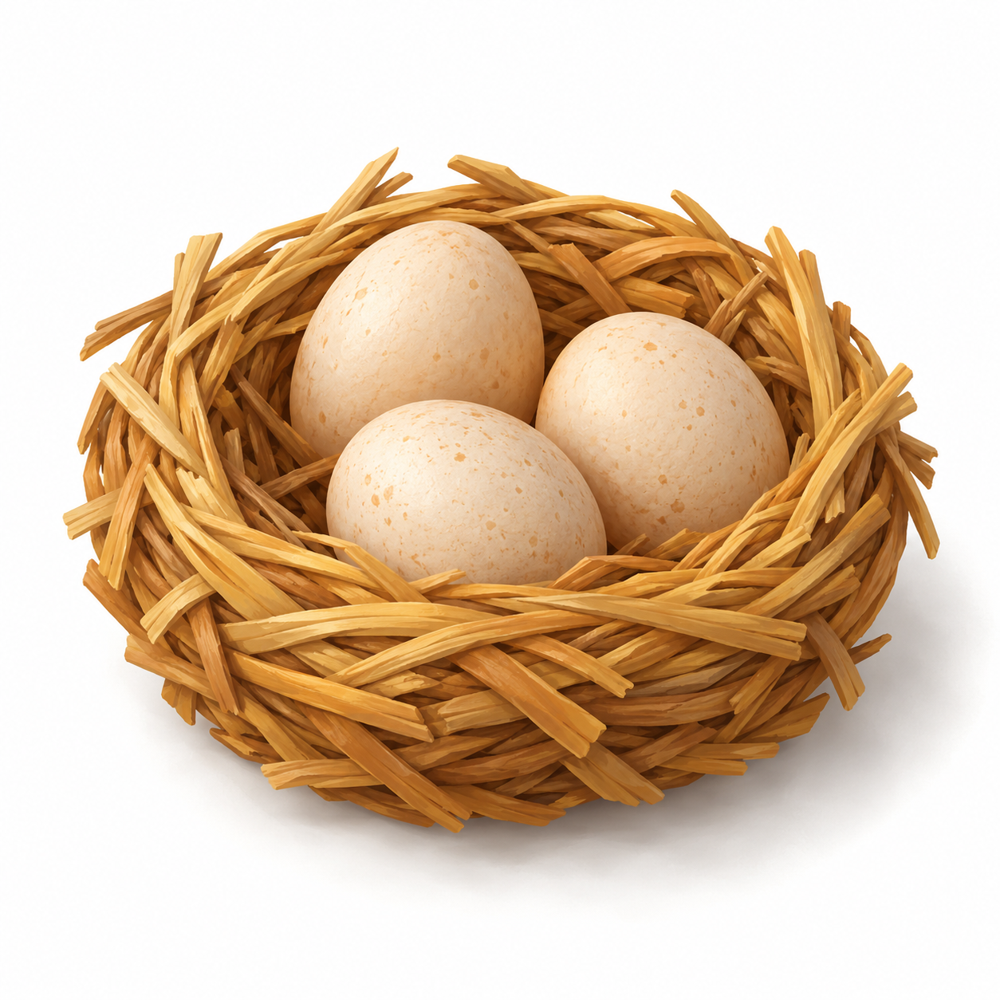
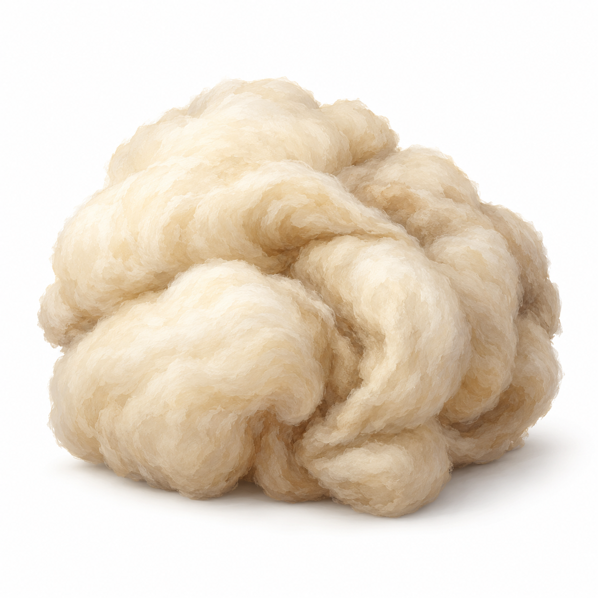
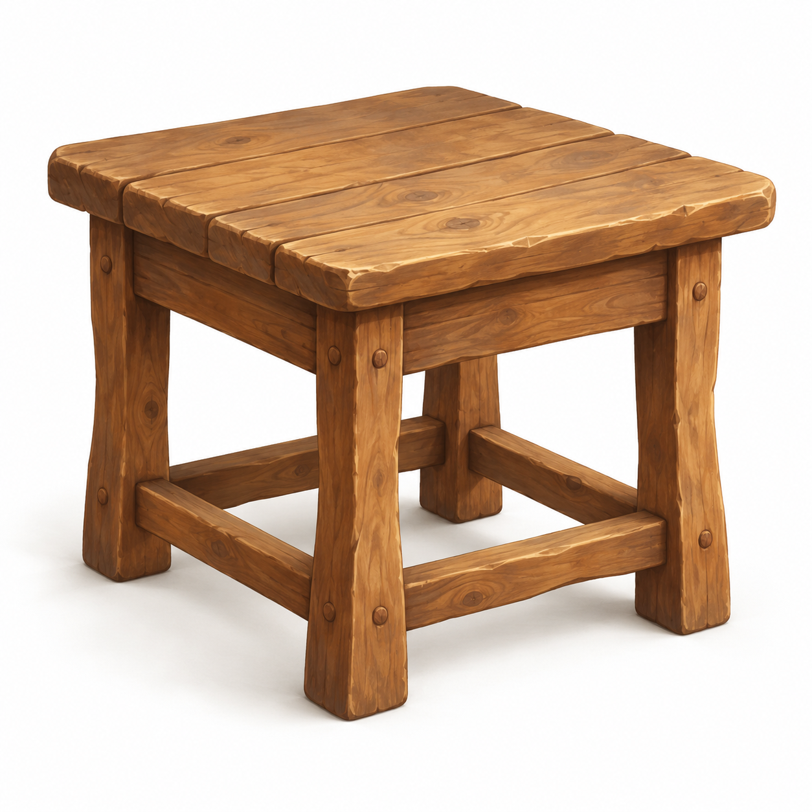
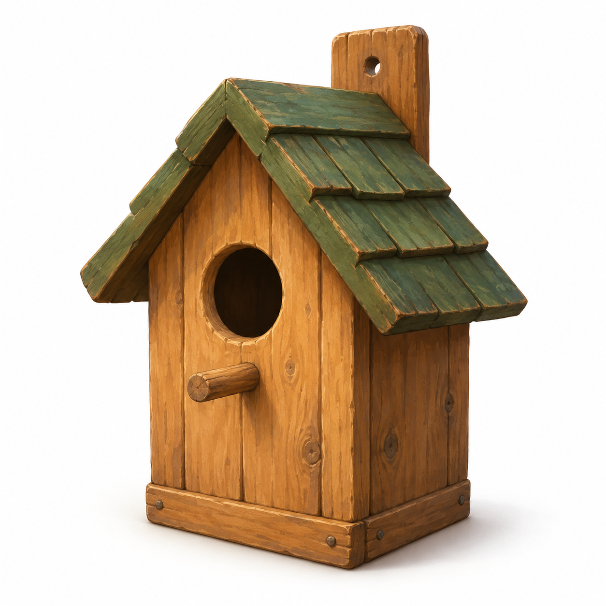
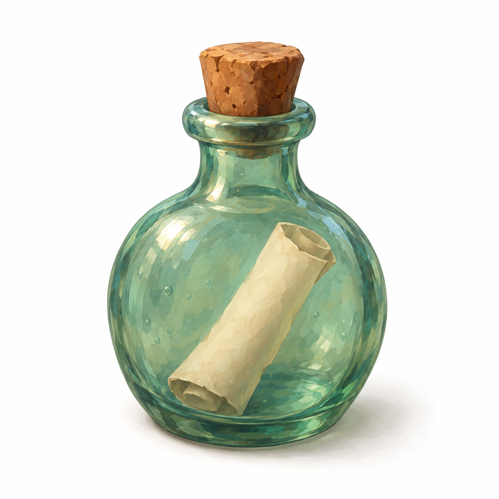

# X3 小道具参考图

日期：2026-10-27。对应 [玩法扩展方案第 7 节](GAMEPLAY_EXPANSION_PLAN.md)。12 张均由内置 `image_gen.imagegen` 单独生成，统一白底、无文字、手绘材质；文件均与计划位于 `docs/` 同一目录。

状态：**参考图已生成并初步图像复核，待用户确认**。不是 Lux3D 模型或实机截图；未调用 Lux3D。完整逐张提示词与来源见 [生成记录](evidence/2026-10-27-x3-references/generation.json)，尺寸与 SHA-256 见 [文件校验](evidence/2026-10-27-x3-references/validation.json)。

## 01 蘑菇簇

## 02 浆果小枝

## 03 贝壳

## 04 松果

## 05 草窝鸡蛋

## 06 羊毛团

## 07 小木桌

## 08 鸟屋

## 09 钓竿架

## 10 木路牌

## 11 漂流瓶

## 12 发光水母

## 后续建模注意

- 草窝的交错草条、羊毛细纹和松果鳞片应按实际模型效果合并，不逐根复制插画细节。
- 鸟屋背板安装孔不作为第二个鸟入口；钓竿架为空架，竿与线后续独立放置。
- 漂流瓶透明玻璃、内部纸卷和水母半透明发光需要模型生成后的材质处理；单图不保证自动还原。
- 透视、背面、尺度、触手交叉与家具结构均须在唯一模型上复核。实际图中叶片、桌面木板与水母触手数量可能与提示词的辅助数量不同，不作为精确几何规格。

