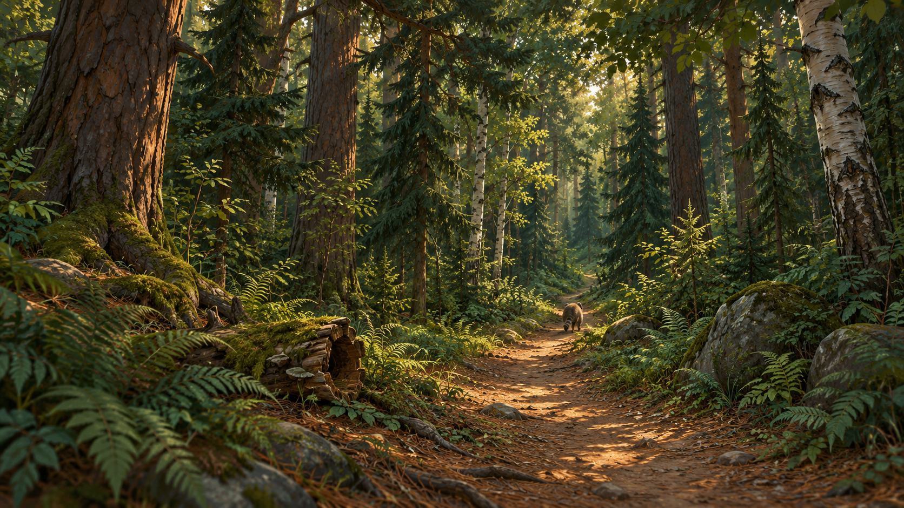

# 森林群岛扩展方案

2026-10-29 · 实施稿 v4 · **主岛西扩与雾松岛首个闭环已进入实现；保留西扩，另外新增三座较小邻岛；树木按参考图经 AHOLO API 制作。**

## 1. 本轮选择

以现有森林岛为生活中心，向西侧扩出茂密的混合森林；东侧群岛带包含「雾松岛」「秋岚岛」「潮汐岛」，即 **1 座主岛 + 3 座邻岛，共 4 座岛**。后两座由本轮用户明确追加进规划范围；开发仍按逐岛完成往返闭环推进。

- **主岛：** 可行走面积暂以现状的 1.4–1.6 倍为设计目标；新增部分放在西部和西北部，保留已有建筑、种植点、池塘、南沙滩和东码头。面积增幅是待地形采样验证的目标，不是半径放大倍数。
- **邻岛：** 雾松岛约为原主岛可行走面积的 20%–25%，秋岚岛约 20%–25%，潮汐岛约 12%–18%。三岛依靠不同树群、地形和发现点区分，不复制生活区建筑。
- **节奏：** 主岛新增区域约 2–3 分钟散步；主岛至雾松岛、相邻岛之间的单段航程以 30–50 秒为目标。秋岚岛和潮汐岛离主岛更远，不承诺从主岛直航也只需 30–50 秒；可经邻岛中转。一岛散步约 1–2 分钟，完整群岛游览允许更长。均需按实际速度与路径验证。
- **美术：** 成熟克制的温暖童话森林；深绿针叶树、暖灰岩、旧木、低饱和海水和少量琥珀灯光。建筑保持少而精。

用户 2026-10-29 再次明确：**保留主岛西扩，另外新增三座较小邻岛**。当前运行时为扩建主岛与独立雾松岛；秋岚岛、潮汐岛仍待实现。西侧连片区域属于主岛扩建。雾松岛含碰撞可站立面积 897.5 m²，占扩建前主岛 3695 m² 的 24.29%，两岛由海水分开。多泊位与到访记录已接入；地形分片、模型缓存与植被分块复用，尚无按航程动态加载。见[雾松岛实施证据](evidence/2026-10-29-mist-island/evidence.md)。

西扩初版地形采样为原来的 1.387 倍，含碰撞可站立面积为 1.382 倍，略低于 1.4–1.6 设计目标；不把地形包围框或视觉投影当作面积。初版复用旧树只是灰盒占位，用户指出树形不符后，已按 IE-01 古松、IE-05 云杉参考提交 AHOLO Lux3D 任务，生成与实机接入状态见[实施证据](evidence/2026-10-29-west-expansion/evidence.md)。

完整新树与湿地细化后，可站立采样为原来的约 1.370 倍；较初版减少的部分来自新树根部碰撞。古松、云杉任务均已成功并进入西林，近远景保留完整几何，湿地与栈道已按本轮要求细化为不规则浅池、闭合缓坡泥岸、岸边水草和 Blender 木板/梁柱模块，见[制作与复核](evidence/2026-10-29-wetland/evidence.md)。

## 2. 空间安排

平面阅读约定：北在上，西在左，东在右；对应项目坐标北为 -Z、东为 +X。以下是设计关系，不是施工坐标表。

| 区域 | 空间关系 | 玩家在这里做什么 | 设计约束 |
| --- | --- | --- | --- |
| 原生活区 | 保留当前中心、南部及东岸 | 工坊、喂养、钓鱼、种树、玩沙 | 不挪动既有交互点和存档物件 |
| 西侧深林 | 从原林间路向西进入，形成两端连接旧路的环线 | 在树冠相接的松杉混交林下行走，经过少量古松林窗和倒木 | 林内大部分视野应被多层树干和树冠包围；少量林窗用于辨路，不能把整片深林摊成草地 |
| 西北湿润林地 | 低洼地形与浅湿地，接回深林环线 | 经过短栈道，看蕨丛与水面 | 不穿过现有溪流、狐狸点位或种植区；最终位置需叠图复核 |
| 北部崖顶 | 保留现瞭望塔与主要海景方向 | 从高处看新增森林及海岛 | 不向塔正前方堆高地或密树；先检查塔上视线 |
| 东侧近海 | 从现有东码头出发 | 沿能看见目的地的短航线划船 | 需连通可航行海域、靠岸区和返回路线 |
| 雾松岛 | 东侧略偏北，西岸朝向主岛 | 小码头上岸 → 古松林窗 → 倒木蕨径 → 回码头 | 有一条清楚环线，岔路短；不做浓雾迷宫 |
| 秋岚岛（新增） | 东侧群岛带中段，雾松岛南侧 | 靠岸 → 白桦林径 → 枫树林窗 → 缓坡观海 → 回码头 | 针叶树保留骨架，枫树和白桦局部成片；按现有季节改变叶色，不设置永久秋天 |
| 潮汐岛（新增） | 东南侧，秋岚岛南侧偏西 | 靠岸 → 海风松岸径 → 浅潮池观察点 → 礁石观海 → 回码头 | 固定安全步道，不靠涨落潮解锁通路；首版潮池是静态景观，不承诺潮汐模拟 |

主岛采用局部增加陆地的方式，避免把现有岛整体缩放后导致路、建筑与交互脱节。西侧扩建应保留原区域内的高度、道路与植被实例；交界处设过渡带，再调整新海岸线。

雾松岛先以直径约 30–36 个世界单位的地形包络尝试布局。码头间直线距离初估约 32–45 个单位：当前前进终速约 1.05 单位/秒，仅匀速直航约需 30–43 秒，加减速、转向和靠岸还会增加时间。最终以实际完整航程为准，不能把本图比例作为测量依据。

秋岚岛可先采用与雾松岛相近的包络，潮汐岛更小且更低平；三岛之间保持开阔水道，不用陆桥连接。先用真实船体、速度和海岸采样布置泊位，再确认岛间距离；可沿群岛连续航行，也可在安全海域直返主岛。目的地、当前岛屿和泊位必须可辨认，远景薄雾不遮掉返航方向。

### 2.1 树种与造型扩充

现有 `vegetationLayout.ts` 主要从 `tall-pine-a`、`normal-pine-b`、`young-tree-b`、`round-tree-a` 四类树模板布置；灌木另算。这是造型模板数量，不代表四个植物学树种，也不把种植成长阶段重复计作新树种。

| 树类 | 造型差异与用途 | 分布 |
| --- | --- | --- |
| 现有普通松、高松 + IE-01 古松 | 保留森林的针叶主调，古松树干粗、冠形展开 | 主岛、雾松岛为主 |
| IE-05 云杉 | 细长尖塔轮廓、层叠短枝、垂落枝梢，与宽冠古松区分 | 深林中后景，雾松岛密林 |
| IE-06 白桦 | 亮色斑驳树皮、细干、轻透叶冠 | 林缘和秋岚岛小片树林 |
| IE-07 枫树 | 掌状叶、圆阔但不球形的树冠，枝干分叉清楚 | 秋岚岛焦点、主岛少量林窗 |
| IE-08 赤杨 | 水边树形，偏直细干和不规则卵形叶冠 | 主岛湿润林地、水边；不塞满海岸 |
| IE-09 海风松 | 倾干与单侧伸展的风剪冠；属于松树造型变体，不虚计为新树种 | 潮汐岛及少量迎风岬角 |

增加 4 类可辨识树种（云杉、白桦、枫树、赤杨）和 1 类海风松造型。全群岛仍以针叶树占多数；秋岚岛局部允许阔叶成片。每类至少规划成树和较小树形两种轮廓，优先在 Blender 改枝、改冠和树龄派生，不只对同一模型随机缩放。环境幼树与已有可种植树的成长/存档规则分开。

### 2.2 深林应当更茂密

深林密度明确高于生活区：设计试排目标为 **每 100 m² 深林地块约 8–12 株中大乔木，树冠投影覆盖约 75%–85%**，再加入少量幼树、灌木和片状蕨丛。这是风格化场景的试排起点，覆盖率按冠层投影并集计算、不重复叠加；不能靠塞入大树后遮得无法操作来达标。

- **上层：** 松、云杉、少量古松树冠相互搭接，形成连续林顶与斑驳光，不把每棵树孤立摆在草坪上。
- **中层：** 不同树龄、细树干与零散灌木制造纵深；同种树小簇聚集，再在簇边混入另一树种，不平均撒满所有树种。
- **下层：** 蕨丛、苔石、倒木、针叶落叶色块；沿地形、潮湿区和树根聚集，使用共享材质和实例化，不给每片落叶加实体。
- **通行：** 主步道净宽暂取 1.8–2.4 m，局部枝下净空约 2.2 m；离路径几步便进入密林。少量林窗只放在地标和转折处，生活区、码头、塔视线保持通畅。
- **画面验收：** 同机位比较生活区与深林，检查是否有连续树冠、前中后景树干和林下植物。树量增加必须同时调整镜头与树干碰撞，保留整树可见规则，不通过临时消失大量树冠来制造可操作假象。

具体株数与覆盖率需在实机布置和性能采样后校准。复用旧松树堆密不能替代新树种交付；当前新增树林只作为通行与镜头试排，后续逐项替换参考模型，不声称已完成四类新树种或密林美术验收。

## 3. 一次完整体验

**主岛深林：** 从生活区原道路进入 → 走到古松林窗 → 绕过中空倒木 → 走短栈道穿过湿润林地 → 接回旧路。利用现有拍照与手账能力，计划增加地点发现记录，不引入材料刷取或经营数值。

**跨岛旅行：** 东码头上船 → 划到雾松岛西侧泊位 → 明确的停靠反馈和下船 → 沿环线发现岛内古松地标 → 拍照、留下首次到访记录 → 返回同一泊位上船 → 回主岛。

**秋岚岛：** 船到林湾泊位 → 白桦小径 → 枫树林窗拍照点 → 缓坡远眺 → 回泊位；首次到访与地点发现各有持久化反馈。不同季节使用相应叶色，概念图用秋色展示树类差异。

**潮汐岛：** 船到背风泊位 → 沿海风松步道走到浅潮池 → 观察复用贝壳、礁石和水面 → 海岬拍照点 → 回泊位。首版以到访与观察记录形成闭环，不新增采集经济、潜水或动态潮汐机制。

第一次发现需要实际到达触发；有持久化记录与可见反馈才算完成。复用现有上下船过渡方式，不把新的跨舷动作作为这阶段前置条件。雾松岛首次到访、古松发现和地点面板状态已接入独立本地记录；尚未增加手账任务或印章。

雾只作为稀薄的局部氛围：航线和泊位应可辨认；减少动态效果与低画质设置仍须能看清安全路径。不上新动物，也不承诺洞穴穿行、树上攀爬或跳跃玩法。

## 4. 整体概念图

左侧是扩大的主岛密林；右侧从上到下为雾松岛、秋岚岛、潮汐岛。针叶林、季节阔叶林、低矮礁岸形成三种体验。三岛独立场景概念、地形造型参考与逐岛资产清单见[邻岛图册](ISLAND_NEIGHBOR_REFERENCES.md)。

林下图强调连续树冠、多层树干、幼树与蕨丛，主通路保持可辨。插画中的树数、光照细节和角色尺寸不作为运行时目标值；密度按第 2.2 节试排并在实际相机中调整。

所有概念都表达空间与美术方向，旧建筑、道路和海岸并非逐点复刻。整体图内的码头旁小屋等生成细节不新增到建设清单；实施以现有坐标和本文约束为准。海峡宽度、树密度、高程与独立地形图均不能直接测量施工。双岛 [v1](references/island-expansion/concept-v1.png)、[v2](references/island-expansion/concept-v2.png)及四岛 [v3](references/island-expansion/concept-v3-four-islands.png)保留为历史设计，当前采用四岛 v4。

## 5. 建模清单

建模清单扩为 **9 件基础资产**：原 4 件保留，新增 5 件树形。先用代理体积验证路径和密林密度，再生产模型；三岛仍复用码头、船、岩石和点缀。以下尺寸是建模起点，须对照现有角色与地形调整。

| ID | 模型 / 用途 | 建议尺寸与结构 | 建议生产方式 | 接入要点 |
| --- | --- | --- | --- | --- |
| IE-01 | 古松 / 深林和雾松岛的少量地标树 | 高约 7–9 m，冠幅约 4–5 m 为设计目标；实际候选冠幅更宽，按实测碰撞放置 | 已经 AHOLO Lux3D 生成，任务 4461967；Blender 整理后接入西林 | 树根保守碰撞；近远景完整几何；西林 5 棵，雾松岛 1 棵，未强行压扁到目标冠幅 |
| IE-02 | 苔藓中空倒木 / 林间发现点 | 长约 3 m、外径约 0.8–1 m；一端有清楚空洞，断口可读；苔藓块不遮住木质轮廓 | Lux3D 候选，Blender 补内壁、背面与碰撞 | 用于观看与绕行；空洞不是玩家可穿行隧道，不新增入洞交互 |
| IE-03 | 蕨类丛 / 湿润林地和树根下层次 | 高约 0.45–0.65 m，宽约 0.7–1 m；一簇 7–9 片有层次的叶，中心收拢 | 优先 Blender 自制低复杂度叶片，手绘贴图；不必占用生成服务 | 无碰撞、实例化；叶片双面/透明裁剪与远景切换需在浏览器检验 |
| IE-04 | 直线木栈道模块 / 低洼林地短段通行 | 长约 2.4 m；实际沿用灰盒 1.9 m 板面、两侧各留 0.28 m 身体余量；平直板面、两条纵梁、四根支脚；首版低矮、无扶手 | 已由 Blender 自制，原创木纹贴图，5 段拼接；板顶高程 0.9 m | 板面连续、接缝不绊脚；独立行走碰撞面，顺地形调支脚；不作为跨深谷桥 |
| IE-05 | 云杉 / 密林骨架 | 高约 7–10 m，冠幅 3–4 m；尖塔冠、层叠短枝 | 已经 AHOLO Lux3D 生成，任务 4461973；独立幼树枝形仍待派生 | 近远景完整几何；小树当前仅按比例缩放，不计为独立变体 |
| IE-06 | 白桦 / 林缘和秋岚岛 | 高约 5–7 m，冠幅 2.5–3.5 m；亮色斑驳树干、轻透小叶冠 | Lux3D 候选 + Blender 树干/枝形变体 | 树皮不是纯白发光；支持季节叶色 |
| IE-07 | 枫树 / 秋岚岛林窗 | 高约 5–7 m，冠幅 4–5 m；分叉树干、掌状叶、非对称阔冠 | Lux3D 候选 + Blender 整理树冠与叶材质 | 不烘焙永久橙红光；按季节调色，春夏仍为绿叶 |
| IE-08 | 赤杨 / 湿润林地 | 高约 5–7 m，冠幅 3–4 m；细干、不规则卵冠、圆卵形叶 | Lux3D 候选 + Blender 树龄派生 | 根部贴地，水岸避免穿水；低枝不堵栈道 |
| IE-09 | 海风松 / 潮汐岛迎风地标 | 高约 4–6 m，冠幅 4–5 m；倾干、单侧风剪树冠 | 优先 Blender 基于松树派生；必要时再生成 | 根盘稳定、避免浮根；倾斜轴和碰撞不能只跟随竖直树模板 |

每件保留独立白底单体参考，见[建模参考图册](ISLAND_EXPANSION_REFERENCES.md)。图册统一旧木、深绿、柔和漫反射的质感；它不能给出可靠背面、拓扑或尺寸，生成模型后仍需多视角检查，不能直接把二维图当已完成资产。

### 邻岛地形造型参考

按用户追加要求，每岛另生成一张去除植被、建筑和水面的白底灰模风格地形图，均为 **AI 插画，不是真实灰盒或 Blender 渲染**。单岛场景与地形图配对见[邻岛图册](ISLAND_NEIGHBOR_REFERENCES.md)；下列三项属于程序地形/Blender 造型工作，单独列出，不混入 9 件单体模型数量或整岛付费送模任务。

| ID | 地形 | 必须表达的结构 | 实施方式与验收 |
| --- | --- | --- | --- |
| IT-01 | 雾松岛 | 西侧上岸湾、中央林窗、东北岩脊、绕脊缓坡 | 参数化地形为主，Blender 岩石辅助；环路不爬垂直崖壁 |
| IT-02 | 秋岚岛 | 西南泊位湾、宽缓林地、东北观景丘 | 参数化低丘和坡道；保持连续坡面，不能依赖跳跃上下丘 |
| IT-03 | 潮汐岛 | 背风凹湾、低岩台、3 处有底浅潮池、干燥岸径 | 地形凹槽与独立水面分开；池边可观察，环路不穿水；无潮汐模拟 |

地形图不是高度图、法线图或工程投影，不能直接作为位移贴图。实际高度、坡度、船体水深、岸线碰撞与面积必须重新在游戏内求值和验证。

### 复用与派生，不重复建模

| 内容 | 现有来源 | 扩展方式 |
| --- | --- | --- |
| 普通松树、少量阔叶、灌木 | `public/assets/vegetation/forest-kit.glb` 与 LOD 版本 | 新区域重新布局；原区域实例位置保持 |
| 海岸岩石、漂木 | `public/assets/expansion/coastal-kit.glb` | 挑选已有轮廓，苔色材质派生；不新增整套礁石模型 |
| 岛际码头 | `public/assets/models/coastal-jetty.glb` | 为邻岛增加配置实例，按地形调整支撑，保持足够停泊水深 |
| 独木舟与桨 | `public/assets/models/canoe-center-seat.glb`、`paddle.glb` | 共用船与动作；新增目的地逻辑 |
| 路牌、蘑菇、松果、莓枝 | `public/assets/x3/` 对应资产 | 少量点缀与路线识别，不做新采集经济 |
| 四岛地形、湿地/潮池水面、薄雾 | 现有地形与环境代码 | 新增地形/区域配置与材质变化，不向模型服务提交整座岛；潮池沿用水面技术，碰撞另验 |
| 工坊、牧场、塔、灯光等 | 当前主岛资产 | 留在原生活区；雾松岛不复制成第二个村庄 |

新模型的面数、贴图、包体只作为参考，不默认减面；先看完整模型和实测瓶颈。设计阶段仅生成二维图；实施阶段已按用户要求调用古松、云杉两件 AHOLO 模型，额度接口返回 500，未核实实际积分，见[资产证据](evidence/assets/2026-10-29-island-trees/evidence.md)。

## 6. 当前实现需要怎样扩展

扩建前，`worldConfig.ts` 以单岛半径描述陆地与近海，`movement.ts` 另有固定距离边界。西扩已局部合并高度、向西追加网格列，移除旧距离限制，并采用连续近海包络；现有 main/mist 两个稳定泊位 ID，雾松岛独立地形网格和高度查询已接入。以下是完整群岛方向，首岛实现不代表全部完成。

1. **地形与查询：** 引入稳定 `islandId`、区域包围范围、各岛高度和海岸查询；主岛旧区域沿用原地形规则，新区域局部混合。步行、船体水深、镜头和小地图使用同一地形来源。当前单片网格不无限加大，原池塘和沙地的局部精细度保持。
2. **多泊位：** 泊位具有岛屿、位置、船朝向、停泊范围与上岸点；船体采样、上下船和召回不能再只引用主岛码头。船在邻岛停靠后刷新，仍要能上船返航，不能把船重置在另一岛造成软锁。
3. **存档兼容：** 老种植点 ID 和沙作品坐标保留；旧档无岛屿字段时解释为主岛。新增到访记录以稳定岛屿 ID 存储。覆盖老档迁移、跨岛刷新、退出恢复、缺失资产时安全回退。
4. **渲染范围：** 按岛屿和林区分块，共用 GLB/材质缓存，重复植被按模型/LOD 实例化；远岛展示简化轮廓与树林，接近时预载细节及交互。仅近处树木投精细阴影，林下透明叶片关注过绘制；避免四岛高精度地形与交互同时满负荷运行，不能靠岸才同步加载造成卡顿。
5. **镜头与导览：** 步行镜头根据所在岛调整边界，远景可看群岛；导览新增站点是后续配置，不能沿用旧机位裁切新区域。检查西林遮挡、转弯视野、窄路相机跳动和塔上视线。

西扩已开始修改地形、步行边界、海域包络和最远镜头；原生活区采样、植被与泊位坐标保持。雾松岛使用独立高度查询、main/mist 泊位配置与版本化到访记录；只保存最近安全靠岸点，刷新后人物与船在同一泊位，旧档缺少新记录仍从原主岛出生。首次保存前在海上刷新也恢复主岛。两岛地形常驻，尚未实现四岛按需预载与缺失资产回退，上述后续接口仍适用。

## 7. 实施顺序与验收

| 阶段 | 产物 | 进入下一阶段的依据 |
| --- | --- | --- |
| A 方案与参考（已形成） | 四岛方案、群岛与深林概念、共 9 件单体参考、来源记录 | 2026-10-29 用户确认保留西扩并另加三个小岛，明确树木走 AHOLO API |
| B 主岛扩建（本机限定验证） | 西林/湿润林地地形、道路、浅水岸线与 Blender 栈道，古松/云杉真实模型 | 原坐标、新环线双向检查、栈道键鼠、拍照/刷新及 PC 窗口检查通过；新树截图已抽查，整体美术与用户体验仍待完善 |
| C 跨岛闭环（雾松岛本机验证） | 雾松岛地形、林路、到访/古松发现、多泊位和刷新恢复；秋岚岛、潮汐岛待实施 | 雾松岛实际出海 44.8 秒、古松发现、返航和两泊位刷新已通过；完整三岛连续航行与另外两岛泊位仍待实现 |
| D 资产与氛围 | 古松/云杉与 IE-04 栈道已提前制作；剩余 6 件基础资产及独立树龄/树冠变体待推进 | 检查各树种轮廓、密林层次、季节叶色与碰撞；PC 浏览器截图复核，不以概念图代替 |
| E 体验与性能 | 地点记录、照相发现、加载和画质调整 | 原玩法回归、旧档迁移与重复往返通过；检查 1920×1080、1280×720、1024×768 PC 窗口，并记录帧时间/加载实测 |

每阶段运行项目 lint、单测和 build；涉及可见效果时使用项目浏览器流程截图。性能先测当前版本基线，再比较主岛深林、航行中、邻岛三个代表场景，依据真实瓶颈调整密度与加载方式。

三座邻岛均已纳入用户范围，当前只实施雾松岛。复用 1 棵古松和 31 株云杉完整模型，东北起伏与林间环路已有地形；倒木、独立蕨类、岩脊布景和局部雾未完成，不把首版往返等同最终美术。逐岛完成可玩闭环后再推进下一岛，主岛原区域和旧档持续回归。
