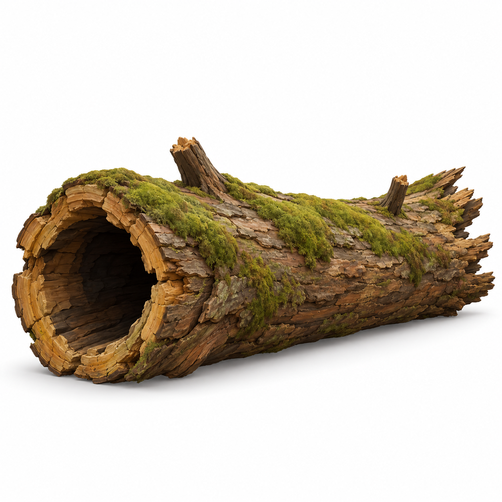
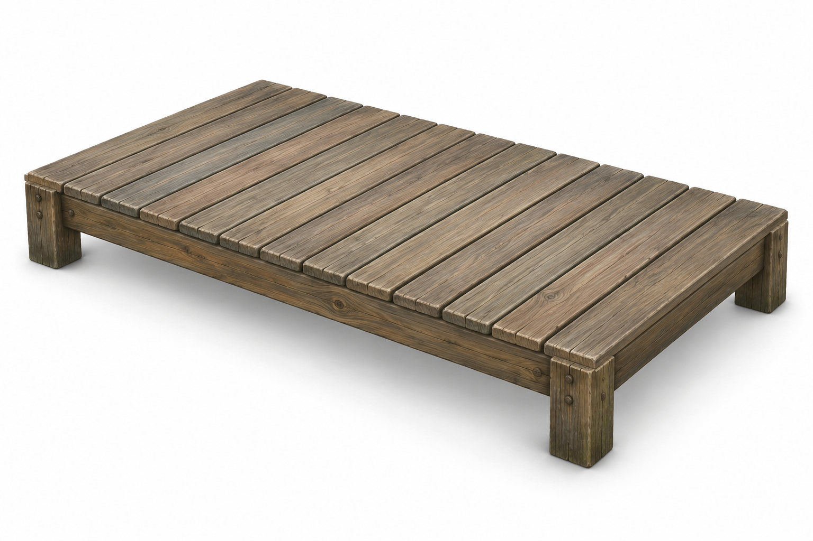
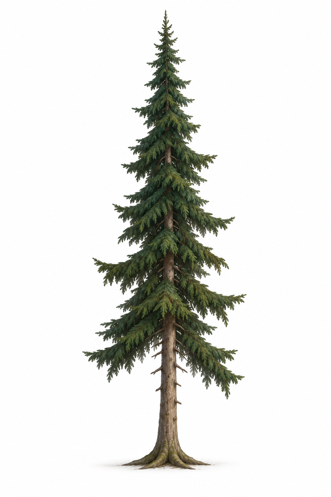
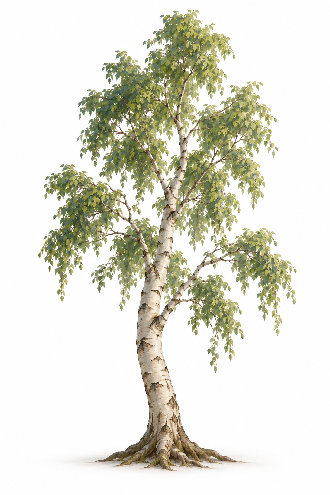
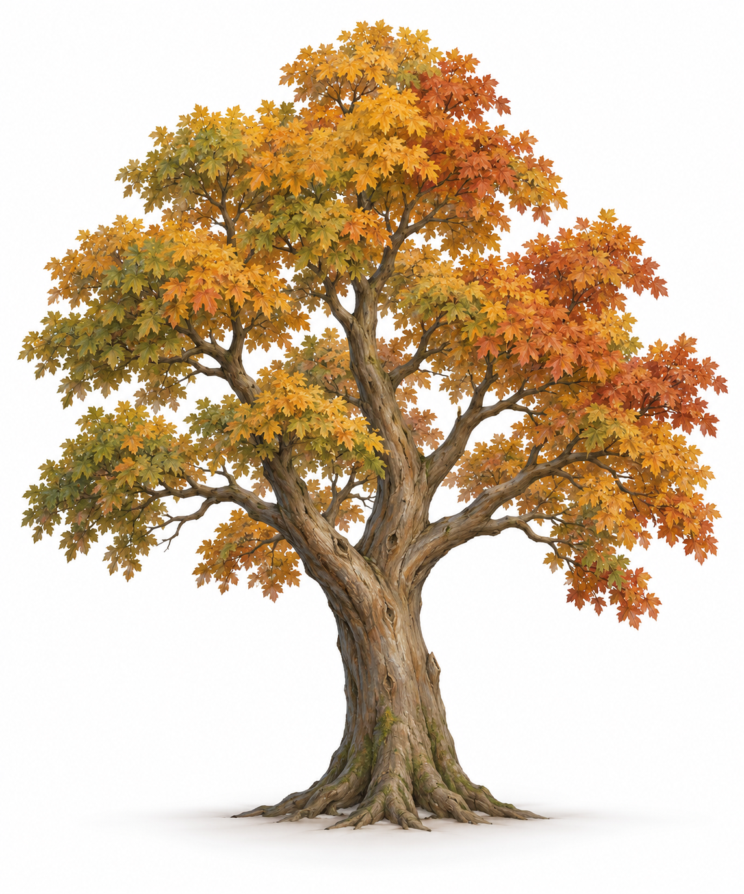
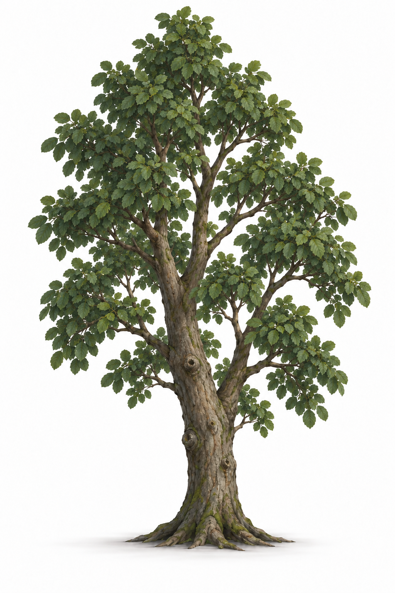
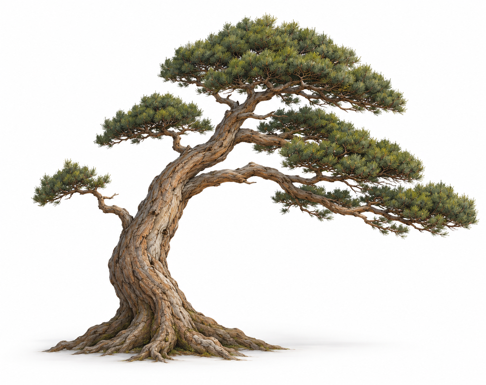

# 群岛扩展 · 建模参考图册

2026-10-29 · 单体参考图册 v2，共九件 · **AI 设计参考已生成，待用户审阅；模型未制作、未接入游戏。**

空间与实施安排见[规划方案](ISLAND_EXPANSION_PLAN.md)。本图册每件为独立图片，可在后续授权建模时逐件使用；生产方式以逐项清单为准，不需要重复生成共用资产。三座邻岛的独立概念、地形参考与逐岛资产归组见[邻岛图册](ISLAND_NEIGHBOR_REFERENCES.md)。全部图片由内置 imagegen 生成，不是 Blender 渲染或浏览器截图。

| 编号 | 参考图 | 计划生产方式 | 计划尺寸 |
| --- | --- | --- | --- |
| IE-01 | [古松](references/island-expansion/ie-01-old-pine-v1.png) | Lux3D 候选 + Blender 修整 | 高 7–9 m，冠幅 4–5 m |
| IE-02 | [苔藓中空倒木](references/island-expansion/ie-02-hollow-log-v1.png) | Lux3D 候选 + Blender 补内壁 | 长 3 m，外径 0.8–1 m |
| IE-03 | [蕨类丛](references/island-expansion/ie-03-fern-clump-v1.png) | Blender 自制叶片与贴图 | 高 0.45–0.65 m，宽 0.7–1 m |
| IE-04 | [直线木栈道模块](references/island-expansion/ie-04-boardwalk-module-v1.png) | Blender 自制，复用旧木材质 | 长 2.4 m，通行净宽 1.6 m |
| IE-05 | [云杉](references/island-expansion/ie-05-spruce-v1.png) | Lux3D 候选 + Blender 枝形/树龄派生 | 高 7–10 m，冠幅 3–4 m |
| IE-06 | [白桦](references/island-expansion/ie-06-birch-v1.png) | Lux3D 候选 + Blender 变体 | 高 5–7 m，冠幅 2.5–3.5 m |
| IE-07 | [枫树](references/island-expansion/ie-07-maple-v1.png) | Lux3D 候选 + Blender 季节材质 | 高 5–7 m，冠幅 4–5 m |
| IE-08 | [赤杨 v2](references/island-expansion/ie-08-alder-v2.png) | Lux3D 候选 + Blender 水岸树形派生 | 高 5–7 m，冠幅 3–4 m |
| IE-09 | [海风松](references/island-expansion/ie-09-windswept-pine-v1.png) | 优先 Blender 基于松树派生 | 高 4–6 m，冠幅 4–5 m |

## IE-01 古松

采用粗干、倾斜主轴和不对称分层树冠，放在深林林窗与雾松岛的少数地标位置。普通树林继续复用现有松树。建模时把针叶细节归纳为可读的枝叶组，检查根部落地、背面分枝及路径上方净空；参考中的纹理细节无需全部转成几何。

## IE-02 苔藓中空倒木

保留清楚的近端空洞、厚木壁、断口和少量苔藓。它是绕行、观察与拍照的发现点，不设玩家钻洞功能。AI 建模可能封住空洞，后续需专门检查内壁、远端、底部和碰撞；简化苔藓及树皮碎片，避免生成大量细碎悬浮几何。

## IE-03 蕨类丛

单根丛心向外舒展，中间高、两侧低，作为湿润林地和树根边的下层植物。参考用于叶形、层次和颜色；Blender 制作时控制叶片数量，利用贴图表现细节，实例化摆放且不加碰撞。叶片背面、透明边缘和远景闪烁需要实际浏览器复核。

## IE-04 直线木栈道模块

平直板面、纵梁和短支脚，服务低洼林地的一小段通路。无扶手、无台阶；末端保持齐平，便于首尾拼接。建模按方案尺寸重建，板条数量以结构与视觉为准，不按图片测量。底面和被遮住的支脚由结构补齐，行走碰撞使用连续平面；不拿它代替深谷桥或海中码头。

## IE-05 云杉

尖塔冠、短层枝和下垂枝梢，作为深林与雾松岛的密林骨架，与横向展开的古松区分。制作时合并针叶细节，路边版本抬高低枝，树林内部版本可保留较低枝条；树干碰撞、冠层遮挡和 LOD 分别处理。

## IE-06 白桦

亮色斑驳树干和轻透叶冠，在林缘提供不同于松杉的竖向线条。原图为绿色叶冠，秋岚岛的金黄来自季节材质。不要把树皮做成发光纯白；小簇布置时派生枝形、树龄和轻微倾斜，避免整片只缩放同一棵树。

## IE-07 枫树

分叉树干、掌状叶和不对称阔冠，用于秋岚岛的林窗与少量主岛阔叶点景。此图为秋色造型参考，不代表永久秋季；制作叶片材质时保留春夏绿叶与季节调色能力，不把橙色环境光烘焙到整棵树。

## IE-08 赤杨

湿润林地和淡水边的树形：较直的灰褐干、不规则卵形冠、圆卵形叶。首版叶片出现橡树式深裂，采用 v2 修正为较完整的圆卵形叶片；[初版](references/island-expansion/ie-08-alder-v1.png)保留，不能再作为叶形输入。该图仍是风格化造型参考，不是植物学图谱；建模需要检查低枝、水岸根部与栈道净空。

## IE-09 海风松

倾干、单侧伸展的风剪冠和稳固根盘，用于潮汐岛和少量迎风岬角。它是松树造型变体，不另计一个树种；优先从现有或新古松在 Blender 派生。倾斜枝干需要对应的碰撞和地形贴合，不能只把整棵树绕中心转倒。

## 文件与生成记录

- 整体概念位于[规划方案第 4 节](ISLAND_EXPANSION_PLAN.md#4-整体概念图)，当前采用四岛 v4；此前双岛概念保留为历史。
- [完整提示词与原始输出路径](evidence/2026-10-29-island-expansion/generation.json)；使用内置图像工具，未使用 CLI/API fallback。
- [图像尺寸、SHA-256 与可读取性](evidence/2026-10-29-island-expansion/image-checks.json)及[制作证据](evidence/2026-10-29-island-expansion/evidence.md)。
- 本轮新增五件树形、四岛/深林/邻岛图及地形图的[完整提示词](evidence/2026-10-29-island-expansion-v2/generation.json)、[尺寸与哈希](evidence/2026-10-29-island-expansion-v2/image-checks.json)、[版本取舍与验证](evidence/2026-10-29-island-expansion-v2/evidence.md)。

尺寸是建模目标，单视图不提供精确尺度、背面或拓扑。当前没有新 GLB、骨骼、碰撞验收或新场景截图；图像生成用量未核账，未调用 Lux3D/Tripo 建模服务。
