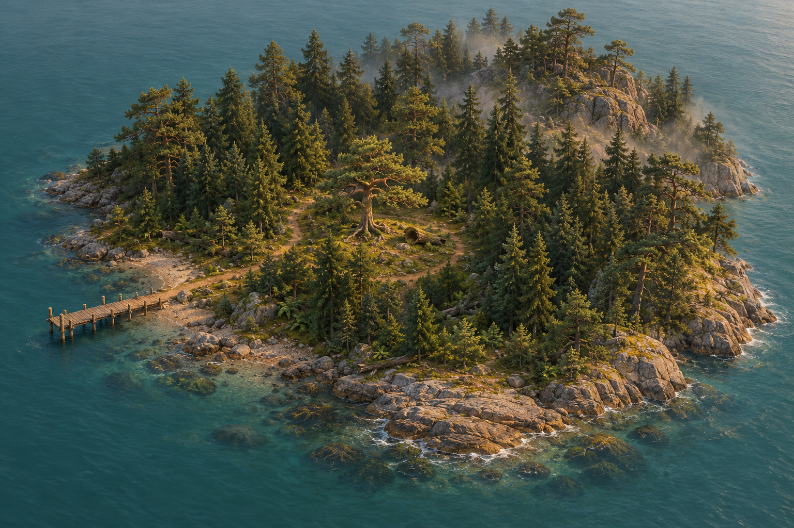
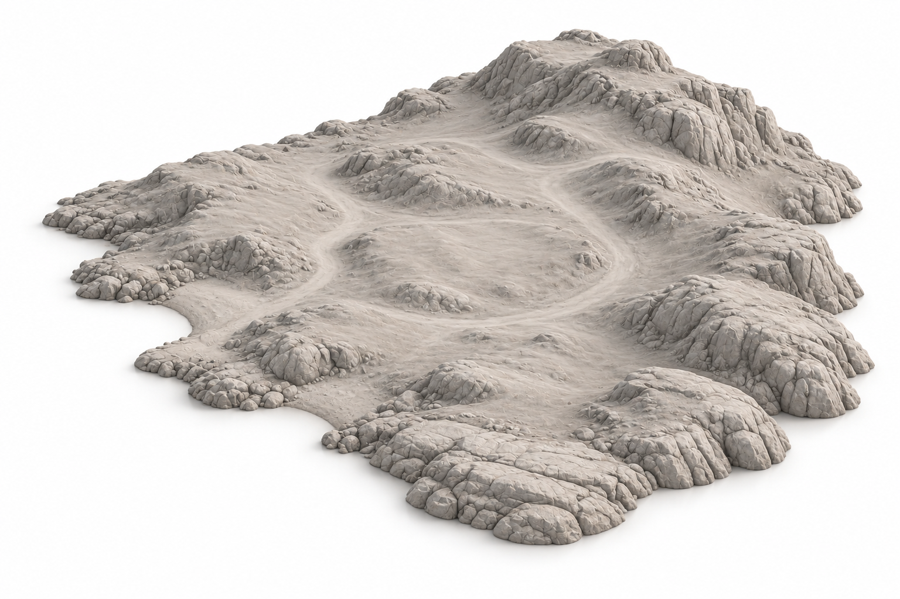
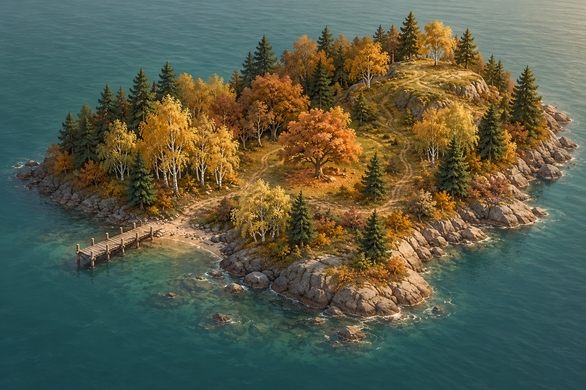
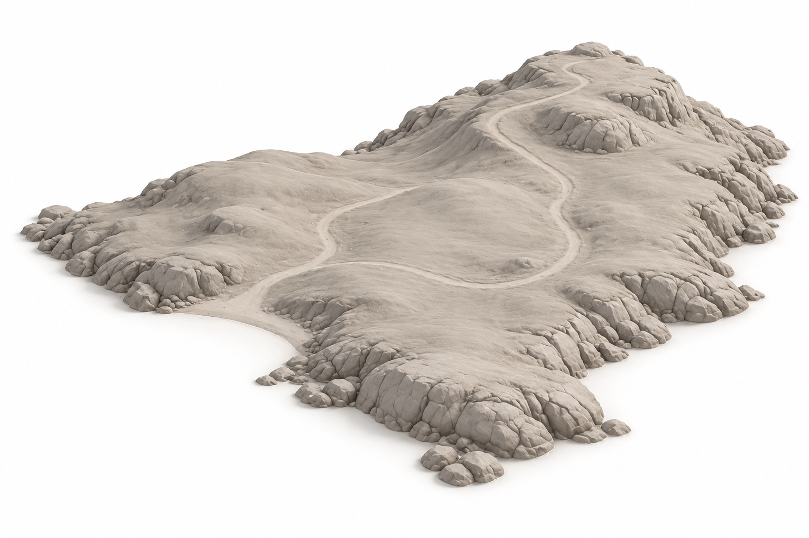
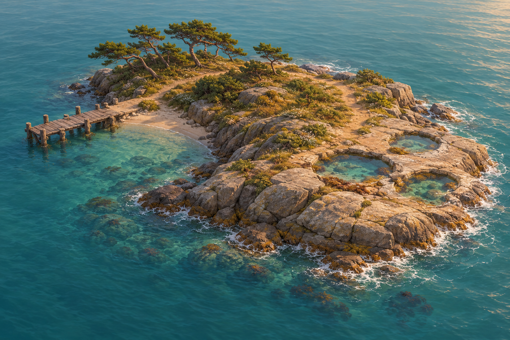
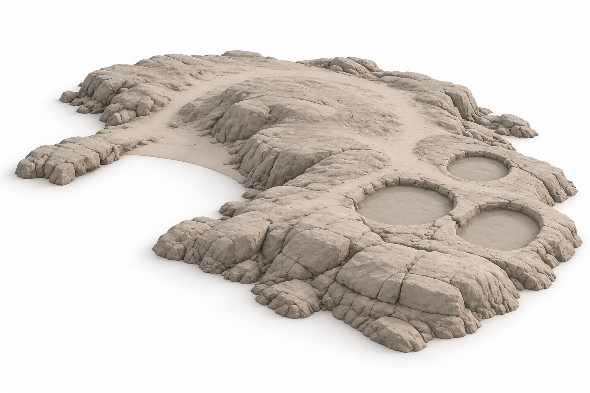

# 三座邻岛 · 独立概念与地形建模参考

2026-10-30 · v12 · **本文图片仍为 AI 设计参考；雾松/秋岚及潮汐地形首版已进入运行时；秋岚白桦/枫树已接入，潮汐岸岩/池边石组已接入，海风松与完整礁岸待制作。**

总布局见[群岛规划](ISLAND_EXPANSION_PLAN.md)，树木/倒木/蕨类等独立模型图见[九件单体图册](ISLAND_EXPANSION_REFERENCES.md)。每岛提供场景概念和去除布景的地形造型图。后者是图像工具生成的灰模风格插画，**不是已经制作的灰盒或 Blender 模型**。

| 邻岛 | 独立场景概念 | 地形造型参考 | 主要单体参考 |
| --- | --- | --- | --- |
| 雾松岛 | [密林与薄雾](references/island-expansion/mist-island-concept-v1.png) | [IT-01 西湾与岩脊](references/island-expansion/it-01-mist-terrain-v1.png) | IE-01 古松、IE-02 倒木、IE-03 蕨丛、IE-05 云杉 |
| 秋岚岛 | [白桦与枫树林](references/island-expansion/autumn-island-concept-v1.png) | [IT-02 林地与缓丘](references/island-expansion/it-02-autumn-terrain-v1.png) | IE-06 白桦、IE-07 枫树，复用普通松 |
| 潮汐岛 | [海风松与潮池](references/island-expansion/tide-island-concept-v1.png) | [IT-03 低岩台与浅池](references/island-expansion/it-03-tide-terrain-v1.png) | IE-09 海风松，复用海岸石、贝壳与漂木 |

雾松岛当前采用独立程序地形、复用 AHOLO 古松/云杉和现有码头，面积为原主岛的 22.29%（加入 8 株幼态云杉后）；首版蕨丛、局部岩脊、不规则岸湾与柔边薄雾已接入，倒木与林缘已细化，北/东岸等外沿新增 16 处复用岩块和坡面色差，完整岩岸与最终美术仍待验收。[实机实现与验证](evidence/2026-10-29-spruce-sapling/evidence.md)单独记录，不把下列插画当作实现证据。

## 雾松岛

西侧低湾上岸，中央古松林窗作为识别点，东北岩脊围合深绿密林。云杉与普通松形成大部分连续树冠，古松只作少量地标，倒木和蕨类放在林径边缘。环路绕过岩脊，雾集中在后景，码头入口保持可见。

地形参考去掉树与水，便于检查上岸湾、中央缓地和环路连接。建议试排包络 30–36 m，岩脊相对岸边高差先试 4–6 m，再按步行坡度校准。参考显示的石纹不全部转为碰撞；靠近泊位的水下坡面仍需另外设计。

单体输入：[古松](references/island-expansion/ie-01-old-pine-v1.png)、[倒木](references/island-expansion/ie-02-hollow-log-v1.png)、[蕨丛](references/island-expansion/ie-03-fern-clump-v1.png)、[云杉](references/island-expansion/ie-05-spruce-v1.png)。码头、普通松和岩石复用现有资产；不新增小屋或动物。

## 秋岚岛

2026-10-30 林下补充：8 簇低灌木与 24 丛蕨叶复用接入，保留原树木和岸岩、中央林窗与东北观景丘；灌木实体使可站立面积调整为 866 m²（23.44%）。局部静音三季近景已验证，最终美术未完成；[证据](evidence/2026-10-30-autumn-understory/evidence.md)。

2026-10-30 补入北/东岸为主的 18 处复用岩块，采用版加深埋入、打散间距并保留西湾入口；可站立面积现为 877.75 m²（23.76%），树木、地形与 24.37 m 海峡不变。岸岩首版已有局部静音实机复核，完整岸线与林下层次未完成。见[证据](evidence/2026-10-30-autumn-coast/evidence.md)。下段面积为换树后的历史阶段。

首版状态（2026-10-29）：独立地形、第三泊位、林路与观景丘发现已接入；15 株树已改为 8 白桦、3 枫树、4 普通松，专用阔叶按参考经 AHOLO 生成；完整面数和季节材质见[制作证据](evidence/2026-10-29-autumn-trees/evidence.md)。按用户间距反馈，秋岚整体向东 4 m、南 18 m 平移，最近岸距从约 6.06 m 拉开到 24.37 m；专用树根碰撞接入后可站立面积 901 m²，为原主岛的 24.38%。静音实机往返与刷新通过，航程 67.722 秒，优先独立海岛的空间感；[过程与同机位对照](evidence/2026-10-29-autumn-island/evidence.md)。

白桦林径连接枫树林窗，再沿缓坡登上东北低丘观海。图中以秋色表现树种差异，实施时跟随现有季节变化，春夏仍是绿叶；林缘保留深绿松树，与主岛森林保持同一风格。

试排包络约 30–36 m，低丘高差先试 3–4 m；中央林窗较缓，坡道连续登丘，避免制造必须跳跃的台阶。实际植被会覆盖地形图里的大片裸地，不能照此做成空旷草坪。

单体输入：[白桦](references/island-expansion/ie-06-birch-v1.png)、[枫树](references/island-expansion/ie-07-maple-v1.png)。复用普通松、灌木、岩石和码头；叶色/落叶地表作为材质变化制作，不单独生成满地落叶模型。

## 潮汐岛

2026-10-30 岸岩/池边首版：新增 13 处岸岩、18 处池边石组，均复用原 Blender 套件，保留地形、水位、路径与泊位。含实体面积现为 553.25 m²（14.97%）；完整礁岸、海风松、贝壳与漂木待完善。见[布景证据](evidence/2026-10-30-tide-rock-coast/evidence.md)。以下为地形首版历史尺寸与后续参考目标。

2026-10-30 实施：低岩台、三处有底固定浅池、干燥环路、观察记录和第四泊位已接入；含碰撞面积 578 m²（原主岛 15.64%），最大水深 0.36 m。静音实机往返/刷新与环路检查通过；当前没有海风松、层叠礁石、贝壳或漂木布景，仍为地形首版。参考试排包络与高差不是验收尺寸，实际代码/截图见[证据](evidence/2026-10-30-tide-island/evidence.md)。

低矮岩台和偏向一侧的海风松形成轮廓，左侧背风湾停船，前侧三个浅潮池供观察与拍照。岛上树量明显少于深林，沿岸保持连续干燥步道，让三个邻岛拥有不同疏密和空间感。

试排包络约 24–30 m，岩台高差先试 1.5–2.5 m。三个浅凹槽需有池底，水面是独立运行时效果；步道沿池外侧走，不能要求涉水或跳石。潮池深度、边缘碰撞和泊位水深另测。首版采用固定水位，不实现涨落潮，也不让潮水切断返航路线。

单体输入：[海风松](references/island-expansion/ie-09-windswept-pine-v1.png)。复用 `coastal-kit.glb` 岩石/漂木、`seashell.glb` 贝壳与 `coastal-jetty.glb` 码头；浅池轮廓由地形制作，不额外调用整岛生成模型。

## 建模时如何使用

先按 IT-01–03 做可走的地形与泊位灰盒，再按单体图制作或复用模型，最后放置树群、薄雾、潮池水面。三个地形工作项与九件单体资产分开计数；当前雾松/秋岚可玩首版、潮汐地形首版和 7/9 基础资产已接入，其他项目仍待完成。

场景图与地形图为 AI 编辑关系，不是同一 3D 模型的受控前后渲染。它们大致保留岸线和高差布局，但不保证逐点几何一致，不是高度图或精确投影。后续实施必须重新求值面积、坡度、角色净空、船体碰撞和性能。

完整[提示词与输入输出](evidence/2026-10-29-island-expansion-v2/generation.json)、[尺寸和哈希](evidence/2026-10-29-island-expansion-v2/image-checks.json)及[制作记录](evidence/2026-10-29-island-expansion-v2/evidence.md)均已留存。该参考图制作阶段未生成新 GLB、未调用付费建模服务；后续模型生产以逐件证据为准。
