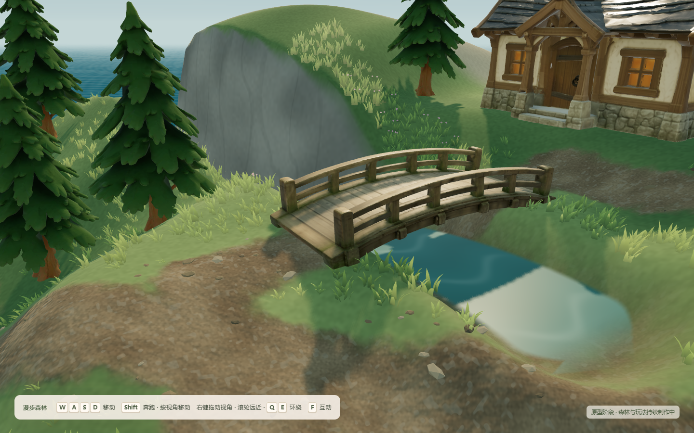
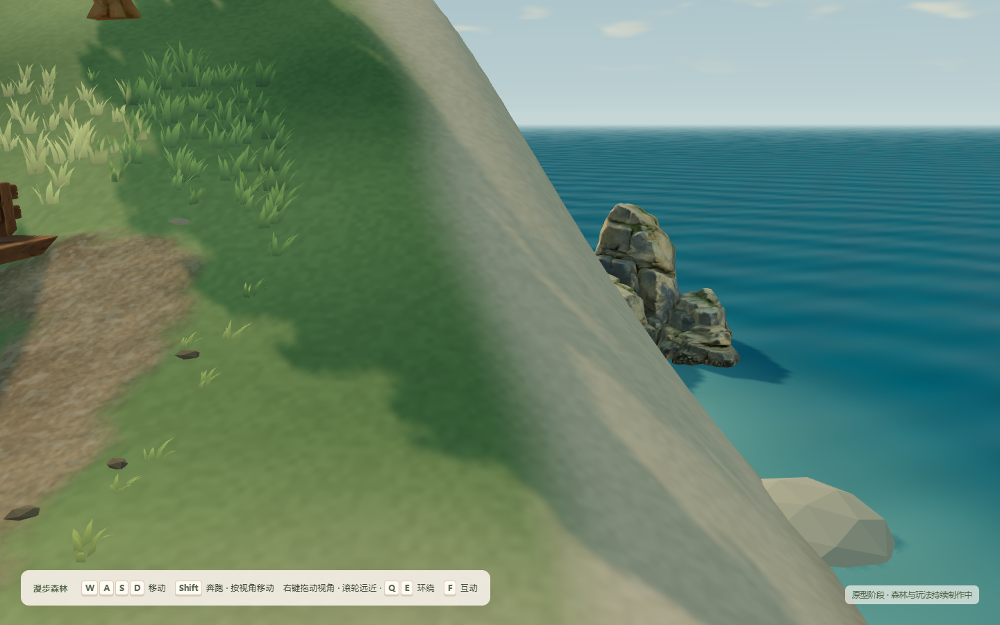
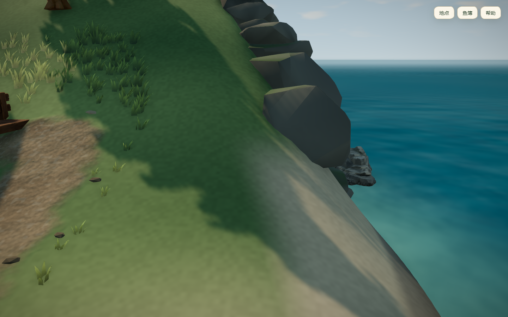

# V3 海岸与崖壁重做 · 进行中（2026-10-25）

[场景视觉升级计划](../../VISUAL_UPGRADE_PLAN.md) 第四阶段。状态（2026-10-26 更新）：**套件已接入场景，本机限定验证完成，待用户查看**。下文“进行中”一节保留为 2026-10-25 的历史记录，接入结果见文末“2026-10-26 接入与验证”。

## 已完成：本地 Blender 手作海岸套件

- 脚本：`scripts/build_coastal_kit.py`（可复现的源文件，没有另存 .blend）。用项目的 `scripts/aholo/blender_run.py` 隔离运行，Blender 5.2.1 LTS。没有调用 AHOLO 或其他付费服务（按决策 D3）。
- 输出：`public/assets/expansion/coastal-kit.glb`，97,244 B，共 6 个模块（尺寸单位 m，三角面数见 `coastal-kit-blender.json`）：
  - `Rock_Slab`：三层错落岩层，550 面。
  - `Rock_Tall`：两段垒叠的高岩，586 面。
  - `Rock_Boulder`：单块巨石，276 面。
  - `Rock_Cobbles`：一组碎石，694 面。
  - `Driftwood_Long`：带断枝的长漂流木，456 面。
  - `Driftwood_Short`：短漂流木，432 面。
- 材质：单一材质加顶点色。岩石为暖灰岩色（#7D7A6E 系），底部较暗，表现潮湿；朝上的面有斑驳苔藓。漂流木为褪色木色。
- 审阅渲染：`scripts/render_coastal_kit.py`（Workbench，显示顶点色）。迭代过程：
  - `coastal-kit-lineup-v1.png`：倒角过大加细分，石头像软垫；漂流木两头被捏尖。不采用。
  - `v2`：改为随机平面切削，出现凿刻块面，但三角面数涨到 3000–9800，巨石上有捏痕。
  - `v3`：去掉细分、先三角化再倒角，面数降到 258–720；但逐顶点随机抖动把倒角接缝撕开，变成皱纸团。
  - `v4`（当前）：改用按位置取的连续噪声位移，加窄倒角，切面干净。底部岩层前端仍有一片薄边，落地后应埋入地形，接入后需复核。

## 进行中：运行时布局（WIP 草稿归档，未接入）

- `src/world/coastalLayout.ts`（纯函数）与 `coastalLayout.test.ts`：
  - 崖面：按角度分列，按落差分行铺岩块。
  - 溪口：沿两侧崖壁铺巨石。
  - 潮间带：放碎石与漂流木，只选高于海面不到 0.16 m（不可行走）、水深不足 0.22 m（不可划船）的位置。
  - 底排岩块若伸进可划船水域，就向岸内回收。
- 当前单测 3 项中 1 项失败：溪口有 7 块巨石落进溪流中线（距中线 0.03–0.23 m），或判定为侵入可划船水域。原因是入海口溪床低于海面 0.42 m，被航行规则算作可划船的海水；回收方向沿岛心径向，在溪谷里起不了作用。待修：溪口岩块改为沿溪谷横向回收，并检查这段溪床是否应当排除在航行区域之外。
- 尚未做：
  - 替换 `CoastalRocks.tsx` 的二十面体碎石。
  - 地形着色器改动：崖顶不再刷沙色，岩色加深，崖顶加草皮包边。
  - AHOLO 礁石调色。
  - 截图对比与回归。
- 沙丘草计划并入 V4 的地表植被统一处理；贝壳暂不做。

## 2026-10-25 提交复核

本轮仅归档现有文件，没有修改布局或新增视觉验收。`pnpm lint` 与 `pnpm build` 通过；`pnpm test` 90/91 通过，失败仍为 `coastalLayout.test.ts` 的可航行水域净空断言。布局和测试作为独立 WIP 提交，后续仍需修复与接入验证。

## 2026-10-26 接入与验证

### 布局修复

- 溪口失败的根因：入海口两侧在 x≈-36 以西已经是开阔海面，原规则仍在那里放巨石，再沿岛心径向“回收”，于是被拖到溪床中线。改为从溪床横向向外逐步前进，找到墙面第一次越过目标高度的位置贴墙放置；仍压到可划船水域的就不放。南岸岬角是一道墙后又落回海面的窄脊，二分查找会落到海侧，所以改成逐步前进。
- 净空检查从“朝海一侧半圈”改为“四周 8 个方向”，因为溪口是侧向开口。
- 原测试遇到第一个失败就中止，掩盖了另外两处问题：溪谷内侧的巨石落在可走的崖顶上、两根漂流木被拉上可走沙滩。现在潮间带碎石被拉到可走地面时直接跳过；溪谷岩块要求所在位置坡度大于 0.85（不可站立）。
- 崖面改为错缝铺排：角度步长 0.052→0.04，奇数层错开半格；以层岩为主，高岩只作坡脚支墩；每层高度 2.2→1.7 m。溪谷扫描延伸到 x=-19（桥在 -14，不碰桥）。崖面岩块按放置后的实际位置再过滤一次，离溪中线不足 1.5 m 的不放。
- 结果：398 块（崖面 282、溪谷 75、潮间带 41），布局单测 3/3 通过，上限 420 未放宽。

### 接入场景

- `CoastalRocks.tsx` 改为加载 `coastal-kit.glb`，每种模块一个 InstancedMesh（共 5 个，替换原 1 个二十面体碎石实例组），几何和材质直接复用 GLTF 缓存，卸载时只释放实例缓冲。`ForestWorld.tsx` 外包 Suspense。
- 地形着色：沿岸沙色只留在低处，崖顶草皮一直铺到边缘；崖面岩色压暗约 40%，与套件接近；崖面遮罩下限从 0.2 m 改为海平面附近，岩色一直延伸到水线，去掉崖脚那条奶油色沙带（用红/蓝调试色确认，见 `iterations/3-mask-debug-cliff-red-sand-blue.png`）。
- AHOLO 礁石：在材质里向套件暖灰去饱和并压缩明暗反差（`ExpansionScene.tsx` 的 `withCoastStone`）。曾怀疑礁石发青是 glTF 默认金属度为 1，取出贴图核对后金属通道均值仅 10/255，推测不成立，已撤回该改动。

### 迭代过程

| 图 | 说明 |
| --- | --- |
| `iterations/1-columns-seaCliff.png` | 首次接入：岩块成竖列，缝里露出浅色墙面，底层像倒挂的石柱 |
| `iterations/1-columns-creekMouth.png` | 首次接入：溪口只有北侧有岩块，南侧岬角尖端仍是光滑柱体 |
| `iterations/2-creek-top-uncovered.png` | 临时俯视机位定位：浅色楔形是南岸岬角尖端，南侧溪谷墙几乎没覆盖 |
| `iterations/3-mask-debug-cliff-red-sand-blue.png` | 调试色：红为崖面岩色，蓝为沙色；崖脚 1–1.5 m 被沙色覆盖 |
| `iterations/4-sand-strip-before-fix.png` | 错缝铺排后，崖脚仍有奶油色沙带 |
| `iterations/5-rejected-low-threshold-hides-reef.png` | 尝试把崖顶门槛 1.6→0.8 m 覆盖礁石旁陡面：改善有限，且大岩挡住礁石观赏点，**未采用** |

### 同机位对比（基线见 `../2026-10-25-visual-review/baseline/`）

| 机位 | 基线 | 改后 |
| --- | --- | --- |
| 海崖 |  |  |
| 溪口 |  |  |
| 溪谷 |  |  |
| 礁石 |  |  |

另存 `after/dusk-seaCliff.png`、`after/night-seaCliff.png`、`after/day-fullIsland.png`、`after/day-beach.png`。

### 验证（本机限定）

- `pnpm lint` 通过；`pnpm build` 通过，主 JS 1590.65 kB / gzip 488.21 kB，保留既有大分块提示；新增下载 `coastal-kit.glb` 97,244 B。
- `pnpm test` 90/91：海岸布局 3/3 通过。唯一失败是 `rowing.test.ts` 一项超过 5 s 默认超时；暂存本轮改动后在 HEAD 上同样超时，加长超时后 7/7 通过（约 5.8 s），与 V3 无关，本轮没有改测试超时。
- 三时段全部机位 68 张，控制台错误 0（`.tmp/v3-final`，批次留本地，8 张归档到 `after/`）。
- 扩岛导航回归 6/6 PASS：按镜头方向过桥进卧室、卧室走动与提前醒来、码头登船划行返回、钓获入缸及刷新保留。
- 崖面岩块没有一块的中心落在可走地面上；只有 1 块在 0.6 m 内邻近可走区。岩块没有碰撞，可走范围、桥面、溪流与划船边界未改（`movement.ts`、`rowing.ts` 未动）。
- 帧时间：本轮机器负载异常，两组改前/改后对比中同一段均值在约 4.0–9.3 ms 间波动，**没有测出稳定差异**，不作结论。三角面按套件面数计算每个渲染 pass 约 +18.3 万（套件 187,032，原碎石 4,320）。数据见 `perf-*.json`、`validation.json`。

### 未完成 / 遗留

- `day-reef` 礁石左侧的大片光滑坡面主要是可行走的高地坡道，不能铺岩，留给 V4 地表处理。
- 溪口南岸岬角尖端仍有一小条浅色面。
- 漂流木在“不可走、不可划”规则下只剩 2 根短木。
- 路边碎石（`ForestWorld.tsx` 的二十面体小石）尚未统一到套件风格。
- 未做跨设备性能、生产包实测；画面待用户查看后再决定是否进入 V4。
