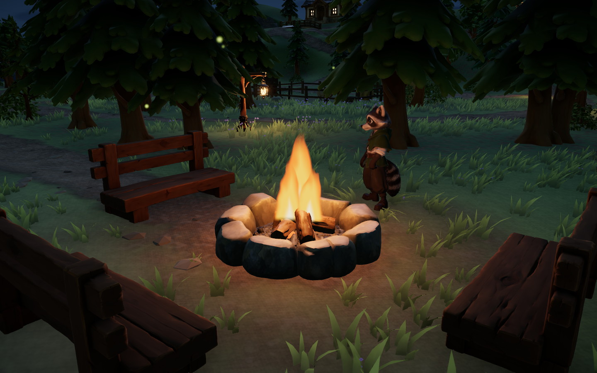

# 篝火参考 my-blog 重做 · 2026-10-26

状态：已实现、本机限定验证，待用户查看。代码位于 main 的未提交工作区，基于 `34b9409` 并包含此前手账改动；关键文件 SHA-256 见 validation-summary.json。未提交、推送、部署或调用付费资源。

## 用户反馈与来源

用户认为旧版篝火太假，指定参考本机 my-blog。旧版七个硬边几何火苗通过缩放运动，浅色轮廓像实体锥片。参考 `F:/Projects/my-blog/src/world/scene/CampfireFlame.tsx`，源提交 `14d4c1d1621f5e4528e82c25ef54fb7d7c1ff22c`；原文件与参考图哈希见 [source.json](source.json)。参考图从该项目 `public/assets/world/sample-albums/raccoon-2-campfire.webp` 原样复制，仅作来源展示，不作为森林拾光运行截图。


## 实施与前后对比

新增 `src/world/CampfireFlame.tsx`，将三层朝向相机的竖直火焰面片、上升噪声轮廓、橙红边缘/明亮火心、28 个渐隐火星与轻微波动暖光接入现有 `lit` 状态；根部上移到柴堆内，着色器时钟单帧增量上限 0.05 秒。沿用源方案，无外部纹理；保留原石圈、柴堆、炭火和座椅。没有 Lux3D/Blender 产物或新资产下载。

熄灭时隐藏完整效果组；减少动态效果时固定火焰形状和光照，隐藏火星。火焰与火星不参与相机/交互射线。`ForestWorld.tsx` 仅补充 QA 近景、侧面、俯视机位。

两图均为 1440×900、白天、相同 fireClose 机位及角色位置，动态相位不同。新火焰轮廓柔软，根部位于木柴之间。


下图为夜景补充，不能与白天图视为光照受控对比。




## 验证

- `pnpm lint`、`pnpm test`（26 文件、116/116）、`pnpm build` 通过。主 JS 1,673.41 kB / gzip 513.14 kB；既有 >500 kB 分块提示保留。`git diff --check` 通过。
- Windows、独立无头 Edge 156.0.4314.42、1440×900；本地 Vite 开发服务 `127.0.0.1:5176`，当前工作区代码。
- `check_campfire.mjs` 默认和低画质各 2 组自动检查、19 张图通过，控制台错误 0。昼/夕/夜 × 近景/侧面/俯视/营地共 12 图，连续动态 4 图，熄灭、减少动态效果、完成烤火各 1 图。
- 真实 F 键点燃/熄灭；检查火焰时间推进、12 顶点与 28 火星；减少动态效果下两次读取时间为 0、强度为 5、火星不可见；熄灭后整组不可见。
- 设置待办任务与地标起点后，用真实 F 点火、坐下，等待连续 8 秒由实际状态订阅完成手账，再起身熄火。不注入完成标志。
- `scene-review/` 另有三时段全岛、角色、工坊、池塘、牧场、木塔、营地及其他视角共 26 张图，错误 0；代表图抽查不等同于所有玩法重新验收。
- 使用项目 `createHeadlessBrowser`，浏览器临时目录在 `.tmp/`，最外层 finally 清理。截图先预热再保存，避免先前观察到的首张拼块失真。

`before/` 为改前 18 图，`after-v1/` 为初版 18 图；初版视觉通过后增加手账联动检查并重采 `final/`，没有另编造视觉迭代。`low-quality/` 为低画质复跑。原始 headless-validation.json 与完整图片批次仅保留本地并忽略，版本控制保存本文引用图、参考图、来源与精简验证摘要。

复跑（先启动项目 Vite 服务，PowerShell）：

```powershell
$env:FOREST_URL='http://127.0.0.1:5176/?qa&view=fireClose'
$env:FOREST_QA_OUT='docs/evidence/2026-10-26-campfire/recheck'
$env:FOREST_FIRE_ASSERT='1'
node scripts/check_campfire.mjs
# 低画质：将 FOREST_URL 增加 &quality=low，并更换输出目录后再次运行。
```

## 限制与下一步

风格化面片火焰并非体积流体模拟，高俯角存在面片缩短；未增加烟雾物理。尚未跨 GPU/浏览器实测、对比帧时间、公网加载或人工试听。本轮仅 PC 键鼠，保持手机界面不在兼容范围。后续依据用户实际观看反馈调整形态和光照。
