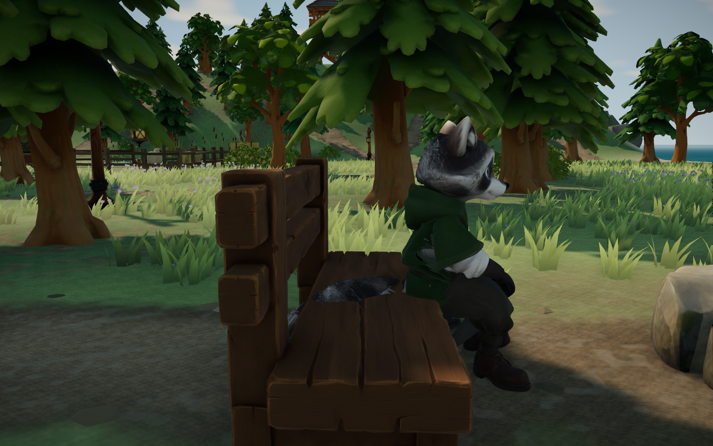
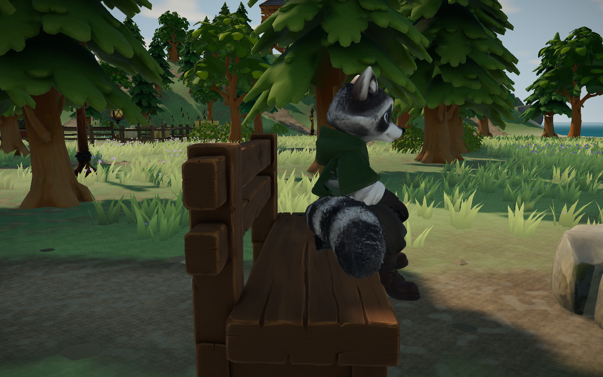
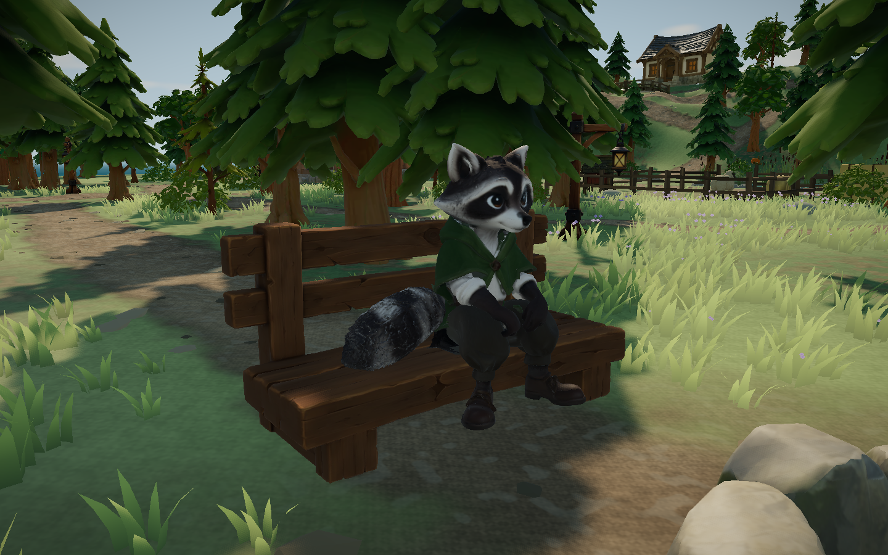

# 长凳坐姿与穿模修复 · 2026-10-26

状态：已实现，本机限定验证，待用户查看。当前 main 工作区基于 `34b9409`，保留此前手账和篝火未提交改动。本轮未提交、推送、部署，无付费调用。

## 问题与参考

用户提供营地西侧坐姿穿模截图。复现使用当前实际游戏、原 `public/assets/expansion/low-bench.glb` 与 `public/assets/models/raccoon.glb`。长凳仍是此前从 my-blog 导入的原模型，本轮未修改任何 GLB，也没有生成 Lux3D/Blender 资产。原资产及运行时文件哈希见 [验证摘要](validation-summary.json)。

原根节点在椅心前方约 0.593 m，臀部动画后移约 0.296 m，角色靠近前缘；长凳座面约 0.35 m，大腿底面约 0.20 m，没有坐高补偿；尾巴后垂穿过座板/靠背。

## 修复与方案调整

坐稳根节点改为前方 0.45 m（后移约 14.3 cm），抬高 15 cm；平滑过渡，地面高度取长凳中心，走近/离座位置保持。尾根渐变侧转 90°、轻抬 0.38 rad，保留原分节动作，每帧先撤回上次附加旋转以免累积。仅五张长凳生效，木墩不变。

实际迭代保留在本地：

- `before/`：原状态五张长凳三机位，共 15 图。
- `after-v1/`：坐高/偏移修正，尾巴仍穿靠背。
- `after-v2/`、`after-v3/`：尾巴转向身侧；开始实际蒙皮顶点审查，发现臀部/衣摆低轮廓仍穿座板。
- `after-v4/`、`after-v6/`：整体抬高至 0.24/0.32 m，会使腿部悬空，弃用。
- `after-v5/`：仅按 Cloth 材质处理衣摆不足，实际低轮廓还在 Fur 材质分区，弃用。材料名称不等同于身体部位。
- `after-v7/`：按骨骼权重选取低臀轮廓接触，坐稳通过；`transitions/` 随后发现起身时上腿与尾尖仍穿入，扩大限定部位处理后复跑。
- `final/`：最终代码，五张长凳坐下/坐稳/起身抽样与真实离座通过，27 图。

最终 `benchSeatContact.ts` 只修改角色克隆的顶点，在座面范围将低臀/衣摆、上腿和尾尖托到椅心地面 +0.358 m；通过加权蒙皮矩阵逆变换写回，离座恢复原顶点，不污染共享 GLB。源姿态不是针对此高凳制作，不能靠抬高整个身体同时解决接触和视觉支撑；采用局部接触处理。不是布料或软体物理，也没有重新烘焙动画。

## 实际图片

下面两图同为白天、Edge 156、1440×900、营地西侧 `seatSide` 机位；呼吸动作相位略不同。





下图是不同机位的正面补充：



## 验证与边界

- lint 无警告，118/118 单测（27 文件），build 通过。JS 1,676.24 kB / gzip 514.10 kB；原有大分块提示保留。
- 新增 2 项单测验证五种旋转/高程的接触、源顶点不变、离座恢复、木墩不受影响、过渡边界连续。初次合成测试揭示 SkinnedMesh 世界矩阵更新不足，修正后全通过。
- 独立无头 Edge 156.0.4314.42、1440×900、Vite 开发服务 127.0.0.1:5176。项目 `.tmp/` 配置，最外层 finally 清理。
- `check_seat_fit.mjs` 设置椅前起点，真实 F 坐下，等待实际动画计时；在约 0.85 秒后暂停取坐下/起身中段，再继续。每张长凳三机位坐稳截图，西侧加黄昏/夜间，共 27 图。五次真实坐下/起身，浏览器错误 0。
- `seat-contact-audit.js` 对实际长凳三角形建立垂直相交区间，检查全部角色蒙皮顶点。五张长凳 × 坐下/坐稳/起身 = 15 个姿态，最终均无超过 3 mm 的顶点穿入，坐稳支撑间隙约 7.98 mm。自动失败阈值 10 mm，原始实际结果保存在摘要中。不是所有帧/所有三角形边的连续碰撞证明。
- `scene-review/`：三时段全岛、角色、工坊、池塘、牧场、木塔、营地等 26 图，错误 0。代表图复核不替代所有玩法重验。海湾正面被前景草遮挡，使用其他角度和几何检查，未修改植被。
- `fire-regression/` 为同一最终代码的点火、熄火、连续 8 秒烤火手账复跑，最终状态见验证摘要。
- 未测跨 GPU 性能、人工试听或公网加载。运行时接触处理有 CPU 成本，仅长凳活动期间执行；没有宣称帧率提升。待用户查看实际坐姿。

完整截图批次和 headless-validation.json 为本地忽略的原始记录，仅正文三张图与本摘要纳入版本控制。

复跑（先启动 Vite，PowerShell）：

```powershell
$env:FOREST_QA_OUT='docs/evidence/2026-10-26-seat-fit/recheck'
$env:SEAT_TRANSITIONS='1'
$env:SEAT_ASSERT='1'
node scripts/check_seat_fit.mjs
```

可选 `SEAT_IDS='camp-west'` 限定诊断单座；最终验收未设置此参数，覆盖全部五座。
