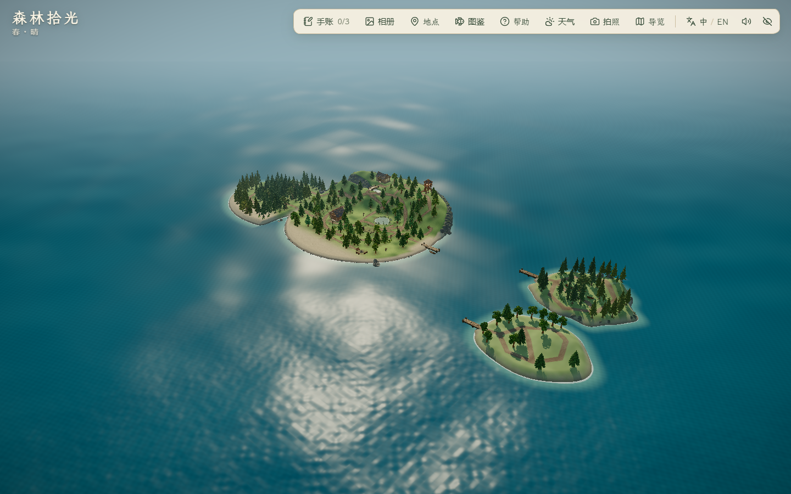
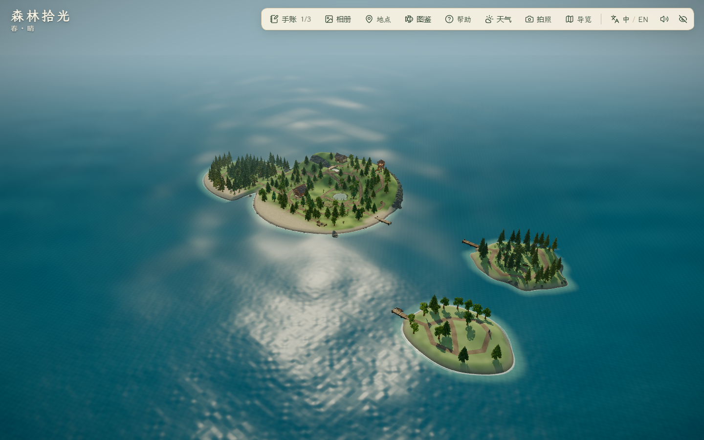
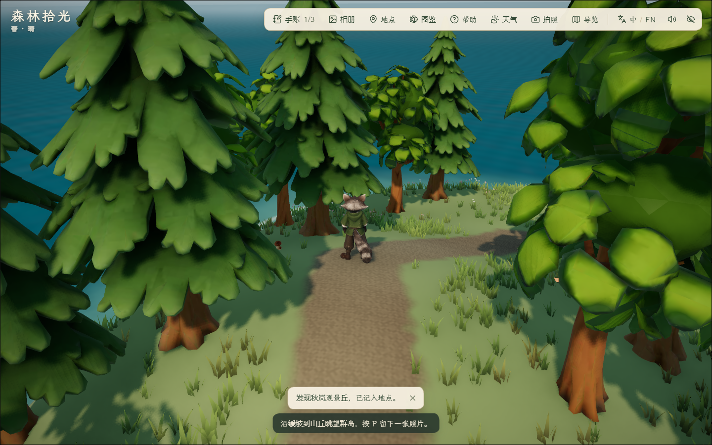
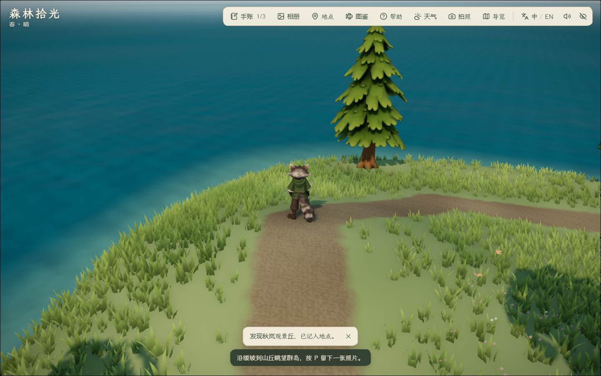

# 秋岚岛首版与岛间距修订

2026-10-29。当前采用：秋岚岛首版地形、第三泊位、林路、观景丘、到访/发现记录与安全泊位恢复；专用白桦、枫树、完整岸岩和最终美术仍待制作。使用 forest-visual-qa 与 living-project-report；没有新增付费调用或生成模型。

## 布局与用户修订

依据 [四岛概念 v4](../../references/island-expansion/concept-v4-four-islands.png) 和 [IT-02 地形参考](../../references/island-expansion/it-02-autumn-terrain-v1.png)，采用西南上岸湾、中央林窗、东北缓丘、连续步行环路；参考图是 AI 插画，不能当作施工坐标或准确比例图。

首轮为了约 30–50 秒航程，把中心放在 (108,29)。用户指出两个小岛过近后，岸线采样确认雾松/秋岚最近只有约 **6.06 m**；采用稿将秋岚岛整体向东 4 m、向南 18 m，中心改为 **(112,47)**，最近岸距约 **24.37 m**。地形、路、树、码头和发现点共享平移，面积不变；优先保留开阔海峡，航程相应加长，旧 30–50 秒设计目标不用于压缩间距。

岸距由两岛各 360 条射线在海平面高度求岸线，再求采样点间最短距离；约数不是概念图测量值。新增规则要求岸距 >20 m，旧布局 6.06 m 明确不通过。海域包络扩大以容纳新位置，完整船体水深及码头碰撞保持。宽视角依据当前邻岛中心取景，修复秋岚岛拉远后仍朝雾松岛构图的问题。

两图只用于布局比较；角色位置、手账状态、海浪和草叶存在运行时变化，不能用于逐像素差分或性能归因。

## 地形、路径与素材

- 可站立面积 **922.5 m² / 原主岛 3695 m² = 24.97%**，按 0.5 m 网格包含碰撞采样，位于 20%–25% 范围。首稿为 898.25 m²，观景树木调整后增加；未缩放岛屿来改变面积。
- 独立 54×50 m 地形片、180×166 网格、59,760 三角形；坡道、船体水深、路径与海岸材质共享高度/岸线函数。旧主岛和雾松岛 2,748 个地形样本、304 个植被实例及原 main/mist 泊位保持，数值比较容差 1e-10。
- 复用 `forest-kit.glb` / LOD 版本布局 **15 株（4 株普通松、11 株既有圆冠阔叶）**，使用现有春/夏/秋季节材质；不是已制作的 IE-06 白桦或 IE-07 枫树。基础资产清单仍为 5/9。
- 复用既有码头、船和划桨动作；资产哈希/体积及原授权证据入口见 [复用台账](asset-reuse.json)。沿用既有用户本地复用授权，未新增第三方商业许可证明；无新 Lux3D/Blender 产物、贴图或减面。
- 三个稳定泊位 ID：main / mist / autumn。新增 visitedAutumn、foundVista 默认 false，兼容旧 v1 记录；人物与船刷新恢复到同一个命名泊位。到访只在实际下船后记录，观景丘需步行实际到达。

## 试稿与修正

[首稿截图](first/report.json) 包含 24 株布局树。首次实走登丘时前排树冠遮住主要视线，调整东北树群后保留 15 株，海面可见；同为日间，角色到达位置接近，但待机/镜头并非逐帧同步。

首次完整浏览器轮次 [final/report.json](final/report.json) 完成往返操作，但最终标为 **FAIL**：脚本误向只支持春、夏、秋的系统传入 winter，引起 Climate 异常。该图中的 winter 不是功能成果。脚本已改为读取实际 seasonIds；间距修订前的 [reviewed/report.json](reviewed/report.json) 已重跑通过，航程 50.462 秒，仅属于旧的紧凑布局。

第一次三泊位绕角辅助检查 [berth-clearance/report.json](berth-clearance/report.json) 使用固定一秒输入，在多会话并行时未达到角度断言；改为等待实际转向/位移并保留 8 秒超时，不放宽碰撞。采用稿结果见下表。类型检查曾发现测试变量推断成坐标字面量联合类型，补明确 number 类型后通过。

## 验证

采用稿往返 8 组通过、25 图，三泊位与实际滚轮 4 组通过、7 图，原主岛 1 组/18 图，三份摘要均为 PASS、控制台错误 0。采用稿雾松至秋岚实际航程 **67.722 秒**（含转向、减速与下船过渡），旧紧凑布局为 50.462 秒；加长来自这次间距修订，不为压回原目标而提高船速或缩小海峡。

本机静音 Edge 156.0.4314.50，1440×900；地点面板另检查 1920×1080、1280×720、1024×768。统一 createHeadlessBrowser，配置和 TEMP/TMP 位于项目 .tmp，最外层 finally 清理；不使用用户浏览器存档。

| 范围 | 记录 |
| --- | --- |
| 采用稿雾松—秋岚往返、下船、刷新、登丘发现、全环路/支路、拍照入口、春夏秋预览、地点面板 | [spaced/report.json](spaced/report.json)；起点置于已验证雾松泊位，此后为真实键鼠操作；不称从主岛全程连续出发 |
| 主岛/雾松/秋岚三泊位空角转向、划离，秋岚实际滚轮拉远 | [spaced-clearance/report.json](spaced-clearance/report.json) |
| 采用稿原主岛昼/夕/夜六机位，角色、工坊、池塘、牧场、塔和概览 | [final-main-views/report.json](final-main-views/report.json)；截图复核不替代全部旧玩法 |

`pnpm lint`、51 文件 **238/238** 单测、`pnpm build` 通过。主 JS **1,898.88 kB / gzip 584.87 kB**；保留既有大分块提示。规则检查覆盖两岛旧布局保持、新岛面积、整条林路双向/路肩、第三泊位保存失败与旧档恢复、岸距、各岛宽视角，以及原有靠泊和碰撞约束。

尚未验收：专用白桦/枫树与最终岸岩、按岛预载、跨设备/公网加载、声音与完整旧玩法。三岛地形常驻，不将局部测试称为四岛系统完成；潮汐岛仍未实施。未提交、推送、部署或导出。
