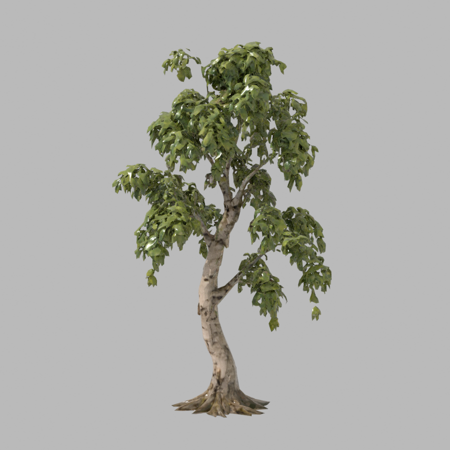
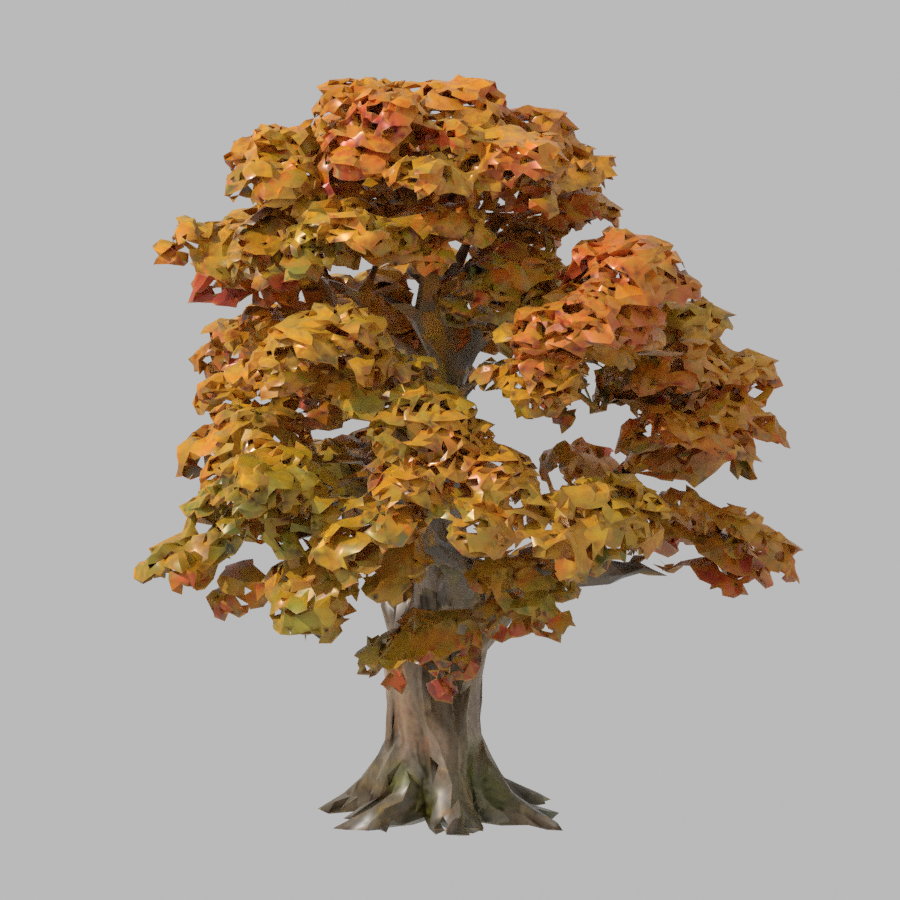
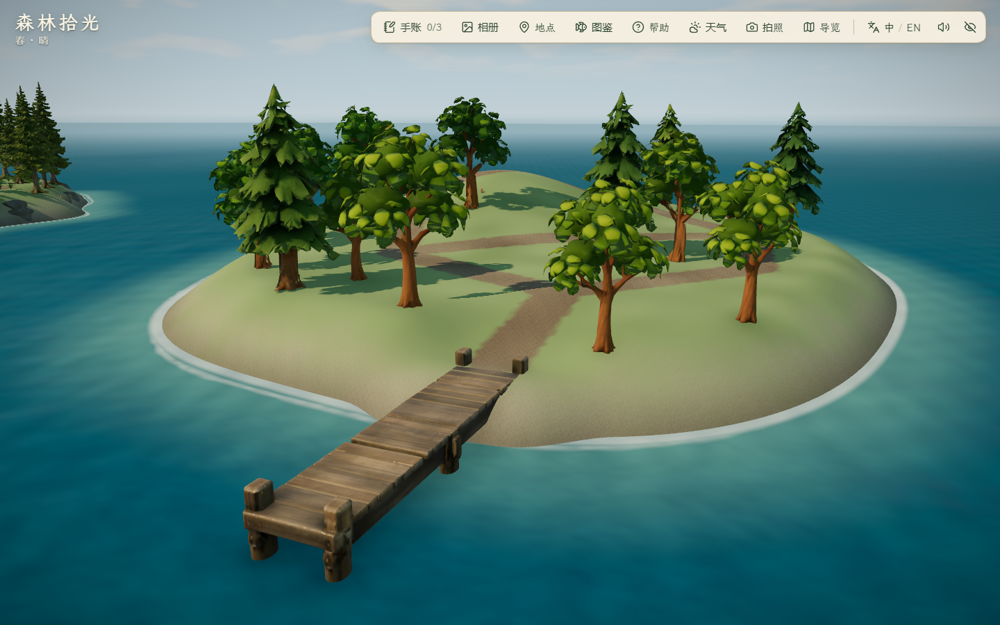
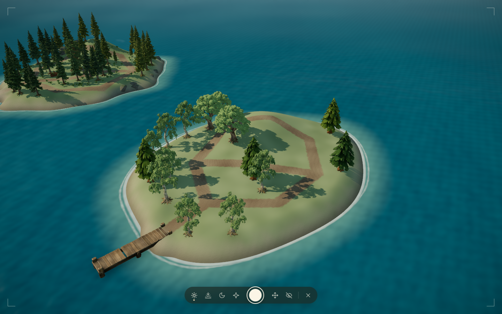
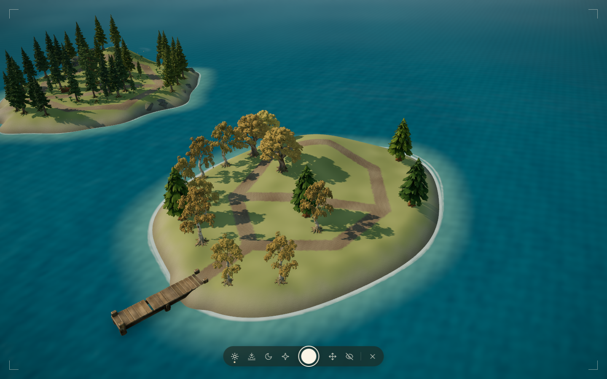
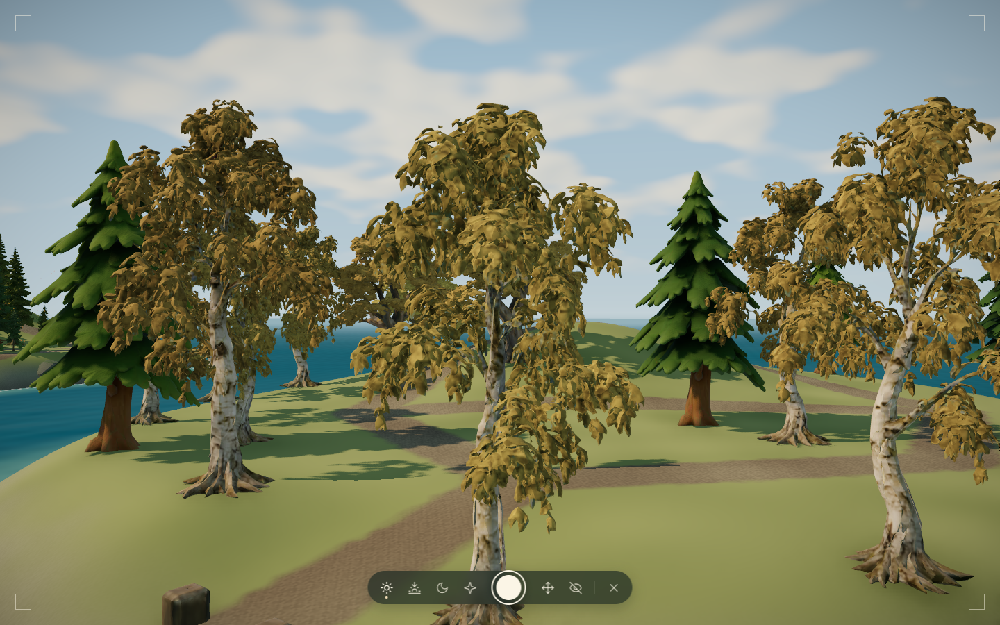
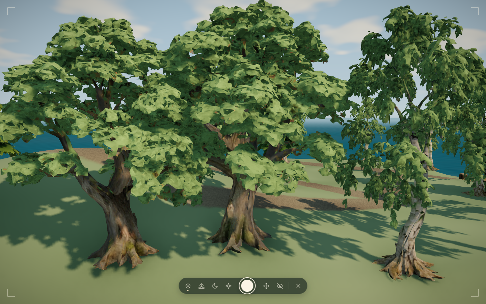

# 秋岚白桦与枫树 · 完整模型与季节接入

2026-10-29。状态：模型、季节材质与实际旅行已完成本机限定静音复核，最终美术仍待用户查看。不将本机验证当作最终美术或商用授权。

## 生成来源

沿用用户 2026-10-29「新增树木按单体参考经 AHOLO API 制作」的授权和既有单体参考，没有重画输入。中国区 `https://api.aholo3d.cn`、Lux3D G1、关闭自动尺寸预测、ZIP/GLB 输出；白桦请求 100000 面、枫树请求 120000 面。每件仅一次创建请求，生成期间只查询原任务。

| 资产 | 参考 | 任务 | 原始 / 运行三角形 | 规范高度 | 运行 GLB |
| --- | --- | --- | --- | --- | --- |
| IE-06 白桦 | [单体输入](../../references/island-expansion/ie-06-birch-v1.png) | 4480409 | 97,792 / 97,792 | 6.5 m | 6,455,960 字节 |
| IE-07 枫树 | [单体输入](../../references/island-expansion/ie-07-maple-v1.png) | 4480412 | 119,142 / 119,142 | 6 m | 8,453,232 字节 |

[脱敏生成记录](generation.json)保留输入哈希、选项、授权范围和原始下载哈希。原始 ZIP/GLB 与 `normalized.blend` 分别在 `assets/lux3d/ie-06-birch-v1/`、`assets/lux3d/ie-07-maple-v1/`，不进入部署目录。原始 GLB 为 15,295,168 / 17,528,648 字节。密钥仅取环境变量，记录不含密钥或带鉴权参数的下载地址。

使用当前配置的 AHOLO 账号；未取得新的账号等级、商用许可凭据。额度端点 HTTP 500，报价和实际积分未知，不能沿用旧估价宣称实扣；用户调用授权与第三方商业许可分开。

## Blender 制作与结构审查

`scripts/aholo/prepare_autumn_trees.py` 通过项目 `blender_run.py` 启动隔离 Blender 5.2.1 LTS：烘焙变换、底部居中、等比统一高度，保留全部几何及 UV；去除金属度/粗糙度贴图驱动，设为非金属、粗糙度 0.88。运行 GLB 保留 2048² 基色图并以 WebP 90 导出，单 mesh / 单材质，不减面，不新增 LOD。体积减少来自材质贴图整理与编码，不是几何简化。

已查看两树正反面。白桦斑驳浅色树干、枫树较宽分叉冠可以辨识；叶团较参考厚实，背面由生成服务推断，不称为逐叶或植物学复刻。没有独立幼树/树龄变体。

[白桦规格](birch/runtime.json)、[枫树规格](maple/runtime.json)包含法线/UV/尺寸及哈希；各自 `glb-audit.json` 复核实际导出三角形与材质。按模型距地 0.15–1.2 m 顶点建立保守圆：半径约 0.6321 / 0.8816 m；冠幅半径约 2.1607 / 2.9719 m，比单体图册目标更宽；保留实际树冠，未压扁到目标宽度，另用于镜头与地面冠影。Blender 输出独立 template，合并时保持既有古松、云杉、幼态云杉条目。

## 运行时与前后对照

仅替换秋岚原 11 株圆冠布局树：8 白桦、3 枫树，保留 4 普通松，全部位置/比例/角度保持。新树按 8 m 小区域实例化，近远景均完整几何。原主岛/西扩/雾松 304 个植被实例、地形/泊位保持由已有单测回归；不修改存档或航线。

画质自适应、阴影、海浪与植被动态未逐帧锁定；本组用于布局/树形比较，不用作精确材质或性能差分。

原始枫叶是橙红色，运行材质采用近似感知色空间的局部饱和度、归一化绿蓝差、高度识别，白桦/枫树使用独立饱和度范围，保留纹理明暗并跟随现有春夏秋系统调色；低部树干保持。第一版的春夏红斑在 `first/` 保留，`reviewed/` 调整颜色阈值后改善远景红斑；`final-review/` 新增近景发现枫树枝干误调色、低垂叶片遗漏。`bark-reviewed/` 改为近似感知色空间识别并降低高度起点，随后 `adopted/` 为白桦采用更适合淡色叶片的独立阈值。技术 PASS 不等于视觉采用，未采用材料均保留。识别是针对两件材质的启发式，不是精确人工叶片蒙版，后续仍可修细枝边界。

新身体碰撞令可站立面积从 922.5 降至 901 m²，仍为原主岛 3695 m² 的 24.38%；0.5 m 网格采样包含障碍，不以岛外包面积代替。林路双向及路肩检查通过。两岛最小岸距 24.3709 m、秋岚平移量 (4,18)、东北林窗和泊位保持。

## 验证范围

- `pnpm lint`、51 文件 239/239 单测、`pnpm build` 通过；新增白桦/枫树实体、相机冠层与地表遮阴检查。主 JS 1,901.41 kB / gzip 585.59 kB，保留既有大分块提示。
- 静音 Edge 156.0.4314.50、1440×900，项目统一隔离 browser helper，最外层 finally 清理。`before/` 1 组/15 图；`first/` 3 组/18 图；中间 `reviewed/` 3 组/18 图；主岛与近景 `final-review/` 3 组/33 图（含主岛昼夕夜六机位 18 图）；枝干修正 `bark-reviewed/` 3 组/24 图；最终采用 `adopted/` 3 组/24 图；控制台错误均 0。验证真实 GLB 加载、完整三角形、法线及三季材质；已查看关键图。采用稿另有两种专用树近景三季图，已查看白桦转黄、枫树夏/秋、总览与夜间泊位。少量低饱和暖色纹理仍可见，不声称逐像素叶/枝分离。固定 `autumnVista` / `autumnClearing` 机位有原松树前景遮挡，不据该机位宣称真实玩家视野被堵或已验证全部近景。
- 最终 `adopted/` 夜间群岛全景 RAF 中位/P95 7.0/15.0 ms，替换前 5.8/13.4 ms；均高画质、取消帧率限制、180 帧。采样时构建已完成，不据接近的短样本证明性能改善。这是短样本，不代表显示器 FPS、长期负载或跨设备表现。
- 中间 `reviewed/` 两件资源本机请求约 914 / 1066 ms，编码体积同 GLB；这不等于公网冷加载或 GPU 上传时间。最终 CDP JSHeapUsedSize 83,856,904 字节、JSHeapTotalSize 131,457,024 字节，是单时点 JS 堆，不含完整 GPU 内存。后处理下已有 triangles/calls 遥测只显示最后一 pass，不能用于整帧性能断言。
- [实际往返报告](roundtrip/report.json) 8 组/25 图 PASS、控制台错误 0：真实键鼠雾松→秋岚→雾松，出海 67.533 秒；刷新、登丘发现、环路/支路、拍照入口/三季预览及三档 PC 地点面板通过。原主岛六机位/三时段 18 图位于 `final-review/`，已抽查概览、角色、工坊、池塘、牧场、塔与夜景；后续只改两件秋岚材质，不重跑相同路线与主岛玩法。声音、照片保存、全部旧玩法和人工完整游玩不在本轮结论中。

复现：`FOREST_QA_OUT` 设独立目录，`FOREST_AUTUMN_TREES=1` 执行 `node scripts/check_mist_detail.mjs`；路线执行 `node scripts/check_autumn_travel.mjs`。基线不可覆盖。截图使用实际浏览器输出，不用渲染图替代实机。

基础资产 7/9，剩余 IE-08 赤杨、IE-09 海风松。秋岚林下层次、岸岩、独立树龄变体和潮汐岛仍待推进。没有提交、推送、部署或导出报告。

最终检查汇总见 [verification.json](verification.json)。全部自动浏览器会话已退出并执行各自清理；正常游戏音量设置保持。
