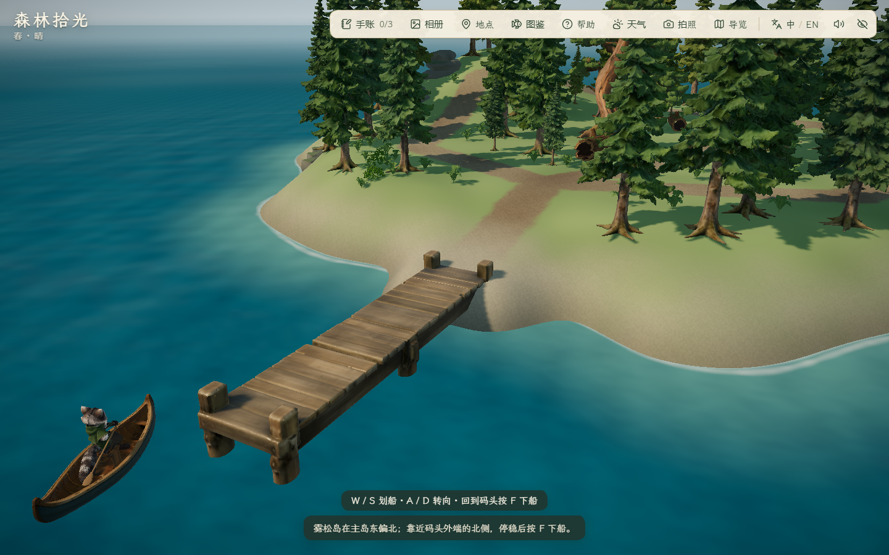
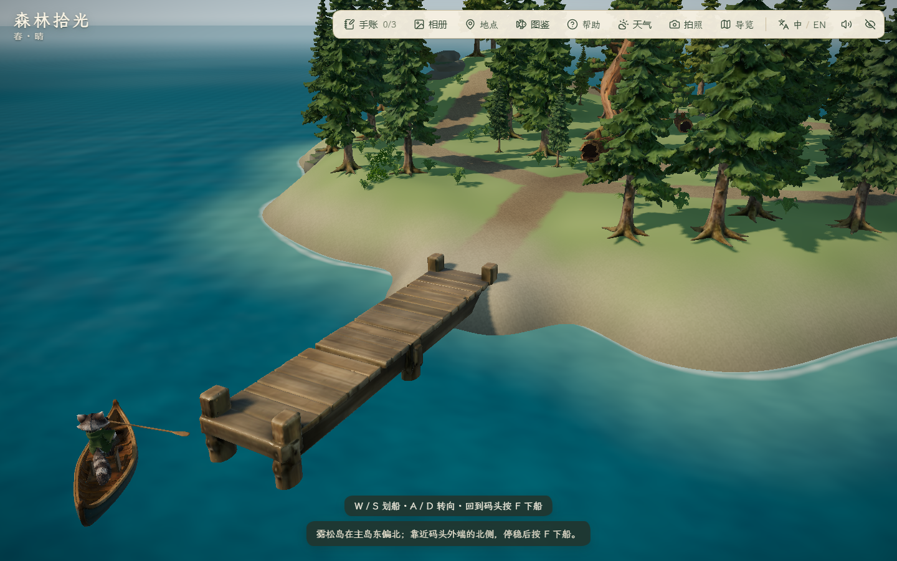
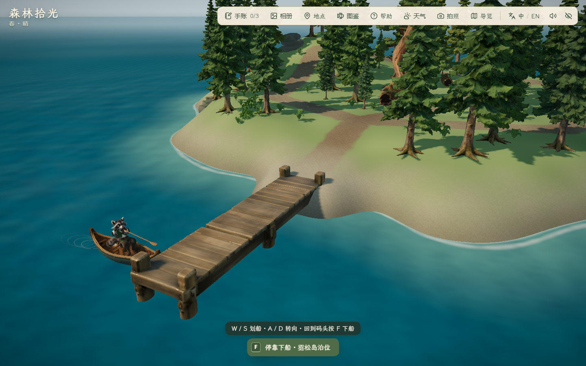
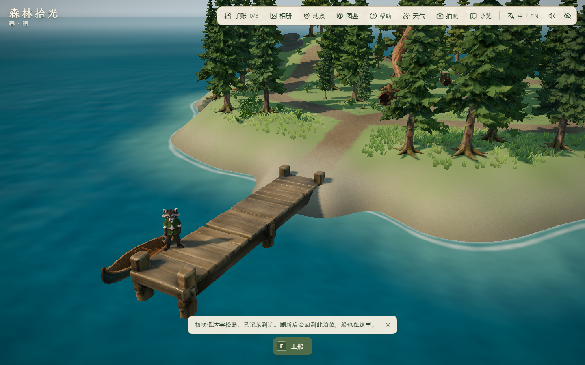

# 雾松岛码头停靠与船体碰撞修复

日期：2026-10-29。范围：用户反馈靠近雾松岛码头难以下船，并明确「空气墙」出现在划船前进/转向时。使用 forest-visual-qa 与 living-project-report 流程；没有生成、修改模型或调用付费服务。

## 原因与处理

1. 原下船判定同时要求距泊位中心 <0.85 m、速度 <0.18 m/s、船头平行误差约 20.5°；六种真实按键靠近场景均停在附近却无法下船。此前跨岛脚本精确导航到泊位并对齐船头，没有覆盖自然靠近的容错。
2. 停靠改为泊位沿码头方向 ±2.4 m、上船侧距码头边不超过 2.5 m 的局部区域，仍要求完整船体可通行和速度 <0.18 m/s；取消手动平行对齐要求。主岛南侧与雾松岛北侧开放，反侧、远海、码头穿透不开放。快速进入时提示松开 W / S。
3. F 下船使用既有 0.85 秒过渡；在 0.4 秒全遮罩提交点把船系到原泊位，船头朝外。上下船站位和存档格式保持；再次上船可直接 W 驶离，没有新增专用跨舷或系绳动画。
4. 船碰撞原来仅用旋转船体的世界轴包围矩形检测码头，斜船的空角也阻挡转向。改为船体与码头四条分离轴检测；保留船体半长 1.7 m、半宽 0.57 m、原深度采样和码头边界。实机加载船壳局部范围约 x=[-1.67248,1.67991]、z=[-0.43790,0.55606]，处于既有碰撞尺寸内，没有缩小船体规避问题。

## 实机证据

全部使用隔离无头 Edge 156.0.4314.50、1440×900、静音启动；只设置靠近起点，之后用 CDP 实际 W/A/F 输入。测试配置和缓存位于项目 .tmp，最外层 finally 清理；不触碰用户浏览器存档。

- [下船修复前](before/report.json)：六种场景全部保持 rowing，canLand=false。这里 PASS 仅表示完成旧行为采样，不表示旧体验通过。
- [下船首轮修复](final/report.json)：主岛/雾松岛 × 正面/偏移/斜向，F 下船、F 上船、W 离泊六组，加主岛刷新恢复，共七组通过，12 图，控制台错误 0。
- [空气墙修复前](collision-before/report.json)：雾松岛位置 (77.8,-12.2) 按 A 约一秒只转 0.33664 rad，约 19.3° 后阻挡；主岛对称位置同样复现。
- [空气墙修复后](collision-final/report.json)：同起点、同机位、同白天设置，雾松岛转 0.77008 rad，约 44.1°，随后实际 W 驶离；主岛同类检查通过，四图、错误 0。时间由浏览器实际帧推进，非逐帧动画对齐比较。
- 合并版本停靠闭环复测七组通过、12 图、错误 0，结果见 [最终摘要](final-combined/report.json)。本轮局部检查不替代全程跨岛航行、昼夕夜全场景、听觉或跨设备验收。

## 检查与复现

`pnpm lint`、`pnpm test`（50 文件、232/232）、`pnpm build` 通过；主 JS 1,892.51 kB / gzip 583.44 kB，保留原大分块提示。新增规则检查涵盖宽容停靠、未停稳提示、反侧/远海/甲板/无效值拒绝、下船后离泊，以及空角可旋转与真实船体重叠仍阻挡。首次新增停靠测试把主岛靠岸浅滩误当可航行起点，测试失败后调整测试位置到外海，没有放松水深碰撞。

本地 Vite 5176 启动后执行 `node scripts/check_boat_clearance.mjs` 和 `node scripts/check_berth_docking.mjs`；FOREST_QA_OUT 可指定独立输出目录。FOREST_QA_BASELINE=1 仅用于旧代码观测，不用于修复验收。

无新 Lux3D/Blender 产物。当前为本机代码与局部操作验证，仍待用户实际体验；未提交、推送、部署或导出。
