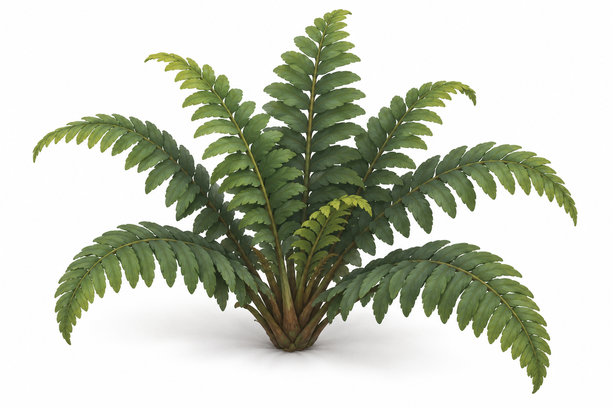
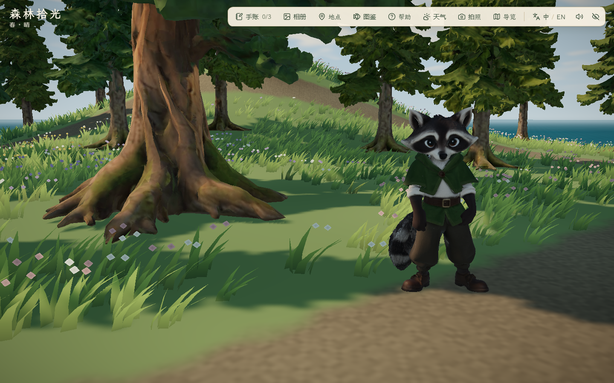
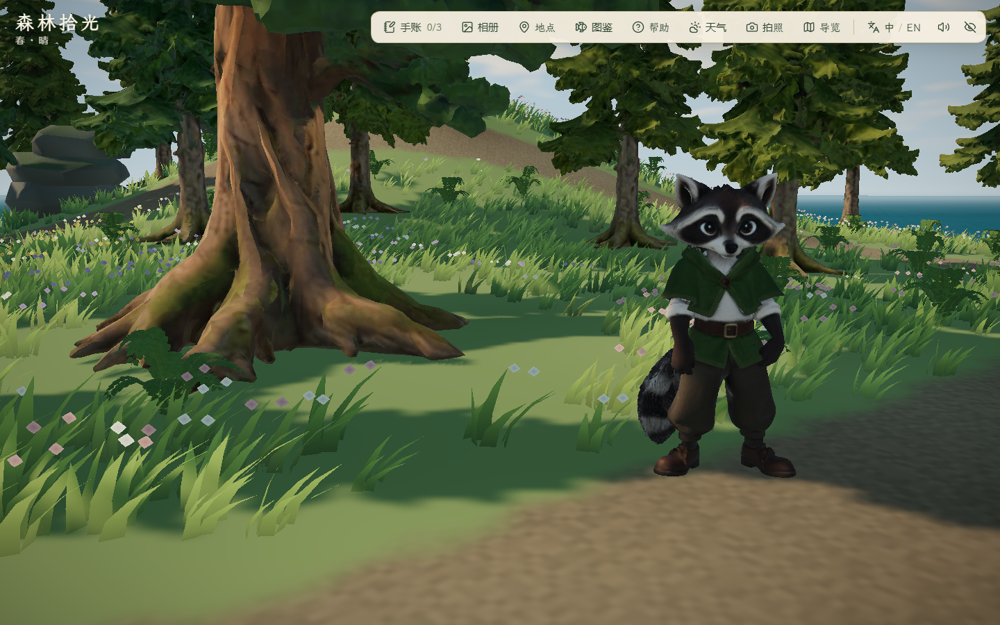

# 雾松岛蕨丛与局部岩脊

2026-10-29，接续雾松岛首版。此前西扩、湿地与双岛往返已本地提交为 `23516e4`；本目录记录提交之后的细化，未提交或推送。

## 制作与范围

- IE-03 蕨丛参考：`docs/references/island-expansion/ie-03-fern-clump-v1.png`，本轮未重新生成参考。按参考的羽状叶和丛生轮廓在 Blender 5.2.1 原创制作，未提取或复制参考图纹理；不是 AHOLO 生成物，不新增付费任务或授权声明。
- 制作脚本：`scripts/build_fern_clump.py`；本地工作文件：`assets/blender/fern/fern-clump.blend`；运行文件：`public/assets/expansion/fern-clump.glb`。9 枝叶、3,240 三角形、317,856 字节，高约 0.663 m；双面实叶、顶点色，无透明卡片、无独立贴图。GLB 单 mesh/单材质，结构、面数与 SHA-256 见 [模型检查](glb-validation.json) 和 [Blender 记录](fern-validation.json)。
- 原稿中叶片折痕较深，调整折度后仍像水平层片；最终改为小叶随弯曲叶轴排列。三个版本的 Blender 渲染/记录保留。只调整造型与法线，没有减面；全部版本仍为 3,240 三角形。没有修改既有古松、云杉的几何。
- 场景加入 67 丛蕨叶，集中林路旁和树根外；采用一次实例化绘制，没有行走碰撞，不堵路。当前静态，无专用风动、远景 LOD 或西林/湿地投放。
- 岩脊复用现有 `coastal-kit.glb` 的 6 组岩石，按地形埋入坡面并沿用实体碰撞。完整可见半径在 16 个方向采样，避开可航行海水、林路和树根；未重新制作岩石模型。
- 加岩石后可站立面积为 885.25 m²，占扩建前主岛 3695 m² 的 23.96%，仍在 20%–25% 目标内。此前 897.5 m² / 24.29% 是未加岩石版本。原主岛 1517 个地形点、140 个植被实例及原泊位保持，跨引擎数值对照容差为 1e-10。[布局与面积](layout-validation.json)

## 参考、模型和实机分开记录








截图用于比较造型与布置，不作逐像素差分。草叶、角色待机及运行时阴影存在变化；较小的蕨叶仍被草部分覆盖，不宣称与参考逐叶一致或已满足最终密林覆盖率。

## 检查与失败取舍

- `pnpm lint`、49 文件 225/225 单测、`pnpm build` 通过。主 JS 1,885.10 kB / gzip 580.86 kB；既有大分块提示保留。Blender 正常退出，仅报告未来 6.0 的 `Material.use_nodes` 弃用提醒。
- [before/report.json](before/report.json)：修改前昼/夕/夜四机位基线；没有把历史不同机位截图冒充本轮基线。
- [after/report.json](after/report.json)：小块岩石与水平蕨叶的中间稿，键鼠环路通过，但美术继续修改。
- [final/report.json](final/report.json)：扩大岩石后的中间稿，实走通过；新增完整足迹单测发现外沿跨入航行水域。此目录不是采用版本；首张白天概览仍显示加载屏，也不得当作场景验收图。未降低测试要求，改为检查完整可见半径后剔除越界岩石，并在截图前等待加载遮罩退出。
- [final-v2/report.json](final-v2/report.json)：采用版本，Edge 156.0.4314.42、1440×900，无头浏览器 3 组通过、控制台错误 0。三时段四机位、模型实际加载、真实右键转向/W 步行，走过北部岩脊旁道路、东/南环路再到古松，成功记录发现。开始时定位到入口，之后整条环路通过真实输入；未重测海上航行、双泊位刷新、所有原主岛玩法或三档 PC 窗口。
- 最终 15 图包含三时段四机位和实走/拍照模式/地点面板。拍照与面板截图由状态设置打开，不作为真实按钮操作或照片保存证据；地点面板停留在顶部，不声称新条目视觉验收。脚本已将后续滚动选择器修正为 `.place-list strong`，该滚动修正没有重跑。
- 采用版夜间泊位固定机位 RAF 中位/P95 为 3.6/6.4 ms，低画质、取消帧率限制、180 帧；基线同机位 3.4/7.5 ms。正常波动不据此声称性能提升或其他 PC 达标，也不与上一阶段高画质双岛远景比较。

## 缓存与复现

本轮检查确认：浏览器配置、磁盘缓存及 TEMP/TMP/TMPDIR 在项目 `.tmp/`，使用 `scripts/browser-session.mjs`，最外层 `finally` 清理本次目录。Blender 启动器继承命令环境的 `TEMP=TMP=D:\Android\Temp`。这些是进程配置核验，不是全系统文件写入追踪；不能保证 Codex 应用、驱动及系统组件从不使用 C 盘。

```powershell
python scripts/aholo/blender_run.py scripts/build_fern_clump.py --blender 'D:/Program Files/Blender Foundation/Blender 5.2/blender.exe'
# 开发服务在 127.0.0.1:5176 启动后：
$env:FOREST_QA_OUT='docs/evidence/2026-10-29-mist-detail/recheck'
$env:FOREST_DETAIL_AFTER='1'
node scripts/check_mist_detail.mjs
```

本轮是局部林下和岩脊细化；倒木、完整自然岸线、局部雾、独立树龄变体及秋岚岛/潮汐岛仍待完成。没有新增付费调用、部署或 PDF/PPT 导出，当前新改动未提交。
