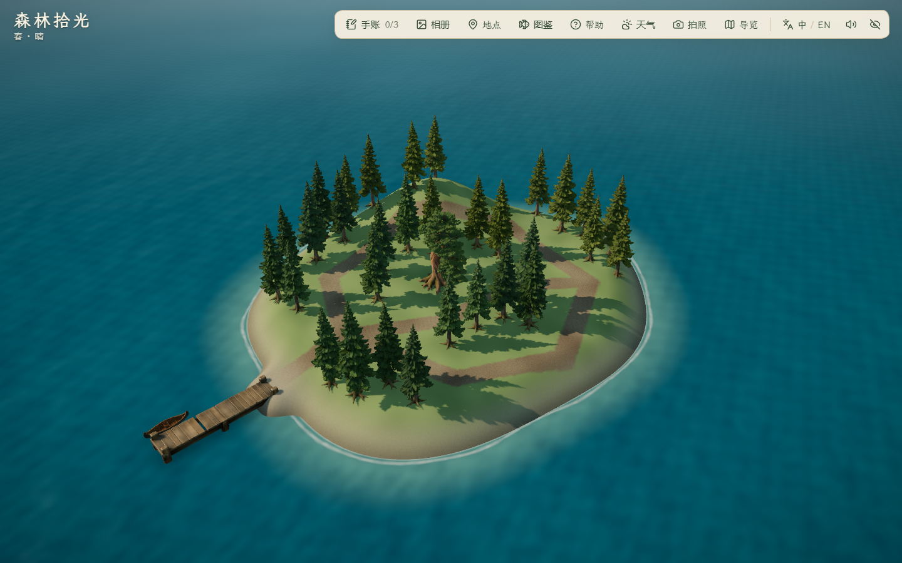
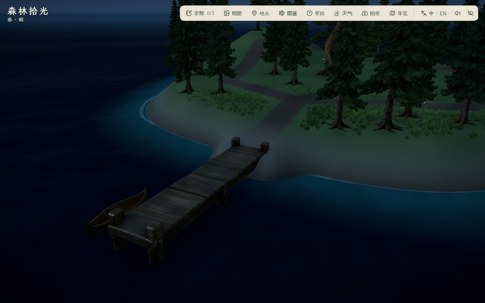

# 雾松岛首版：独立小岛与往返闭环

2026-10-29。当前实现为主岛西扩 + 一座雾松岛，秋岚岛、潮汐岛未实施。本轮不新增付费任务，不修改或减面既有 GLB，不等同完整群岛或最终美术验收。

## 范围与来源

- 按 [IT-01 与雾松岛参考](../../ISLAND_NEIGHBOR_REFERENCES.md)制作独立程序地形：西湾泊位、中央林窗、东北起伏、林间环路。参考仍为 AI 插画，运行地形由 `src/world/mistIsland.ts` 与 `MistIslandScene.tsx` 生成，没有新 Blender 岛屿文件。
- 可站立面积按 0.5 m 网格、实际坡度/水域/碰撞采样，为 897.5 m²，占扩建前主岛 3695 m² 的 **24.29%**。初试包络得到 28.54%，缩小后符合 20%–25% 目标；面积包括安全栈桥，不能用透视截图或地形包围框替代。详见 [validation.json](validation.json)。
- 复用 1 棵 AHOLO 古松和 31 株云杉：任务 4461967 / 4461973，单件完整几何分别 119,684 / 97,828 三角形，近远景不减面。来源与既有授权边界见 [资产证据](../assets/2026-10-29-island-trees/evidence.md)。共用现有码头、独木舟、桨与草地；本轮没有新增来源或商用许可声明。
- 新增 main/mist 双泊位配置、共同水深/船体碰撞、岛上远景焦点及阴影范围；草地冠层图覆盖雾松岛并保留 0.5 m 采样精度。两片地形常驻，树木分块实例化，尚未做航程驱动的资源预载。
- 新记录 `forest-moments:island-travel:v1` 只保存最近安全靠岸点、首次到访、古松发现。刷新时人物与船同泊位，海上刷新回最近出发泊位；无新记录的旧档仍在原主岛出生。不改旧种植、鱼簿、手账和沙作品格式，不增加任务印章。

## 验证与失败记录

`pnpm lint`、49 文件 224/224 单测、`pnpm build` 通过；主 JS 1,883.30 kB / gzip 580.32 kB，既有大分块提示保留。新增 5 项契约检查覆盖面积/海峡、全部林路双向步行、两泊位转场、发现与存档、坏档和存储失败；海上恢复属于状态规则测试，浏览器刷新在两处泊位执行。

1517 个原地形点、140 个原植被实例、路灯和原泊位对照保留。Node 与浏览器三角函数末位存在约 1e-15 差异，因此独立数值比对采用 1e-10 容差；这不代表放宽碰撞或面积要求。初次精确比较误报已纠正。独立 Vite SSR 采样进程还报告在用浏览器缓存的 EBUSY 文件监听提示，采样与正常结束成功；未改动浏览器缓存。

- [first/report.json](first/report.json)：实际出海、登岛成功，随后脚本在刷新时误读旧文档的 ready 标记并拿到空快照。浏览器错误为 0，检查失败保留；此轮不计完整通过。
- `scripts/check_island_travel.mjs` 已改为等待新的 `performance.timeOrigin` 与场景就绪，避免把刷新前的画布当作新页面。
- 最终完整检查 [final/report.json](final/report.json)：Edge 156.0.4314.42、1440×900，8 组通过、控制台错误 0；出海航程含转向/减速 44.762 秒，符合本段 30–50 秒目标。共 19 张截图，另检查 1920×1080、1280×720、1024×768 地点面板无横向溢出。双岛夜景概览 RAF 中位/P95 9.4/14.5 ms，未降为低画质、取消帧率限制、180 帧，非显示器 FPS 或跨设备性能结论。所有浏览器执行使用 `scripts/browser-session.mjs` 的独立项目配置与最外层 `finally` 清理，未操作用户浏览器或存档。

浏览器测试只在开始时将角色放到原主岛出发点，此后出海、登岛、探索、回码头、返航均通过实际键盘和右键拖动；自动化预设机位只用于截图，未代替航行或步行。单测检查全部环路双向，实机走过入口、古松支路及东/北返程；南侧环路两段不计为本轮实机覆盖。拍照检查打开/退出模式，未新增照片导出与保存验收。

## 实机复核







以上为本轮实际浏览器截图，不是参考插画或 Blender 渲染。最终目录包含昼/夕/夜四机位、上下船与拍照过程、三档 PC 地点面板；精选图片纳入 Git，完整截图批次保留本机。古松固定近景 `day-mistPine.png` 被前景云杉遮挡，因此不作主稿展示图，保留为问题证据。正常行走拍照图中角色和林路可见；截图不能证明所有连续镜头或动画均无瑕疵。

目前海岸仍偏规整、林路弯角明显；东北高地尚未铺正式岩脊，倒木、独立蕨丛、局部雾与独立树龄变体未制作。夜间码头无新增灯，当前轮廓可辨，亮度仍待用户体验。新岛已可往返，不宣称与概念图美术一致或密林覆盖率达标。

## 复现

先运行项目开发服务于 `127.0.0.1:5176`，再在 PowerShell 执行：

```powershell
$env:FOREST_QA_OUT='docs/evidence/2026-10-29-mist-island/recheck'
node scripts/check_island_travel.mjs
```

文档收尾：主稿、PRD、群岛方案、邻岛图册和本证据共 130 个本地链接可达、42 处引用图片可解码，最终 19 张截图可解码；主稿排除词检查与 `git diff --check` 通过。

本轮未提交、推送、部署或导出 PDF/PPT。未测跨 PC 性能、公网冷加载和整场景长时运行，旧主岛玩法浏览器结果仍保留各自日期。
