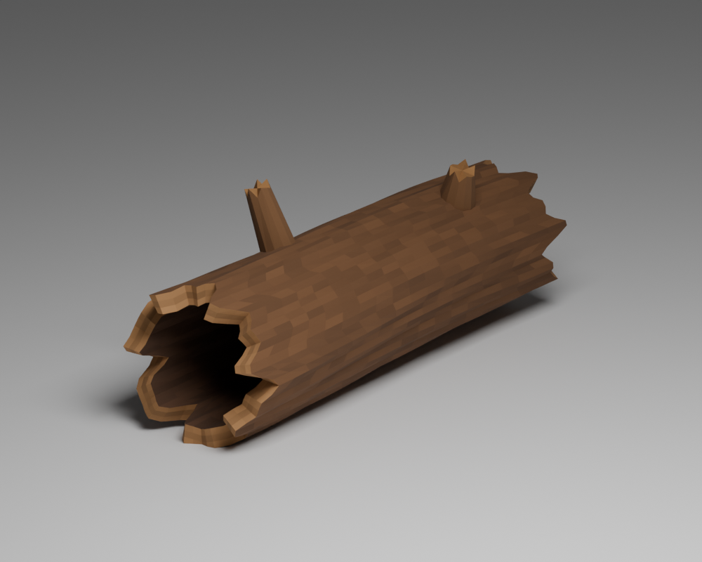
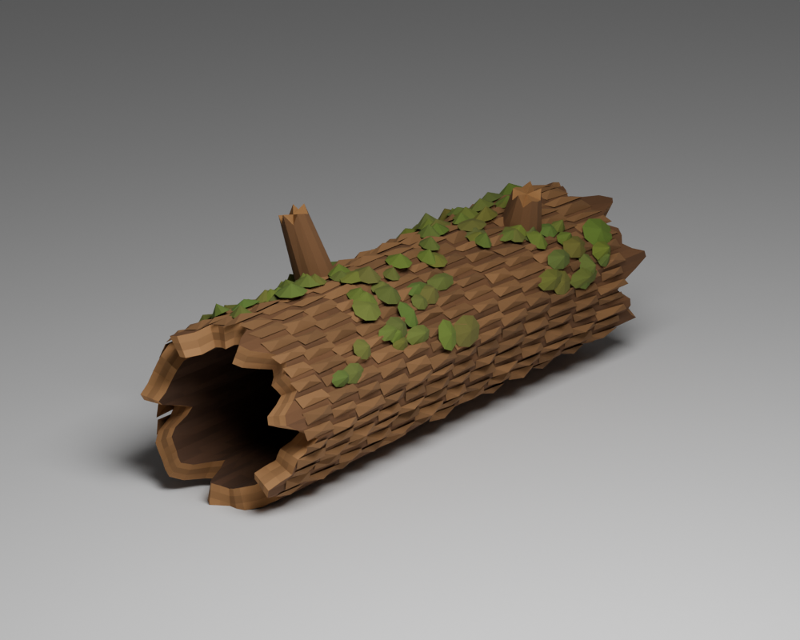
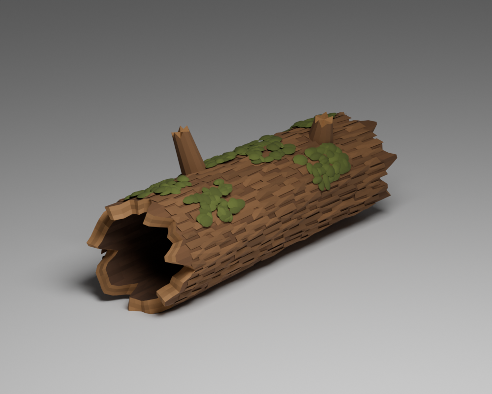
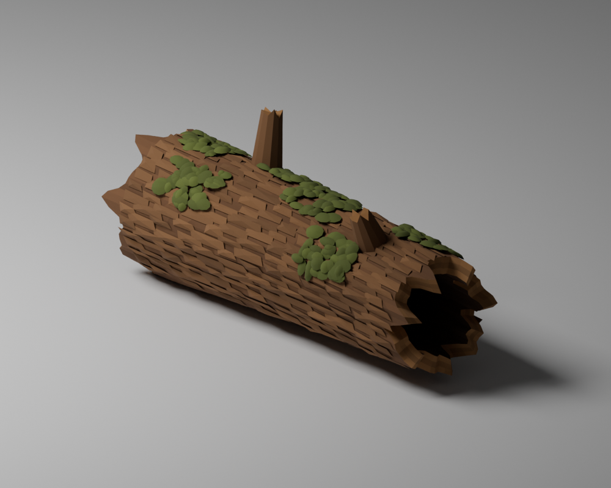
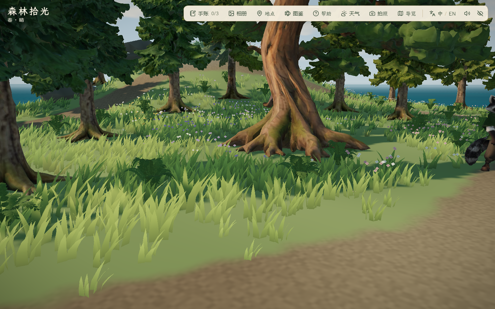
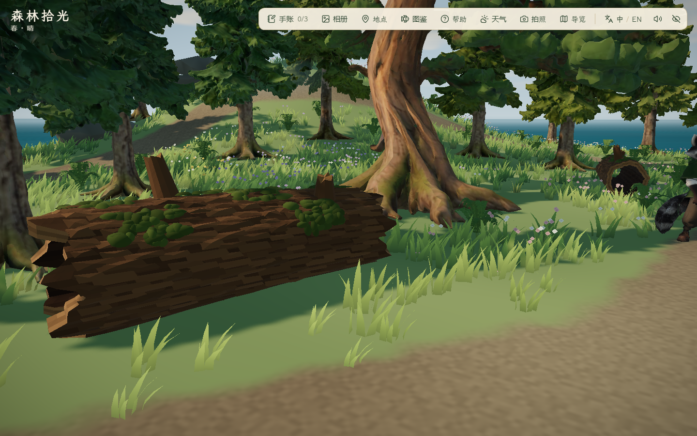
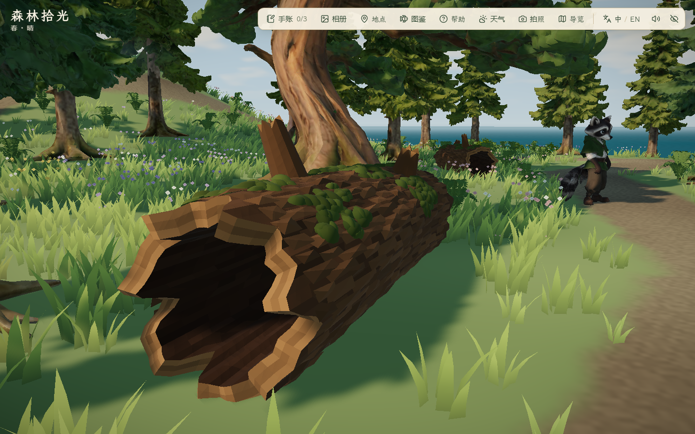

# 雾松岛倒木与林缘细化

2026-10-29，接续岸线与薄雾。新增 IE-02 倒木，复用既有灌木和 IE-03 蕨丛；树木仍使用既有完整 AHOLO 模型。本轮没有付费调用、减面或新树种生成。

## 来源、制作与模型核验

- 输入是既有 [IE-02 苔藓中空倒木参考](../../references/island-expansion/ie-02-hollow-log-v1.png)，为 AI 单体插画，非模型或精确投影。依据空洞、厚木壁、断枝和苔藓位置在 Blender 5.2.1 LTS 原创制作；没有复制参考纹理，也不新增第三方商业授权声明。主项目核心 Lux3D 资产继续沿用，不能把此辅助模型记作 AHOLO 生成物。
- 脚本 `scripts/build_hollow_log.py`；本地工作文件 `assets/blender/hollow-log/hollow-log.blend`；运行产物 `public/assets/expansion/hollow-log.glb`。长约 3.187 m、宽 1.008 m、含断枝高 1.361 m；木壁约 0.12 m，前后两端贯通，轴向射线检查未命中封盖。
- 最终 14,852 三角形、759,152 字节，1 mesh、1 材质、顶点色，无贴图、无动画、不依赖 UV。GLB2 长度、索引面数、法线/颜色属性、尺寸和哈希已核查。[Blender 检查](log-validation.json)、[资产来源与 GLB 清单](asset-manifest.json)。
- 结构稿 5,448 三角形；第一版树皮与块状苔藓为 7,788 三角形，苔藓像碎石、树皮过于整齐。采用版改为错落较薄树皮与贴附木面的连续小苔片；面数增加来自造型补充，没有减面。三版截图保留，最终前后端分别查看。









## 场景与碰撞

- 两段倒木分布在古松林窗外侧，按局部平缓地面落位并轻微埋入草地；分别保留完整模型和 0.78 倍场景缩放，不是两种独立资产。采用有方向的实体碰撞，窄空洞供观察，不提供玩家钻洞或穿越功能。
- 首选位置靠近古松外伸根部/云杉碰撞范围，绕行测试未通过；按真实碰撞范围重新选位后，两段四周净空通过。北侧灌木候选会令岩脊避让筛选掉已有岩石，已撤回；保留 6 组既有岩石。
- 最终 7 簇低灌木聚在西侧、南侧和东侧林缘，复用 `bush-a`；蕨叶从 67 丛调整为 78 丛，避开倒木实体、树根和主路。不把缩放灌木或蕨丛计作新树种/树龄变体。
- 可站立面积由 873.5 m² 调整为 **853.5 m²**，相对扩建前主岛 3695 m² 为 **23.10%**，仍在 20%–25% 目标内；不是地形面积缩小，差异来自新增实体与植被碰撞。







## 复核范围与未完成项

- `before/` 是原四机位基线；`before-close/` 是新近景基线。`after/` 功能检查通过，但林缘机位被旧树冠遮挡，不能作为林缘布景对比；`final/` 调整检查机位，并将倒木再下沉 4 cm 改善贴地。`mistLog` 前后仍为同机位；新的 `mistLogMouth` 与调整后的 `mistEdge` 只用于采用版检查。
- `pnpm lint`、50 文件 227/227 单测、`pnpm build` 通过；主 JS 1,889.62 kB / gzip 582.33 kB，保留既有大分块提示。新增倒木实体/空洞入口阻挡、四周绕行与林路净宽检查；旧路径双向、面积、泊位和存档检查保留。
- 采用版无头 Edge 156.0.4314.42、1440×900，[6 组浏览器检查](final/report.json) 全部通过，控制台错误 0，17 张截图。覆盖实际键鼠走完整林路/古松发现、绕第一段倒木一周与侧面实体阻挡；两段倒木的全周净空由单测覆盖。三时段三个近景机位、薄雾雨天预览/减少动态效果通过；已查看白天倒木空洞与林缘、夜间倒木及 Blender 前后端。原主岛 1517 个地形采样、140 个植被实例、路灯和泊位对照保持，容差 1e-10。夜间林缘 RAF 中位/P95 为 2.4/6.8 ms，低画质、取消帧率限制、180 帧；因检查机位调整，不与初始林缘帧时间作前后比较，不推导跨 PC 性能结论。测试使用项目隔离浏览器，缓存/TEMP 在 `.tmp/`，finally 清理本次会话。
- 倒木是当前风格化首版，树皮仍有程序排列感，与参考的细碎写实纹理存在差异；未宣称最终美术验收。尚无倒木交互、穿洞功能、独立树龄变体或完整自然岩岸；秋岚/潮汐两岛仍待制作。没有公网加载、其他 PC、全部旧玩法或本轮跨岛实机往返结论。

## 复现

```powershell
$env:PYTHONUTF8='1'
python scripts/aholo/blender_run.py scripts/build_hollow_log.py --blender 'D:/Program Files/Blender Foundation/Blender 5.2/blender.exe'
# 本地 Vite 服务位于 127.0.0.1:5176 时：
$env:FOREST_QA_OUT='docs/evidence/2026-10-29-mist-logs/final'
$env:FOREST_DETAIL_AFTER='1'
$env:FOREST_SHORE_AFTER='1'
$env:FOREST_LOG_VIEWS='1'
node scripts/check_mist_detail.mjs
```

辅助布局分析缓存 `.tmp/mist-layout-vite` 的删除被自动审批审查拦截（`blocked by policy`），已保留；未用其他路径绕过删除限制。浏览器会话由公共 helper 清理。

本轮继续保留此前未提交成果；未提交、推送、部署或导出。
