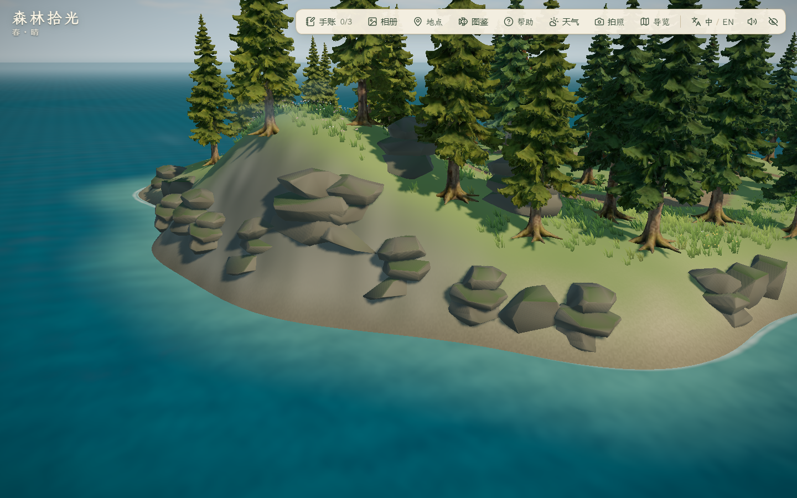

# 雾松岛外沿岩岸 · 2026-10-29

本轮在已有倒木与林缘基础上细化北岸、东岸及少量南岸岩块组。复用现有模型，保留西湾码头、沙湾间隙和林路；不以这次局部布景声称完整群岛或最终美术完成。

## 来源与制作

- 复用 `public/assets/expansion/coastal-kit.glb`，97,244 字节，SHA-256 `1267a96632235e8c593739912572a32ec26b3424f9decfa857791ce4a7c35225`。由项目 `scripts/build_coastal_kit.py` 原创制作，原始 Blender 5.2.1 LTS 模块、渲染和制作取舍见[既有台账](../2026-10-25-visual-v3/evidence.md)。本轮没有新增 GLB、Blender 产物、第三方资产或付费调用，不新增商用授权主张。
- 复用 Rock_Slab（550 三角形）与 Rock_Boulder（276 三角形），按现有模块实例化，不新增贴图或减面。古松、云杉完整模型保持。
- `src/world/coastalLayout.ts` 按岸坡高程布置错开的岩块组，逐步向内回收完整水平足迹，避让树根、林路与已有岩脊；实体碰撞仍沿用随地形高度变化的岩石轮廓。
- `src/world/MistIslandScene.tsx` 仅调整坡面色差，地形高度、海面岸线参数和存档格式未变。

## 过程与视觉取舍

- `before/`：本轮改动前实际浏览器基线，新增东岸/北岸固定复核机位，白天、黄昏、夜晚共 15 图。
- 首次布局仅通过 7 处候选，未达到岩岸覆盖试排要求，未作为采用版；改为按不同高程错开布置。
- `first/`：增加岩块后共 9 图，层叠岩块重复感偏强。随后降低层叠模块占比、加深嵌入，以独立块石为主。
- `final/`：布局、足迹、林路与倒木回归批次，7 组通过、26 张图、控制台错误 0。坡面矿物条带偏连续，此版纹理未采用；目录名称不等于最终美术验收状态。
- `reviewed/`：进一步把矿物纹理对比从 16% 降为 7%，用噪声打断连续条带，地形、布景与碰撞未再改变。三时段五机位 15 张图，另检查实际加载岩石几何，2 组通过、错误 0。已查看白天北岸、东岸及夜间东岸。岩块仍有规则切面与局部重复，最终自然感待用户查看，不声称完整岩岸已达成。
- 单测发现旧主码头断言缺少 X 上界，将远处邻岛误判为主码头入口；修正为有限的码头范围，并新增雾松岛上岸点与整圈岩石足迹检查。

## 验证方式

浏览器均通过 `scripts/browser-session.mjs` 创建隔离 Edge，临时配置、缓存和 TEMP/TMP 位于项目 `.tmp/`，最外层 `finally` 执行 cleanup。场景与交互复核使用 `scripts/check_mist_detail.mjs`，跨岛往返沿用 `scripts/check_island_travel.mjs`。截图是实际浏览器图，不是 AI 参考或 Blender 渲染。

实际浏览器版本为 Edge 156.0.4314.50，1440×900；本轮浏览器版本不同于前一阶段 .42，不能将跨版本帧时间视作严格性能对照。

采用布局保留 6 处旧岩脊，新增 16 处外沿岩块；完整加载的 5,108 个新岩块顶点没有落入可划船水域，单测另采样每块完整水平足迹 64 个方向。原主岛 1,517 个地形点、140 个植被实例、路灯和泊位保持（容差 1e-10）。可站立面积从 853.5 降至 840 m²，为原主岛 3695 m² 的 22.73%，仍在 20%–25% 范围内。

`final/` 已用真实键鼠走完整林路、记录古松发现、绕第一段倒木并验证侧面阻挡；两段倒木的全周净空、洞口入口阻挡仍由单测覆盖。减少动态效果冻结/恢复、雨天薄雾预览通过；预览不作为手动天气面板或照片保存验收。最新采用版仅降低坡面纹理对比，未改这些交互与布局。

最终代码检查：lint、50 文件 228/228 单测、build 通过；主 JS 1,890.81 kB / gzip 582.83 kB，保留既有大分块提示。采用版夜泊位 RAF 中位/P95 1.5/3.5 ms，基线 1.7/3.6 ms，均本机低画质、取消帧率限制、180 帧；样本很短，不据此声称性能提升或其他 PC 表现。

用户在验证途中要求不开音效，已将 `--mute-audio` 写入统一 helper，并在 AGENTS.md 保留约束；后续 `reviewed/`、往返及主岛截图会话均静音。已从启动进程确认采用稿浏览器主进程携带该参数；GPU 子进程不必重复此标记。请求到达前的 `final/` 会话在补静音前已自行结束并清理，不将其写成全程静音。未改正常游玩的音量存档，不计作听觉验收。

## 精选前后对照

相机与白天设置相同，风动草木和阴影存在逐帧差异；不作逐像素或单因素性能结论。跨岛往返与主岛截图结果见下节。本轮未提交、推送、部署、调用付费服务或导出。

## 采用版往返与主岛显示检查

- [roundtrip/report.json](roundtrip/report.json)：8 组通过、错误 0、19 图。真实键鼠出海 44.852 秒，到访、古松发现、林路回泊位、返航和两泊位刷新保持通过。地点面板覆盖 1920×1080、1280×720、1024×768；已查看最小 PC 窗口图。海上刷新安全回退仍仅由单测覆盖，本轮没有伪称海上实机中断。
- [main-views/report.json](main-views/report.json)：1 组截图检查通过、错误 0。昼/夕/夜六机位共 18 图：总览、角色、工坊、池塘、牧场、崖顶塔。已查看全部白天近景与夜间总览；主岛布局未改，固定工坊机位右侧仍有树冠遮挡。静态图不能验收动作连续性，不新增全部旧玩法回归结论。
- 主岛截图会话与返航后半段有重叠，不采用它们的帧时间作为本轮性能样本。采用版夜泊位 1.5/3.5 ms 来自此前独立运行的 `reviewed/` 会话。
- 两个后续会话均由带 `--mute-audio` 的统一 helper 启动并完成清理；没有听觉验收。无跨 PC、公网冷加载或长时稳定性结论。

复现：本地 `pnpm dev --host 127.0.0.1 --port 5176 --strictPort`。新 PowerShell 会话设置 `FOREST_QA_OUT` 为独立目录；局部完整回归运行 `scripts/check_mist_detail.mjs`，设置 `FOREST_DETAIL_AFTER=1`、`FOREST_SHORE_AFTER=1`、`FOREST_ROCK_COAST_AFTER=1`、`FOREST_LOG_VIEWS=1`；用 `FOREST_QA_VIEWS` 指定逗号分隔的固定机位。跨岛用 `scripts/check_island_travel.mjs`。原主岛截图另开新会话，只设置 `FOREST_QA_MAIN=1` 与六机位列表，避免继承局部回归开关。
