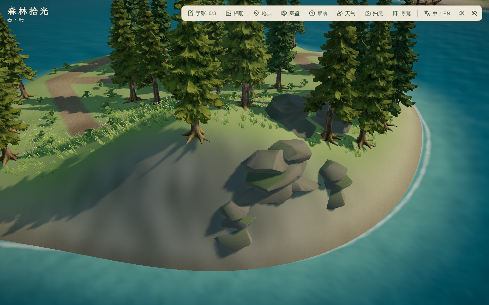
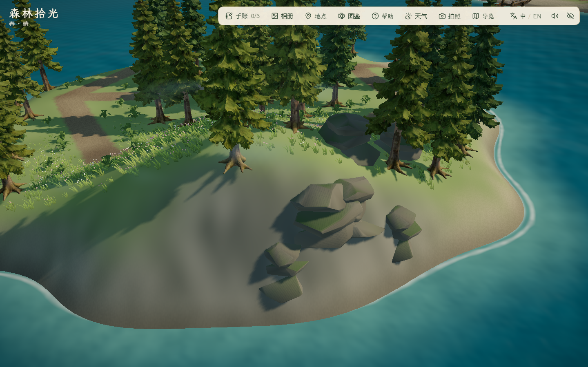
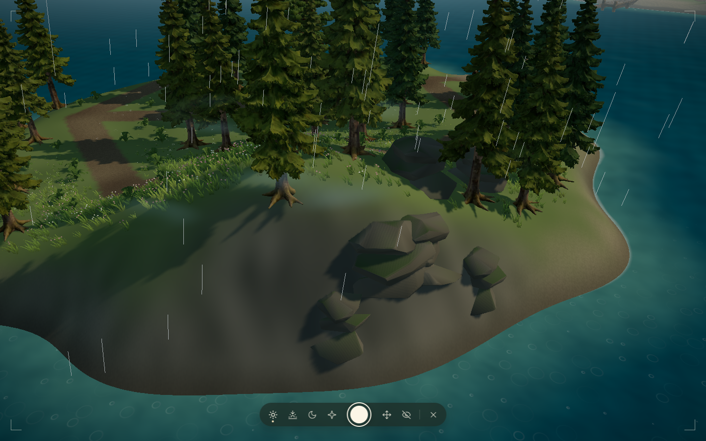

# 雾松岛岸线与局部薄雾

2026-10-29，接续蕨丛与岩脊细化。此轮为程序地形与着色器调整；未新增模型、付费调用或减面。保留之前的蕨丛、完整 AHOLO 树木与主岛西扩工作。

## 设计与实现

- 依据既有[雾松岛概念](../../references/island-expansion/mist-island-concept-v1.png)和[IT-01 地形参考](../../references/island-expansion/it-01-mist-terrain-v1.png)，在外围岸坡加入小湾与岬角，保留内陆林路和西侧码头衔接。参考为 AI 插画，不是实机或精确施工图。
- CPU 高度查询与海水泡沫 GLSL 使用同组岸线参数；沙土过渡加入少量不规则变化。坡面与岩石碰撞仍按实际地形计算，面积继续以 0.5 m 网格、可站立条件采样。
- 六片柔边薄雾集中在东北岩脊附近，实例化绘制、保留深度测试、关闭深度写入，避免覆盖西湾与航道。颜色随昼夜改变，雨天稍浓，复用气候时钟；系统减少动态效果时冻结，关闭该偏好后恢复。
- 雾片为面向相机的视觉近似，不是完整体积散射或逐像素场景深度融合。保持透明度低；仍需用户在实际操作中确认观感。没有增加雾天迷宫或新的玩法机制。

## 失败稿与采用版

- `before/`：本轮修改前的 12 张三时段四机位截图。
- `after/`：首轮箱体雾在坡面交界产生明显硬边，视觉不采用；减少动态效果关闭后的时钟恢复断言亦失败，见 [失败记录](after/report.json)。后续改为柔边雾片，并在每帧明确同步共享时钟值。
- `final/`：采用版，保留同机位三时段、雨天、减少动态效果和实际林路截图。雨天使用拍照天气预览，不能当作真实天气按钮操作测试；拍照/地点展示也不证明照片保存。








## 验证与边界

- `pnpm lint`、49 文件 225/225 单测、`pnpm build` 通过；主 JS 1,887.52 kB / gzip 581.73 kB，既有大分块提示保留。
- 采用版无头 Edge 156.0.4314.42、1440×900，[局部复测](final/report.json) 5 组通过、控制台错误 0；18 张截图可解码。真实键鼠走完整林间环路并触发古松发现；昼/夕/夜四机位、雨天预览、减少动态效果冻结/恢复通过。人工查看采用版白天岩脊、雨天岩脊、夜间泊位、全岛俯瞰及双岛远景；未见失败稿的箱体硬边。
- 可站立面积 **873.5 m² / 原主岛 3695 m² = 23.64%**，仍在 20%–25% 范围；此前蕨丛/岩脊阶段为 885.25 m² / 23.96%。1517 个原地形采样、140 个原植被实例、路灯和原泊位对照通过，跨引擎容差 1e-10。现有 6 组岩石、67 丛蕨叶；岸线重新筛选后为 1 棵古松和 32 株云杉，没有新增树模型。
- 夜泊位 RAF 中位/P95 为 2.9/8.3 ms，基线为 3.2/6.1 ms；同机、低画质、取消帧率限制、180 帧，有噪声，不能作为性能提升或跨设备流畅度结论。
- [独立往返复测](roundtrip/report.json) 8 组通过、控制台错误 0；真实键鼠出海约 44.9 秒，下船、古松发现、返航与 main/mist 两泊位刷新通过。PC 1920×1080、1280×720、1024×768 地点面板无横向溢出，19 张截图；已抽看 1024×768 面板。林路与功能自动检查、截图复核不等于用户最终美术验收；未重跑全部旧玩法、测公网加载或验证其他 PC。倒木、完整岩岸、独立树龄变体及秋岚/潮汐两岛仍待制作。

## 复现

在项目根目录启动 `pnpm dev --host 127.0.0.1 --port 5176` 后运行：

```powershell
$env:FOREST_QA_OUT='docs/evidence/2026-10-29-mist-shore/final'
$env:FOREST_DETAIL_AFTER='1'
$env:FOREST_SHORE_AFTER='1'
node scripts/check_mist_detail.mjs
$env:FOREST_QA_OUT='docs/evidence/2026-10-29-mist-shore/roundtrip'
node scripts/check_island_travel.mjs
```

浏览器测试临时配置、缓存和进程 TEMP/TMP 使用项目 `.tmp/`，通过公共 helper 和外层 finally 清理本次会话；未修改系统缓存设置或清理其他历史目录。截图来自本机浏览器，不是生成图；本轮未提交、推送、部署或导出报告。
