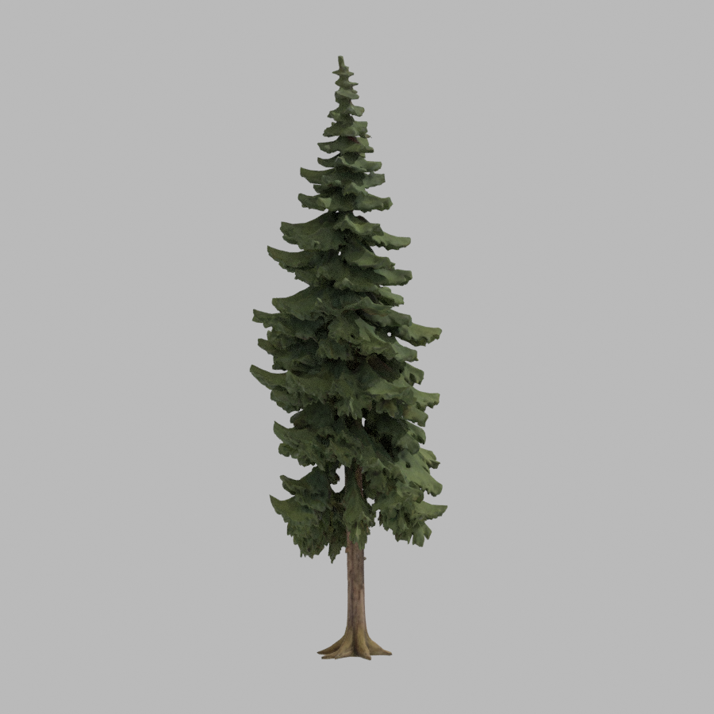
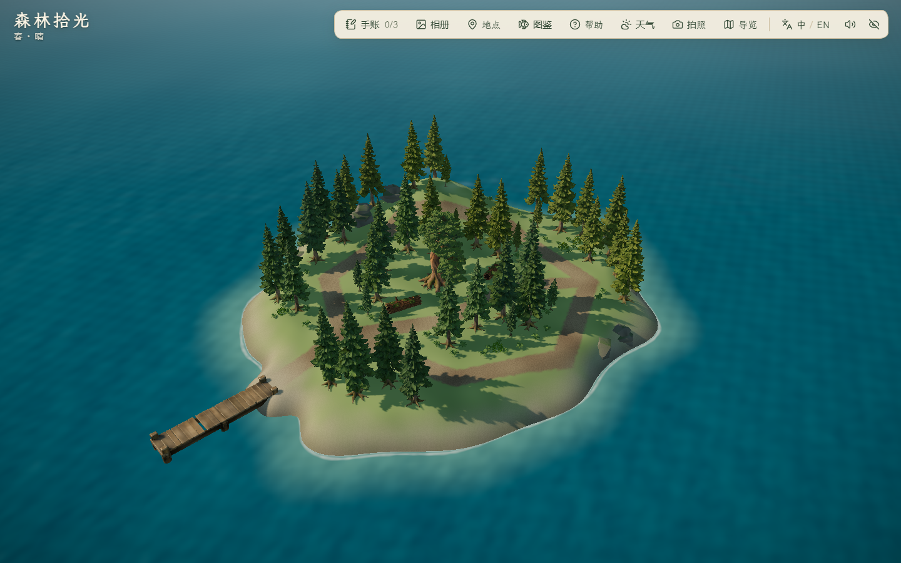
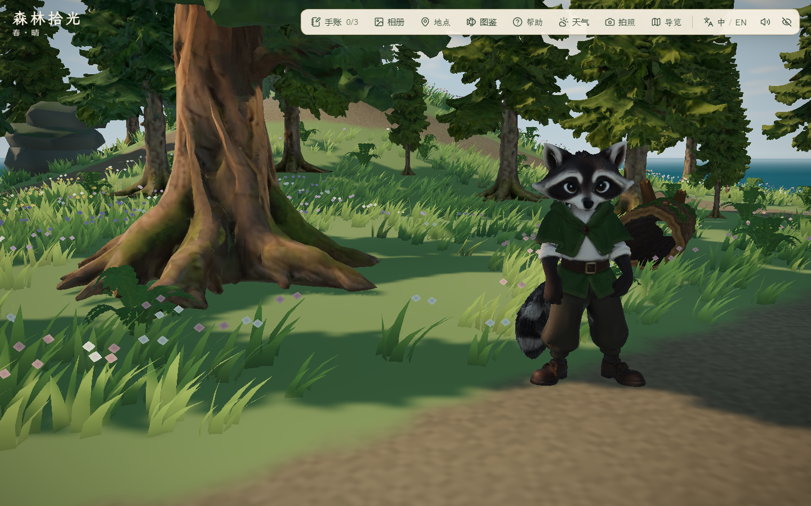

# 雾松岛幼态云杉枝冠派生 · 2026-10-29

本轮补一种环境树的幼态枝冠，与玩家种植的成长阶段和存档无关，不新增植物学树种。树冠覆盖率 75%–85% 仍是群岛设计目标，不因增加几株树就声称密林美术完成。

## 来源、方法与产物

- 源模型为现有 IE-05 云杉，AHOLO Lux3D G1 任务 4461973，来源与授权边界见[原台账](../assets/2026-10-29-island-trees/evidence.md)。本轮未调用生成服务或付费资源，未取得新的商业授权凭据。
- 使用项目隔离 Blender 5.2.1 LTS 后台流程运行 `scripts/derive_spruce_sapling.py`。MCP 插件未连接，未操作用户的活动 Blender 场景。
- 将 9 m 成树派生为 3.8 m 环境幼态树：细化根盘/树干、缩短下层枝冠、保留较宽的中上层枝冠，加入小幅非对称枝长、扭转与树干偏斜。是连续网格形变，不是重新生长枝条的模拟，也不是仅做均匀缩放。
- 保留 97,828 三角形与原 UV、贴图字节，未减面；变形后清除旧自定义法线并重算。导出 90,613 个法线均为有限单位向量；原成树 GLB 哈希保持。结构、哈希、纹理与法线检查见 [asset-validation.json](asset-validation.json)，源结构见 [source-inspection.json](source-inspection.json)。
- 工作文件 `assets/blender/spruce-sapling/spruce-sapling.blend` 与候选 GLB 保留本地；运行文件 `public/assets/island-trees/spruce-sapling.glb`，4,562,028 字节。沿用模型 LFS 规则；新增一个独立模型请求，尚无公网冷加载结论，不因包体数字自动减面。

## 同高度形状对照

已查看前、后、侧视图；这是一种幼态轮廓首版，不代表古松、云杉完整树龄系列已完成，原叶团的层叠感仍可见。上图是 Blender 渲染，不是浏览器截图。单体脚本先输出同高缩放对照，再输出派生正/背/侧面，不以不同高度制造轮廓变化。

## 布局与实机验证

保留原成树位置，仅在雾松岛内部空隙少量补入；避开古松林窗、林路、倒木和外沿岩石。首轮候选距林路 1.9 m，与既有植被的 2.1 m 规则不一致，单测拦截后改为直接复用 `clearForVegetation`，没有放宽原避让规则。

新树使用完整模型分块实例化，加入地面冠层图、树冠相机避让和实体碰撞。`first/` 是法线修正与地面冠层图补齐前的布景检查，不能作为采用版；`before/` 为本轮改动前，`final/` 为采用版回归。三时段固定机位和实际键鼠行走沿用 `scripts/check_mist_detail.mjs`，统一 helper 启动静音浏览器并清理项目 `.tmp/` 会话。

代码检查已通过 lint、50 文件 229/229 单测、build；主 JS 1,891.87 kB / gzip 583.15 kB，保留既有大分块提示。采用版静音无头 Edge 156.0.4314.50、1440×900，8 组通过、错误 0、20 张图；见 [final/report.json](final/report.json)。

未提交、推送、部署或导出；前一轮未提交的岩岸与静音修改保留。

- 采用布局为 8 株幼态云杉，实例高度约 3.27–3.66 m。1 棵古松、32 株成树云杉、7 丛灌木、78 丛蕨叶、两段倒木、6 处岩脊和 16 处岸岩保持。每株实际加载 97,828 面；基础资产仍为 5/9，派生不另计一件基础树种。
- 可站立面积 823.75 m²，占扩建前主岛 3695 m² 的 22.29%；原主岛 1517 个地形采样、140 个植被实例、路灯和泊位保持，容差 1e-10。
- 真实键鼠通过完整林路、古松发现、第一段倒木绕行与侧面阻挡；全部林路净宽、两段倒木全周净空由单测覆盖。雨天薄雾预览与减少动态效果通过；预览不算天气面板与照片保存测试。跨岛往返、双泊位刷新和三档 PC 窗口保留前一阶段结果，本轮未重测。
- 夜间林缘 RAF 中位/P95 为 1.8/6.7 ms，基线 1.5/8.0 ms；低画质、取消帧率限制、180 帧。中位数与 P95 方向不同，不声称性能提升。该采样在另一个主岛截图会话启动前完成；后续两个会话重叠期间的数据不用于性能结论。
- [main-views/report.json](main-views/report.json) 是同版主岛昼/夕/夜六机位 18 图，1 组截图检查通过、错误 0；已抽查总览、角色、工坊、池塘、牧场和塔，仅看显示，不代表完成全部旧玩法与动作回归。所有本轮测试会话均静音，无听觉验收；无跨 PC、公网或长时稳定性结论。

已抽查总览和林下近景，幼态树形成较低枝冠层次；不把这组截图当作树冠覆盖率达标证明。风动、阴影和待机动画存在运行时变化，不做逐像素对比。

复现：`python scripts/aholo/blender_run.py scripts/derive_spruce_sapling.py --blender 'D:/Program Files/Blender Foundation/Blender 5.2/blender.exe'` 先写本地候选；检查后复制 GLB 到运行目录，并将 `template.json` 写入 `island-tree-templates.json` 的派生项。浏览器沿用端口 5176 和 `scripts/check_mist_detail.mjs`，局部回归开启 `FOREST_SAPLING_AFTER=1`、`FOREST_DETAIL_AFTER=1`、`FOREST_SHORE_AFTER=1`、`FOREST_ROCK_COAST_AFTER=1`、`FOREST_LOG_VIEWS=1`，输出到独立证据目录。原主岛截图另起干净环境，只开 `FOREST_QA_MAIN=1` 与六机位列表。
