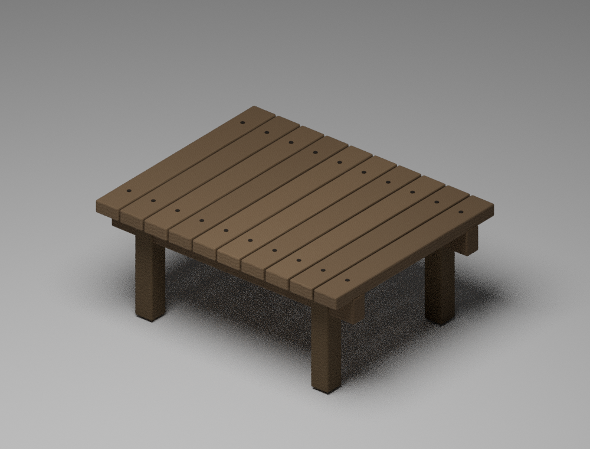
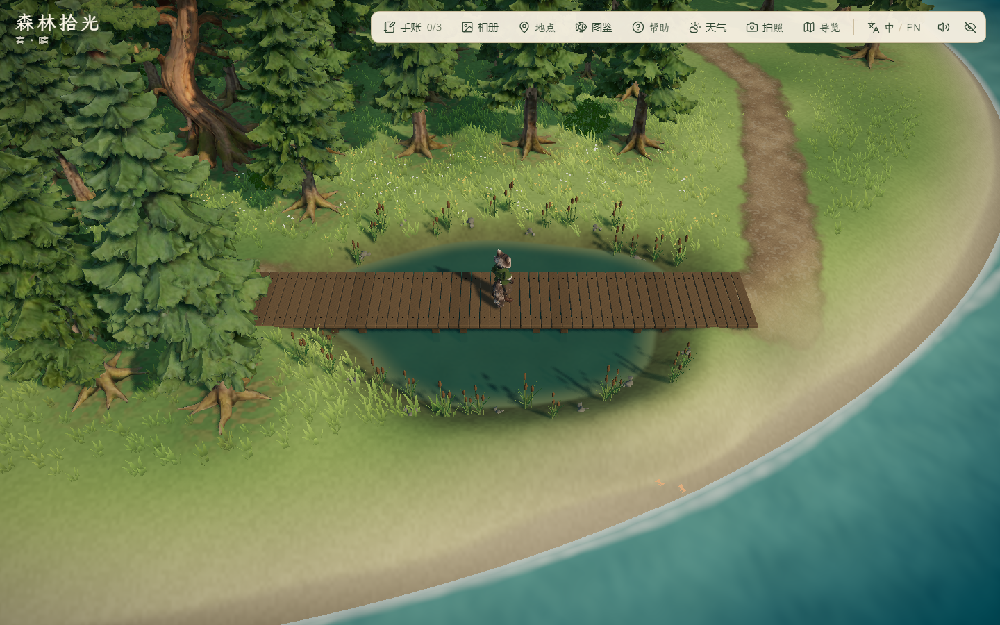
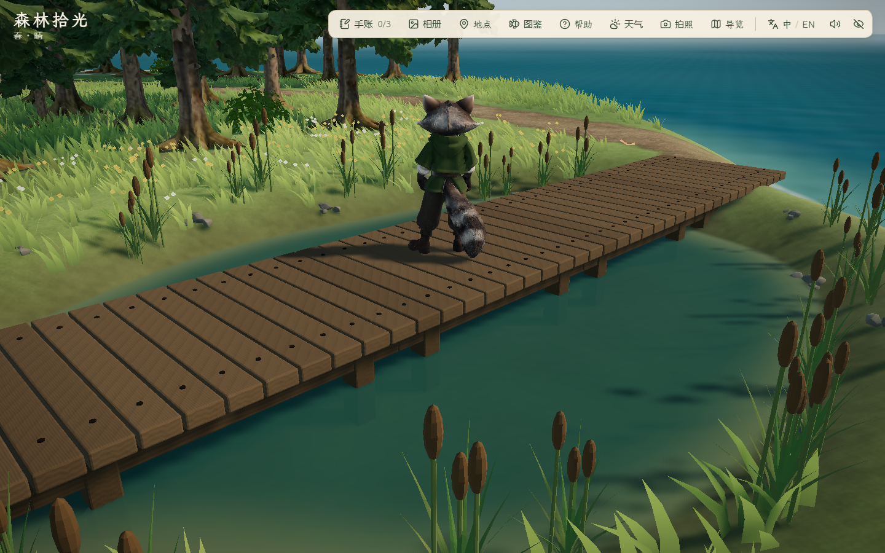

# 湿地与栈道细化 · 2026-10-29

状态：本机开发版实现与限定检查完成，待用户查看。无新增付费调用、无减面、未提交/推送/部署；未改角色动作、存档或三座邻岛。

## 来源与制作

- 设计输入：[IE-04 原参考](../../references/island-expansion/ie-04-boardwalk-module-v1.png)，此前已确认由 Blender 自制。保持无扶手、低矮、平直拼接的结构。
- 新作：`scripts/build_wetland_kit.py` 在 Blender 5.2.1 中创建独立木板、倒角、两根纵梁、四根支脚和钉头，并原创制作 512×1024 木纹。模块长 2.4 m、宽 1.9 m，沿用已验证灰盒尺寸而非缩窄为早期目标。五段拼成 12 m，板顶高程 0.9 m；连续行走面与可见板缝分离。
- 同脚本制作折面叶片与香蒲状穗头；28 丛水草和 12 组复用岸石避开入口及板面。水草为原创点缀，不宣称已完成 IE-03 蕨类。岸石来自既有 `coastal-kit.glb`，本轮未改该模型。
- `public/assets/expansion/wetland-kit.glb`：955,624 字节；栈道 2,288 三角形、水草 684 三角形，完整导出且实例化。几何、法线、顶点色、内嵌 PNG 与 GLB 头检查见 [资产验证](asset-validation.json)，尺寸/版本/哈希见 [Blender 摘要](blender.json)。
- 本地工作文件：`assets/blender/wetland/wetland-kit.blend` 与 `wood-grain.png`；未纳入静态发布或 Git。模型与材质由项目脚本制作，无第三方下载或新增生成积分；不据此扩大既有 AI 参考的许可声明。

## 湿地地形与水面

- 共用不规则湿地轮廓描述地形凹槽、泥岸着色和水域判定。靠海侧补齐渐变土坡，让浅池保持闭合；原生活区 1517 个地形样本、140 个原植被、路灯与泊位不变。
- 水面以地形深度做浅水色与透明过渡，细微法线波纹和雨点使用现有天气时钟。减少动态效果时冻结时钟，没有另开独立动画计时器。
- 陆地采样 6,173.25 m²（相对扩建前 +38.57%），可站立采样 5,061 m²（约 +36.97%）。面积包含坡度/碰撞筛选，不是包围框面积。

## 试稿与取舍

1. [细化前灰盒](../2026-10-29-west-expansion/final-full-detail/day-westWetlandClear.png)：硬边椭圆和整块平板。
2. [首稿](after/day-westWetlandClear.png)：已接入模型，但只按地形高度截取水面，误把邻近较低海岸算成淡水区域。该轮脚本功能通过不代表画面通过，视觉弃用。
3. `final/`：先限制水域范围，矩形消失，但海侧低岸仍让截断边缘出现锯齿。保留本地截图，未采用。
4. `reviewed-final/`：补齐池岸后重新运行完整专项脚本，浅水收在自然岸内，未再出现矩形漏水或截断边缘。新增单测检查 72 个方向的干岸，以及双侧板面可站立、水域不可站立。

## 实际检查

- `pnpm lint` 无警告；`pnpm test` 48 文件 219/219；`pnpm build` 通过，714 模块、主 JS 1,875.52 kB / gzip 578.15 kB，保留既有大分块提示。
- 复现：设置 `FOREST_PHASE=final-wetland`、`FOREST_OUT=docs/evidence/2026-10-29-wetland/reviewed-final`、开发地址 `FOREST_URL`，执行 `node scripts/check_west_expansion.mjs`。浏览器使用项目隔离目录及 finally 清理。
- [浏览器记录](reviewed-final/report.json)：Edge 156.0.4314.42，6 组通过、控制台错误 0。包括原区域保留、模块加载、减少动态效果冻结、右键转向后 W 实走穿越、拍照/刷新和三档 PC 窗口。
- 1440×900 下白天/黄昏/夜晚六机位；另有雨天、减少动态效果及 1920×1080、1280×720、1024×768。共 24 张截图，已实际抽查湿地全景、近景、夜景、雨天与 1024×768。
- 低画质、取消帧率限制的 180 帧 RAF：湿地 7.4/17.3 ms、栈道近景 6.9/13.8 ms（中位/P95）。不是屏幕 FPS，未做受控性能改善对比。报告中的 load.elapsed 包含初始化与地形扫描，不能当成冷加载耗时。
- 代码测试覆盖原区域、整条西扩环线双向、海域与船体规则；本轮未重跑完整沿海 73 段键鼠航行，细化前同日 7 组结果保留原日期，不冒充本轮实走。

## 边界

水面是风格化浅水材质，并无流体、潮汐或独立实时平面倒影；草叶与水草仍可继续丰富，夜间保持自然暗光。整体林下层次、树龄变体、IE-03 蕨类与三座邻岛不属于本轮完成项。以上是本机证据，不替代用户美术验收、跨 PC 或公网冷加载测量。
