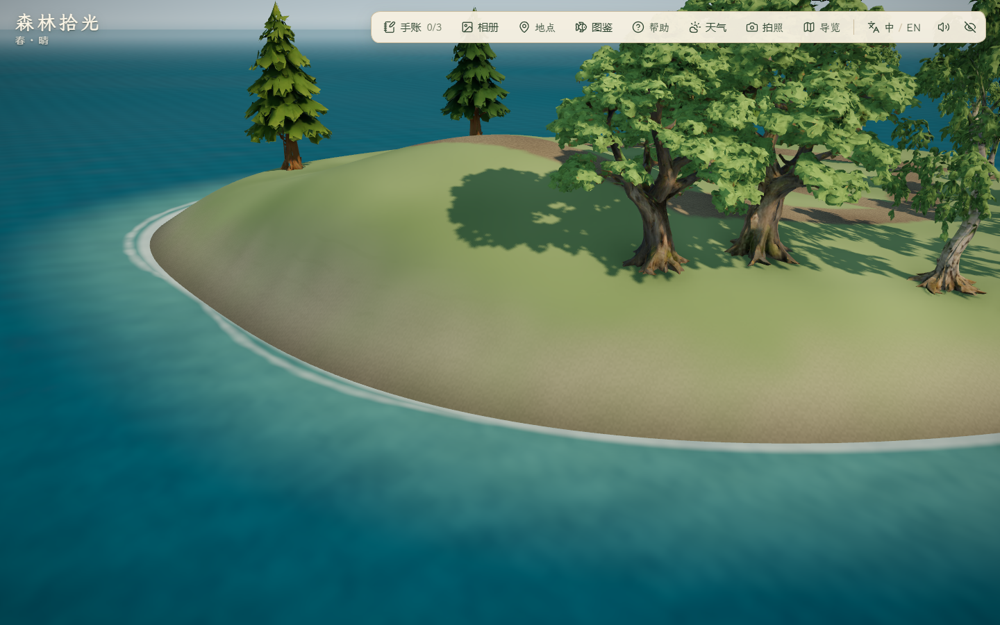
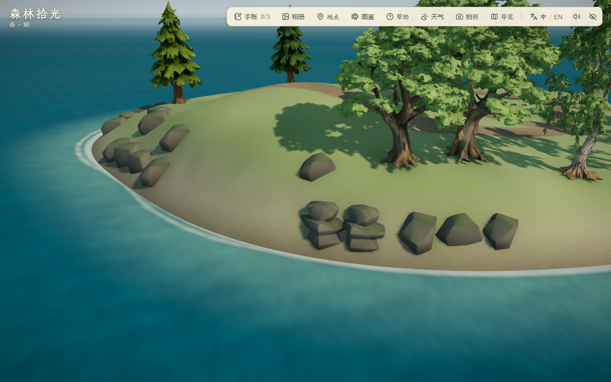
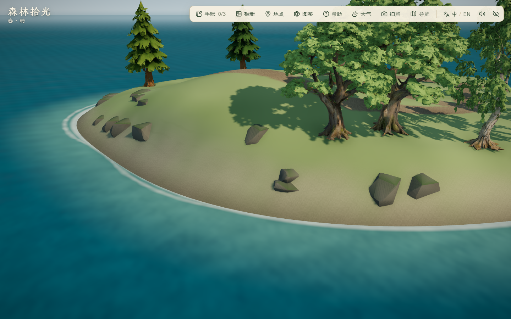

# 秋岚岛岸岩细化 · 2026-10-30

状态：岸岩首版已实现，代码、局部静音浏览器与真实键鼠往返回归通过。完整岸线、林下层次与最终美术仍待完善。

## 来源与范围

- 复用项目 Blender 原创 `public/assets/expansion/coastal-kit.glb`，97,244 字节，SHA-256 `1267a96632235e8c593739912572a32ec26b3424f9decfa857791ce4a7c35225`。来源、制作脚本、失败稿及原模块检查见[既有制作记录](../2026-10-25-visual-v3/evidence.md)。本轮没有生成新模型、修改模型几何/贴图、付费调用或新增第三方许可主张。
- 采用 16 处 Rock_Boulder（每实例 276 三角形）、2 处 Rock_Slab（每实例 550 三角形），新增实例合计 5,516 三角形；共用已有几何、材质和实例组。基础单体资产仍为 7/9，不把复用布景算新模型。
- 改动位于 `src/world/coastalLayout.ts`：北/东岸为主、南岸少量散石，按海岸高程定位后向内回收完整足迹；避让林路、观景丘、树根与西湾泊位。自动进入已有岩石实例渲染和按地形高程计算的实体碰撞。
- 原主岛/雾松地形、旧岩块、所有树木、道路、三个泊位、海峡和存档格式保持。秋岚 8 白桦、3 枫树、4 普通松不变。没有改变地形着色器或岸线形状。

## 过程与取舍

1. `before/`：新增北/东/南岸固定机位，加总览与泊位；昼/夕/夜共 15 张实际浏览器基线图。
2. `first/`：24 处岩块，2 组检查、15 图、错误 0；加载几何 6,987 个顶点没有进入可航行水域。实机查看发现岩块过于凸出、等距感和层叠重复明显，未采用。
3. `reviewed/`：扩大角度和内收距离差异、加深并错开埋入深度、降低层叠模块占比，最终 18 处。3 组检查通过、15 图、控制台错误 0；已查看北/东/南岸白天、黄昏北岸、夜间东岸、总览与泊位。局部切面与重复轮廓仍在，不声称完成自然海岸最终美术。
4. 首次局部单测 12/13 通过：旧全场上限 420 未区分新增岛屿，首稿全场 433 超限。保留原主岛＋雾松的 420 上限，秋岚单独检查少于 30 处；采用版全场 427（旧区域 409＋秋岚 18）。足迹/通行检查没有放宽。







三图相机与昼夜设置相同；海浪、风动和阴影没有逐帧同步。固定岸面检查将角色设置在雾松，不代表完整秋岚步行视野或林下层次验收。

## 验证与限制

- `pnpm lint`、51 个测试文件 240/240 单测、`pnpm build` 通过。主 JS 1,902.40 kB / gzip 585.77 kB，保留既有大分块提示。
- 新单测按每块完整水平足迹 64 个方向检查水域净空、埋入、林路、泊位、观景丘与树根距离。既有秋岚全环路/支路双向与路肩、主岛/雾松历史样本与植被保持、三泊位、旧档/保存失败、最小岸距等检查通过。
- [采用版局部摘要](reviewed/report.json)：18 处岸岩、5,184 个加载几何顶点，无可航行水域侵入。按 0.5 m 网格采样，可站立面积 877.75 m²，为原主岛 3695 m² 的 23.76%；此前 901 m²（24.38%），减少来自新增岩石实体阻挡，地形未变。最小岸距仍约 24.37 m。
- 静音无头 Edge 156.0.4314.56，1440×900。夜泊位 RAF 中位/P95：基线 2.2/4.6 ms，采用版 2.4/5.3 ms；高画质、取消帧率限制、180 帧。只作本机短样本，无跨 PC、显示器 FPS、公网冷加载、长期稳定或听觉验收结论。
- [真实键鼠往返摘要](roundtrip/report.json)：8 组通过、25 图、错误 0，雾松→秋岚出海 67.314 秒；实际停靠、到访、登丘发现、全环路/支路、拍照入口/三季预览、返航、两泊位刷新均通过，地点面板覆盖 1920×1080、1280×720、1024×768。已查看登丘、返航与最小 PC 窗口；不把预览当作照片保存验收。
- [主岛显示摘要](main-views/report.json)：1 组通过、昼/夕/夜六机位共 18 图、错误 0；已抽查白天角色、工坊、池塘、牧场、塔和夜间总览。原工坊机位仍有右侧树冠遮挡，没有因此修改主岛布局。
- 主岛截图与往返后半程并行，不采用这两轮的帧时间做性能结论；前述局部岸岩性能样本来自更早独立会话。没有完整旧玩法/角色动作回归、照片保存或主岛起步的连续三岛旅行结论。

## 复现

本地启动 `pnpm dev --host 127.0.0.1 --port 5176 --strictPort`。每次用独立 PowerShell 会话运行，避免继承其他验证开关。

```powershell
$env:FOREST_QA_OUT='docs/evidence/2026-10-30-autumn-coast/recheck'
$env:FOREST_QA_VIEWS='autumnNorthShore,autumnEastShore,autumnSouthShore,autumnOverview,autumnBerth'
$env:FOREST_AUTUMN_COAST_AFTER='1'
node scripts/check_mist_detail.mjs
```

往返使用 `scripts/check_autumn_travel.mjs`，只设置独立 `FOREST_QA_OUT`。主岛显示使用 `scripts/check_mist_detail.mjs`，设置 `FOREST_QA_MAIN=1` 和 `FOREST_QA_VIEWS=overview,player,workshop,pond,farm,tower`。

全部浏览器由 `scripts/browser-session.mjs` 启动，默认 `--mute-audio`，临时配置/缓存/TEMP/TMP 放在项目 `.tmp/`；最外层 `finally` 清理自己的会话。未改变正常游玩音量。本轮未提交、推送、部署或导出。
