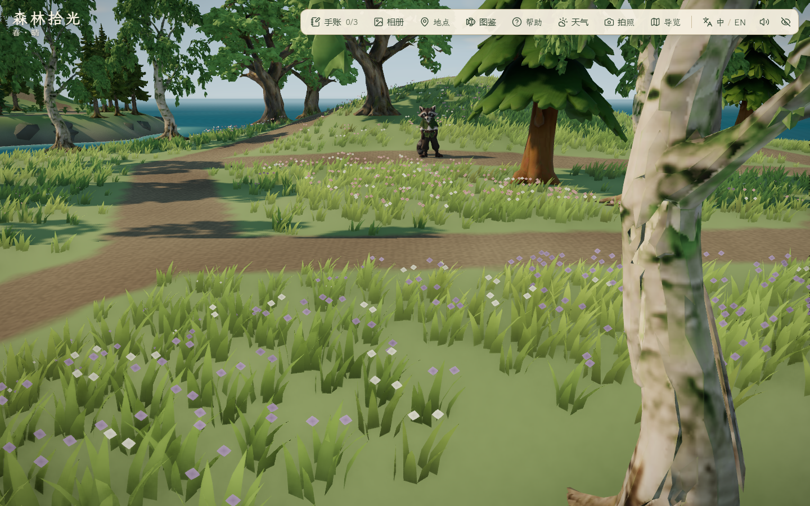
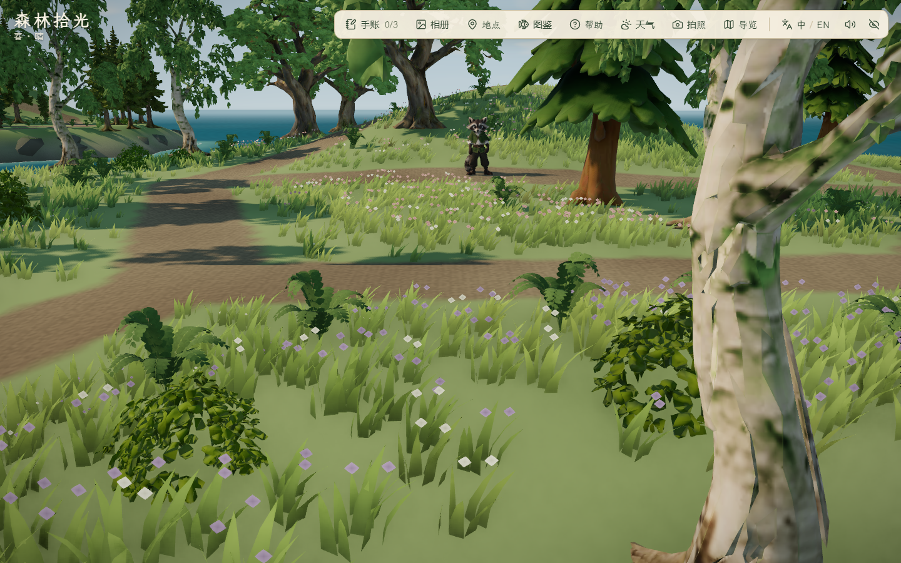
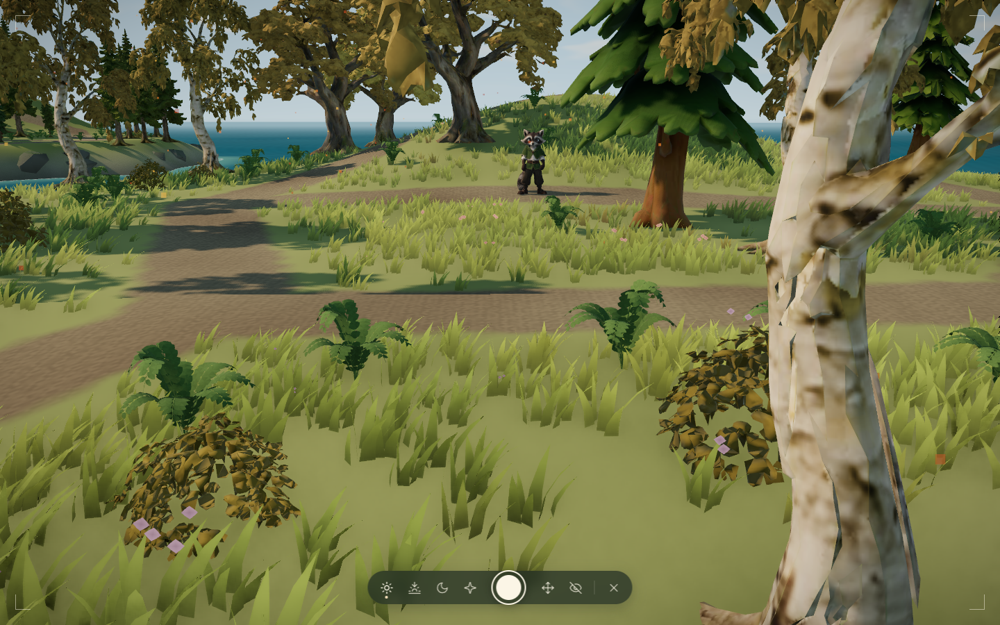

# 秋岚林下层次 · 2026-10-30

状态：8 簇低灌木、24 丛蕨叶已接入；代码、局部静音实机、三季近景、完整往返与主岛显示检查通过。最终美术仍待完善，本轮为限定范围的本机验证。

## 来源与实现

- 延续[秋岚场景参考](../../references/island-expansion/autumn-island-concept-v1.png)的疏朗阔叶林方向，在入口白桦和枫树林窗边补充低层，东北观景丘及中央林窗留空。参考是 AI 插画，不是实机结果。
- 8 簇灌木复用 `public/assets/vegetation/forest-kit.glb` 中的 `bush-a`，原高模模板 2,470 三角形，沿用已有低模、分块实例化、季节叶色、实体碰撞与相机冠层。原任务、源模型和复用记录见[植被资产清单](../vegetation-expansion/2026-10-24/asset-manifest.json)与[原复用证据](../vegetation-expansion/2026-10-24/evidence.md)。不登记为本轮生成，不新增第三方商用许可主张。
- 24 丛蕨叶复用项目 Blender 原创 IE-03：`public/assets/expansion/fern-clump.glb`，317,856 字节、3,240 三角形、9 枝羽状叶、双面实叶、顶点色，无透明卡片；[原制作与优化过程](../2026-10-29-mist-detail/evidence.md)。新实例共用缓存几何/材质，只拥有独立实例缓冲，卸载时不释放共享资源。每株规模约 0.8–1.1 倍，作为静态绿色地被，不新增动画或季节变叶；灌木继续随现有季节变色。
- 原模型哈希及字节数收于 [assets.json](assets.json)。本轮没有新增 GLB、Blender 产物、贴图、减面、付费调用或模型任务；基础单体仍为 7/9。
- 原 15 株树、18 处秋岚岸岩、主岛与雾松植被、地形/路径/泊位/海峡及存档格式保持。新灌木有实体，蕨叶无额外碰撞；完整叶片避开主路和树根，中心不落入已有实体范围。

## 迭代与失败

1. `before/`：角色设置在秋岚，让现有草地加载后采图；昼/夕/夜五机位共 15 图。这批可与本轮采用版比较，不能同上轮角色留在雾松的岸面截图做受控地被对比。
2. `first/`：增加灌木/蕨叶，1 组截图采集检查通过、15 图、控制台错误 0；这不代表布局回归已通过。新单测发现低灌木影响原岩块筛选，岩块数量虽仍为 18，位置却发生变化；另有蕨叶中心落进普通松枝叶实体。此版不采用，保留图片。
3. 修订后岸岩只读取原有植被布局，晚加入的低灌木不再让它重新选点；新增岩块逐坐标回归检查，1e-10 容差保持。灌木与岸岩按模型范围进行的布景净空检查通过；蕨丛布局额外调用现有实体可站立检查，筛去松树枝叶内部候选。
4. `reviewed/`：3 组通过、18 图、错误 0；已查看白天白桦入口、枫树坡路、总览、黄昏林窗、夜间坡路及夏/秋近景。白桦入口仍有右侧树干构图遮挡，固定林窗机位仍被旧松冠遮挡，相关图保留；本轮没有移动成树或修改镜头避让行为。完整树龄变化、林冠与自然感仍待完善。







前后相机、角色设置与昼夜相同；风动、阴影、花朵与昆虫未逐帧同步，不用于逐像素比较。季节图是预览，没有据此声称完成照片保存验收。

## 验证

- `pnpm lint`、52 文件 242/242 单测、`pnpm build` 通过。主 JS 1,904.31 kB / gzip 586.24 kB，保留既有大分块提示。
- 新增 2 项布局回归：原岸岩逐坐标保持；灌木实体/相机冠层、蕨丛与林路/树根/灌木的完整外沿净空、观景丘留空和主要环路横向 ±0.6 m 通行。既有双向路线、三泊位、面积、旧档与旧区域保持检查继续通过。
- [采用版局部摘要](reviewed/report.json)：实际实例矩阵变换后的 222,912 个蕨叶顶点，离林路中心最近约 1.40 m；法线单位长度检查通过。8 个灌木中心均有实体；仍为 15 株树、18 处原位置岸岩。
- 可站立面积 866 m²，占原主岛 3695 m² 的 23.44%；前轮岸岩版 877.75 m²，差异来自灌木实体。地形、海峡未变，最终面积仍在 20%–25% 范围。
- 静音无头 Edge 156.0.4314.56，1440×900；夜泊位 RAF 中位/P95：基线 3.2/16.7 ms、采用版 3.2/12.3 ms，高画质、取消帧率限制、180 帧；只作本机短样本，不声称性能提升或跨 PC 表现。两轮均先把角色置于秋岚，不能与上轮未加载秋岚近景草地的岸岩数据直接排名。
- [完整往返](roundtrip/report.json)：8 组/25 图通过，控制台错误 0。真实键鼠雾松至秋岚航行 67.653 秒；到访与刷新、登丘发现、三季拍照预览退出恢复、完整环路及林窗支路、返航停靠与刷新、1920×1080 / 1280×720 / 1024×768 三个 PC 窗口面板均通过。已查看登丘与 1024×768 面板截图。
- [主岛显示](main-views/report.json)：昼夕夜六机位共 1 组/18 图通过，控制台错误 0；已查看白天角色、工坊、池塘、养殖场、瞭望塔及夜间总览。工坊近景既有树木遮挡仍保留。主岛截图与往返后半段并行，不采用这两组帧时间作性能结论；无听觉、完整旧玩法/角色动作、照片保存、公网冷加载或长期稳定性结论。

## 复现

本地 `pnpm dev --host 127.0.0.1 --port 5176 --strictPort`。独立 PowerShell 会话：

```powershell
$env:FOREST_QA_OUT='docs/evidence/2026-10-30-autumn-understory/recheck'
$env:FOREST_QA_AUTUMN='1'
$env:FOREST_AUTUMN_UNDERSTORY='1'
$env:FOREST_QA_VIEWS='autumnEdge,autumnUnderstory,autumnClearing,autumnOverview,autumnBerth'
node scripts/check_mist_detail.mjs
```

往返另开会话，仅设置独立 `FOREST_QA_OUT` 后运行 `node scripts/check_autumn_travel.mjs`。主岛截图使用 `scripts/check_mist_detail.mjs`，只设置 `FOREST_QA_MAIN=1`、`FOREST_QA_VIEWS=overview,player,workshop,pond,farm,tower` 与输出目录。

所有会话由项目 `createHeadlessBrowser` 创建，静音参数 `--mute-audio`，临时配置、缓存及 TEMP/TMP 放在 `.tmp/`，最外层 `finally` 清理；不改正常游玩音量。沿用上一轮未提交改动，本轮未提交、推送、部署或导出。
