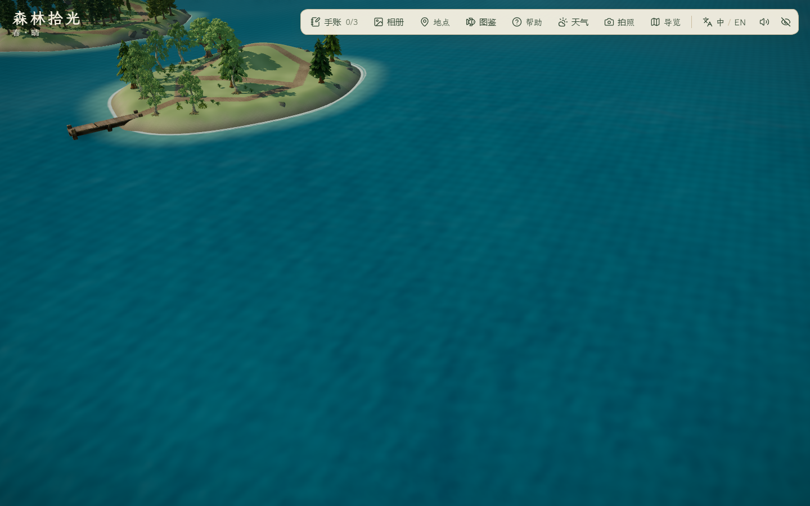
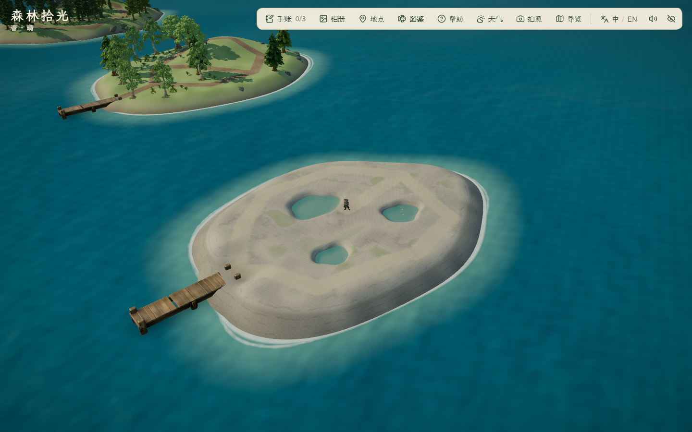
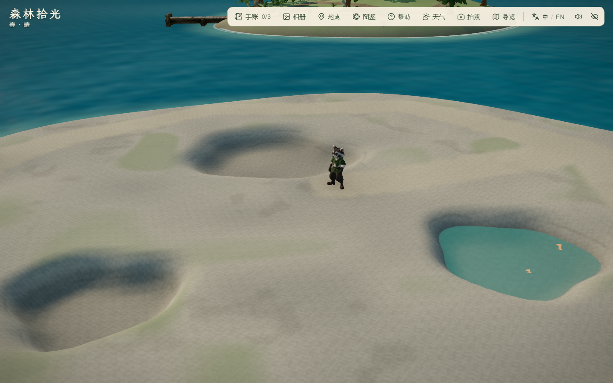
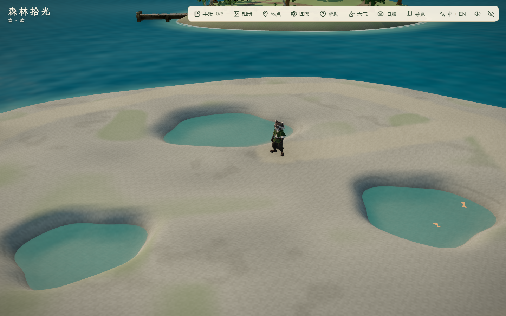
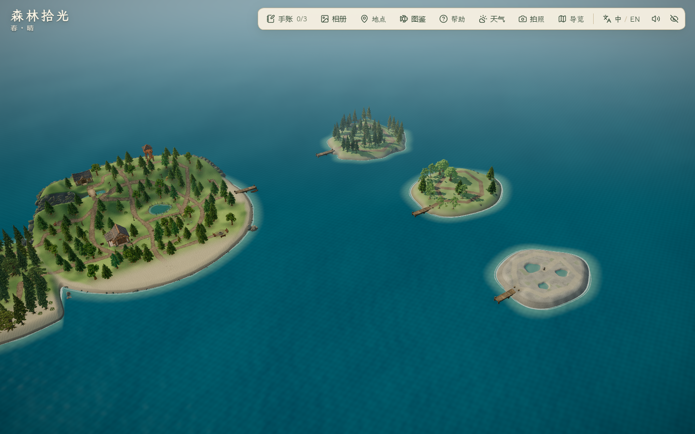

# 潮汐岛地形与浅池首版 · 2026-10-30

状态：低岩台、三处有底固定浅池、干燥环路、第四泊位与到访/观察记录已实现；本机代码、局部静音视觉、完整往返与主岛显示检查通过。当前为可玩的地形首版，海风松、层叠礁石、贝壳、漂木与最终美术未完成。

## 来源、实现与预算

- 依据既有 [IT-03 地形参考](../../references/island-expansion/it-03-tide-terrain-v1.png) 与[潮汐岛概念](../../references/island-expansion/tide-island-concept-v1.png)：低岩台、背风湾、三处有底浅池和连续干燥岸径。两图均为 AI 插画，不是本轮实机或 Blender 产物；本轮没有重新调用生成服务。
- 地形由项目 TypeScript 高程函数生成独立网格：40,001 顶点、79,200 三角形；池底与坡岸是同一实体网格，3 张独立透明水面共 6 三角形。固定水位 0.18 m、池底 -0.18 m，最大水深 0.36 m；不是潮汐、流体或涉水玩法。地表材质含暖灰石、低对比纹理、局部苔色和土径，尚缺礁石剪影与海风松，不能称最终概念图美术。
- 中心 (100,101)，形状包络半径约 17×13 m，位于秋岚南侧偏西。含新泊位及池岸碰撞的可站立面积 578 m²，为扩建前主岛 3695 m² 的 15.64%，在 12%–18% 目标内。海峡保留水域；海上外限延长连续椭圆南北轴，包含原有可航行范围，仍按真实地形深度与完整船体阻挡。
- 第四泊位复用 `public/assets/models/coastal-jetty.glb`，2,447,124 字节、299,741 三角形，SHA-256 与原[运行清单](../assets/2026-10-24-coastal-layout/runtime-asset.json)一致；[原参考→AHOLO 4321451→Blender 流程](../assets/2026-10-24-coastal-layout/plan.md)。本轮仅新增实例、共用原缓存几何/材质，不减面，不新登记使用权或费用。摘要见 [assets.json](assets.json)。
- 旅程存档仍为 v1，只增加潮汐到访/浅池发现布尔字段和安全泊位 ID；旧存档缺失字段默认 false，仍只从安全泊位恢复。支持中英文地点与停靠提示，拉远镜头取最近邻岛中心。基础单体资产仍 7/9，无新 GLB、贴图、Blender 工作文件或付费调用。

## 迭代与实际截图

1. `before/`：相同五机位、昼/夕/夜 15 张，新增岛之前的海面基线。
2. `first/`：地形和池床出现，但仅一处水面可见；原因是闭包内三种池形共用默认 shader program cache key。截图采集检查 PASS 仅代表无浏览器错误，不代表美术通过。失败图保留。
3. `reviewed/`：每池使用独立 shader key，三处水面均已显示。实际场景检查三个材质 key、池底/水位/阻挡和 40,001 个网格顶点；最大高程误差约 1.20e-7 m。白天总览/浅池近景、黄昏总览、夜间泊位已查看。
4. 首轮完整单测 245/246 通过：局部圆形海域与原椭圆拼接造成外边界不连续，在旧完整环航测试约 1.025 rad 处船体被边界卡住。改为保留原中心/东西轴、扩大南北轴的单一椭圆；原断言保留，完整回归已通过。该修正只影响航行外限，不改变 `reviewed/` 中的地形或水面。
5. 初次 build 暴露新路径测试局部变量被推断为坐标字面量类型；改为明确的数值坐标类型。无运行时放宽通行/碰撞条件。











前后机位与昼夜设置相同；波纹、蝴蝶、萤火虫和阴影未逐帧同步，不作像素级比较或性能改善证明。新增前角色仍在雾松，新增后设置在潮池旁；基线只对比地形，不对比角色或局部粒子。

## 验证

- `pnpm lint`、53 文件 246/246 单测、`pnpm build` 通过；主 JS 1,911.21 kB / gzip 587.75 kB，既有大分块提示保留。
- 新增 4 项综合回归：面积及三处封闭池岸、池水阻挡；全环路/观察点支路双向通行及横向 ±0.5 m 路肩；完整船体跨岛通道与四泊位离泊；到访/观察/旧档迁移/第四泊位恢复和拉远镜头。既有主岛、雾松、秋岚区域/岸岩/树木保持和全圈外边界断言继续通过。
- [局部采用版](reviewed/report.json)：2 组/15 图通过，控制台错误 0，Edge 156.0.4314.56、1440×900；40,001 顶点高程一致、3 个池底/独立水面材质/阻挡、4 泊位、面积检查通过。该批与单测/构建部分并行，不将 RAF 数据作为受控性能测量。
- [真实键鼠往返](roundtrip/report.json)：8 组/7 图通过，控制台错误 0；秋岚至潮汐实测 61.167 秒（含转向、减速和下船转场），超出原 30–50 秒设计目标，保留当前海峡与船速。到访/刷新可上船、真实走完干燥环路及观察支路、浅池发现、拍照入口/退出、返航秋岚/刷新、1920×1080 / 1280×720 / 1024×768 地点面板均通过。已查看发现、返航及最小 PC 窗口截图。
- [主岛显示](main-views/report.json)：昼夕夜六机位共 1 组/18 图通过，控制台错误 0；已查看角色、工坊、池塘、牧场、塔及夜间总览，工坊右侧旧树遮挡仍在。与往返部分并行，不以这两组帧采样作性能结论，也不当作完整旧玩法验收。
- 所有浏览器经项目 helper 静音（`--mute-audio`），配置/缓存和 TEMP/TMP 放 `.tmp/`，最外层 `finally` 清理；没有修改正常游玩音量。
- 尚未验收声音、完整旧玩法/角色动作、照片保存、跨 PC、公网冷加载或长期稳定性；没有从主岛起步连续巡游四岛。当前地形偏平滑、岸岩/海风松缺失，属于后续美术任务。

## 复现

预览：`pnpm dev --host 127.0.0.1 --port 5176 --strictPort`。局部截图：

```powershell
$env:FOREST_QA_OUT='docs/evidence/2026-10-30-tide-island/recheck'
$env:FOREST_QA_TIDE='1'
$env:FOREST_QA_VIEWS='tideOverview,tideBerth,tidePools,tideObservation,tideArchipelago'
node scripts/check_mist_detail.mjs
```

另开干净 PowerShell 会话运行 `node scripts/check_tide_travel.mjs`（可用 `FOREST_QA_OUT` 指向新目录）。主岛检查另开会话，只设置 `FOREST_QA_MAIN=1`、`FOREST_QA_VIEWS=overview,player,workshop,pond,farm,tower` 与独立输出目录。

保留此前两轮秋岚未提交成果，本轮未提交、推送、部署或导出。
