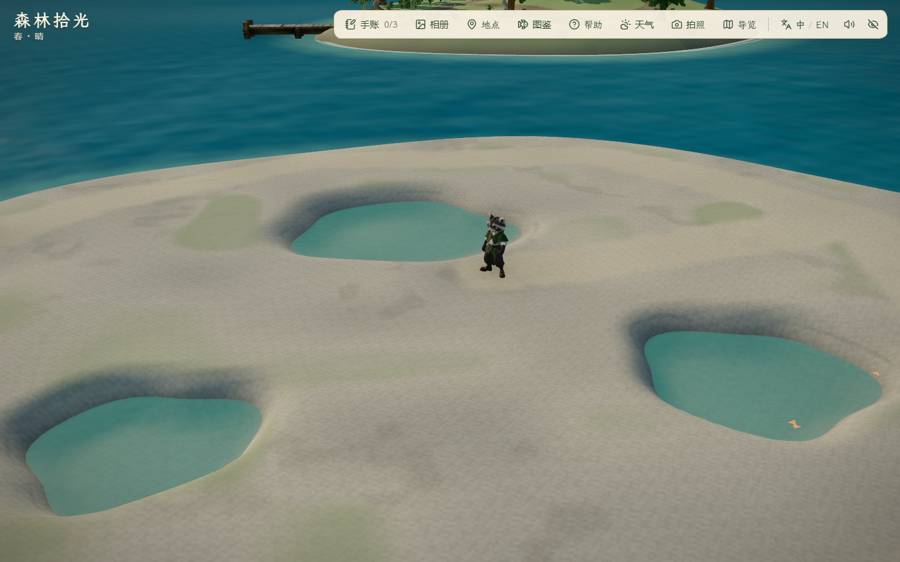
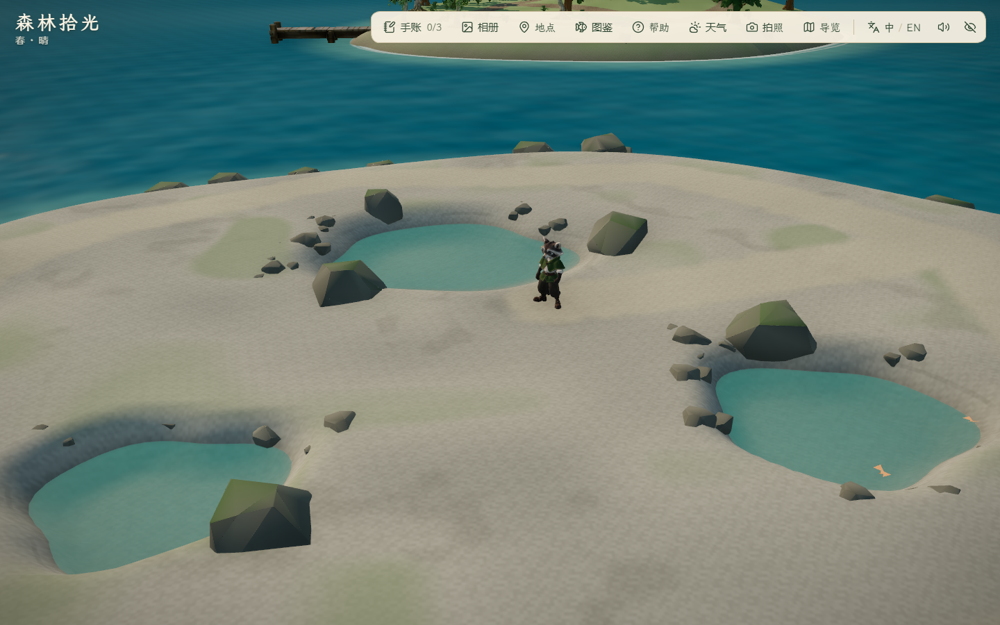
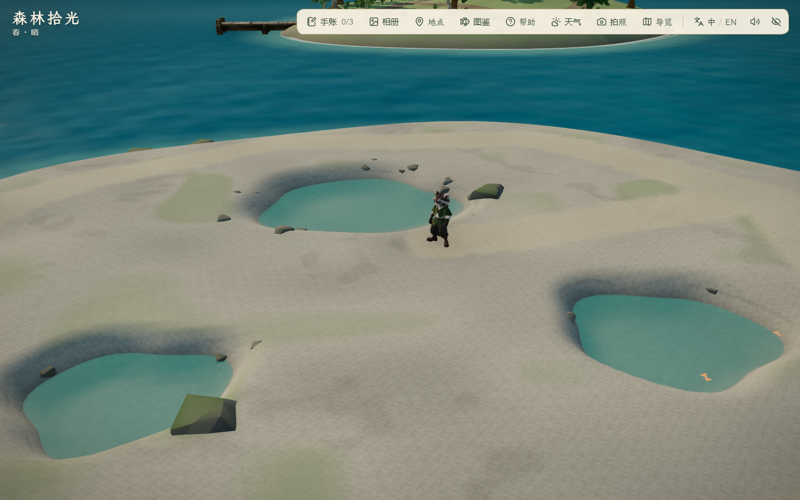
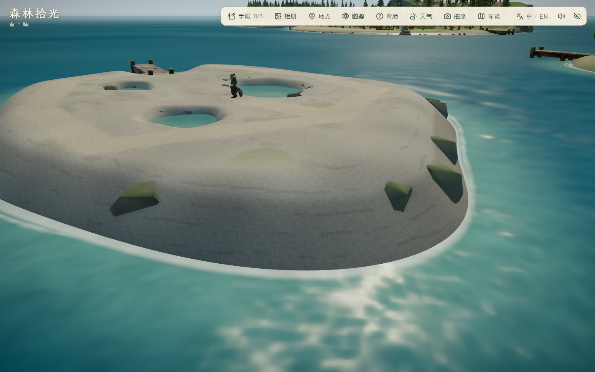

# 潮汐岛岸岩与池边石组 · 2026-10-30

状态：13 处岸岩、18 处池边石组已接入，本机静音局部实机、代码、完整往返与主岛显示回归通过。海风松、贝壳、漂木、完整岩岸与最终美术待完善。

## 来源与实现

- 延续 [IT-03 低岩台参考](../../references/island-expansion/it-03-tide-terrain-v1.png)与[潮汐岛概念](../../references/island-expansion/tide-island-concept-v1.png)；两者为既有 AI 插画，不是本轮实机。保留已经验证的低岩台、三处固定浅池、干燥环路、观察点与泊位。
- 复用 `public/assets/expansion/coastal-kit.glb`，97,244 字节，SHA-256 `1267a96632235e8c593739912572a32ec26b3424f9decfa857791ce4a7c35225`；与既有台账一致。来源为项目 `scripts/build_coastal_kit.py` 原创 Blender 5.2.1 LTS 套件，见[制作证据](../2026-10-25-visual-v3/evidence.md)与[模块实测](../2026-10-25-visual-v3/coastal-kit-blender.json)。本轮没有新建模、新 GLB、贴图、减面、付费调用或第三方授权主张；[资产摘要](assets.json)。
- 采用版岸岩 13 处，全为 Rock_Boulder；池边石组 18 处，包括 2 块 Rock_Boulder、16 组 Rock_Cobbles。模块分别保留 276 / 694 三角形，31 处实例合计 15,244 三角形；共享原几何/材质和按模块实例化，仍由现有随地形变化的岩石轮廓提供碰撞。
- `src/world/tideCoastLayout.ts` 独立构造新布局，沿岸不等距分组、回收完整足迹、加深埋入；池边只在部分角度布置，避免完整围圈。最小路径足迹净空 1.15 m，观察点留 2 m、泊位留 7 m，均另加模型足迹半径。保留所有旧布景位置、地形、水位、水深、路径、四泊位和存档格式。
- 可站立面积现为 553.25 m²，占原主岛 3695 m² 的 14.97%；地形首版为 578 m²，差异来自新增岩石实体，仍满足 12%–18% 目标。基本单体制作仍 7/9。

## 迭代与取舍

1. `before/`：角色置于潮池观察点、相同五机位昼/夕/夜共 15 图，2 组检查通过、控制台错误 0；另保存原有全部 427 处海岸布景坐标 [coast-snapshot.json](before/coast-snapshot.json)。
2. `first/`：首稿岩块凸出过高、池边大石和小石排列偏整齐。保留首稿实机图，不作为采用版。初次新单测使用严格浮点对象相等，Node 与浏览器三角函数末位差约 1e-14 导致旧布局断言失败；改为项目已有的 1e-10 容差逐坐标比较，类型/顺序/数量仍严格检查。
3. `reviewed/`：岸岩增加随机内收、加深埋入，池边留出四组角度缺口，减少大块石并降低石组高度。3 组/15 图通过、控制台错误 0；实际实例矩阵变换后的 9,625 个顶点没有进入可航行水域，距路中心最近约 1.21 m，法线检查通过。浏览器内旧 427 处布景与基线严格比较一致。
4. 已查看白天总览、池边、东岸、黄昏池边、夜间东岸。改善了凸出的块体和围圈感，但岸坡仍平滑、岩石仍有明显规则切面，局部石组较深嵌入；这是局部布景首版，不是参考插画的完整层叠礁岸。









前后机位、角色位置与昼夜设置相同；海浪、昆虫与阴影没有逐帧同步，不作像素级或性能提升比较。原始/失败截图保留，非精选批次仅留本地。

## 验证

- `pnpm lint`、54 文件 248/248 单测、`pnpm build` 通过。主 JS 1,912.78 kB / gzip 588.39 kB；既有大分块提示保留。
- 新增 2 项回归：旧 427 处布局逐坐标与类型/数量保持；新实例完整足迹的路径/观察点/泊位及可航行水域净空。既有潮汐面积、三池闭岸、全环路/支路双向及 ±0.5 m 路肩、四泊位离泊、旧档与宽镜头检查继续通过。主岛/雾松数量上限仍保持，潮汐与秋岚各有独立数量约束，没有放宽旧区域预算或通行要求。
- [采用版实机摘要](reviewed/report.json)：静音 Edge 156.0.4314.56、1440×900；3 组/15 图，0 控制台错误。岩石实际加载顶点与法线、原布局、地形/浅池材质及面积通过；局部采图与单测/构建部分并行，不以 RAF 样本作性能结论。
- [完整往返](roundtrip/report.json)：8 组/7 图通过，错误 0；秋岚→潮汐实航 61.368 秒，含转向/减速/下船转场。潮汐到访/刷新可上船、全环路和观察支路、浅池发现、拍照入口/退出、返航秋岚/刷新、三档 PC 地点面板通过；已查看发现与 1024×768 地点面板图。仍超出原 30–50 秒目标，未改船速或海峡。
- [主岛显示](main-views/report.json)：昼夕夜六机位 1 组/18 图通过，错误 0；已查看角色、工坊、池塘、牧场、塔及夜间总览，工坊右侧既有树木遮挡保留。与往返部分并行，不把这两批 RAF 作为性能结论，也不将截图等同全部旧玩法验收。
- 全部验证使用项目 `createHeadlessBrowser`，静音 `--mute-audio`，配置/缓存及浏览器 TEMP/TMP 在 `.tmp/`，最外层 `finally` 清理，不改正常游玩音量。
- 无声音、完整旧玩法/角色动画、照片保存、公网冷加载、跨 PC 或长期稳定性结论；未从主岛连续巡游四岛。

## 复现

本地预览 `pnpm dev --host 127.0.0.1 --port 5176 --strictPort`。独立 PowerShell 会话：

```powershell
$env:FOREST_QA_OUT='docs/evidence/2026-10-30-tide-rock-coast/recheck'
$env:FOREST_QA_TIDE='1'
$env:FOREST_TIDE_COAST_AFTER='1'
$env:FOREST_QA_VIEWS='tideOverview,tidePools,tideEastShore,tideNorthShore,tideBerth'
node scripts/check_mist_detail.mjs
```

往返在另一个干净会话只设置独立输出目录后运行 `node scripts/check_tide_travel.mjs`。主岛另设 `FOREST_QA_MAIN=1`、`FOREST_QA_VIEWS=overview,player,workshop,pond,farm,tower` 和输出目录，运行局部脚本。

保留此前未提交成果；本轮未提交、推送、部署或导出。下一步制作/适配海风松与补充池边细节，完整群岛美术仍待验收。
