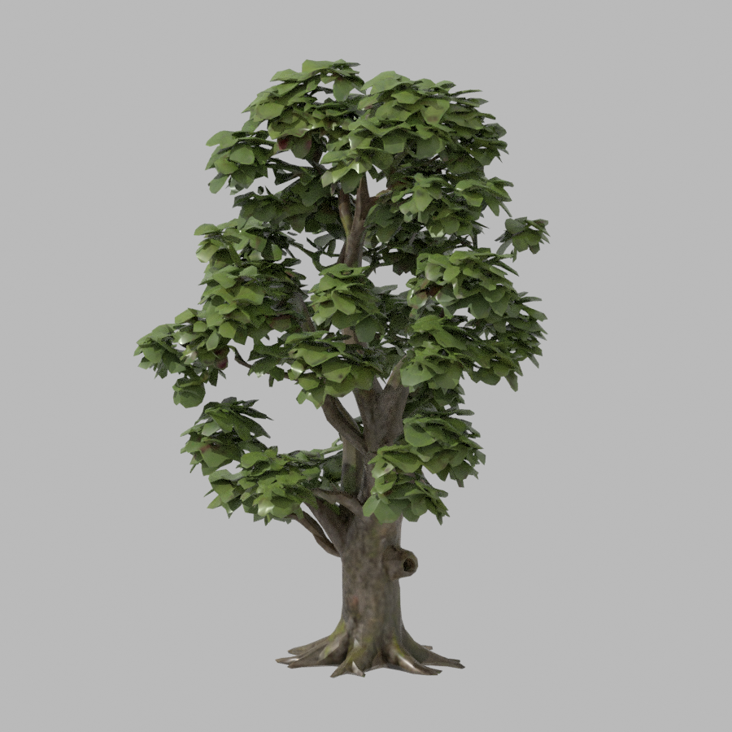
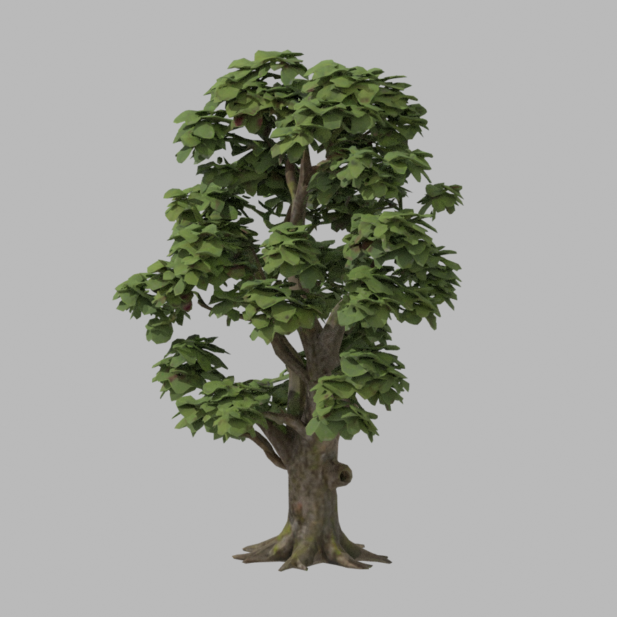
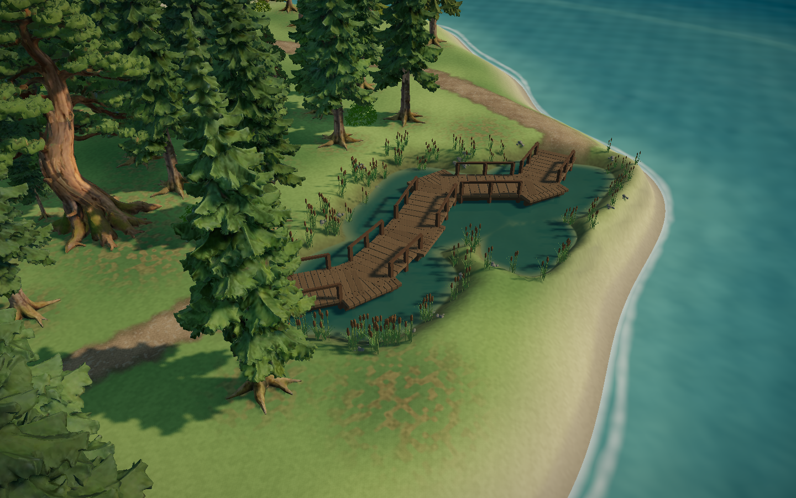
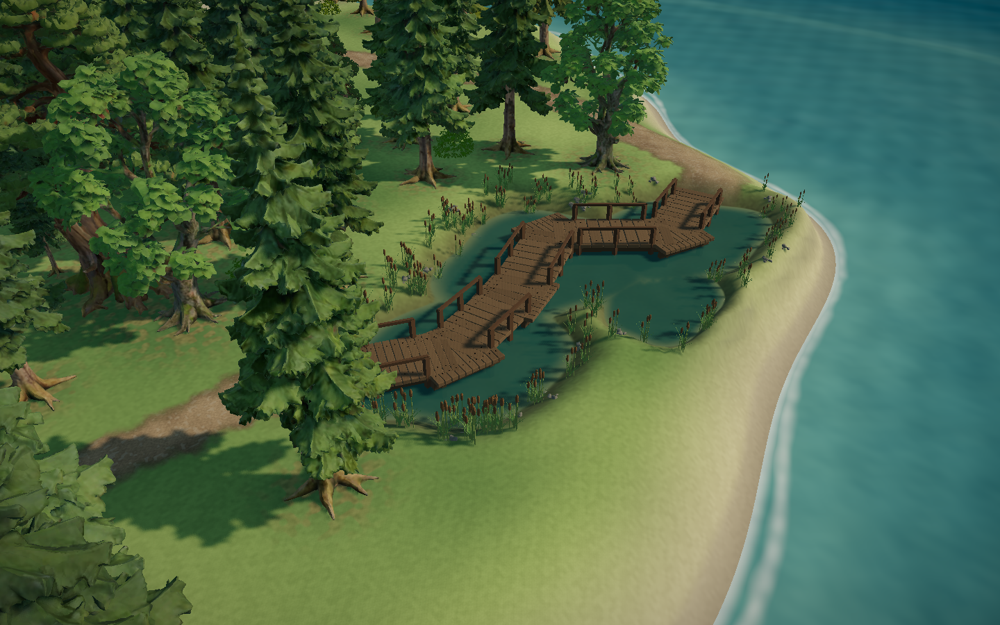
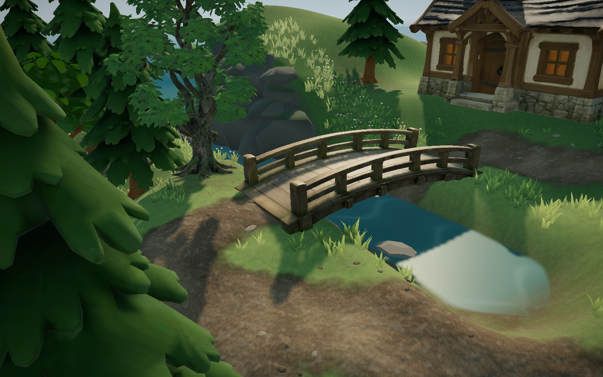

# 群岛阶段 8：赤杨（AHOLO Lux3D）· 2026-11-04

## 生成

| 项 | 内容 |
|---|---|
| 参考图 | `docs/references/island-expansion/ie-08-alder-v2.png`（SHA-256 `2c2c2fb3…d825`） |
| 服务 | AHOLO Lux3D 图生 3D，`https://api.aholo3d.cn/lux3d/v1/generate/img-to-3d/task/create` |
| 参数 | G1，faceCount 100000，输出 zip + glb，`aiPredictSize: false` |
| 任务号 | **4649902**，状态 succeeded（`assets/lux3d/ie-08-alder-v1/ledger.json`，本地，不进 Git） |
| 原始产物 | `output-0.zip` 15,558,481 字节（SHA-256 `35afd51b…e7d2`）；`output-1.glb` 13,016,660 字节（SHA-256 `2b57aaf7…7fac`） |
| 积分 | 余额接口仍返回 HTTP 500，查不到实际扣除，也拿不到报价；没有自动重试，只提交了这一次 |
| 授权 | 2026-11-03 用户在群岛计划中授权赤杨用 AHOLO 生成；2026-11-04 提交前再次确认“提交，继续阶段 8”。ledger 里的授权字段沿用脚本模板写的是 2026-10-29 的旧文本，以本条为准 |
| 商业授权 | 没有新的商业授权凭据；调用授权不等于商用许可 |

## Blender 整理

`scripts/aholo/prepare_autumn_trees.py 08`（隔离 Blender 5.2.1，脚本增加了赤杨一项）：

- 根部中心移到原点，整体缩放到 6.5 m（和白桦同一档）；
- 金属度清零、粗糙度 0.88；
- 94,250 三角形，与原始产物相同，没有减面；1 组 UV，法线全部有限；两张 2048 贴图，导出为 WebP；
- 运行文件 `public/assets/island-trees/alder.glb`，5,241,496 字节（SHA-256 `c0329ea8…06a0`）；
- 树干碰撞半径 0.71 m，树冠半径 2.50 m，见 [runtime.json](alder/runtime.json)、[template.json](alder/template.json)。

 

## 接入

- 新列表 `alderPlants` 追加在植被最后，已有树木的位置一株不动。
- 候选点只取两类地方：
  - 西扩湿地水洼外 1.75–3.2 倍水洼半径的干地；
  - 溪岸：离溪 3–4.5 m，并且离溪水高度不到 1.2 m（第一版有一株落在峡谷顶上，地面高 9.9 m，远高于溪水）。
- 同时要满足：原有的植被避让规则、离栈道至少 3.2 m（低枝不压栈道）、坡度不大于 0.45、和其他树至少 2.6 m。
- 结果只有 3 株：湿地 2 株，溪岸 1 株（缩放 0.83–0.91，约 5.4–5.9 m）。西林很密，栈道两侧都有树，能放的位置不多；这也符合“针叶为主、少量阔叶”的方向。
- 否决稿：湿地东南的一株正好挡在湿地总览视线上，把整片水洼和栈道遮住。已加规则保留这条视线。
- 着色沿用主岛阔叶的季节色调；树干有碰撞，树冠进入地面阴影图和镜头避让。

栈道近景和黄昏图同目录保留。

## 加载

赤杨在主岛，出生后不久就能看到，所以随场景一起加载，不延后。同一时段测量（正式构建，禁用缓存冷启动，除首次外）：

| 构建 | 各次（ms） | 除首次外均值 |
|---|---|---|
| 不含赤杨（只从渲染列表里去掉赤杨） | 27,323 / 13,906 / 13,468 / 13,689 | 13.7 s |
| 含赤杨 | 27,303 / 14,458 / 13,933 / 13,916 | 14.1 s |

多约 0.4 秒。这一时段整体比上午快很多（上午同类测量约 23 秒），所以只和同一时段的数据比较。

## 验证

- oxlint 0；63 文件 287/287 单测（新增 `alderPlacement.test.ts`：湿地和溪岸各至少一株、有碰撞和树冠、根在水面以上的干地、离栈道至少 3.2 m、溪岸株离水不到 1.2 m）；build 通过（主 JS 1,991.54 kB / gzip 615.86 kB）。
- 真实键鼠：西扩环路（`check_west_expansion`）3 项通过，含用鼠标转视角、W 键走过湿地栈道。第一次运行报错，来自开发服热更新（我在开跑前恢复了一个文件，页面加载到一半模块被热替换），重跑通过，不是游戏问题。
- 截图 JS 异常 0；全部静音，无听觉验收。

## 尚存

- 只有 3 株，量少；不随季节换色到秋季黄叶（沿用主岛阔叶色调）。
- 没有做幼态赤杨。
- 实际积分消耗未知。

未提交、推送、部署或导出。
