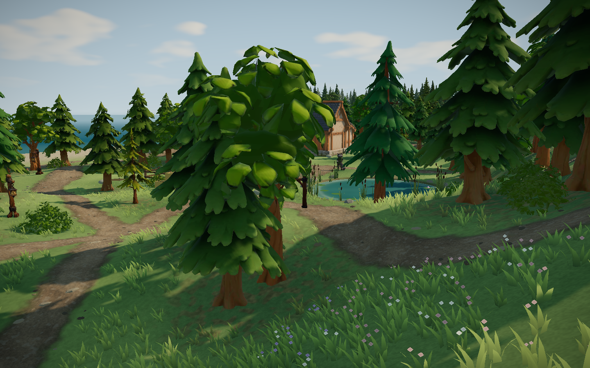
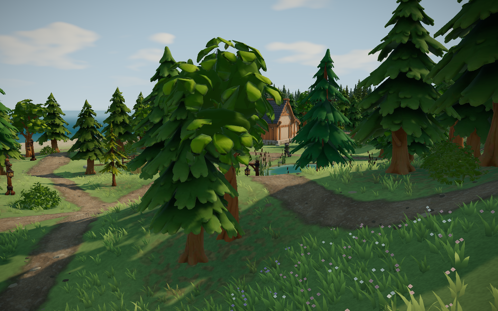
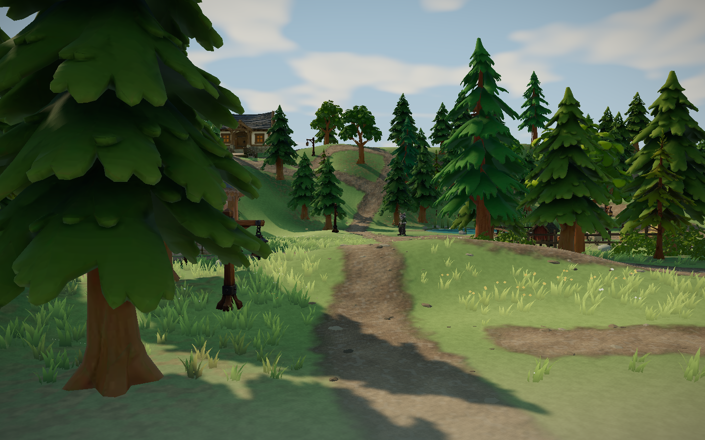

# 群岛阶段 9：主岛内陆起伏 · 2026-11-04

## 改动

只改 `src/world/worldConfig.ts` 的 `inlandRelief`（开阔地起伏）：

| 项 | 改动前 | 改动后 |
|---|---|---|
| 三座小丘高度 | 1.3 / 1.0 / 0.9 m | 1.8 / 1.4 / 1.25 m（半径各加 0.5 m） |
| 大起伏（低频） | 振幅 0.45 | 0.62（约 +38%） |
| 细起伏（高频） | 0.25 | 不变 |

- 起伏仍乘以 `openGround`：建筑、围栏、种植地、池塘、码头、座位、玩沙区、峡谷、海滩和西扩全部为 0，玩法点和路线端点的地面不变。
- 地形起伏只在 CPU 端计算，没有着色器副本需要同步。

## 试过的版本

| 版本 | 结果 |
|---|---|
| 全部 ×1.5，小丘 2.0/1.6/1.4 m | 19 处路面坡度超过可走上限 0.85；林间空地 (-20,19) 站不住；整岛导航测试失败 |
| 只放大低频 ×1.6，细起伏不变，小丘 1.8/1.4/1.25 m | 剩 2 处路面坡度 0.86、0.85（南坡步道 (6,-19.5) 附近，原本就陡的坡上又叠了一个凹地） |
| 低频 ×1.47 | 剩 1 处 0.851 |
| 低频 ×1.38（采用） | 路面坡度、空地、导航测试全部通过 |

放大幅度受南坡步道限制。要再加高，需要让起伏在路面上淡出，或在陡坡上减弱；`inlandRelief` 在地形模块里，直接取路径距离会形成循环引用，本轮没有做。

## 数据

- 开阔地（`openGround` ≥0.99，0.5 m 网格，2278 个采样点）：平均坡度 0.313 → 0.331，最大坡度 1.122 → 1.148（最大值来自原有山坡，不在路面上），高度范围 -0.49–7.96 m → -0.58–8.04 m。
- 主岛植被按坡度规则重新筛选，344 → 343 株：只有灌木变化，5 丛去掉、4 丛在附近新出现；树木一株不动。（否决的第一版还挪动了 1 株松树、换掉 2 株树。）邻岛植被逐坐标不变（`autumnTravel.test.ts` 冻结基线通过）。

## 截图（浏览器实机，静音无头 Edge 156.0.4314.58，1440×900，开发服）

新增两个低视角机位 `reliefKnollEast`、`reliefKnollNorth`。机位高度取地面以上 2.2 m，所以改动后镜头也随地面抬高一点，不是像素级同机位。

从高处总览（`overview`）看差别很小，只是草地明暗起伏稍强；`grove` 机位被近处树冠挡住，不能用来对比。

## 验证

- oxlint 0；63 文件 287/287 单测；build 通过。
- 真实键鼠回归：坡地相机（平地、上坡、下坡）3 项通过；扩建导航 5 项通过（过桥进卧室、家具导航、新码头上船划船返回、钓鱼入缸、鱼缸刷新保留）；tier1 第 6 项“河灯第二张照片”连续两次失败。
  - 排查：去掉地形改动、去掉赤杨、把 `src/` 全部回退到上次提交，三种情况都同样失败，所以不是今天的改动造成的。
  - 记录到的位置：22 秒后领头的河灯在 x=-28.7、高 0.72，已经越过瀑布口（x=-26.6）落进潭里；脚本把相机放在它身后 5 m 的溪面上方，正好对着峡谷岩壁，拍不到河灯。推测是脚本固定等 22 秒，这次河灯漂得比以往快（这一时段机器整体更快），未确认。
  - 用临时副本把这张照片改成警告后跑完全程：其余 8 项全部通过，包括原来排在后面的第 7–9 项（六块地长成、导览、语言切换）。
  - 修复（2026-11-05，用户要求）：`check_tier1.mjs` 不再固定等 22 秒，改为等三盏河灯都漂过 x=-18.5、且领头的还在瀑布口上游 0.8 m 以外再拍。重跑 tier1 9 项全部通过，错误 0；拍照时三盏灯在 x=-22.3/-20.4/-18.6，照片里三盏灯都在开阔溪面上（`regression/tier1/08-lanterns-creek.png`）。

## 尚存

- 加高幅度有限（低频 +38%、小丘 +38%–56%），远看仍偏缓。
- 起伏没有在路面上单独淡出。
- tier1 的河灯等待已修；其他检查脚本里是否还有类似的固定等待，没有排查。

未提交、推送、部署或导出。
