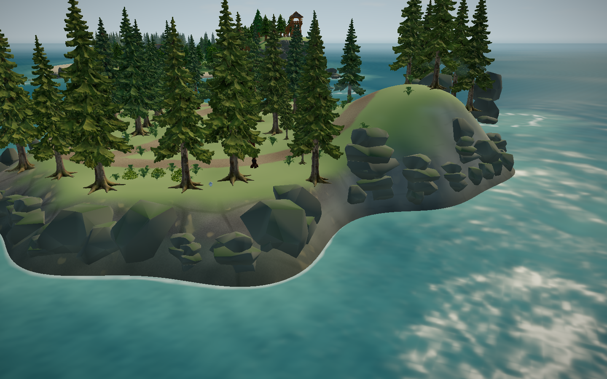
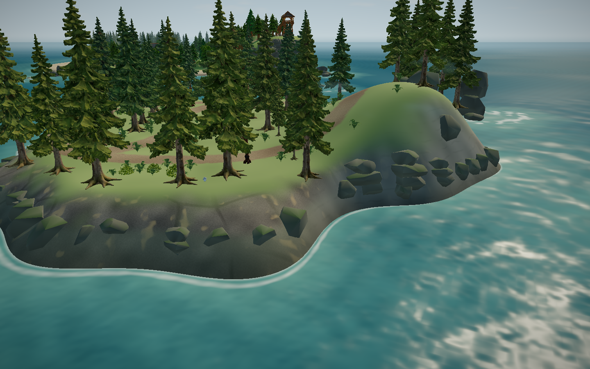
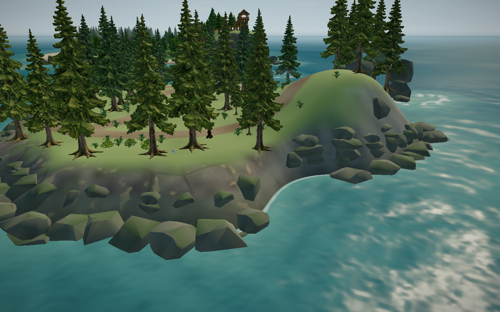
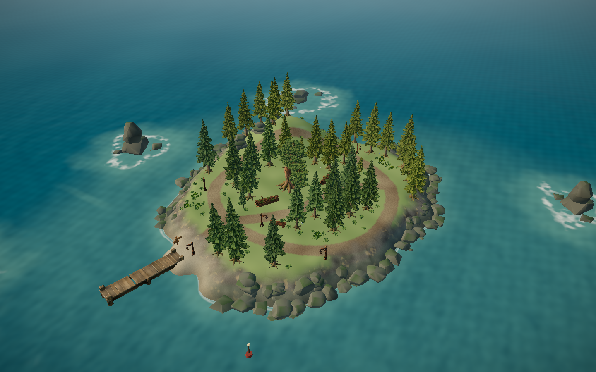
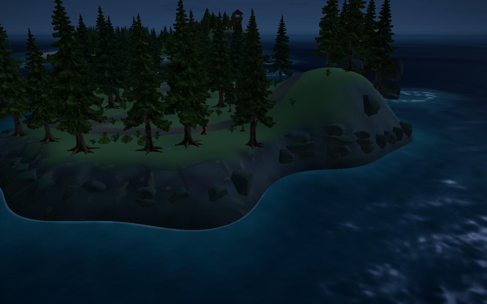
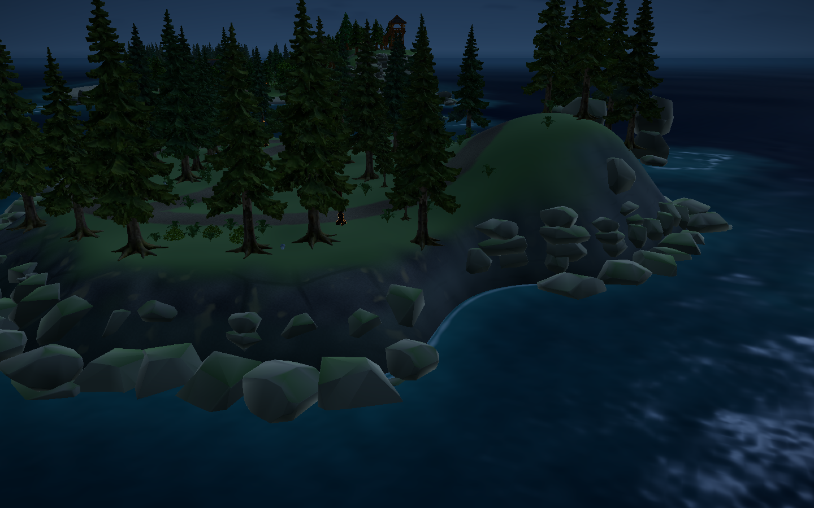
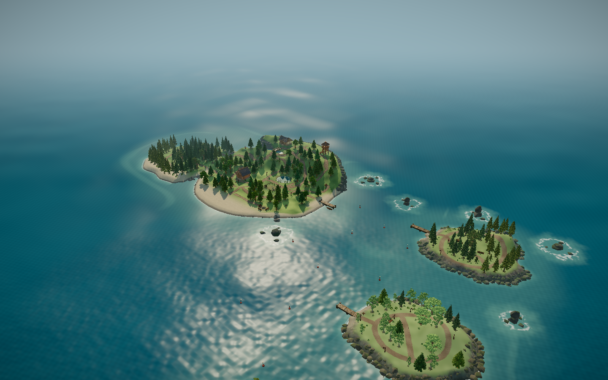

# 群岛阶段 7：连续礁岸、岸岩尺度与夜间对比 · 2026-11-04

三座小岛原来的岸岩是零散的小石块，挂在光滑的坡面上，远看像碎石；岩石与水面之间隔着一圈光秃坡面；夜里岩石几乎和坡面融成一片。本轮在水线上加一圈连续的双层礁石，并给岸岩加上夜间的冷色轮廓光。只复用现有 Blender 海岸套件（`coastal-kit.glb`），没有新模型，也没有付费调用。

## 做法

- 新增 `src/world/reefShore.ts`，沿每座小岛的水线逐段放石头：
  - 下层：中心略在水线外（四分之一个石宽），石头大部分立在海里，相邻的石头互相叠成一体；
  - 上层：60% 的位置在下层后面再放一块，只放在陡坡上（坡度 ≥0.55），不占可行走的岸边；
  - 湾口留空成沙湾（取岛形里的内凹段），码头、泊位 8 m 内、小径、树木和潮池都避开；
  - 尺寸限制在套件的 0.7–1.7 倍，放不下时依次换小一号。
- 雾松 61 块，秋岚 71 块，潮汐 50 块。原有岸岩和岩脊一块不动，新石头追加在后面。
- 船：其中 135 块的水线附近部分伸进可划水域，作为船的障碍，和外缘礁石一样按船体轮廓判定（`reefShoreSolids`）。
- 夜间：新增 `climateNight`（取自天空的夜色系数），岸岩材质加一道朝轮廓的冷色边光和朝上面的少量月光，白天为 0，画面不变。海岸套件的材质是共用的，所以外缘礁石、潮汐岩台和湿地的石头也一起变化。

## 迭代与否决稿

| 版本 | 问题 | 处理 |
|---|---|---|
| v0 | 只放下 6/11/6 块：大多和原有岸岩重叠（56 次）或离小径太近（36 次） | 允许新石头和旧岸岩叠成一体（重叠阈值放宽，只对旧岩石），放不下时换小一号 |
| v1 | 石头离水线还隔着一圈光滑坡面 | 实测：水下浅带只有 0.2–0.3 m 宽，石头必须完全留在不可划水域里，只能停在水线内约 0.8 m |
| v2 | 改为按石头下坡一侧的最低地面下沉，仍然隔着一圈坡面 | 同上，根本原因是不可划水域太窄 |
| v3 | 下层改为站进海里，同时把它们加进船的障碍 | 远看是连续礁岸（`v3/`） |
| 采用版 | 在 v3 基础上限制尺寸、上层只放陡坡、下层外移四分之一石宽 | 截图见 `final/` |
| 测试 | 尺寸超出套件范围（最大 1.98）；秋岚可站立面积降到 19.7%，低于 20% 下限 | 尺寸限制在 0.7–1.7；上层只放陡坡 |



## 前后对比（浏览器实机，静音无头 Edge 156.0.4314.58，1440×900，开发服）













秋岚、潮汐的前后图和夜间总览同目录保留（`before/`、`final/`）。

## 代价：可站立面积

石头会挡住走路，所以岸边能站的地方变少了（0.5 m 网格统计）：

| 岛 | 改动前 | 改动后 | 规划范围 |
|---|---|---|---|
| 雾松 | 21.81% | 20.36% | 20%–25% |
| 秋岚 | 22.60% | 20.35% | 20%–25% |
| 潮汐 | 13.86% | 12.90% | 12%–18% |

- 都还在范围内，但雾松和秋岚已接近 20% 下限。下层和上层各占约 1 个百分点。
- 下层外移四分之一石宽只收回约 0.2 个百分点，所以面积主要是被石头在岸边的碰撞范围占掉。

## 验证

- oxlint 0；62 文件 286/286 单测；build 通过（主 JS 1,990.52 kB / gzip 615.67 kB）。
- 新增 `reefShore.test.ts` 2 项：每岛 40 块以上、按 10° 扇区计有石头的扇区超过 70%、尺寸在套件范围内；水线石头对船是障碍，所有泊位船身放得下，泊位 8 m 内没有礁石。
- 已有的整岛面积、泊位、航道（`boatFits` 沿海峡逐米检查）测试全部通过。
- 真实键鼠回归（静音无头 Edge，开发服，结果在 `regression/`）：
  - 雾松、秋岚、潮汐三条往返各 8 项全部通过；
  - 船绕外角（`check_boat_clearance`）4 项通过；
  - 停靠（`check_berth_docking`）：第一次在“雾松正面靠岸”失败，按 F 时仍在划船状态。去掉礁岸代码重跑通过；恢复礁岸再重跑，7 项全部通过。用单测按同样的按键回放，船停在下船范围内、可以下船，最近的礁石在 9 m 外。原因没有确认，推测是按 F 时船速还没降到下船阈值，记为偶发；
  - 岛上内容（`check_island_finds`）：11 段全部通过（小鸟、全景、枫叶、树洞、烤菌、配方、手账、卧室、季节、长椅、浮标），JS 错误 0。

## 尚存

- 石头脚下没有白浪，近看石头和平静的浅水之间缺少过渡。
- 礁岸排得比较均匀，局部像一圈围石；没有新的岩石模块，形状重复仍可见。
- 主岛没有加礁岸（阶段 7 只针对三座小岛）。
- 只看了静态截图，没有在船上沿岸划一圈实测手感。

## 复现

```
VIEWS=archipelago,mistOverview,mistEastShore,autumnEastShore,tideEastShore LIGHTS=day,night HIDE_HUD=1 node scripts/check_visual_review.mjs <输出目录>
FOREST_QA_OUT=<输出目录> node scripts/check_island_travel.mjs   # 另有 check_autumn_travel / check_tide_travel / check_berth_docking / check_boat_clearance
```

未提交、推送、部署或导出。
