# 群岛阶段 6：幼树形态 · 2026-11-04

本轮把“成树等比缩小充当小树”的实例换成真正的幼态树形，并为古松、白桦、枫树各派生一种幼态。没有调用生成服务或付费资源，也没有新增商业授权凭据；来源与授权边界沿用各源模型台账。

## 来源与方法

| 幼态 | 源模型 | 源任务 | 高度 | 三角形 | 运行文件 |
|---|---|---|---|---|---|
| 幼松 `ie-young-pine` | IE-01 古松（8 m） | AHOLO Lux3D 4461967 | 4.57 m | 119,684（与源相同） | `public/assets/island-trees/young-pine.glb`，6,182,320 字节 |
| 幼桦 `ie-young-birch` | IE-06 白桦（6.5 m） | AHOLO Lux3D 4480409 | 4.00 m | 97,792（与源相同） | `public/assets/island-trees/young-birch.glb`，6,457,608 字节 |
| 幼枫 `ie-young-maple` | IE-07 枫树（6.0 m） | AHOLO Lux3D 4480412 | 3.70 m | 119,142（与源相同） | `public/assets/island-trees/young-maple.glb`，8,455,488 字节 |

云杉不另做：沿用 2026-10-29 的[幼态云杉](../2026-10-29-spruce-sapling/evidence.md)。来源台账见[古松/云杉](../assets/2026-10-29-island-trees/evidence.md)与[白桦/枫树](../2026-10-29-autumn-trees/evidence.md)。

- 脚本 `scripts/derive_young_trees.py`，项目隔离 Blender 5.2.1 LTS 后台运行，未操作用户的活动 Blender 场景。
- 幼树不是成树缩小：树干相对高度更细（幼松树干半径 0.49 m，同高等比缩小的古松为 1.06 m），净干段更短，树冠更窄并收尖，叶团缩小、露出枝梢，主干略偏。
- 叶团按运行时着色器的叶片判定找出（针叶看绿高于红，阔叶看彩度），每团整体平移并绕自身中心缩小，法线方向不变；树皮和枝条连续形变，自定义法线按雅可比矩阵变换。
- 面、顶点、UV、材质和贴图全部保留，没有减面。逐件数据与哈希见 [asset-validation-all.json](asset-validation-all.json)，运行模板见 [template-all.json](template-all.json)。
- 工作文件 `assets/blender/young-trees/*.blend` 与候选 GLB 保留本地，不进 Git。

SHA-256：young-pine `2f1fb2b8…c0d9`，young-birch `ca4860d2…7d2d`，young-maple `2e2e4282…eeb7`（完整值见 asset-validation-all.json）。

## 同高度形状对照（Blender 渲染）

每组左图是源成树等比缩放到幼树高度，右图是派生幼树；同机位、同光照、同取景。

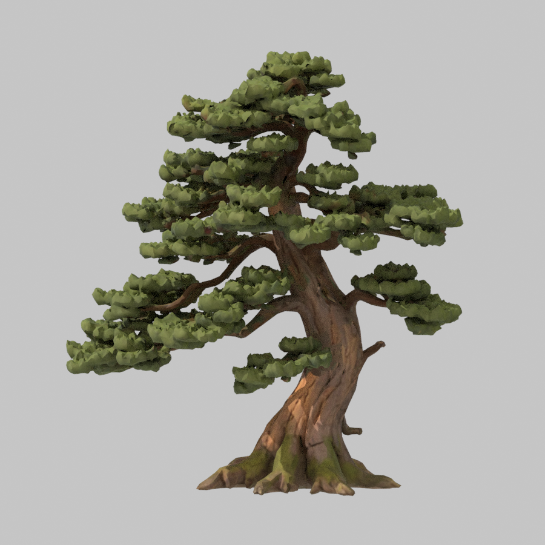 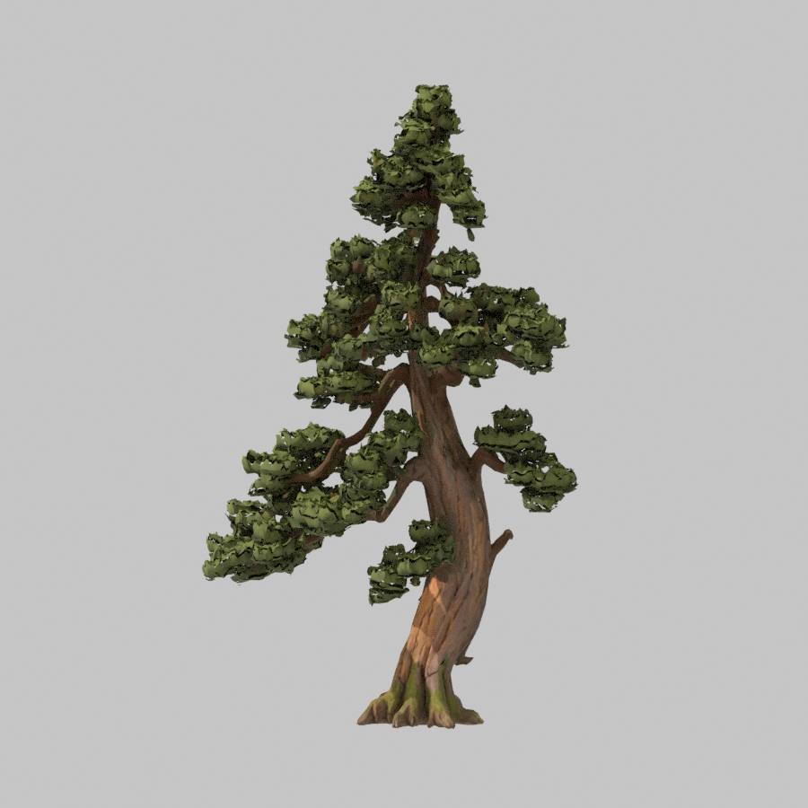

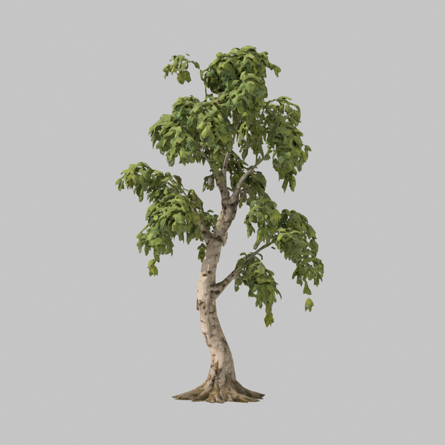 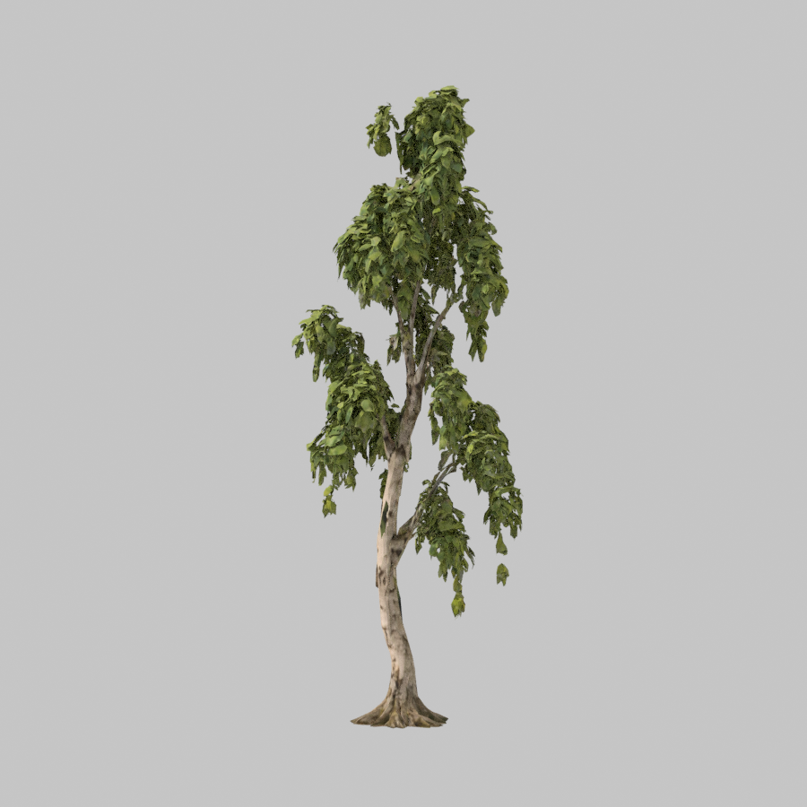

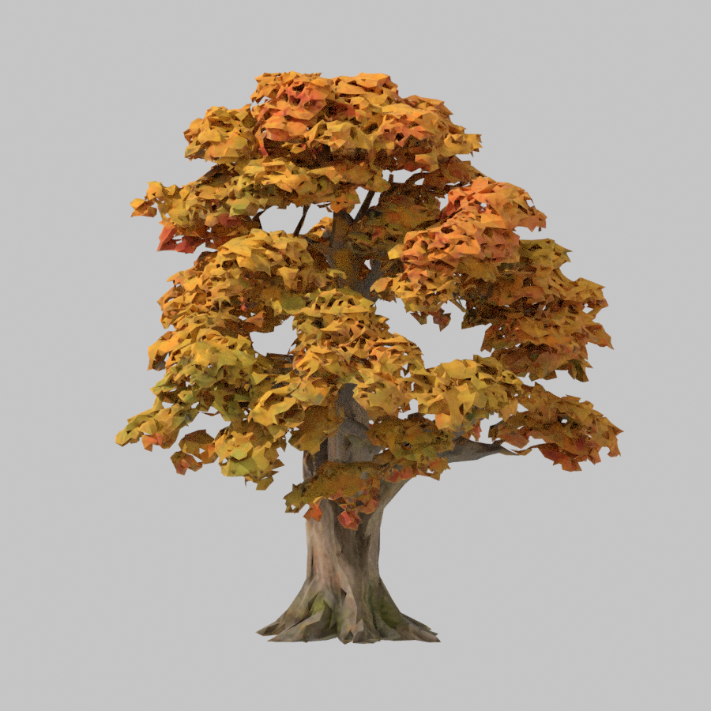 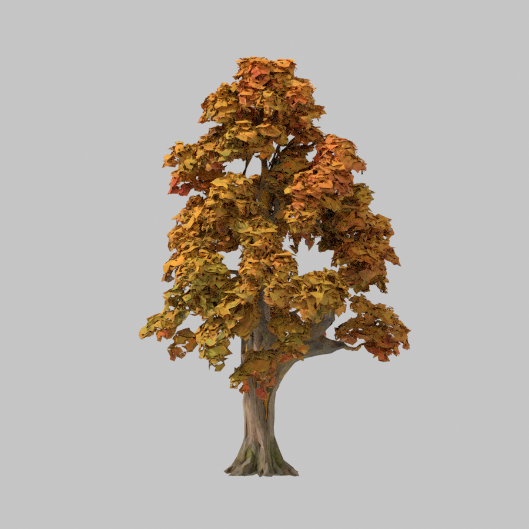

侧面和背面图同目录保留（`*-side.png`、`*-back.png`），没有纳入 Git。

中途问题：第一次运行时，汇总指标读的是对照渲染前的顶点引用，Blender 重新分配网格数据后这些引用失效，算出的幼松树干半径为 4.35 m，白桦和枫树直接报错。模型本身没有问题（实测宽 ±1.4 m）。已改为渲染后复制顶点坐标再统计。

## 布局

- 西林伴生小树原来是成树云杉缩到 0.45 倍（约 4 m）。13 株全部换成幼态：6 株幼松（缩放 0.80–0.85，约 3.7–3.9 m），7 株幼态云杉（0.98–1.19，约 3.7–4.5 m）。
- 秋岚：离小鸟林窗 11 m 以外、缩放小于 0.91 的白桦和枫树改为幼态（4 株幼桦、1 株幼枫，缩放为原来的 1.15 倍）。林窗附近的树保持成树，小鸟栖枝不受影响。
- 所有树的坐标都没有变：和改动前逐坐标对比，341 株的位置差异为 0，只有这 18 株换了树种和缩放。
- 否决稿：去掉古松旁的伴生树（伴生点落在古松 2 m 根盘碰撞里）。这样会让西林约 5 株成树重新抖动位置，总数从 341 变成 339，动到了已采用的西林基线，所以没有采用。古松旁的伴生树现在是幼态云杉，仍然站在古松根盘上，这是原来就有的问题，记为尚存。
- 采集：枫叶和桦皮的采集点同样认幼态树，编号和数量不变（枫叶仍是 7 处）。采集点离树的距离按树的缩放计算，所以幼树旁的点向外移了最多约 0.45 m。
- 秋季叶色：幼树树冠底只有约 0.63 m，低于原来叶片遮罩的高度下限（本地 0.7–1.2 m）。遮罩高度改为按派生比例缩放（幼桦 ×0.49，幼枫 ×0.52），否则最低的叶子不会随季节变色。

## 浏览器实机（静音无头 Edge 156.0.4314.58，1440×900，开发服）

同机位前后对比：改动前只回退布局文件，让场景用回成树，其余代码相同。

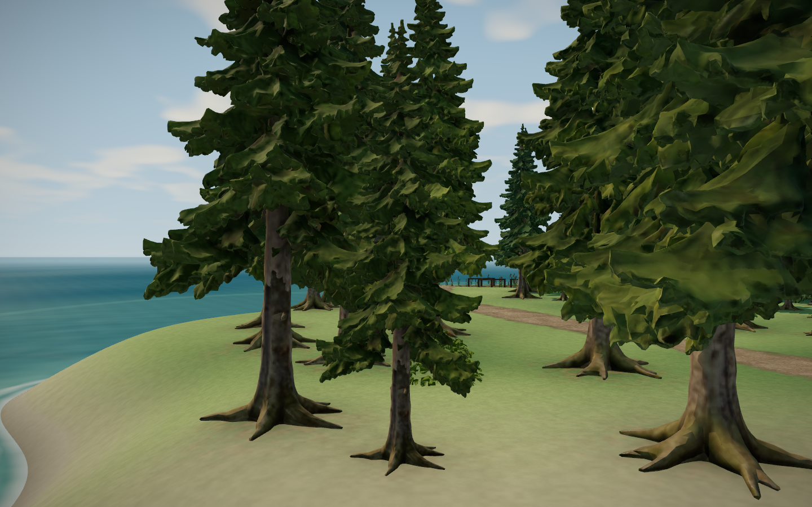

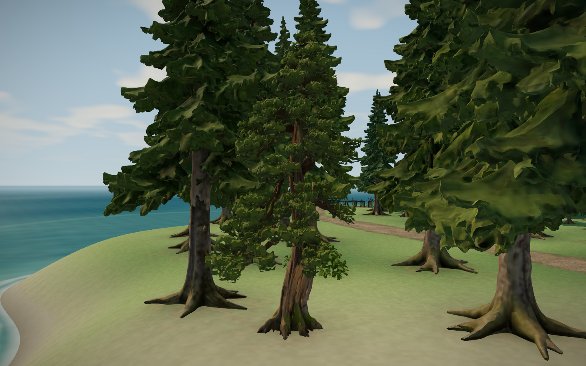

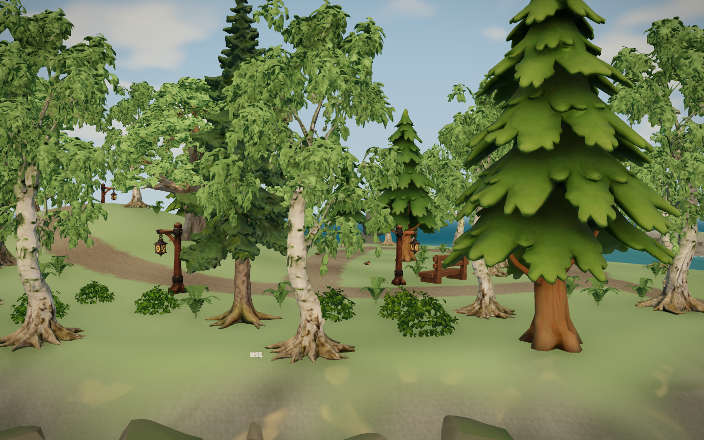

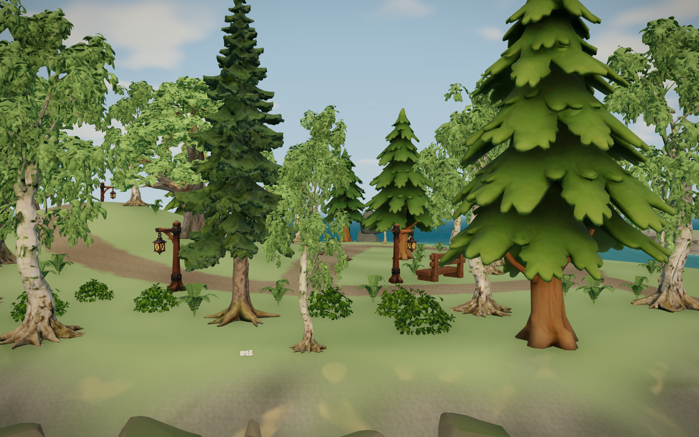

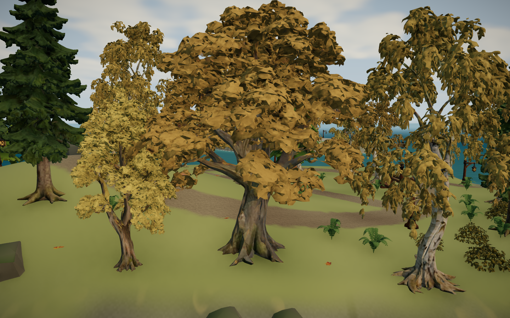

- 近景能分出小树形态：幼松树冠呈锥形、树干偏红；幼桦细高，与两侧成树明显不同。
- 秋季（`NIGHTS=9`）幼桦整冠变金，最低处的叶子也已变色，没有残留绿叶，说明缩放后的叶片遮罩生效（见 `after/autumn-autumnYoung.png`）。
- 幼枫叶色比相邻成树偏黄一些，来自每株树按位置取的色彩随机量，不是遮罩问题。
- 黄昏图同目录保留（`after/dusk-*.png`）。各次截图 JS 异常都是 0（`meta.json`）。

## 加载实测

正式构建，本地 `vite preview`，禁用缓存冷启动，每组 3 次，计时到加载卡片消失（`scripts/check_loading_card.mjs`，`PROD=1`）：

| 构建 | 三次（ms） | 后两次均值 |
|---|---|---|
| 改动前（不请求幼树 GLB） | 33,847 / 23,563 / 22,925 | 23.2 s |
| 改动后 | 39,675 / 29,859 / 30,282 | 30.1 s |
| 改动后（另一次） | 38,650 / 29,292 / 29,769 | 29.5 s |

- 三个新模型共 21.1 MB，本地冷启动多了约 6.5 秒（约 28%）。本机是本地回环，下载本身很快，多出来的时间主要在解析、建实例和上传显存。没有测公网加载。
- 每组第一次明显更慢，是系统首次读盘的影响，不计入均值。
- 第一组“改动前”测量因基线构建的类型检查失败，实际测的是旧的改动后产物，已改名为 `load-after-a/`（即上表“另一次”）；基线随后用不做类型检查的 `vite build` 重建再测。
- 主 JS 1,986.86 kB / gzip 614.79 kB（改动前 1,985.90 kB / 614.58 kB），沿用原有大分块提示。

### 延后加载（用户 2026-11-04 选择）

幼树只在西林和秋岚，离出生点远。按用户选择改为加载卡片消失后再下载：`uiStore.loadingDone` 由加载卡片在真正撤下时置为 true，`IslandTrees` 把三种幼树放进单独的 Suspense，等这个标记后才挂载。幼树的树干碰撞和镜头树冠来自布局数据，开局就存在，不等模型。

| 构建 | 各次（ms） | 除首次外均值 |
|---|---|---|
| 延后加载 | 47,515 / 26,445 / 23,738 | 25.1 s |
| 延后加载（另一组） | 51,667 / 23,627 / 23,594 / 21,130 | 22.8 s |

- 除首次外的 5 次均值约 23.7 秒，回到改动前的约 23.2 秒。
- 每组首次在 33.8–51.7 秒之间大幅波动（各构建都有），受浏览器新配置和首次读盘影响，不用它比较。
- 开发服实测（`load-deferred-dev/`）：幼树组在加载卡片消失后 0.8–1.3 秒挂进场景；卡片仍然要等场景真正画出才撤下（`ready` 均为 true）。代价是这一两秒内远处西林和秋岚少 18 株小树。
- 延后加载后浏览器截图中幼树正常出现，JS 异常 0。
- 测量中途发现：停止后台预览命令只结束了 pnpm 外壳，旧的 vite 预览进程仍占着 4180 端口，新预览启动失败。核对旧进程返回的 `index.html` 与 JS 正是当前构建（大小一致、含 `loadingDone`），所以数据有效；之后已结束该进程。

## 验证

- oxlint 0；61 文件 284/284 单测（新增 `youngTrees.test.ts` 4 项：伴生树是幼态而非缩小的成树、幼阔叶离林窗 11 m 以外且成树保留、幼树有碰撞和镜头树冠、幼树相对高度更细更窄）；build 通过。
- 西林测试原来用“缩放 ≥0.8”区分网格树和伴生树，伴生树改为幼态后改为按树种区分。
- 新手引导在加载进行时不显示，所以首次进入时引导会在幼树下载完后才出现（约 1 秒）。
- 只在开发服和本地正式构建验证；没有跑真实键鼠穿行西林和秋岚，没有跨 PC 或公网测量；全部静音，无听觉验收。

## 复现

```
python scripts/aholo/blender_run.py scripts/derive_young_trees.py --blender "D:/Program Files/Blender Foundation/Blender 5.2/blender.exe" --timeout 1500
# 检查后复制 assets/blender/young-trees/young-*.glb 到 public/assets/island-trees/，模板并入 src/world/island-tree-templates.json（crown.r 取完整树冠半径）
VIEWS=westYoungPine,autumnYoung,autumnMaple LIGHTS=day,dusk HIDE_HUD=1 node scripts/check_visual_review.mjs <输出目录>
NIGHTS=9 VIEWS=autumnYoung,autumnMaple HIDE_HUD=1 node scripts/check_visual_review.mjs <输出目录>
PROD=1 RUNS=3 FOREST_URL=http://127.0.0.1:4180/ FOREST_QA_OUT=<输出目录> node scripts/check_loading_card.mjs
```

未提交、推送、部署或导出。
