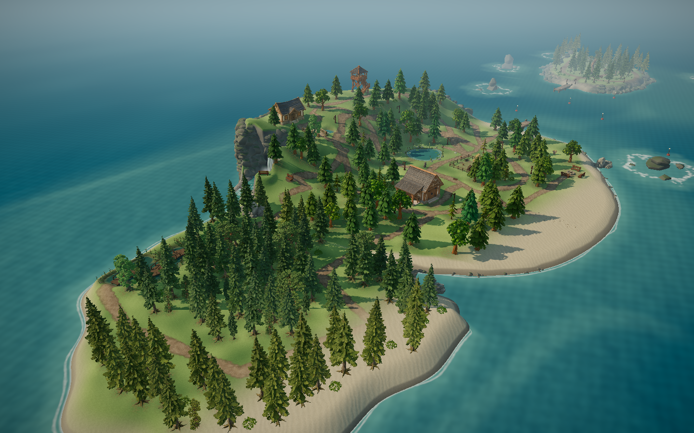
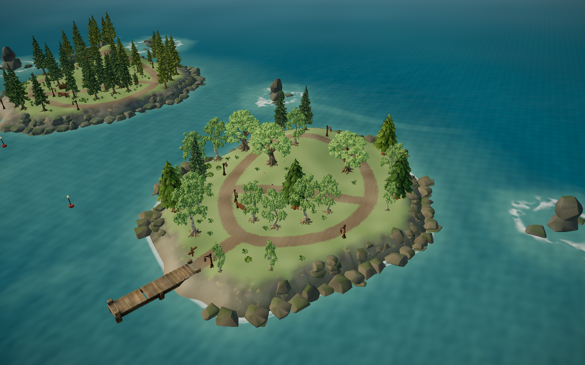
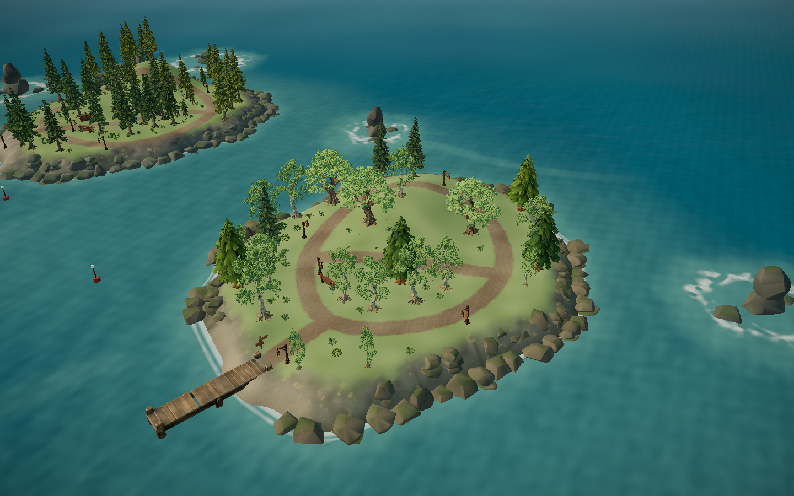

# 岛上树木远景 LOD · 2026-11-05

## 起因

用户在 ModelScope 国际站私有 Studio 上打开页面，反馈“进入后掉帧”。

本地开发服实测（静音无头 Edge，RTX 3050，1440×900，关闭帧率上限，4 秒中位）：

| 情况 | 中位帧率 | 中位帧时间 | 95% 帧时间 | 场景三角形 |
|---|---|---|---|---|
| 默认 | 109 fps | 9.2 ms | 16.2 ms | 2270 万 |
| 分辨率倍数 1.7 | 99 fps | 10.1 ms | 15.1 ms | 2270 万 |
| 隐藏 AHOLO 岛上树木 | 222 fps | 4.5 ms | 7.9 ms | 600 万 |
| 隐藏海岸岩石 | 115 fps | 8.7 ms | 13.7 ms | 2240 万 |

AHOLO 树木占 1670 万个三角形、约一半帧时间。每棵 9.4–12 万面，远处的树也按完整面数绘制，阴影再画一遍。95% 帧时间贴近 60 Hz 的 16.7 ms，会偶发掉帧。分辨率和岩石影响很小。

项目规则要求“减面必须有实测瓶颈和视觉对照依据”。用户 2026-11-05 选择“远处用简化模型”。

## 做法

- `scripts/derive_tree_lods.py`（隔离 Blender 5.2.1）：11 种树各做一个折叠减面版，保留约 12% 的面（1.1–1.4 万面），只导出几何，见 [lod-validation.json](lod-validation.json)。
  - 运行时沿用完整模型的材质和贴图，不会重复下载贴图；
  - 11 个文件共约 8.5 MB，`dist` 174 → 182 MB。
- `IslandTrees.tsx`：每个 8 m 区块同时放完整和简化两套实例。区块离镜头 31 m 外切到简化版，27 m 内切回完整版，和主岛 `ForestKit` 现有的 LOD 用同样的缓冲带。完整模型文件不变，近处画面不变。
- 幼树仍在加载卡片之后下载，它们的简化版也随之一起延后。

## 结果

同一视角、同样条件：

| 情况 | 中位帧率 | 中位帧时间 | 95% 帧时间 | 场景三角形 |
|---|---|---|---|---|
| 改动前 | 109 fps | 9.2 ms | 16.2 ms | 2270 万 |
| 改动后 | 196 fps | 5.1 ms | 9.2 ms | 810 万 |
| 改动后，拉远到全岛 | 192 fps | 5.2 ms | 7.7 ms | 730 万 |

## 画面对照（浏览器实机，同机位）

`full/` 为临时回退 `IslandTrees.tsx` 后的完整模型版，`lod/` 为采用版。








两组几乎看不出差别：松树层次、阔叶叶团、林缘轮廓和明暗都保持。主岛开局视角的树属于 `ForestKit`，本来就有 LOD，本轮没有改动。

## 验证与边界

- oxlint 0；64 文件 288/288 单测（新增 `treeLod.test.ts`：每种岛上树都有对应的简化模型）；build 通过（主 JS 1,992.18 kB / gzip 616.07 kB）。
- 只有静态截图对照，没有在走动中专门检查切换时的跳变；切换带与主岛 `ForestKit` 相同。
- 帧率数据来自开发服无头浏览器；用户实际浏览器、嵌在 ModelScope 页面里的情况没有测到（私有 Studio 需要登录态，无头浏览器打不开）。
- 全部静音，无听觉验收。

## 复现

```
python scripts/aholo/blender_run.py scripts/derive_tree_lods.py --blender "D:/Program Files/Blender Foundation/Blender 5.2/blender.exe" --timeout 1200
VIEWS=overview,westOverview,mistOverview,autumnOverview LIGHTS=day HIDE_HUD=1 node scripts/check_visual_review.mjs <输出目录>
```
