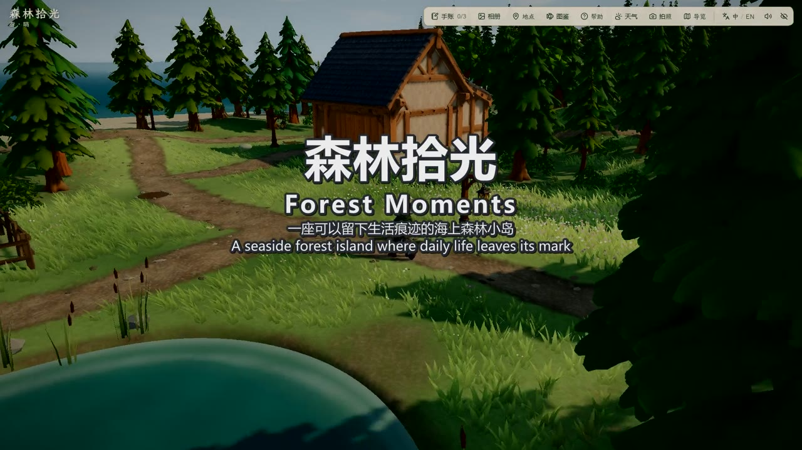
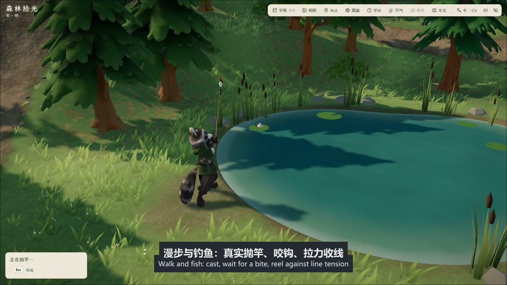
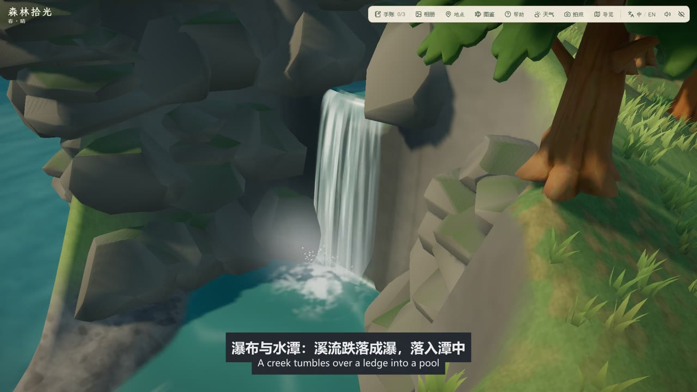
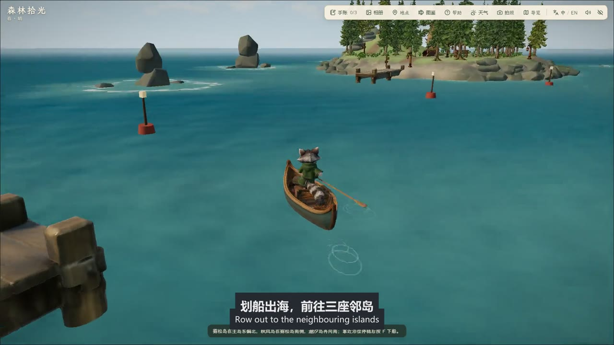
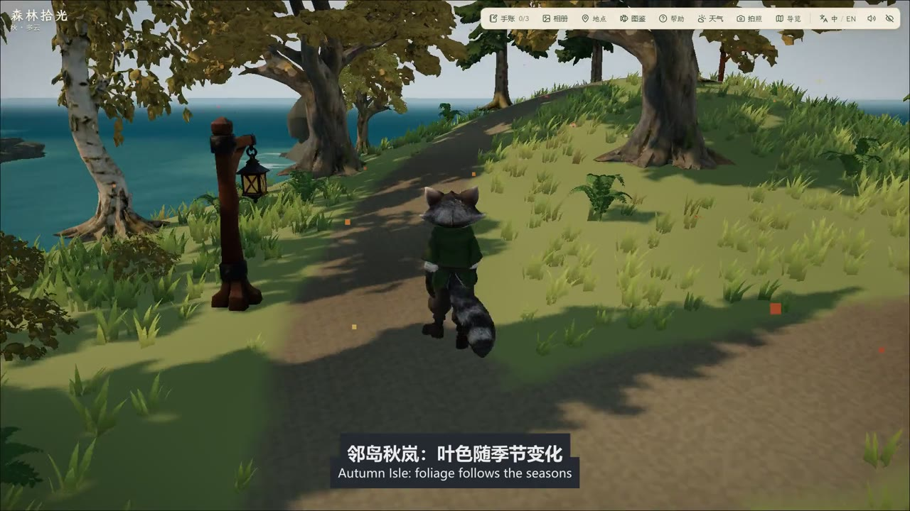

# 演示视频制作记录（2026-11-06）

成片：`docs/report/export/森林拾光-演示视频.mp4`，91.3 秒，1920×1080、30 fps，H.264（标准 yuv420p、bt709）约 4 Mbps，43 MB，AAC 立体声（约 -16.6 LUFS）。中英双语字幕烧录在画面里。

## 画面来源
- 全部是游戏实机录制，不是渲染稿。在本机开发服（`http://127.0.0.1:5176/?qa`，源码 `c38c29e`，与线上构建一致）里用无头 Edge 1920×1080 运行，通过 CDP 屏幕流取帧（实测 30–50 帧/秒），再合成 30 fps。
- 行走、划船、钓鱼、玩沙、坐下都是真实按键事件（W/A/D/Shift/F/空格/B/数字键），镜头转向用右键拖动。脚本：`scripts/demo/record_demo.mjs`（录制）、`scripts/demo/build_demo.mjs`（剪辑、字幕、混音）、`scripts/demo/session.mjs`（浏览器与按键驱动）。
- 用 store 直接设置的只有每段的起点和前提：把浣熊放到起点；瀑布用游戏自带的两个固定观察机位 `creekFalls`、`creekRim`；秋岚把天数设为秋季并登岛；夜景先设为夜晚并点燃篝火。这些不是玩家操作，字幕没有声称它们是。
- 每个新区域先不录制地预热一次，避免着色器编译造成的卡顿。

## 分镜
| 段落 | 实录时长 | 成片时长 | 处理 |
| --- | --- | --- | --- |
| 开场：镜头从浣熊拉远 | 8.0 s | 6.6 s | 原速，叠标题；剪掉镜头拉远中途约 1.5 秒的原地停顿 |
| 漫步与钓鱼 | 34.8 s | 20.1 s | 行走加速 1.8×，咬钩前等待剪掉，收线 1.5× |
| 瀑布与水潭 | 11.8 s | 8.8 s | 两个机位，原速 |
| 玩沙 | 23.4 s | 10.8 s | 脚印、沙堡、沙坑、小河，1.3–1.4× |
| 划船去邻岛 | 49.1 s | 17.7 s | 离岸和靠岸原速，海上航段 6× |
| 邻岛秋岚 | 46.9 s | 13.4 s | 行走 2–4.5× |
| 夜晚的营地 | 17.4 s | 8.0 s | 原速，从镜头转向完成后开始 |
| 结尾字卡 | — | 6 s | 模糊的夜景底图，链接与 Lux3D 使用说明 |

## 起初开头卡顿的原因与处理
用户反馈开头有点卡。逐帧核对后确认有两处：
- 开场：第一次把镜头拉到全岛视角时，要现场编译着色器、换上远景树模型，录到一次 1.09 秒的整段冻结和多次 0.2–0.6 秒的间隔；另外游戏的缩放在中途约 1.5 秒原地不动，看起来像停住。处理：开场前加不录制的预热，并把中途的静止段剪掉。
- 第一段行走：刚按下 W 时有一次 0.82 秒停顿（只出现在第一次迈步）。处理：片段从停顿之后开始。
- 划船上船瞬间有 0.2 秒左右的卡顿，处理：加预热（先上船划一小段再复位）。夜景镜头转向瞬间有 0.5 秒停顿，处理：片段改为从转向完成后开始。
重新合成后，成片前 14 秒的画面运动量每半秒都不为零，没有停顿。这些是录制时的帧间隔，不是线上页面的表现。

## 声音
游戏自带的 CC0 素材（`public/assets/audio/`，来源见 `docs/evidence/assets/2026-10-26-audio/`）：日间与夜间音乐、海浪、鸟鸣、虫鸣、脚步、抛竿、咬钩、收线、划桨、水花、海鸥等，按画面事件的实际时刻混入（抛竿和咬钩按录制时的事件标记对位）。游戏里的篝火噼啪声、瀑布水声是运行时合成的，没有录进来，所以视频里没有这两种声音。

## 验证与边界
- 已核对：成片时长、编码、分辨率；12 个时间点的画面与字幕；无黑场；唯一的静止段是结尾字卡；响度 -16.6 LUFS，峰值 -1.4 dBFS。
- 玩沙字幕“引海水”对应游戏提示“沟渠挖通了，海水流了进来。”（已看过该帧）。
- **没有人工试听**，混音平衡只做了电平检查，需要你听一遍确认。
- 夜景那段我没有确认浣熊是否坐下，字幕只写了“篝火、长椅与路灯”。
- 只在本机开发服、无头浏览器里录制，不是线上页面，也不代表其他电脑的画面表现。

## 代表截图

