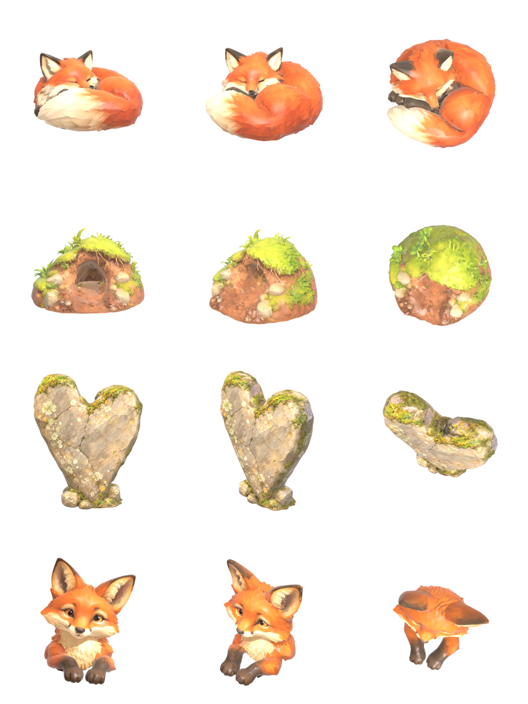

# X5 隐藏角落建模资产（Lux3D，2026-10-28）

状态：4 件已生成、优化并接入场景，本机限定验证（Edge 无头，1440×900），待用户查看。清单与提示词见 [玩法方案第 8 节](../../../GAMEPLAY_EXPANSION_PLAN.md)。

## 来源与授权

- 参考图：用户按清单生成 4 张，1254×1254，白底单体，保存在 `docs/forest-moments-x5-0{1..4}-*-v1.png`。
- 授权：用户在 2026-10-28 授权“4 件全部”，心形石“用现图，在 Blender 里压薄”。
- 服务：Aholo Lux3D img-to-3d G1，中国区 API。四个任务都是一次创建成功、一次生成成功，没有重试。
  - 任务 ID：4434100（睡狐）、4434115（洞口）、4434124（心形石）、4434132（探头狐狸）。
- 积分：余额/报价接口仍返回服务器错误，没有实际报价。按第一轮账单每次 20 积分估算，共约 80 积分，未与账单核对。
- 记录：台账不含临时下载地址，见 [generation.json](generation.json)。脚本为 `scripts/aholo/submit_x3.mjs` 和 `record_x3.py`，已改为可指定 x3/x5 系列。

## 原始模型审阅

每件都渲染了正面、3/4、俯视三个视角（`x5-*/front|three-quarter|top.png`）。四件都与参考图一致：
- 洞口模型的洞较浅、洞里偏亮，进场景时在洞里叠加了一层暗色渐变。
- 心形石原始厚度约为宽度的 38%。

## 优化（`scripts/aholo/prepare_x3.py`，`FOREST_SERIES=x5`）

处理步骤：按真实尺寸缩放，原点放在底部中心，减面，贴图压到 1024 WebP，金属度设为 0、粗糙度 0.85。

| 资产 | 三角面（原始 → 运行时） | 尺寸（m） | GLB |
| --- | --- | --- | --- |
| 睡狐 | 38,974 → 16,000 | 0.62 × 0.62 × 0.43 | 1.02 MB |
| 狐狸洞洞口 | 46,718 → 12,000 | 1.31 × 1.27 × 0.83 | 0.69 MB |
| 心形石 | 29,304 → 8,000 | 0.95 × 0.18 × 1.15（厚度压到一半） | 0.46 MB |
| 探头狐狸 | 39,566 → 14,000 | 0.34 × 0.35 × 0.42 | 0.72 MB |

- 两只狐狸首版减到 1 万和 8 千面后，皮毛出现明显折面，已改为 1.6 万和 1.4 万面。
- 运行时 4 件合计约 2.8 MB，放在 `public/assets/x5/`，走 Git LFS。

## 接入场景（`src/world/Secrets.tsx`）

- **狐狸洞**：
  - 洞口土丘放在瞭望塔小路旁的坡脚，顺着坡前倾 0.4 rad，后半部分埋进坡里。
  - 首版放在坡腰，几乎被土坡整个埋住，只剩一圈边。之后下移到坡脚并顺坡倾斜。
  - 洞口和睡狐都有碰撞。按 F 的站位前移到 (14, −16.9)。
- **狐狸**：
  - 白天睡在洞口左前方，有轻微的呼吸起伏。首版放在右边，被灌木挡住，已改到左边。
  - 黄昏换成从洞里探头的模型。
  - 夜里只在洞里露出一双会眨的眼睛。
- **心形石**：替换原来的挤出几何体。朝向和拍照判定不变，碰撞按新的厚度收窄。
- **塔梁刻字**：保持原样，它已经贴在瞭望塔真实的木构件上。

## 验证

- `check_world_details` 7 组通过。狐狸洞那一组增加了黄昏截图，并检查模型确实加载。
- lint、183/183 单测、build 通过，主 JS 1,809.95 kB（gzip 557.24 kB）。

## 限制

- 狐狸是三个静态模型（睡、探头，夜里只有眼睛），按时段切换，没有骨骼动画，也没有过渡动作。
- 洞口模型的洞较浅，靠叠加暗色加深。
- 无头截图的机位会被自由取景的树冠约束推高，所以截图偏俯视。
