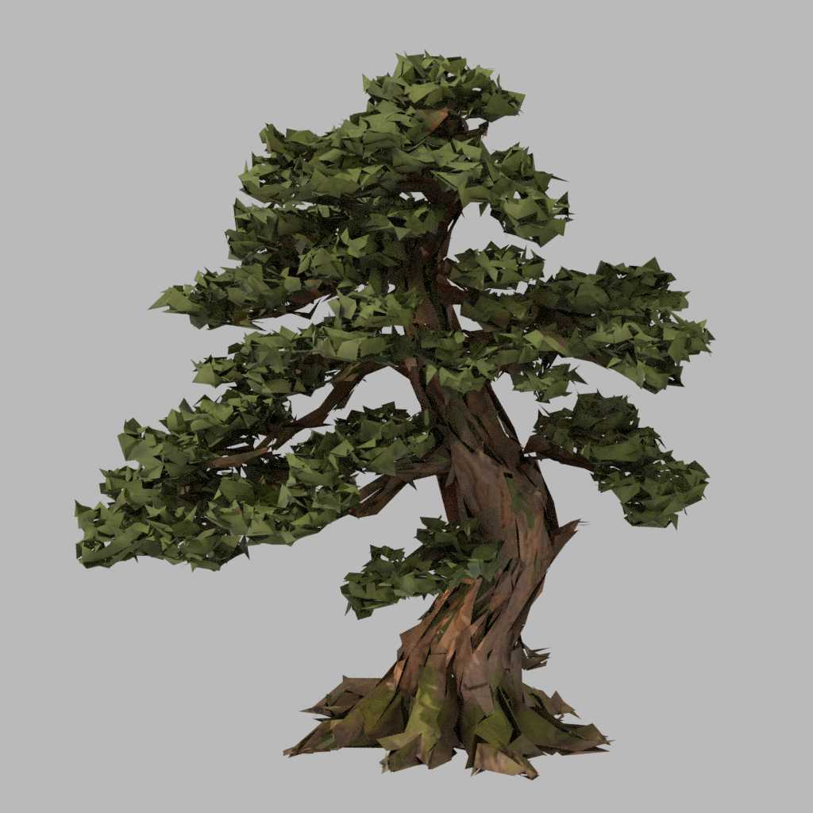
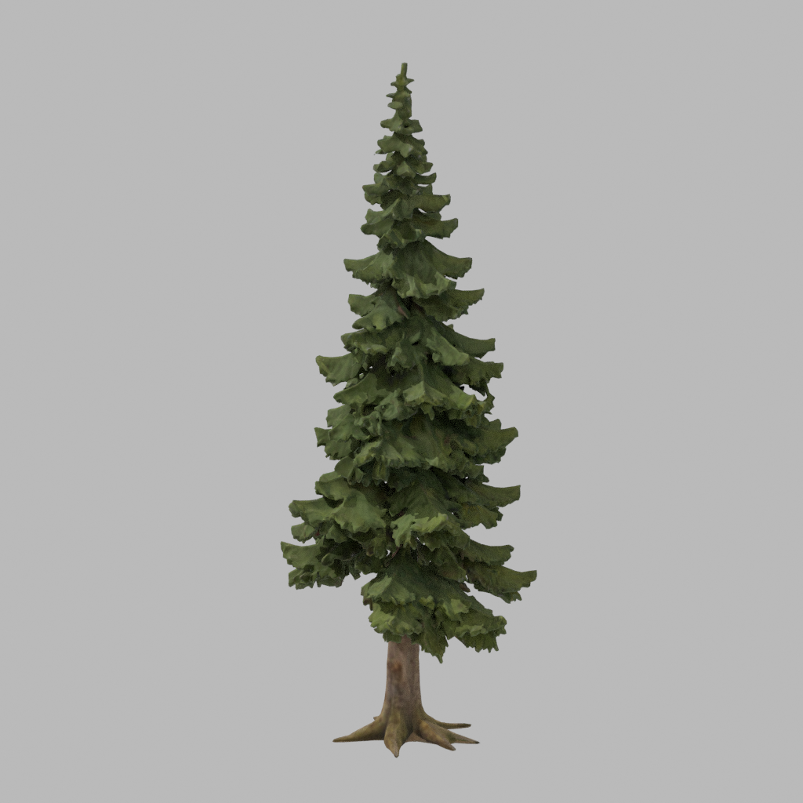

# 西林古松与云杉 · AHOLO 生成及完整模型接入

2026-10-29。本轮仅两件树资产，不代表九件单体、三座邻岛或最终密林美术已完成。

## 来源与调用

用户指出西扩旧树占位不符合已给定参考，要求树木根据参考图调用 AHOLO API；随后确认保留主岛西扩、另加三座较小邻岛。采用项目已生成的独立参考，未重新生成图片。

| 资产 | 图像输入 | Lux3D G1 任务 | 原始三角面 | 运行三角面 | 规范高度 | 运行 GLB |
| --- | --- | --- | --- | --- | --- | --- |
| IE-01 古松 | `docs/references/island-expansion/ie-01-old-pine-v1.png` | 4461967 | 119,684 | 119,684 | 8 m | 6,180,400 字节 |
| IE-05 云杉 | `docs/references/island-expansion/ie-05-spruce-v1.png` | 4461973 | 97,828 | 97,828 | 9 m | 4,560,788 字节 |

- 中国区 `https://api.aholo3d.cn`，`/lux3d/v1/generate/img-to-3d/task/create`，版本 G1，请求面数分别 120000/100000，输出 ZIP/GLB，关闭自动尺寸预测。
- 密钥仅从环境变量读取。先独占创建台账，再上传及创建；每件仅一次创建请求，两任务均成功。原始下载及哈希位于 `assets/lux3d/ie-01-old-pine-v1/`、`assets/lux3d/ie-05-spruce-v1/`，不进入静态部署目录。
- 额度接口 HTTP 500，报价和实际积分不可核实；没有把旧任务估价当成本轮实扣。图像 token 鉴权、上传及任务创建成功。用户调用授权不等于新增商用许可，本轮未获得新的商业许可凭据。
- [官方参数说明](https://labs.aholo.ai/api-docs/en/sdk/typescript)；可复用的项目脚本为 `scripts/aholo/submit_island_asset.mjs`，后续查询只用原 taskId，禁止因下载恢复而重建付费任务。

## Blender 过程和未采用版本

Blender 5.2.1 LTS 独立后台进程：保留完整源模型，烘焙变换，按高度统一尺寸、底部居中，去掉金属度和粗糙度贴图驱动，设为非金属、粗糙度 0.88。导出 WebP 材质的 GLB，保留纹理尺寸；没有修改树冠设计或增加骨骼。规范后的工作文件为每件本地目录中的 `normalized.blend`。

最初尝试近景 5 万面、远景 1.4 万面。实看发现叶团尖刺、碎裂，放弃近景减面；又保留 5 万面作为远景候选。用户随后强调不应默认减面，因此最终**近远景均保留完整几何**，两种减面试验都未进入最终运行版本。

同机位前后、背面及远景候选分别保留在 `old-pine/`、`spruce/` 及各自 `retained-detail/` 中。首轮 `runtime.json` 是当时试验记录，最终采用见[古松当前记录](old-pine/retained-detail/runtime.json)、[云杉当前记录](spruce/retained-detail/runtime.json)。未采用的 LOD GLB 已移至各 `assets/lux3d/ie-*/` 工作目录，`public/assets/island-trees/` 仅包含两件完整模型。

首次预览触发 OIDN 内存错误，没有产出可用图；关闭降噪后完成 Cycles 16 采样预览。此为预览工具故障，没有因此重新调用生成 API。叶片仍比输入插画概括，背面由生成模型推断，不称为精确植物学复刻。

生产脚本 `scripts/aholo/prepare_island_trees.py` 默认不减面。只有显式 `--lod-trial` 才创建本地简化候选，不能自动成为运行版本。

## 游戏接入与验证

`IslandTrees.tsx` 共享 GLB、材质，按 8 m 小区域实例化并利用视锥剔除，不按镜头距离隐藏树冠、不切换简化网格。西林有 5 棵古松、91 个云杉实例；其中较小云杉只是缩放实例，不虚计为独立树龄模型。灌木 19 丛复用原资源，原生活区 140 个植被实例未迁移。

碰撞围绕完整模型在角色身体高度范围内的实际顶点建立保守圆；古松基部半径约 2.29 m、云杉约 0.65 m，古松放在离路线较远位置。树冠另用包络供相机避让；同一树形反复使用的规整感、保守碰撞与未来更细的分枝变体仍需实际体验后调整。

- lint、48 文件 218/218 测试、build 通过。新树最终完整几何已参与西扩双向路径、植被阻挡与原坐标保留测试。
- 无头 Edge 156.0.4314.42，1440×900；三时段 5 机位、栈道实际键鼠通行、拍照、刷新安全出生点、三档 PC 窗口均通过，控制台错误 0。截图已抽查；见[完整模型实机摘要](../../2026-10-29-west-expansion/final-full-detail/report.json)。
- 完整模型下，概览 RAF 中位/P95 为 8.4/12.6 ms，湿地近景为 8.0/17.5 ms，均 180 帧；本机低画质且取消帧率限制，不代表显示 FPS、跨设备表现或公网加载速度。前一候选运行自动处于高画质，两次不可当作有效 LOD 性能对比，不能据此宣称减面有必要。
- 未人工完整游玩，未验证所有树根边缘、阴影切换和高画质长时负载；其余树种、正式栈道、蕨丛、倒木、三座邻岛未制作。未提交、推送、部署或导出 PDF/PPT。
