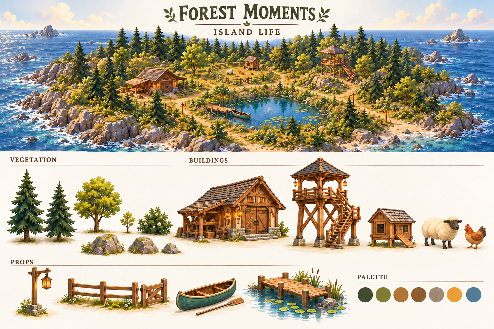

# 森林拾光参考图索引

更新：2026-10-24。先整理参考图，再按海上小岛设计统一结构、风格和交互尺度。

## 最新四阶段树木参考

按用户追加「更小、尚未分叉的第一阶段」制作以下四张单体参考，覆盖旧三阶段板的阶段划分；裂叶、暖木与手绘配色保持一致。四图由 imagegen 先生成，再逐件提交 AHOLO G1，已接入并完成限定浏览器验证；图像本身仍是参考插画。

| 阶段 | 参考图 | AHOLO 任务 |
| --- | --- | --- |
| 单茎初生小苗，0.22 m | [sprout v1](growth/forest-moments-sprout-v1.png) | 4323002 |
| 分叉树苗，0.55 m | [seedling v1](growth/forest-moments-seedling-v1.png) | 4322894 |
| 幼树，1.5 m | [young v1](growth/forest-moments-young-v1.png) | 4322899 |
| 成树，3 m | [mature v1](growth/forest-moments-mature-v1.png) | 4322904 |

完整提示词、顶芽修复、材质修订及实机对比见[报告 5.28](../report/PROJECT_REPORT.md)和[本轮证据](../evidence/assets/2026-10-24-tree-growth/evidence.md)。下方 2026-10-21 的九张专题图及其待确认状态保留为历史记录，不覆盖本轮资产验收状态。

## 最新海边码头参考

[海边栈桥 v1](waterside/forest-moments-seaside-jetty-v1.png)：按用户最新要求先由 imagegen 生成并查看，再作为 AHOLO G1 任务 **4321451** 的单体输入。已完成 Blender 校准与运行时接入，验证见 [海岸记录](../evidence/assets/2026-10-24-coastal-layout/plan.md)。此图覆盖下方早期“池塘码头组装关系”的码头设计；池塘保留钓鱼，船移入海中。参考图不等同实机截图。

## 当前参考的使用顺序

1. 整体空间以 [海上小岛概念 v2](concept/forest-moments-overview-v2.png) 为布局起点，图中建筑细节以本轮专题主图覆盖。
2. [环境总板 v3](style/forest-moments-environment-board-v3.png) 统一色彩与元素构成；单体结构以各专题参考为准。
3. 建模先使用下列 9 张当前专题参考与 15 张保留单体图；历史图片仅用于过程对比。

状态：本轮图片已生成并实际查看，**待用户确认，未做三维结构或实机验收**。多主体板只用于设计说明，不能整张投入单资产建模；需要先选定单体并由模型旋转取得一致多视图。

## 本轮专题参考（9 张）

| 参考 | 修改与使用边界 |
| --- | --- |
| [开放式瞭望塔主图](lookout/forest-moments-lookout-master-v2.png) | 开放式木支架、独立小石脚与外置折返楼梯清楚；已取消错误的多视图。平台入口、踏步及支撑须建模复核。 |
| [低石基工坊主图](workshop/forest-moments-workshop-master-v2.png) | 固定正门左侧附棚，降低石基，去掉烟囱，减少工具；单张主图取代未经核准的多视图，实际进深和门扇开合须建模确定。 |
| [阔叶树三阶段成长](environment/forest-moments-tree-growth-v2.png) | 同一种阔叶树的初栽、幼树、成树可辨且共用基线；画面尺寸为示意，0.45/1.5/3m 是设计目标而非已测量尺寸。 |
| [浣熊造型与姿态](player/forest-moments-raccoon-design-v2.png) | 正背面手臂间隙扩大、鞋部简化、角色身份保留；侧面双臂投影重叠且尾巴细节有差异，不能当作精确三维投影或已绑定证据，毛发细纹仅作贴图参考。 |
| [池塘码头组装关系](waterside/forest-moments-pond-dock-layout-v2.png) | 岸边接入、连续甲板、靠船开放边和淡水水线清楚；栈桥与平台已统一为一个组装方案。实际甲板高度、上船距离和碰撞需灰盒实测。 |
| [海岸、沙滩与池塘过渡](environment/forest-moments-shore-transitions-v2.png) | 岩岸/缓坡沙滩/淡水池岸三类过渡可辨；海边有泡沫、池塘无海浪，连续岩体替代单纯重复圆石。植被密度仅作气氛参考。 |
| [羊与鸡简化造型](farm/forest-moments-farm-animals-v3.png) | 羊毛分为大形体块、鸡翅和尾羽简化，鸡相对尺寸减小；最终模型统一到约0.75m羊肩高、0.35m鸡全高，不从图像像素推断精确比例。 |
| [划桨、钓鱼、开门与喂食](interaction/forest-moments-interaction-scale-v3.png) | 已统一棕鸡与深灰脸羊、降低牧场门；划桨握持、鱼线浮漂、开门空间、喂食位置可辨。船内脚部和尾根部分遮挡，仍需绑定与碰撞验证。 |
| [森林拾光环境总板](style/forest-moments-environment-board-v3.png) | 已移除烟囱、恢复青绿色船身与FOREST MOMENTS标题；开放塔和海岛要素清楚。总板仅总览色彩与构成，建筑/动物具体结构以各自专题主图为准。 |

[建模设计约束](DESIGN_CONTROLS.md) · [生成及复核记录](../evidence/P1/2026-10-21/reference-revision/evidence.md) · [完整提示词与输入记录](../evidence/P1/2026-10-21/reference-revision/generation-record.json)

## 保留的单体造型参考（15 张）

这些图片适合作为外形、配色及材质依据，仍需按角色尺度建模、设置碰撞并控制预算。圆岩/扁岩/立岩用于点缀，连续海岸按岸线专题制作；阔叶成树细节以成长专题保持同种一致。

| 图片 | 用途 |
| --- | --- |
| [高松树](environment/forest-moments-pine-tall.png) | 单体造型与建模输入参考 |
| [松树](environment/forest-moments-pine.png) | 单体造型与建模输入参考 |
| [阔叶树](environment/forest-moments-broadleaf-tree.png) | 单体造型与建模输入参考 |
| [圆岩](environment/forest-moments-rock-rounded.png) | 单体造型与建模输入参考 |
| [扁岩](environment/forest-moments-rock-flat.png) | 单体造型与建模输入参考 |
| [立岩](environment/forest-moments-rock-upright.png) | 单体造型与建模输入参考 |
| [灌木](environment/forest-moments-bush.png) | 单体造型与建模输入参考 |
| [围栏](environment/forest-moments-fence.png) | 单体造型与建模输入参考 |
| [路灯](environment/forest-moments-lantern-post.png) | 单体造型与建模输入参考 |
| [木长椅](environment/forest-moments-wood-bench.png) | 单体造型与建模输入参考 |
| [路牌](environment/forest-moments-signpost.png) | 单体造型与建模输入参考 |
| [独木舟](waterside/forest-moments-canoe.png) | 划船、码头与钓鱼道具建模参考 |
| [船桨](waterside/forest-moments-paddle.png) | 划船、码头与钓鱼道具建模参考 |
| [钓竿](waterside/forest-moments-fishing-rod.png) | 划船、码头与钓鱼道具建模参考 |
| [鸡舍](farm/forest-moments-chicken-coop.png) | 小型牧场动物与鸡舍参考 |

## 历史参考（20 张）

以下图片不再作为当前设计输入。保留原文件和哈希用于追溯，不因保存文件而沿用旧结构、图内标题或视角名称。

| 历史图片 | 当前依据 |
| --- | --- |
| [整体风格板](style/forest-moments-style-board.png) | [新版](style/forest-moments-environment-board-v3.png) |
| [环境元素板](style/forest-moments-environment-board.png) | [新版](style/forest-moments-environment-board-v3.png) |
| [树苗](environment/forest-moments-sapling.png) | [新版](environment/forest-moments-tree-growth-v2.png) |
| [浣熊 · 正面](player/forest-moments-raccoon-front.png) | [新版](player/forest-moments-raccoon-design-v2.png) |
| [浣熊 · 左侧](player/forest-moments-raccoon-left.png) | [新版](player/forest-moments-raccoon-design-v2.png) |
| [浣熊 · 背面](player/forest-moments-raccoon-back.png) | [新版](player/forest-moments-raccoon-design-v2.png) |
| [浣熊 · 右侧](player/forest-moments-raccoon-right.png) | [新版](player/forest-moments-raccoon-design-v2.png) |
| [瞭望塔 · 斜侧面](lookout/forest-moments-lookout-tower-three-quarter.png) | [新版](lookout/forest-moments-lookout-master-v2.png) |
| [瞭望塔 · 右侧](lookout/forest-moments-lookout-tower-right.png) | [新版](lookout/forest-moments-lookout-master-v2.png) |
| [瞭望塔 · 背面](lookout/forest-moments-lookout-tower-back.png) | [新版](lookout/forest-moments-lookout-master-v2.png) |
| [工坊 · 斜侧面](workshop/forest-moments-workshop-three-quarter.png) | [新版](workshop/forest-moments-workshop-master-v2.png) |
| [工坊 · 正面](workshop/forest-moments-workshop-front.png) | [新版](workshop/forest-moments-workshop-master-v2.png) |
| [工坊 · 左侧](workshop/forest-moments-workshop-left.png) | [新版](workshop/forest-moments-workshop-master-v2.png) |
| [工坊 · 背面](workshop/forest-moments-workshop-back.png) | [新版](workshop/forest-moments-workshop-master-v2.png) |
| [工坊 · 右侧](workshop/forest-moments-workshop-right.png) | [新版](workshop/forest-moments-workshop-master-v2.png) |
| [瞭望塔 · 设计板](lookout/forest-moments-lookout-tower-design-board.png) | [新版](lookout/forest-moments-lookout-master-v2.png) |
| [码头栈桥](waterside/forest-moments-dock-pier.png) | [新版](waterside/forest-moments-pond-dock-layout-v2.png) |
| [码头平台](waterside/forest-moments-dock-end.png) | [新版](waterside/forest-moments-pond-dock-layout-v2.png) |
| [绵羊](farm/forest-moments-sheep.png) | [新版](farm/forest-moments-farm-animals-v3.png) |
| [鸡](farm/forest-moments-chicken.png) | [新版](farm/forest-moments-farm-animals-v3.png) |

## 迭代记录

| 试稿 | 未采用原因 |
| --- | --- |
| [lookout](../../docs/evidence/P1/2026-10-21/reference-revision/lookout-rejected-multiview.png) | 未采用：FRONT 与 SIDE 画面过于相似，无法当作可靠结构投影。 |
| [animals](../../docs/references/farm/forest-moments-farm-animals-v2.png) | 已替代：毛羽仍过密、鸡相对偏大。 |
| [interactions](../../docs/references/interaction/forest-moments-interaction-scale-v2.png) | 已替代：牧场门过高、鸡羊颜色与动物参考不一致。 |
| [style-final](../../docs/references/style/forest-moments-environment-board-v2.png) | 已替代：总板重新出现烟囱、船身误为纯木色。 |

## 文件与验收说明

2026-10-24 牧场复用补充：沿用动物 v3 总板比较风格，另只读复制 my-blog 既有模型的历史输入图：[鸡](farm/reused-animal-chicken.png)、[羊](farm/reused-animal-sheep.png)、[鸡舍](farm/reused-ranch-coop.png)。这三张不是本轮新生成，未计入下方 2026-10-21 的 13 张生成统计；来源与哈希见[牧场证据](../evidence/assets/2026-10-24-farm/source-provenance.json)。本轮模型复用和进食校准的实际画面在报告 5.30，不用参考图替代实机验证。

- 原始参考图实际存在 35 张；单独的角色外观基线图此前已缺失，清单保留 unavailable_images 记录。
- 本轮共生成 13 张，9 张为当前专题参考、4 张保留为迭代记录；整体概念 v1/v2 为此前产物。
- [概念 v1](concept/forest-moments-overview-v1.png) 未体现海上小岛，已由 v2 替代。v2 的整体布局保留，单体细节以当前专题主图为准。
- 生成插画不代表实际游戏截图、已完成模型、绑定动作或交互；无法从图像确认尺寸、拓扑、碰撞和帧率。
- 图片保存在 docs，不进入 public 或运行时下载；尺寸、SHA-256 与技术追溯见 [完整清单](reference-manifest.json)。
- 本地设计参考已获用户授权，公开分发、商用及参赛使用权在发布前逐项核实。
