# 森林拾光 Forest Moments · 项目报告书

**参赛报告 v0.82 | 2026-10-28 | 持续更新草案，非最终提交**

> 本报告是唯一事实主稿，持续记录实际截图、生成过程及模型/场景对比。参考插画、几何占位和已验证产物分别标注；当前尚未部署公开 Demo。

当前进度（v0.82）：新增工具栏“天气”按钮，可手动选晴、多云、小雨、薄雾或跟随天数，本机限定验证，待用户查看，见 5.77。同日修复挖小河卡顿、木工台图样面板间距、做完木凳后连坐。

历史进度（v0.81）：南侧大沙滩可以玩沙——走过留下爪印，B 进入堆沙模式，快捷栏堆沙堡、挖通海的小河、挖沙坑、印浣熊轮廓，睡一觉被潮水抹平；沙面加了风纹与湿沙光泽。本机限定验证，待用户查看，见 5.76。

历史进度（v0.80）：瞭望塔移到北侧崖顶，登塔即见西北海面，无树遮挡，本机限定验证，待用户查看，见 5.75。

历史进度（v0.79）：跟随镜头按坡度调整俯角——上坡放平、下坡俯视，本机限定验证，待用户查看，见 5.74。

历史进度（v0.78）：用户表示此前“待用户查看”的各项视为验收通过，并要求先做第一档扩展（方案 `docs/GAMEPLAY_TIER1_PLAN.md`）。T1–T5 已实现并完成本机限定验证，待用户查看，见 5.73：
- 雾鱼、雨后彩虹、雨天多蘑菇；
- 季节回顾；
- 6 处种植地，每天能种一棵；
- 黄昏和夜里放河灯；
- 约 90 秒的镜头导览。

同时修复了 `weatherFor` 天气其实连续多天不变的既有问题。已提交并推送 GitHub `origin/main`（`6beabdd`、`d5bc018`、`d9a8f7f`），未部署。

历史进度（v0.77）：玩法扩展 9 项均已实现，并完成本机限定验证。X5 隐藏角落的 4 张参考图（5.71）已经用户授权，由 Lux3D 生成并接入（5.72）。

- X3 正式道具由 Lux3D 生成，共 12 件，已接入采集、鸡蛋、家具和隐藏角落。
- 拍照界面改为取景器风格。
- 新增码头海钓和 X4 天气季节（5.68–5.69）。
- 已补齐（5.70、5.72）：雨天路面水坑（带真实倒影）、溅落和溪面雨点；水母在海面下的光；隐藏角落增加到 6 处，狐狸洞、狐狸和心形石已换成 Lux3D 模型；春花、夏萤、秋季树冠与落叶（5.70）。第 6 节状态表已按实际实现更正。

仍未完成的：雨声没有人工试听；狐狸只有按时段切换的静态模型，没有动画；没有真机帧时间。

截至 5.72 的改动已提交并推送 GitHub `origin/main`（代码与资产 `0144dd0`），未部署。

历史进度（v0.71）：X3 清单的 12 张单体参考图已生成并初步图像复核，待用户确认，见 5.67；均保存到计划所在的 docs/。尚未调用 Lux3D，不代表正式模型或游戏画面完成。

玩法实现状态（v0.71 延续）：玩法扩展进行中（方案见 `docs/GAMEPLAY_EXPANSION_PLAN.md`），见 5.66。X1 背包与图鉴、X2 鱼种/烤鱼与星空/照片任务/照片墙已实现并本机限定验证；X3 采集、牧场、工坊配方仅逻辑与几何体占位、只有单元测试；码头海钓、家具展示、隐藏角落、天气季节未做；X3 正式道具的 Lux3D 调用待用户确认。全部未提交。

历史进度（v0.70）：拍照模式 P1/P2（环绕与自由取景、相册、6 滤镜、3 相框及手账解锁）、四个遗留浏览器脚本修复和松树逐方向碰撞已实现，本机限定验证，待用户查看，见 5.65。音频已由用户试听确认。自由取景穿墙防护仅有单元测试，低画质关闭景深未对比画面，新增汉字部分回退系统字体，均未验证；无新模型或付费调用，本轮 5 个提交已推送 `origin/main`（至 `b444b50`），未部署。

历史进度（v0.69）：按用户截图修复营地及海边五张长凳的坐姿偏移、座面穿模与尾巴穿靠背，已实现并完成本机限定验证，待用户查看，见 5.64。坐下/坐稳/起身共 15 个姿态抽样通过；工坊木墩保持原姿态，无新模型或贴图。

2026-10-26 提交推送补记：按用户明确授权，5.62–5.64 的手账、PC 范围约束、篝火和长凳修复及精选证据已归档为 `8568397`，GitHub `origin/main` 已接收该提交。本条作为后续记录提交。运行时代码与本会话已通过 lint、118/118 单测、build 及浏览器检查的快照一致，不重复测试；无新视觉改动、模型或部署，保留各章节当时的“未提交/推送”记载及验收边界。

历史进度（v0.68）：按用户反馈参考 my-blog 重做篝火，柔软变形火焰、渐隐火星与暖光已实现并完成本机限定验证，待用户查看，见 5.63。点燃/熄灭与连续烤火手账闭环通过；无新模型或贴图。

历史进度（v0.67）：手账 J1/J2 已完成计数规则、历史页、存档调整与本机限定验证，待用户查看，见 5.62。用户明确仅 PC 浏览器，不兼容手机界面，不做移动端布局或触屏控制；手机宽度不作为验收目标。拍照 P1/P2 仍未实施，音频仍待人工试听。

历史进度（v0.66）：音频已实现、本机限定验证、待人工试听；手账 J1/J2 初版已接入、待浏览器验收；拍照 P1/P2 尚未实施。本轮归档现有成果并作本地 Git 提交，重新通过 lint、111/111 单测及 build，见 5.61。以下版本简介为历史记录。

2026-10-26 合并推送补记：用户随后明确授权合并 main 并推送；`fix/camera-collision-fishing` 的 3 个提交已快进合入 main，无冲突，GitHub `origin/main` 已接收至 `05d40d1`。本补记作为后续记录提交并推送。合并代码与本会话已通过 lint、111/111 单测及 build 的快照相同，未重复测试；未新增截图、模型或部署。下文“未推送”保留为各阶段当时状态。

v0.52 仅归档已确认的整体 UI 升级计划，详见 5.48；UI 尚未实施，当前运行时成果仍见 5.47 及此前章节。

v0.53 为临时清理维护补记：自动审批拒绝删除，未实际清理或释放空间；运行时与 UI 计划状态不变。

v0.54 为场景视觉实机审查与重新制定的升级计划，详见 5.49；仅计划，画面尚未改动。

v0.55 实施场景视觉 V1：光照冷暖对比、后期（环境遮蔽/泛光/ACES/暗角）、夜间窗光与余烬、开局镜头，详见 5.50；用户查看通过。

v0.56 实施场景视觉 V2：海面非周期法线、海天 haze、连续潮线、湿沙带，以及树冠镜头避让，详见 5.51；用户查看通过。

v0.57 实施整体 UI 升级（U 轨道）：统一纸面 HUD、单一底部提示、首次引导、菜单暂停、通知分级，详见 5.52；用户查看通过。

v0.58 记录 V3 进度：本地 Blender 海岸套件已制作，运行时布局开发中、未接入场景，详见 5.53；此前分批提交的记载由 v0.59 的实际 Git 复核更正。

v0.63 完成 V4 地表植被与 V5 地标点缀，详见 5.57；本机限定验证，待用户查看。

v0.62 参考 my-blog 重做加载画面与错误页（斜纹底、浣熊徽章、缝线进度条），详见 5.56 补充；本机限定验证，待用户查看。

v0.61 增加界面隐藏入口、中英文切换和界面风格精修（标题特殊字体、去掉多余框），详见 5.56；本机限定验证，待用户查看。

v0.60 将 V3 海岸套件接入场景：修复布局失败、崖面错缝铺岩、崖顶草皮与水线岩色、礁石调色，详见 5.55；本机限定验证，待用户查看。

记录要求：每轮在本稿内说明问题与目标、设计思路及决策依据、方案调整、参考图、实际前后对比、验证结果和剩余问题。关键图片直接嵌入正文；证据目录保存原文件与完整数据。最新树木常显见 **5.47**，滚轮全岛视角见 **5.46**，崖壁/溪口细化见 **5.45**，休息昼夜过渡见 **5.44**，扩岛与生活功能图文见 **5.43**，维护记录见 **5.37**，历史迭代见 5.1–5.39。

2026-10-24 最新决策：按用户要求，资源体积预算改为可调整参考，不以固定 MB 数阻塞下一阶段；优先画面、动作与实际加载体验。历史章节的 25/15 MiB 和“超预算”保留为当时记录，不再是当前硬性验收门槛。

## 1. 作品概述
中文名：森林拾光。英文名：Forest Moments。拟提交题目：一座会生长的童话森林。
作品目标：以小规模手绘风森林微型世界传递安静、自然、舒适的慢生活体验。玩家化身小浣熊穿行树林，在池塘钓鱼，种树、划船、照顾动物、到工坊制作物品、登瞭望塔看日落。互动不靠长任务清单，而让森林逐渐留下玩家的生活痕迹。

## 2. 创意与核心亮点（设计目标）
1. 小而精的森林空间：用有限地标与林间道路创造环形探索节奏，不堆砌建筑。
2. 行为影响环境：新树苗成长、动物活动、夜灯变化、渔获记录。
3. 浣熊主角动作：骨骼绑定保证走、跑、坐、蹲、钓鱼、划桨与尾巴自然摆动。
4. 真实可玩：交互优先而非静态展示模型，让评委直接在浏览器体验。

上述为作品方向；四阶段成长、钓鱼、划船、喂养、观景和工坊最小闭环已逐步实现，具体状态与验证边界以第 6 节为准，不能将专用动作或完整经营目标写成已完成。

## 3. 场景规划
场景是一座海上的森林小岛，周围大海、自然海岸和地平线清晰可见。岛内独立淡水池塘与海水分离，环形土路连接木作工坊、小牧场、木质瞭望塔、码头、木船和种树区。主色为深绿色针叶树与暖木、琥珀光和柔和岩石，建筑少而精。

先整理参考图，建立风格和单体造型基线；再独立生成整体概念图。早期空间候选为 [海上小岛概念 v2](../references/concept/forest-moments-overview-v2.png)，v1 未呈现大海，已替代。本轮完成 9 张适配专题图，原 35 张中保留 15 张作为当前单体依据、20 张转为历史。当前环境总板 v3、专题主图及建模约束见 [索引](../references/README.md)，个别单体细节覆盖整体概念中的早期表达。这些图均为设计插画，待用户确认，不代表实际游戏截图。提示词、版本与复核见 [本轮证据](../evidence/P1/2026-10-21/reference-revision/evidence.md)。

## 4. 技术架构（已开始）
React + TypeScript + Vite + R3F / Three.js，Zustand 用于交互状态，本地 localStorage 存档。目标以纯静态构建部署到 modelscope.ai 的 Static Studio，访客设备通过 WebGL 渲染，不在服务器执行每帧三维渲染。

现有基础：单页 R3F Canvas、Lux3D 角色/建筑/木船/新海岸码头、迁移的生产植被与室内、既有骨骼动作、跟随/观景/室内相机、地形与家具碰撞、四阶段树苗存档、牧场最小喂养。划船已由池塘迁入沿岛海域，支持码头上船、前后划、转向、停稳下船与恢复步行；池塘西岸保留抛竿/提竿/张力收线/渔获鱼簿闭环；工坊现有独立室内与木墩修整闭环，瞭望塔现有观景模式；2026-10-25 增加高地/海崖/溪桥/沙滩、卧室/睡觉/鱼缸、篝火/坐凳与程序化木工握持动作，见 5.43；休息已按用户新要求改为俯瞰日出/日落（5.44），不再安排上下床动作；逐级攀爬及经营玩法尚未实现。

## 5. 资产生成与优化（首轮原始候选已下载）
已开始通过官方 Lux3D API 生成浣熊、工坊、开放木塔与独木舟的首轮候选。后续计划使用 Blender 校准比例、整理网格/UV/骨骼/碰撞、制作或处理动画，并压缩成运行时 GLB。
- Lux3D 生成模型清单：浣熊、工坊、木塔、独木舟四项均已下载。详见 5.2。
- 生成参数、次数与积分记录：已保留本地任务台账、输入图片及用户账单读数。
- 原稿及试稿对比：已完成离线渲染；工坊与船的两版减面试稿均未通过，详见 5.3。
- 商业使用与参赛授权：必须逐件核对。
当前游戏已使用浣熊 v6、工坊 v2、木塔 v3 和 center-seat-v11 船，原船 v2 作为桨网格来源；树木、灌木和木灯已迁入 my-blog 生产模板，草花风动与扩岛见最新 5.24，牧场仍为几何占位。后续各小节保留当时的历史状态，接入结论见 5.10，5.11 为已弃用的划桨适配，原动作恢复见 5.12，原桨随动诊断见 5.13，历史布局对比见 5.14，中央座位基准恢复见 5.15，木座历史候选见 5.16，中央落座与原桨配合收尾见 5.17，正式划船闭环接入见 5.18。

### 5.1 Aholo 参赛规则确认（2026-10-22）
用户提供的赛事方英文回复确认：通过 **Codex 或 MCP 调用官方 Lux3D API** 来生成作品的**核心 3D 资产**，符合该赛事 Lux3D 强制使用要求；不需要从 Lux3D Web Studio 生成。模型可进一步在 Blender 优化，再集成到 Three.js 游戏中；最终提交时必须清楚说明 Lux3D 如何参与实际制作。

[英文原文、中文翻译和来源边界](../evidence/hackathon/2026-10-22-lux3d-api-rule-confirmation.md)。目前只有用户提供的文字转录，尚无官方回复的原始截图、消息链接或发言人身份记录。此证据仅说明规则沟通，**不代表已生成 Lux3D 模型，不证明模型商用许可，也不代表比赛评审通过**。后续逐件补充官方 API 任务 ID、生成参数、原始模型、Blender 优化前后对比和浏览器实机截图。

本次文档更新检查：原文和本地证据链接通过，git diff --check 通过，pnpm lint 0 错误/0 警告，pnpm test 3/3，pnpm build 成功。未新增浏览器截图和模型产物；既有主 JS 包体积警告仍在。

2026-10-22 提交前复核：修正资产 Skill 的列表编号粘连；重新运行 pnpm lint、pnpm test（3/3）、pnpm build，均通过。主 JS 1,145.60 kB 的既有包体积警告仍在；本次仅文档变更，未新增浏览器验收。

### 5.2 Lux3D 首轮候选（2026-10-22）

用户明确授权开始模型生成，沿用本机已跑通的 `https://api.aholo3d.cn`，`G1`、目标 `faceCount=300000`、输出 ZIP + GLB。第一轮范围为浣熊、工坊、开放木塔、独木舟各一个候选。高面数用于保存原始细节，不代表符合浏览器预算。

浣熊 `4266109`、工坊 `4266166`、木塔 `4266456`、独木舟 `4266578` 全部成功并下载，4 份原始 ZIP 与 4 个 GLB 均已保留。四个 GLB 分别为 299138 / 283475 / 281358 / 287052 三角面，合计约 69.00 MiB；每个含两张 2048×2048 贴图，均为单网格、零骨骼、零动画，尚未优化或集成。详细尺寸与哈希见 [脱敏清单](../evidence/assets/2026-10-22-round-01/manifest.json)。

[输入提示词](../evidence/assets/2026-10-22-round-01/input-prompts.json) · [积分核对记录](../evidence/assets/2026-10-22-round-01/billing.md) · [原始候选与操作说明](../../assets/lux3d/round-01/README.md)。原版/优化版对比及浏览器截图仍待补；本轮 Blender 后台启动阻塞，没有生成可供验收的新渲染，浏览器工具不可用。

本轮验证：pnpm lint、pnpm test（3/3）、pnpm build 通过，既有 JS 包体积告警仍在。生成脚本的台账保护、单次创建、未知提交状态阻断、上传恢复前的输入哈希/路由/参数核验离线检查通过。含临时资源 URL 的响应与恢复台账仅存本机，脱敏证据不包含密钥。

最终文件检查：4/4 输入哈希及图像解码、8/8 输出哈希、4/4 ZIP CRC、4/4 GLB 容器及内嵌纹理解码通过。开发复核页及清单 HTTP 200，但浏览器渲染、视觉外观、拓扑、动作和交互仍未验收。前两笔各 20 积分由用户截图确认，后两笔同参数预计各 20；预计首轮 80，不能把预计总额或余额当作实查结果。完整过程与限制见 [本轮证据](../evidence/assets/2026-10-22-round-01/evidence.md)。

### 5.3 Blender 离线筛选与性能决策（2026-10-22，同日后续）

恢复 Blender 5.2.1 LTS 后，四项原稿完成 25 张 900×900 Cycles 真实渲染，并保留独立 review.blend。启动阻塞在自带 Python 的 WMI 查询复现；仅在子进程中启用其内置备用查询后恢复，没有修改系统服务或 Blender 安装。

浣熊面罩、披肩、尾巴及静态肢体间隙可辨，但碎毛过密、材质偏亮；工坊方向符合设计，背侧孔隙与交互拆件待处理；木塔顶层入口有横向木构件，楼梯通路未通过；船内舱与底部局部黑斑/凹坑需核查，人物与尾巴容纳尚未验证。

工坊与船各做两版本地减面探索，共新增 19 张渲染，原稿与试稿合计 44 张。v1 达到工坊 30000 面 / 4015796 字节、船 12000 面 / 2950080 字节，但表面出现裂片与三角色块；v2 合并重复位置顶点后为 54604 / 34610 面，仍严重失真。**四个试稿全部不采用；没有将较小体积表述为优化成功。** 原始模型与失败试验分别保留，游戏仍使用几何占位。

用户随后询问减面的必要性，修正阶段决策：**减面不是强制流程**。四项原稿约 115 万面、69 MiB 只说明需要实测；当前没有帧率、显存和加载数据，不能认定必须减面。先修原稿的结构、材质，获得受控实机场景测量，再根据瓶颈选择贴图/文件压缩、按需加载或局部减面/LOD，避免以降低外观质量满足数字预算。

验证：pnpm lint、pnpm test（3/3）、pnpm build、生成脚本保护检查、Python 语法检查通过；原稿输入/输出哈希及 ZIP CRC 再次通过，8 个原稿/试稿 GLB 与 44 张渲染图检查通过。主 JS 1,145.60 kB 的既有警告仍在。浏览器工具没有实例，未实机视觉或性能验收；未绑定、未接入、未推送/部署，本轮没有新增 API 生成或积分消耗。

[实际图片、逐项结论及失败对比](../evidence/assets/2026-10-22-round-01/visual-review.md) · [文件验证清单](../evidence/assets/2026-10-22-round-01/review-validation.json)。5.2 中的后台阻塞记录为同日早期状态，本节为最新结果。

### 5.4 保留原面数的材质与结构核查（2026-10-22，同日后续）

浣熊新增 material-v1 候选，仅调整 PBR 材质 JSON：金属度 0、粗糙度 0.68、停用原 metallic/roughness 贴图引用。源模型全部二进制 chunk 逐字节保留，仍为 299138 三角面，UV/法线/贴图不变。3 张同机位离线渲染表明强高光减弱；统一材质也降低了眼部和皮革的差异，仍需分区处理，不作最终材质通过声明。

工坊与船新增 5 张无贴图灰模诊断，后墙、檐口、船底黑色缺陷仍可见，需继续定位几何问题。四项模型仅在内存分析副本中合并位置重复顶点，记录边界片段和非流形边；这些数值不等于破洞数量，未盲目补洞或写回原模型。正式游戏仍为几何占位，未绑定/集成。

开发复核页增加原稿单项/四项同场展示、浣熊材质切换、预热 2 秒后 30 秒固定机位 RAF 采样及 JSON 导出；记录加载准备时间、绘图尺寸、DPR、帧间隔、draw calls 和资源数量。后台、尺寸、资产或机位变化使测量失效。资源个数不是显存，缓存影响加载计时，展示台不是完整游戏性能。页面/模块/清单 HTTP 200，但浏览器工具仍无实例，尚无实际测量结果或浏览器截图。

验证：pnpm lint、pnpm test（3/3）、pnpm build 通过；新增 8 张 900×900 图像解码、来源哈希及材质 GLB/二进制不变检查通过；既有主 JS 体积提示保持记录。本轮未减面、未调用新生成任务、未部署或推送。后续先修几何/分区材质和准备绑定，性能优化仍以原面数实测为依据。

[对照图片与验证边界](../evidence/assets/2026-10-22-round-01/material-diagnostics.md) · [检查记录](../evidence/assets/2026-10-22-round-01/material-diagnostic-validation.json)。

### 5.5 复用现有四视图重生成浣熊（2026-10-22，同日后续）

用户指出旧浣熊尾巴连接衣服，不予采用，并明确选择 docs/references/player 现有正、背、左、右四张独立参考图。本次按该顺序原样上传，覆盖旧清单对这些图的历史参考默认分类；原图及哈希保留。用户提醒前制作的两张参考试稿均未作为模型输入，也没有调用四视图生成 API。

官方 Lux3D 中国区 G1 / 300000 目标面数 / ZIP + GLB，单个新任务 **4268120** 成功。实际 GLB 289504 三角面、19180376 字节（18.29 MiB）、两张 2048² 贴图、零骨骼/动画；实际扣费未核对，来源及脱敏清单见 [本轮证据](../evidence/assets/2026-10-22-raccoon-multiview/evidence.md)。原始输出未减面或改材质。

新增六视角全身、四张尾根近景和两张灰模近景，共 12 张 Blender 真实渲染。新模型背面开叉更清楚，但尾根与下摆仍呈贴连轮廓，**视觉复核未通过**；灰模也没有显示清楚分离，不能宣称已修复。局部网格的内部连接和绑定摆动仍需检查，毛面碎片感及材质高光也待修整。新旧模型保留，没有替换游戏角色或自动继续付费重生成；下一步局部修整尾根、下摆后再验证绑定。

4 张输入来源/副本/台账哈希、2 个输出哈希、ZIP CRC、GLB/贴图及 12 张 PNG 检查通过；多图上传恢复与单次创建保护、脚本语法、pnpm lint / test（3/3）/ build 通过。既有主 JS 体积警告仍在。复核页新增独立候选选项、标记旧稿不采用，原四项同场范围不变。CUA 没有浏览器实例，**未实机视觉/性能验收**，未绑定、未集成、未推送/部署。

### 5.6 浣熊尾根局部修整（2026-10-22，同日后续）

基于四视图任务 4268120，在 Blender 本地切开尾根与 V 形衣摆两侧的粘连。v1/v2 的环形开口不自然，v3 的切缝偏离接缝，v4 的布尔运算仍丢弃远处细碎几何，均未采用为交付候选。v5 依据真实近景射线测得的接缝点切割，仅拼接局部修整片，区域外恢复原始面、UV 与法线；没有新增 API 生成，也没有减面。

当前 v5 GLB 290520 三角面、19294288 字节（18.40 MiB）、两个材质、两张原有 2048² 贴图，无骨骼和动画。原始 GLB 哈希不变，两张内嵌贴图逐字节保留；区域外 270178 个三角面几何多重集合一致，缺失/新增均为 0。边界上 1 个原顶点位置变化属于与修整盒相交的面，未以全身不变掩盖局部变化。

本轮共 26 张实际 Blender 图，v5 包含 6 张全身、4 张近景、2 张灰模。**尾根两侧分离缝在背面和灰模已可辨认，局部静态改善已确认**；切口内侧的平面感/暗缝、原有毛面及高光仍待细化，内部连接、骨骼权重和摆动尚未通过，不作为最终角色替换。开发复核页可切换修整候选与原稿。详见 [对照、失败试验与验证](../evidence/assets/2026-10-22-raccoon-tail-repair/evidence.md)。

lint、test（3/3）、build、JS/Python 语法、GLB/纹理及区域外几何检查通过；既有 JS 体积警告和 Blender 导出采样器节点警告保留记录。浏览器工具无实例，未实机视觉/性能验收，未绑定、未集成、未部署。下一步细化局部切面，检查尾根内部拓扑和权重，再做连续摆尾/走跑验证。

### 5.7 浣熊材质与 Mixamo 既有动作复用（2026-10-22，同日后续）

surface-v1 按毛发、布料、皮革、眼部和金属调整表面响应，并为尾根切面采样邻近原纹理颜色。与 tail-repair-v5 的三角面坐标集合相同，保留 baseColor PNG 字节；原金属粗糙度贴图不再引用。高光降低是离线局部改善，不等于角色定稿。

本轮初始程序动作绑定发现衣摆、袖口和尾腿拉片。用户提醒复用 my-blog 既有 Mixamo FBX 后，已核对本地下载及实际运行时资产，**复用 19 个既有动作、38 根骨骼、5 节尾骨**，并核对动作名称/时长。无需重新制作身体走跑、坐姿、钓鱼或划桨的基础动作；新浣熊仍须适配蒙皮、尾骨及道具。原 my-blog 文件未修改，原始 FBX 未公开分发。

保留 rig-v1 与 Mixamo v2～v6 的诊断过程。v6 保留 290520 三角面，在尾/身体分区边界复制顶点，独立尾部权重，并修正导入骨架局部 Y-up 与网格 Z-up 的坐标转换。尾部主导顶点腿权重为 0，19 个动作实际导出，但**衣摆破损、尾根开口/拉片、脚底及连续动作自然度仍未通过**。尾部当前只有离地约束试稿，自然阻尼和运行时过渡未完成；不替换正式角色。

实际保存材质/姿态渲染、逐帧变形数据及 v6 walk 连续帧；v3 检查全部 19 动作，v6 本轮逐帧范围是 walk / run / paddle。复核页加入动作选择/暂停；浏览器工具无实例，未实机验收。lint、test（3/3）、build 通过，既有 JS 包体积警告保持。没有付费调用、减面、推送或部署。原计划第 3 项工坊/木塔/船尚未改模型。详细来源、失败稿及当前限制见 [本轮证据](../evidence/assets/2026-10-22-raccoon-animation/evidence.md)。

### 5.8 停止衣摆调整（2026-10-22，用户纠正后）

本轮 v7/v8/v9 权重试验出现衣服破面。用户明确要求衣摆不用修正，因此三版全部不采用、脚本默认禁用；后续保留原衣服形状、拓扑和权重。复核页一直使用本轮调整前的 rig-mixamo-v6，原文件哈希与清单一致，未启用失败试稿或覆盖正式游戏资产。

此决定不代表角色整体动态通过。后续仅处理尾巴自身、动作衔接和脚底验证，工坊/木塔/船尚未修改。失败渲染与弃用记录保留于 [动作复用证据](../evidence/assets/2026-10-22-raccoon-animation/evidence.md)。

验证：pnpm lint、test（3/3）、build、Python 语法与 diff 检查通过；33 个本地文档链接及 4 项 HTTP HEAD 200 已核对。既有 JS 包体积警告仍在；这些检查不代表浏览器视觉验收。

### 5.9 保留浣熊并推进三项结构修整（2026-10-22）

用户明确认为当前尾巴可以，要求进入后续步骤。因此保留浣熊 v6，衣服、尾巴、权重与动作均未再改；源文件哈希再次核对一致。这是用户对当前尾巴的外观判断，不代替实机动画过渡、脚底与玩法验证。

工坊 structure-v2 增加背墙小孔与檐口局部背衬；木塔 structure-v3 将顶部挡路的 1480 个原面拆为门片、向内旋转 100°并收边；独木舟 structure-v2 对 42 处离线图中定位的船底暗区补局部表面，新增独立桨杆/渐收桨叶。船首版补片影响侧舷已排除，失败稿保留。

未减面，原导入网格面集合与两张原贴图的解码像素保留。添加局部几何后，三个 GLB 分别为 283794 / 281574 / 296122 面。工坊原始 GLB 283475 面，Blender 导入时实际为 283470 面，5 个退化面差异不归为减面成果。17 张真实 Blender 图完成同机位局部对比；原稿与修整版均可在本地复核页切换。

边界：工坊仍有少量原始檐口缺陷，门/工作台未拆为交互件；木塔踏步与碰撞未实机验证；船内舱、角色净空与握桨对齐待完成。正式游戏仍是灰盒，未接入本轮模型；浏览器工具无实例，无新 API 调用或发布。详见 [结构修整证据](../evidence/assets/2026-10-22-structures/evidence.md)。

验证：lint、test（3/3）、build、Python/JS 语法与 diff 检查通过；原面集合、贴图像素及角色哈希核对通过。主 JS 仍为 1,145.60 kB，尚无实机帧率或完整场景视觉验收。

### 5.10 四项模型接入与无头 Edge 验证（2026-10-22）

用户确认尾巴后保留角色 v6；将其与工坊 v2、木塔 v3、船 v2 逐字节复制到 public/assets/models，合计 74.89 MiB / 1152010 三角面。仅调整场景实例比例、朝向与高度，源网格、衣服、尾巴、权重和动作未改；没有减面、付费调用或部署。

接入 idle/walk/run 的 0.2 秒淡入淡出及平滑转向，补岛界/水面/建筑/树干基础碰撞、码头地面高度、加载提示和错误重试。水面及建筑占用区域不再放置装饰石头，船整体高度校准以减少水面穿舱。木塔仍采用保守整体占用范围，不具备登塔行走面。

用户要求不抢主屏，后续使用独立无头 Edge 155 / WebGL2 / RTX 3050，1440×900。已取得真实场景截图，核对模型加载、动作切换及阻挡等局部运行时行为；30 秒固定池塘视角采样约 60 FPS、P95 16.8 ms，不代替整场景性能和完整视觉验收。预览服务停止造成的一次加载超时另行保留，恢复服务后复测。

船与角色完成两版、共 12 张离线组合图。v2 改正独立桨方向，保留 paddle 原动作；中央座位可放入角色，但 217 帧桨杆中心线检查中有 76 帧与船体相交，**未通过连续握桨/划船验收，未接成玩法**。下一步处理独立桨握点与船内布局/动作使用方式，保持已接受的角色文件不变。

静态检查：lint 0 错误/0 警告、test（6/6）与 TypeScript/Vite build 通过；四项源/public/dist 哈希相同，19 动作完整。主 JS 1219.80 kB（gzip 336.74 kB），包体积提示仍在。9 项无头检查含码头落脚与种树刷新存档，但固定种苗点可能与停留角色重叠；地形/植被风格、镜头遮挡、脚底和完整动作近景仍待后续。详细机器结果与实际图片见 [接入证据](../evidence/assets/2026-10-22-runtime-integration/evidence.md)。

### 5.11 独立划桨适配与完整周期局部复核（2026-10-22）

> **此试稿已被用户否决并弃用。** 起始手臂姿态错误，换边破面；以下仅保留局部数值与历史过程，不再作为可集成成果。当前状态见 5.12。

原船/原动作直接组合仍穿舷；45 组桨/位置与 48 组船宽/深度/座位参数诊断未同时满足握持和入水，未采用改变船形的方案。现保留船、座位和已接受的浣熊 v6，仅在独立派生动作中适配左右 Arm / ForeArm / Hand 共 6 骨，配合独立桨抬起、换边、重新握持与两侧入水。桨实例比例为 0.48，船仍为 0.5；未减面、改衣摆/尾巴/权重或覆盖原始 19 动作，其余 32 骨的 217 帧局部矩阵与原 paddle 完全一致。

先后检出并修正烘焙的四元数插值翻转、肘部朝向不稳和握点贴脸；失败报告与画面均单独标记。最终烘焙动画 120 Hz 共 865 样本中，桨杆/桨叶与船体/补片表面相交 0、握点最大误差 0.7553 mm。实际蒙皮的头颈与手/桨另测 217 帧，表面相交 0。左右划动都有低于参考水位的区间。以上是指定面区域与采样检查，不代表全身连续扫掠碰撞、手指闭合或衣物自碰撞通过。

输出独立 `.blend` 和 41,534,192 B / 586642 三角面的组合 GLB，仅开发复核使用，没有替换 public/dist 模型。无头 Edge 155、1440×900 下核对导出后的 217 帧手位，最大误差 0.0608 mm；15 秒播放跨越两次完整循环、无控制台异常，并取得 18 张最终图。近景明显贴脸已改善，仍保留原袖口蒙皮表现；最终用户视觉验收及正式游戏衔接尚未完成。

本轮 lint、test 6/6、TypeScript/Vite build、Python/JS 语法通过，既有主 JS 1219.80 kB / gzip 336.74 kB 及 >500 kB 警告不变；源/public/dist 四项模型哈希与前轮一致、原角色仍含 19 动作。58 张最终/失败 PNG 与新 GLB 结构/纹理已检查。未重测整个场景性能或地标视角，未调用付费 API、提交、推送或部署。详细 [证据与同机位对比](../evidence/assets/2026-10-22-paddle-fit/evidence.md)。

下一项：把派生动作与桨接入码头，完成上船→前后划/转向→靠岸下船→恢复步行与重复操作验证。**划船玩法仍未实现，不能将独立动作复核作为玩法完成。**

### 5.12 弃用手臂 IK，恢复原始划桨（2026-10-22）

用户提供截图指出问题从起始帧已经存在，并非仅换边时破面。整份 IK 派生动作弃用，禁用生成/导出入口，复核页改为直接读取 v6 的既有 `paddle`，不再修改动画轨道或手臂姿势。此前将破面简单归于原袖口蒙皮、计划直接集成该试稿的判断撤回。模型、衣摆、尾巴、权重和原始 19 动作文件保持不变；正式游戏此前未使用此试稿。

无头 Edge 155、1440×900 以 217 帧对照确认原动作恢复，手位最大误差约 0.0044 mm；15 秒播放跨越两个周期，0 控制台异常，保存 18 张截图。该检查只证明原片段直接播放，不证明新船桨匹配或全部姿态视觉通过。桨暂时隐藏，先核对原动作；后续调整道具握点/尺寸/随动，不再改手臂、服装或权重。详见 [恢复证据](../evidence/assets/2026-10-22-paddle-original/evidence.md)。本轮 lint、test 6/6、build 与脚本语法通过；四项源/public/dist 哈希不变，既有包体积警告仍在。

### 5.13 原桨直接复用与换手随动（2026-10-23）

复核页已恢复显示原桨，直接取用 canoe.glb 的 Paddle_shaft / Paddle_blade 及材质，原始 paddle 动作继续直接播放。仅调整独立桨实例的变换、换手支撑手与沿杆滑动握点；角色骨骼、轨道、衣服、尾巴、权重及源 GLB 均未改。

换手时改用前方手支撑，延后双手握合，并减少柄端向脸部伸出。217 帧离线头颈表面相交由上一轨迹的 45 帧降为 0，船体相交仍为 77 帧（72–102、164–209）。换手释放手最大离轴约 18.35 cm，不代表全程双手贴桨；离散头颈检查不代表连续全身零碰撞。缩船/移位仅作诊断，未采用。当前仍未通过船桨配合验收，不接入正式划船玩法。

无头 Edge 1440×900 保存最新 22 张图及同机位前版，217 帧原手位最大误差约 0.0044 mm，支撑手误差约 0.0069 mm，两个播放循环、0 控制台异常。人工查看换手前后图及穿舷图。lint、test 6/6、build 与 Python/JS 语法通过，既有 JS >500 kB 警告保留。下一步核对船内布局与原动作的空间兼容性，保持角色原样；本轮无付费调用或发布。详见 [原桨复用证据](../evidence/assets/2026-10-23-paddle-prop/evidence.md)。

### 5.14 船内布局对比与容纳检查（2026-10-23，同日后续）

补充船体比例、左右偏移、后舱位置与高度扫描，并把实际蒙皮与船体相交纳入检查。原中央低座位在 8 个检查姿势中出现靴子、尾尖等部位与船体相交；此前静态图的“中央座位可放入角色”不能作为完整容纳结论，现予以收窄。全程保留原角色、衣服、尾巴、权重与动作，没有改手臂迁就船桨。

缩船到原实例 60% 的试稿虽让 217 帧桨/船体相交归零，但靴子、尾巴穿出船体，已否决；后舱低座位也未通过。另制作高座台对照：保留原船实例比例，角色整体移位 (-0.6, -0.2, +0.4) m（Blender Z-up），增加独立 Blender 木座台试稿。217 帧中桨/船壳相交 0，但桨在第 197 帧碰座台；8 个姿势中人物/船壳相交 0，座台/人物仍相交，且高座台明显改变船内造型，未采用。调整水线后左右有入水帧，不代表浮力或划船玩法实现。

无头 Edge 对三布局共 651 个手位样本核对原动作，误差上限仍约 0.0044 mm，两次循环、0 控制台异常，最新 25 张真实截图，原失败稿独立留档。lint、test 6/6、build、脚本语法与哈希检查通过，既有包体积警告保留。复核页默认原布局，另两版标明否决/未采用；正式游戏未加入座台或划船交互。下一项为保留原动作并调整后舱结构/座位，或保留船形另选匹配动作的造型取舍；已提供选项，未擅自替换动作。详见 [布局试稿与证据](../evidence/assets/2026-10-23-paddle-layout/evidence.md)。

### 5.15 后舱试稿停用与中央座位基准恢复（2026-10-23）

用户选择保留原动作并调整后舱结构/座位，随后追问为何没有坐在中间椅子。试稿中人物整体后移 0.6 m 是为减少相交作的实现取舍，不是原动画要求；已停止该路线，默认预览恢复原中间椅子。后舱 v1～v3 均未采用，正式模型不变。

后舱 v2 将船实例统一缩小 15%，再局部降低后舱并补低座，保留原船拓扑、UV、材质分配及两张贴图像素。217 帧采样中桨/船体、桨/座面、人物/船体、桨/头颈表面相交为 0，但 9–193 帧仍有座面/人物边缘相交，未通过。v3 进一步降低座面并修尾端，只完成导出，未作完整几何验收。版本证据和失效的旧缓存截图明确隔离，见 [后舱记录](../evidence/assets/2026-10-23-canoe-stern/evidence.md)。

中央布局原本只把臀骨设为椅面上方 14 cm，没有按实际臀部表面校准。重新读取原组合模型，保存 217 帧桨/船体、8 姿势人物/船体与第 0 帧局部射线诊断，仍有悬空和相交。射线可能命中服装或腿，不能当成落座完成。后续以中间椅子位置为基准，先校准支撑再限定船体局部调整；保持原动作、衣服、尾巴及权重。

无头 Edge 1440×900 确认默认中央布局、原动作在 4 布局共 868 手位样本中的最大误差约 0.0044 mm、两个播放循环和 0 控制台异常，保存 28 PNG 并查看中央及后方近景；未作整体视觉通过结论。lint、test 6/6、build 通过，既有 >500 kB 包体积警告仍在。没有正式划船玩法、付费调用或发布。见 [中央基准证据](../evidence/assets/2026-10-23-canoe-center/evidence.md)。

### 5.16 中央木座与脚部空间校准（2026-10-23）

继续以原中间椅子为基准，人物 XY 不移动，只整体抬高 14 cm。保留原 paddle、角色外形、衣服、尾巴及权重；清理中央旧座位和挤占靴子空间的前沿，制作有后缘留空的木座板、支撑及下方覆盖板。直接拉伸座位形成的鼓包、局部收窄船体导致的变形均已否决。最终 center-seat-v6 保留原船外形，只用于开发复核，没有替换正式游戏资产。

独立验证确认：原船 270555 个保留面的位置、UV、材质分配一致；16497 个移除面均在旧中央座位范围。角色网格/拓扑/权重、原动作 217 帧骨骼局部矩阵、原贴图及实际导出 GLB 的贴图解码像素均已核对。新增木座是 Blender 本地制作，复用任务 4266578 的原船贴图，没有新付费生成。GLB 17,349,944 B、279945 三角面；本轮是局部结构替换，不是减面优化。

完整 217 帧采样中人物/船体、桨/座板、桨/头颈相交为 0；人物/座板仍每帧存在 3–13 个面相交，右侧桨/船体仍有 39 帧（168–206）相交。不能据此宣称落座、连续动作或划船整体通过。无头 Edge 155、1440×900 核对两布局 434 手位样本、两个播放循环与 0 控制台异常，保存 26 PNG；已查看中央座位与穿舷近景。lint、test 6/6、build、脚本语法与 diff 检查通过；既有包体积警告及 Blender 采样器节点警告保留。

下一步保持中央布局，解决右侧桨与船舷的空间匹配及座板边缘相交，完整配合通过后再接上船/划行流程。无付费调用、提交或部署。详见 [中央座位候选与失败稿](../evidence/assets/2026-10-23-center-seat-fit/evidence.md)。

### 5.17 中央落座与原桨配合收尾（2026-10-23）

本轮中央座位和划桨配合修复完成，已通过本机限定检查。人物保留中央 XY，整体抬高 26 cm；派生船 center-seat-v11 替换旧中央座板并为原衣料留空，保留船壳外形。角色 v6 的衣服、尾巴、网格、权重、38 骨和原 19 动作均不修改；浏览器直接播放原 paddle，没有手臂 IK 或骨骼覆盖。

原船 Paddle_shaft / Paddle_blade 直接复用，比例 0.5。按实际手套表面保持握持，换手时由一只手支撑；右侧收桨把支撑握位移向柄端，避免长桨柄扫过松开的上臂。独立道具轨迹补细为 120 Hz / 865 点，角色动作保持原样。短桨、过早抬桨、离散握位跳变及只检查整数帧的失败结果保留，未采用缩窄船体或更改衣服的路线。

完整 865 样本中，身体/船体、身体/座位、桨/船体、桨/座位、桨/头颈和受检身体区域相交样本均为 0；支撑手接触缺失及双手阶段另一只手接触缺失均为 0。桨对身体的检查允许手套以及距原手中心 9 cm 内的前臂握持区域接触；完整角色对座位/船壳没有该排除。支撑射线最近间隙约 10–18 mm，两侧桨叶都有水线下样本。结论限于记录的采样、区域与表面接触，不等于连续时间零碰撞、物理划船或用户最终视觉验收。

无头 Edge 155.0.4283.62、1440×900 核对 434 个源手位样本和两个实际播放循环，0 控制台异常，38 PNG；另由 216 张真实浏览器帧编码为 7.2 秒/30 FPS 视频。已查看中央落座、左右划水、收桨及后方结构近景。验证没有抢占主屏鼠标。原/public 资产哈希、角色/权重/源姿态、270555 个保留船面的坐标/UV、两张船贴图解码像素检查通过。派生船 17,372,336 B、280265 三角面，本轮没有减面或付费生成。

lint、test 6/6、build、脚本语法及 diff 检查通过；既有主 JS 1,219.80 kB 的包体积提示保留。当前产物用于开发复核，正式 public 资产未覆盖，上船、操船和下船交互尚未接入。后续进入玩法接入阶段；无提交、推送或部署。详见 [最终产物、检查范围与视频](../evidence/assets/2026-10-23-paddle-final/evidence.md)。

### 5.18 划船闭环接入与静态构建验证（2026-10-23）

将已验证的 center-seat-v11 和最终 120 Hz / 865 点轨迹逐字节复制到 public/assets/models/canoe-center-seat.glb、paddle-track.json。继承前轮 Lux3D / Mixamo 来源及授权边界，无新生成、减面、衣服/尾巴/权重/骨骼改动。原 raccoon.glb、canoe.glb 哈希不变，构建资源与源文件一致。人物仍居中并整体抬高 26 cm，原桨比例 0.5；运行时独立 SkeletonUtils 克隆播放原 paddle，桨与角色共享 7.2 秒时间，后划反向播放该动作。

Zustand 增加步行/划船状态和船位。玩家走到码头前端按 F 上船，W/S 前后划，A/D 转向，松键减速；仅在停靠点附近且速度低于阈值时可下船，回到可站立的码头位置并恢复走跑。失焦清按键，禁止水中下船，重复往返可用。船体完整保守矩形受池塘边界约束，近岸转向也检查船头/船尾，并排除码头伸入水面的占用范围；桨端与岸边细节没有逐三角面碰撞。上下船为直接状态切换，没有登船迈步动作；运动是固定水线的运动学控制，不是浮力或桨叶流体模拟。水波在池塘范围内显示，系统减少动态效果时关闭附加水波。

独立无头 Edge 155.0.4283.62 / 1440×900，通过两次往返、前后划/左右转向、岸边持续输入阻挡、水中拒绝下船、失焦停船、按钮焦点后继续键盘操作与恢复步行；原动作两个循环中角色/桨时钟误差 0。保存 10 张玩法图；已查看中央坐姿、转向、水边和下船图。既有走跑、输入框排除、建筑/水面碰撞、码头高度、栽苗后刷新存档回归通过。静态 dist 页面另验证六项资源、键盘上船/划行和 QA 遥测移除，保存 2 张图及水波调整前图。三组浏览器记录均无控制台异常；没有控制主屏鼠标。

lint、test 10/10、TypeScript/Vite build 通过，主 JS 1,225.52 kB / gzip 339.21 kB，既有 >500 kB 提示保留。六项模型/轨迹合计 96,554,595 B（约 92.08 MiB），为完整复用原桨仍需读取原船 GLB，下载预算尚未达标，后续可独立导出桨并做无损资源压缩。固定池塘 30 秒 RAF 均值约 59.34 FPS，P95 16.8 ms、最大 350 ms；不代表整个操船过程、GPU 耗时或公网冷加载性能。

证据：[玩法截图、来源与复现说明](../evidence/assets/2026-10-23-rowing-gameplay/evidence.md)。本节仅证明当前划船最小闭环与限定运行验证；其他玩法、昼夜/整体美术、连续逐面碰撞及用户最终视觉验收仍未完成，无推送或部署。

### 5.19 原动作钓鱼与渔获鱼簿（2026-10-23）

复用 v6 原 fish_cast（3.2 s）、fish_hold（约 1.567 s）、fish_reel（2.4 s）、fish_land（约 1.167 s），只控制播放、切换和整体面朝水面，不修改角色网格、衣服、尾巴、权重、骨骼和原轨道。钓竿随左手握点及原姿势转动，浮漂随抛竿飞行、咬钩下沉，鱼线连接竿尖和浮漂；收线时浮漂向岸边靠近，提鱼后显示真实锦鲤模型。

沿用 my-blog 既有 Blender 自制竹竿 6336 B / 480 三角面，锦鲤 139172 B / 4500 三角面（原 Tripo ca298d92-f93b-428c-bc4e-02c27ddc8ff1 的派生文件）；逐字节复制，原项目未修改。新增约 142.1 KiB，没有新生成、付费或重新核实商业许可，没有将辅助旧资产计作本轮 Lux3D 产物。角色原 SHA-256 及源/public/dist 哈希通过，详见资产清单。

池塘西岸 F 开始；等待浮漂咬钩后 F 提竿，空格按住收线、松开降张力，超过张力上限或时间上限会逃鱼。过早/过迟提竿也会失败，可重复抛竿；Esc 随时收起并恢复步行，失焦/隐藏暂停计时，F 主动恢复。渔获只在提鱼结束时记一次，独立 localStorage 键保存锦鲤总数、最大长度、最近 20 次；损坏记录安全回退，写入失败提示只在本次会话保留。

无头 Edge 155.0.4283.62、1440×900：成功与三类失败、失焦暂停/恢复、取消、重复、只记一次和刷新存档均通过，13 张开发截图；静态 dist 另以实际键盘和 DOM 张力条完成钓获及刷新鱼簿，6 张截图、无 QA 遥测。初版 HUD/提示遮住鱼，保留 2 张对照，最终移到左下；已查看抛竿、持竿、收线张力和出水鱼图。全部为独立无头浏览器，没有控制主屏鼠标。划船原闭环同步回归，结果见本轮证据。

lint 无警告、test 15/15、TypeScript/Vite build 通过，主 JS 1235.79 kB / gzip 343.13 kB，既有 >500 kB 提示保留；八项模型/轨迹共 96,700,103 B，下载预算仍待优化。本轮没有测量完整钓鱼帧率/显存或公网加载，不复用前轮静态场景 FPS 作为钓鱼性能结论。

当前限一个钓点、一种锦鲤；鱼模型只在出水/展示时出现，没有水下生态、真实线材物理或完整握持/穿模几何验收。源动作保留和握点随动不等于连续零碰撞或用户最终外观验收。[钓鱼证据、来源和截图](../evidence/assets/2026-10-23-fishing-gameplay/evidence.md)。无提交、推送或部署，下一项按 P3 推进树苗成长。

### 5.20 海天、岸线与地表渲染优化（2026-10-23）

按用户要求先提升场景渲染，参考 my-blog 现有天空环境光、云层、水面与地表技术；原项目只读。新增独立海面、蓝灰/黄昏/夜色天空、程序云与日月星空、PMREM 环境光、半球补光和暖色方向光。海水与淡水池塘使用动态法线、天空反射、深浅过渡及岸边碎浪；没有海浪顶点位移、实时场景镜面反射、折射或浮力。固定 day/dusk/night 参数是光照预设，不是连续昼夜循环；水/云动画实时响应系统减少动态效果。

地形替换两张平面圆盘：可行走区域保留原高度，岛外缓坡构成不规则沙岸，池内下凹；草地、土路、沙岸由程序材质混合。主路弯曲并连接地标周边，树冠改为不规则枝簇，树干、树冠、2400 丛草与 54 岸石分别实例化。碰撞、角色、既有模型/动画和钓鱼/划船逻辑未改。默认相机调整以避开出生点树冠，钓鱼/划船机位不变；标题加浅底保证夜景可读。

本轮没有新 Lux3D/Tripo/Blender 或图像生成产物，没有新增外部纹理、依赖和模型下载，原授权边界保留。当前植被仍是程序造型，牧场、路灯和码头仍有占位感，池塘仍圆形，林缘/牧场近景存在树遮挡，默认画面木塔顶部可能出画；不宣称达到 my-blog 最终效果或完成全场景美术验收。

独立无头 Edge 155.0.4283.62、RTX 3050、1440×900：保存修改前 8 张、最终 16 张，另保留高光过强和相机遮挡等中间试稿。最终包含白天 8 机位、夕/夜各 3 机位、1920×1080 与 390×844 布局；已查看关键画面，0 控制台异常。10 秒固定池塘 RAF 均值约 60.00 FPS，P95 16.8 ms，前版同配置亦约 60 FPS；不代表全地图、GPU 耗时、公网冷加载或跨设备保证。

lint 无警告，test 16/16（含地形与可站立区域一致性），TypeScript/Vite build 通过；主 JS 1,246.20 kB / gzip 347.12 kB，既有 >500 kB 警告与约 92.22 MiB 资产体积问题仍在。走跑、失焦、工坊/水面碰撞、码头落脚、种树刷新存档回归通过；生产 dist 实际键盘完成抛竿、咬钩、张力收线、钓获、刷新鱼簿与上船/划行，新增 8 张图，两组均无控制台异常。生产包已检查不含角色/环境 QA 遥测和开发复核机位。未提交、推送或部署。详见 [前后实图、来源、源码快照与验证边界](../evidence/rendering/2026-10-23/evidence.md)。

### 5.21 植被、路灯迁移与扩岛计划（2026-10-23，未实施）

用户指出本项目草花、植被、树木效果仍逊于 my-blog，要求直接迁移其树木、扩大岛屿，并将路灯纳入；随后明确先制定计划。已写入 [场景升级计划](../SCENE_UPGRADE_PLAN.md)，本节只记录计划，不将其视为新增模型或画面成果。

本轮只读检查 my-blog 的生产植被 GLB、LOD GLB、灯罩发光遮罩，以及 GroundCover、FoliageFade、NightLights 等源码。生产包包含两种松树、阔叶树、幼树、灌木和木质路灯；三项来源文件合计约 1.76 MiB。迁移计划使用生产模板保留造型、UV、贴图与材质，在本岛重新实例化，并适配草花风动、地表权重、遮挡淡出和有限局部光源池。源文件和模板数据已核对，尚未复制、导出、加载或完成新授权复核。

扩建起点为岸线半径参数 20.8→约 29 m、可行走半径上限 16.4→约 23 m，圆形包围面积约 1.97 倍，净面积须扣除障碍；不是整体缩放角色/建筑。保留核心地标、池塘、钓点、码头及停泊点关系，扩展外圈林地/草甸/步道，同步地形、海岸水色、碰撞、道路、相机和阴影参数。实施顺序及同机位、三时段、移动性能和玩法回归要求详见计划。

当前全部迁移与扩岛工作仍为计划，v0.24 已有画面和限制不变。本轮未修改运行时代码或资产、未调用生成服务、未产生新 Blender/实机画面、未提交或部署。

本轮 pnpm lint、pnpm test（16/16）、pnpm build 通过；这些检查只验证当前代码，不代表计划中的迁移、扩岛或新画面已通过验收。

### 5.22 本地图片清理分析（2026-10-23，执行阻塞）

未跟踪图片共 1,126 张、约 404.43 MiB。已筛出可精简的 383 张过程图（207 张视频中间帧、160 张冗余动作采样、16 张完全相同副本），约 68.45 MiB；保留资产输入、关键帧、缺陷近景、前后对比、最终场景图及数值审计。划桨视频经 ffprobe 检查为 216 帧、7.2 秒，计划保留视频和 9 张关键帧。

删除命令被执行策略拒绝，返回 blocked by policy；**未删除任何图片，未释放空间**。拒绝后核对 1,116 张证据图片哈希均未改变。候选路径、原因、替代证据与哈希见 [清理清单](../evidence/maintenance/2026-10-23-image-cleanup.json)。没有新模型、场景改动或视觉验收，植被/路灯/扩岛仍停留在计划阶段。

本轮 pnpm lint、pnpm test（16/16）、pnpm build 和文档 diff 检查通过；不代表清理已执行。

### 5.23 必要文件版本归档（2026-10-23）

用户已授权提交并推送。交付运行代码/测试、8 项运行资源、验证/建模脚本、来源说明、计划/报告与结构化审计；精选 149 张证据图，另外 968 张证据 PNG 保留本机并排除提交。7 个运行 GLB 由 Git LFS 管理，README 记录克隆后的资源拉取步骤。原始 ZIP、Blender 工作文件、模型候选和敏感响应留本地，离线建模脚本需要这些本地源文件；仓库可运行与构建，不声称单凭仓库重建全部历史模型。

本轮 lint、16 项测试、TypeScript/Vite 构建通过；生产构建的实际键盘钓获、鱼簿刷新、上船/划行、无开发遥测冒烟通过，复核截图保存在本地 .tmp/push-validation/，避免重复入库。脚本 4 处空白格式问题已修正；没有新的美术验收、付费生成或 ModelScope 部署。范围及哈希见 [版本选择清单](../evidence/maintenance/2026-10-23-repository-selection.json)，远程结果以实际 Git 核对为准。

### 5.24 植被迁移、扩岛与自然小路（2026-10-24，阶段记录）

以下保留海岸布局变更前的状态，最新位置、数量及验收以 5.25 为准。

已按场景升级计划接入生产模板、草花、木灯和扩岛：岸线参数 29 m，可走半径 23 m，最终 72 树/38 灌木/10 灯。只读复用 my-blog 六类生产模板及 LOD，新增静态资源 1,179,638 B；不是新 Lux3D 产物，无新付费调用。Blender 结构核验、源版/迁移版并排浏览器对照通过；工坊前灯柱阻挡、池塘北侧返回路线和前景树遮挡已修正。

用户进一步授权调整草地、道路和建筑布局，指出小路太假、缺少崎岖感。本轮重点重做道路与草边：变宽磨损边缘、圆滑支路端点、多尺度土石颗粒/凹凸法线、低矮嵌入碎石，以及不超过 12.5 cm 的真实微起伏。角色落脚和草根使用同一地面高度；基础与核心交互点维持平整，原大块石头避开道路。建筑模型及位置、原浣熊与全部原动作保持。21 项单测、lint 无警告、构建通过，最终浏览器回归进行中。详见 [执行证据](../evidence/vegetation-expansion/2026-10-24/evidence.md)。

### 5.25 海岸布局、新码头与海上绕岛（2026-10-24，本机验证完成）

用户明确要求工坊与瞭望塔拉开至小岛两侧、海边沙滩码头供划船、池塘保留钓鱼，以及新模型先生成参考图再用本机 AHOLO_API_KEY 调用 API。已采用工坊 `(-12,8)`、木塔 `(13,-8)`，中心相距约 29.7 m；道路、基础平整区、地标、草花和碰撞同步变更。东岸通向 9.2×2.2 m 栈桥；外海航行边界按实际水线向外 12 m，船体采样排除浅水、陆地、码头和外界；接近外缘显示柔和边界和方向提示，平行停稳才可下船。保留原船、角色及动作，未引入浮力或迈步登船动画。

只新增一件真正的海边码头替换平板占位。参考图由 imagegen 实际生成并查看；AHOLO G1 任务 **4321451** 成功，原 GLB 15438588 B、299741 三角面。Blender 5.2.1 LTS 校准长轴、比例和甲板高度，保存原稿/派生实渲染与工作文件；Meshopt/WebP 压缩到 **2447124 B**，没有减面。原 ZIP CRC、原件与归档/public/dist 哈希通过。报价查询返回 HTTP 500，实际扣费尚未核对；没有猜测单价或自动重建第二笔。

当前 lint 无警告、22/22 单测、TypeScript/Vite build 和 diff 检查通过。最终 8 组浏览器检查全部通过，89 张真实截图，其中日/夕/夜 14 机位及宽窄布局共 44 张；已查看三时段、工坊疏林前后、码头落脚、船/桨、池塘钓获及恢复画面。实际键盘完成海上整圈、沿岛外缘阻挡、反划返回、重复靠泊/下船/回岛、夜间陆地环路和种树刷新；开发/生产钓鱼成功、失败、暂停、取消与鱼簿刷新；生产上下船和植被/码头加载失败恢复全部通过。0 意外控制台错误，开发遥测未进入生产包。

海岸初排 68 树，近景复核后疏去 3 棵遮挡工坊的前景树，当前 65 树/38 灌木/10 灯。局部树冠视线裁切仍有可见圆形轮廓；整体下载预算、跨设备性能、牧场占位及上船过渡/浮力仍未完成。新资产与生成证据：[海岸布局与 AHOLO 记录](../evidence/assets/2026-10-24-coastal-layout/plan.md)，[最终验证汇总](../evidence/vegetation-expansion/2026-10-24/final-validation.json)。没有提交、推送或部署，不将本机限定验证写成用户最终视觉验收。

### 5.26 设计思路、方案调整与效果对比（2026-10-24 补全）

本节把已有对话要求、实际实施和验证证据整理为可复核的设计过程摘要。参考插画、Blender 离线渲染和浏览器截图分别标注；没有执行的方案不写成试验结果。更早的原始过程保留在 5.1–5.25，本节集中说明影响当前版本的取舍。

#### 5.26.1 问题、目标与调整依据

| 观察或用户反馈 | 设计思路与方案调整 | 实际结果及边界 |
| --- | --- | --- |
| 程序圆锥树、短草与球灯缺少成熟森林的层次 | 使用用户指定的 my-blog 生产模板，保留源造型、UV 和贴图；按本岛重新布局，草花适配本岛地表 | 六类模板及 LOD/遮罩共 1179638 B；分块实例化、草花风动和最多 4 个真实点光，不把旧资产记为新 Lux3D 生成 |
| 扩岛需要增加实际探索空间 | 同时扩地形、行走范围和连通道路，保持角色与建筑尺度 | 岸线参数 20.8→29 m，陆地行走上限 16.4→23 m；新增外圈步道，后续单独开放东岸沙滩/码头 |
| 用户指出“小路太假了，没有崎岖感” | 从均匀颜色带改为宽窄变化、磨损草边、土石颗粒与低矮碎石；加入真实微起伏，角色和草根同步高度 | 起伏幅度小于 12.5 cm，建筑基础与钓鱼等落脚区保持平整；这是轻微崎岖的林间土路，不是山地地形 |
| 用户要求工坊与瞭望塔离远，分处小岛两个方向 | 覆盖原计划“核心位置不动”的约束，采用西南工坊和东北木塔；道路、草花、碰撞与地标一起迁移 | 工坊 `(-12,8)`、木塔 `(13,-8)`，相距约 29.7 m；没有重新生成或缩放建筑来制造距离感 |
| 池塘容不下舒展的划船体验，但仍需钓鱼 | 保留淡水钓点，把船与码头移至东岸海域，使钓鱼和航行分区 | 海上绕岛和返回靠泊已验证；池塘原钓鱼/鱼簿回归通过 |
| 海上应有沿岛设定的最远范围 | 按不规则地形与海平面交点求岸线，再沿各方位向外设置 12 m 上限；检查船体而非只限制船中心 | 排除陆地、浅水和码头；接近外缘显示边界与提示；完整环岛和远海阻挡通过。12 m 是当前采用值，不是用户指定数字 |
| 原码头只有平板占位，海岸需要可读的支撑结构 | 按用户指定流程先做参考图，只为必要的新码头调用一次 AHOLO；在 Blender 校准运行尺度 | G1 任务 4321451；9.2×2.2 m 甲板、六支柱和横撑；299741 三角面保留，运行文件 2447124 B |
| 海岸初版工坊被前景树遮挡 | 先疏开真实入口视线，再保留局部裁切作为遮挡兜底；在固定采样后过滤，避免其他树跟着重排 | 海岸初排 68 树，疏去 3 棵后为 65 树；38 灌木与 10 灯保留。外圈部分机位仍可见裁切轮廓 |

本轮采取“复用已确认成果、只生成必要新模型”的范围：原浣熊、衣服、尾巴、骨骼/动作、工坊、木塔和船继续使用。没有顺带实现牧场、工坊制作、登塔、海上浮力或登船过渡，也没有新建线上服务。

#### 5.26.2 参考图与建模依据

**图 1：整体海上小岛概念 v2——设计插画，不是游戏截图。** 用于确立海岛、岛内淡水池塘、少量木建筑和温暖森林的关系。当前建筑分区与海边码头由 2026-10-24 的用户新要求覆盖，不能把旧概念图当作最终坐标图。

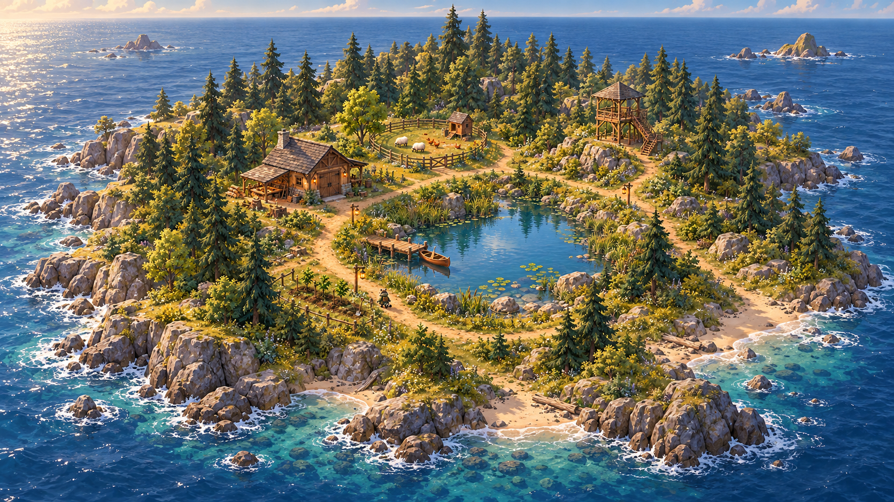

**图 2：海边栈桥 v1——本轮 imagegen 生成的建模输入参考。** 单体三分之四视角、暖旧木板、六根支柱、横撑、四个短角柱和开放侧边；不把人物、船或海面混入待生成网格。参考图只提供结构与材质方向，精确轴向和尺寸由 Blender 校准。

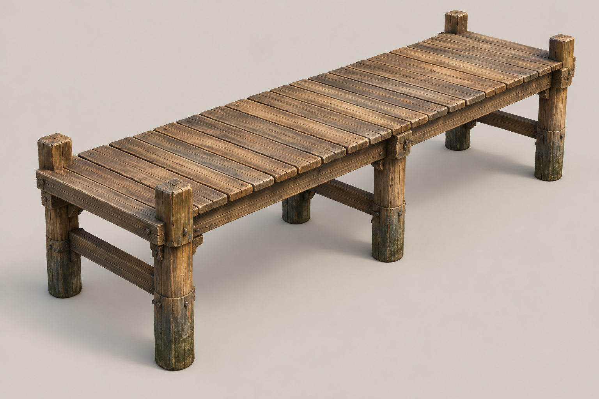

参考图先生成并查看，再作为 AHOLO 输入；本机 `AHOLO_API_KEY` 只用于认证，不写入报告或截图。参数为 G1、目标 300000 面、ZIP+GLB，一笔任务 **4321451**。参考图 SHA-256、文件尺寸、生成来源及设计摘要见 [reference.json](../evidence/assets/2026-10-24-coastal-layout/reference.json)。该文件记录的是设计摘要，不冒充完整逐字提示词。报价查询返回 HTTP 500，实际扣费未核对，未沿用历史价格填账。

更早的结构依据继续保留：[工坊主图](../references/workshop/forest-moments-workshop-master-v2.png)、[木塔主图](../references/lookout/forest-moments-lookout-master-v2.png)、[海岸/池岸过渡](../references/environment/forest-moments-shore-transitions-v2.png)、[环境总板](../references/style/forest-moments-environment-board-v3.png)。[旧池塘码头参考](../references/waterside/forest-moments-pond-dock-layout-v2.png)仅作历史，不再指导当前泊位。

#### 5.26.3 模型从参考到运行时的对比

**图 3：同一生成模型的尺度整理前后，均为 Blender Cycles 真实渲染。** 左图原稿仅做预览归一化；右图为运行尺度，长轴转为 runtime X、宽度校准为 2.2 m、甲板局部高度归零、支柱向水下延伸。两图使用相同相机和光照，不是重新生成的两个候选。

| 原稿预览归一化 | 运行尺度整理后 |
| --- | --- |
| 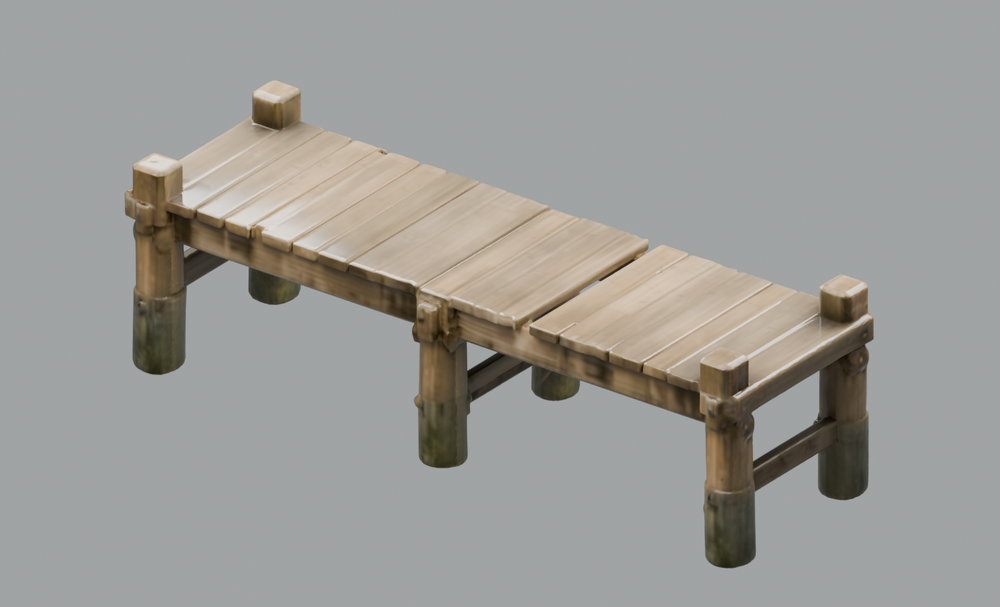 | 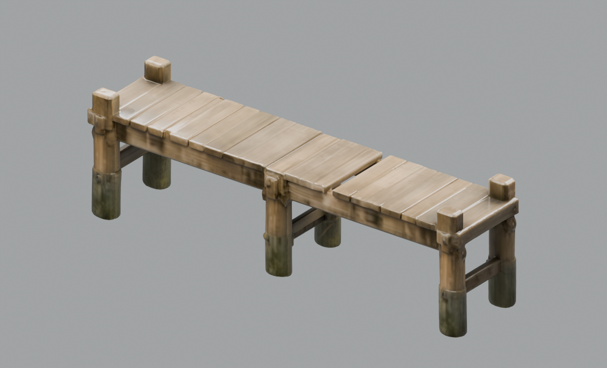 |

原 GLB 15438588 B，派生运行包 2447124 B；三角面数保持 299741。体积下降来自 Meshopt 与两张 2048² WebP（quality 92），不是强制减面。原文件、ZIP、Blender 工作文件和派生版本分别保留；[模型审计](../evidence/assets/2026-10-24-coastal-layout/model-audit.json)、[运行清单](../evidence/assets/2026-10-24-coastal-layout/runtime-asset.json)、[完整性检查](../evidence/assets/2026-10-24-coastal-layout/integrity.json)记录尺度、法线、面数和哈希。

植被采用另一条流程：复用真实生产模板并验证源版与迁移版，而非重新建模。下图是普通松树的同尺度、同光照浏览器对照；其余高松、阔叶、幼树、灌木和木灯的对应图在 [模板验证目录](../evidence/vegetation-expansion/2026-10-24/templates-final/)。

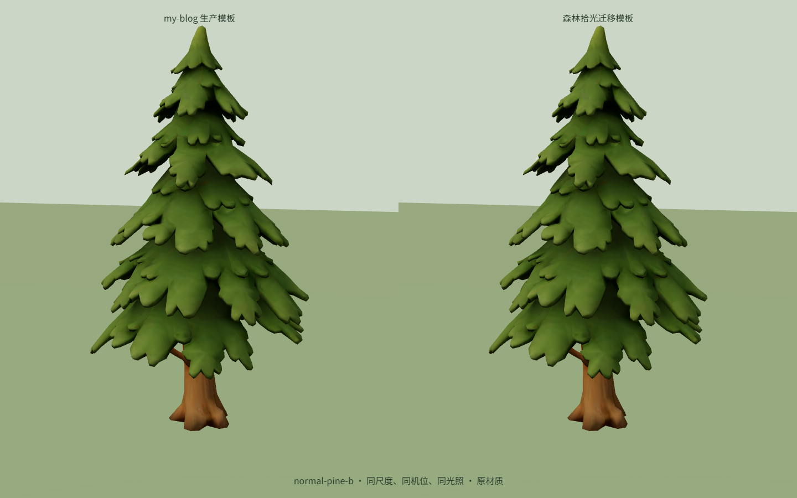

#### 5.26.4 实际场景效果对比

以下均为本机 Edge 156 的实际浏览器截图。主要对比图为 1440×900 / DPR 1，日景使用同一光照预设；整岛使用固定 `overview` 相机。扩岛、植被、道路和建筑迁移同时影响画面，不能把整岛变化全部归因于单个材质。源版本、测试环境和失败批次见 [执行证据](../evidence/vegetation-expansion/2026-10-24/evidence.md)。

**图 4：扩岛与空间分区。** 旧版工坊和木塔集中在一侧，船位于池塘，码头为平板；当前工坊与木塔分处两侧，船移至东岸海面，外圈道路和树林范围扩大。

| 迁移前基线，同一鸟瞰机位 | 当前海岸版，同一鸟瞰机位 |
| --- | --- |
| 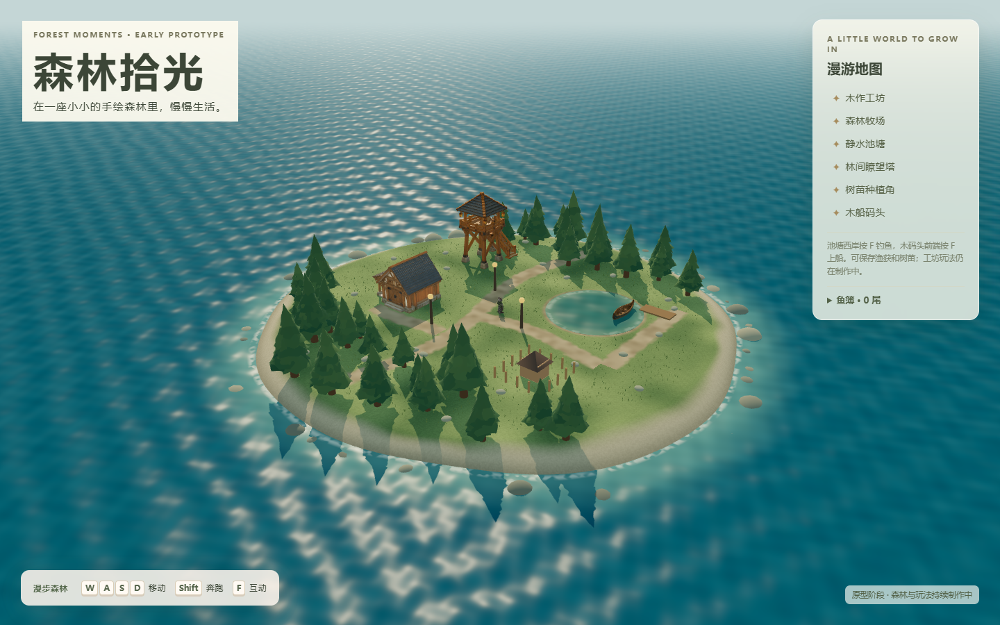 | 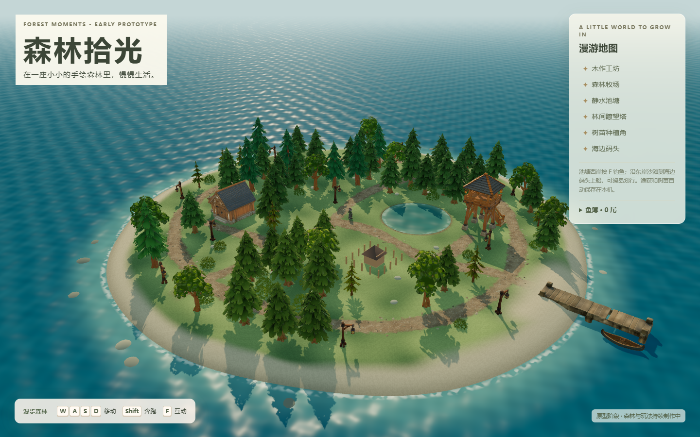 |

**图 5：从平滑道路到自然土路。** 左图是植被已迁入、道路反馈前的中间版；右图是当前版本。均为出生点日景跟随机位，期间建筑和植被也有调整，因此用于对照道路外观，不是只改材质的隔离试验。

| 道路反馈前的中间版 | 当前道路与草边 |
| --- | --- |
| 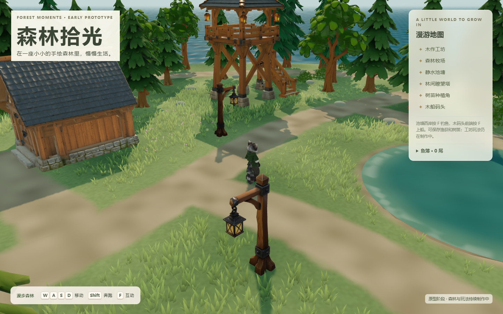 | 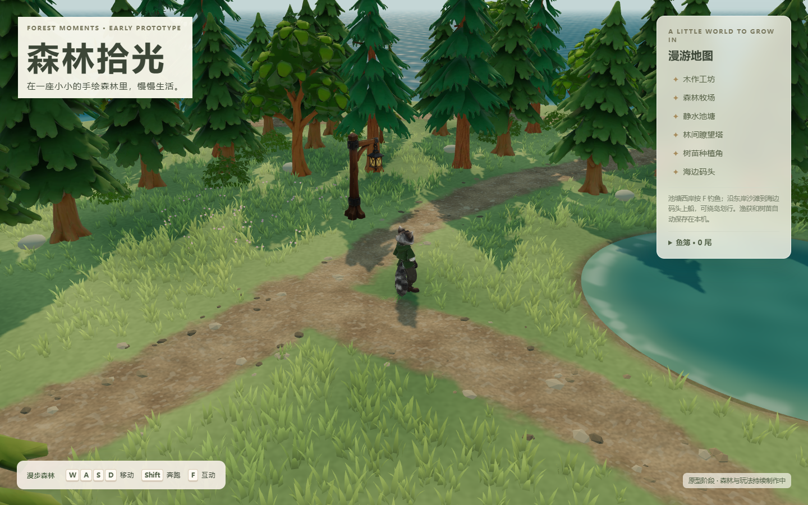 |

下图为新增低机位近景，用于观察碎石、土色颗粒、草边和轻微起伏；**不是上表同机位的替代图**。高度连续性和角色落脚另由单测与实际行走检查证明，不能只凭一张图推断地形可通行。

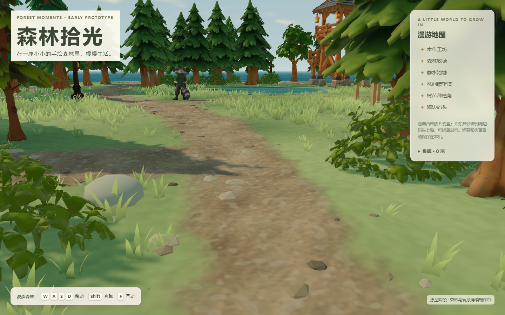

**图 6：工坊入口视线的二次修正。** 建筑迁移后，初版两侧前景树冠大面积遮挡入口；保持工坊和复核相机不动，疏去 3 棵前景树后复拍，门前轮廓和通路更清楚。

| 海岸初版，遮挡偏多 | 疏开视线后的同机位 |
| --- | --- |
| 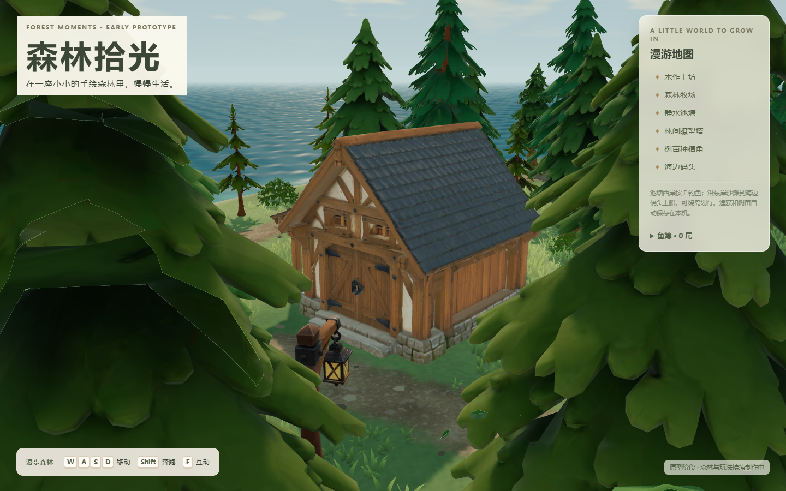 | 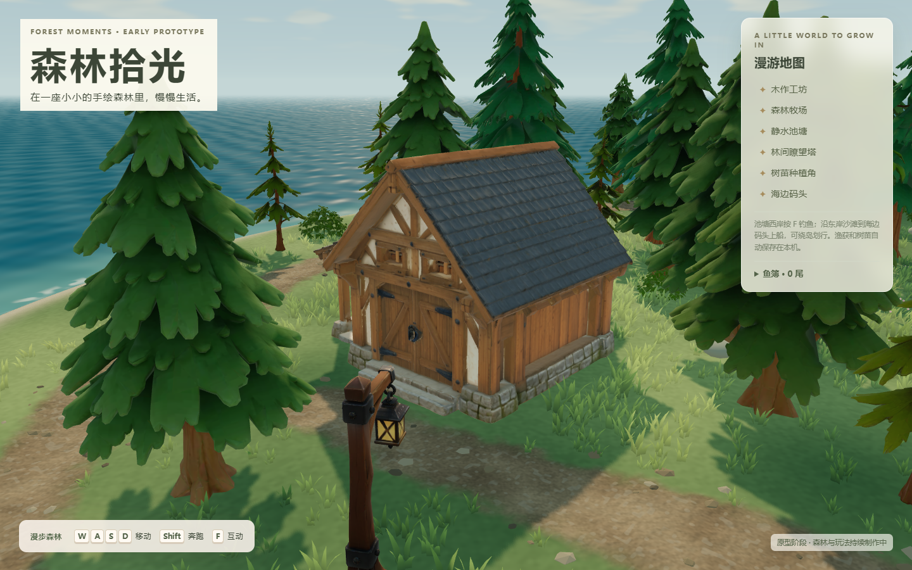 |

**图 7：海边码头与玩法落地。** 左图看沙滩接入、甲板与木船的关系；右图为静态生产版本实际靠泊下船后的画面。两图机位不同，属于结构和交互证据，不作像素级前后对比。

| 新码头日景 | 生产版本返回下船 |
| --- | --- |
| 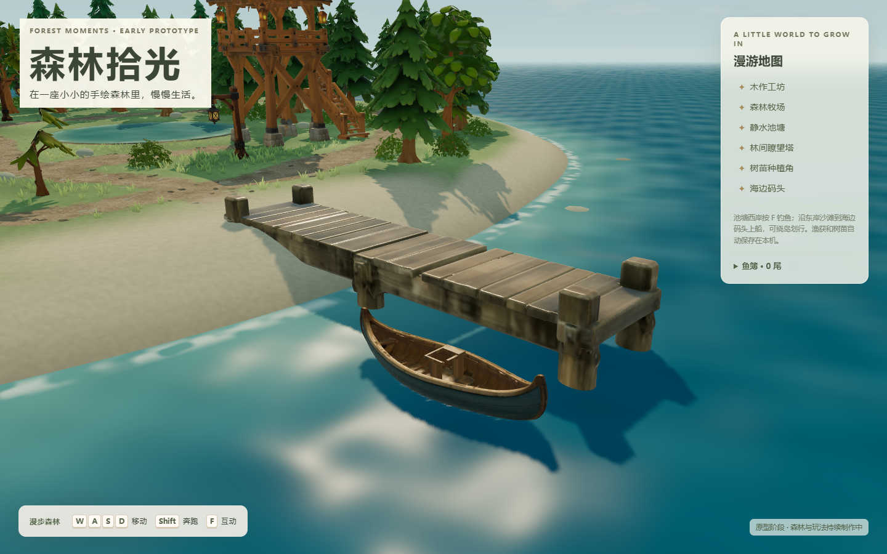 | 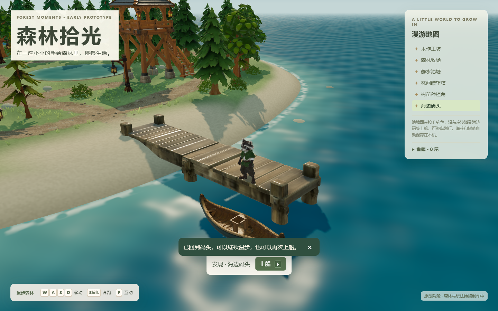 |

**图 8：不同光照下的完整布局。** 日景已见图 4；以下为同一鸟瞰机位的黄昏和夜景。灯罩发光与道路局部暖光分别验证，真实点光数量限制为 4；这些是固定预设，不是完整昼夜循环。

| 黄昏 | 夜间 |
| --- | --- |
| 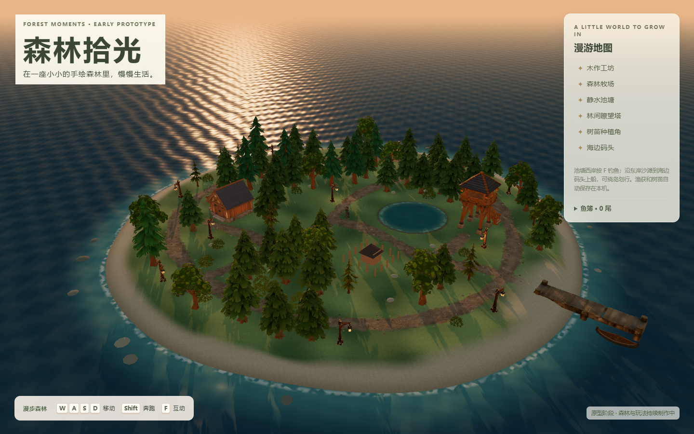 | 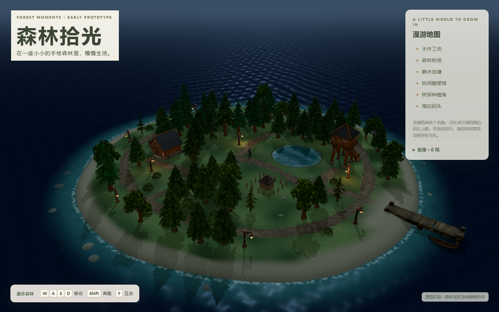 |

更多实机证据：[海上四方向及返回](../evidence/vegetation-expansion/2026-10-24/coastal-final-gameplay/contact-gameplay.png)、[池塘生产钓鱼与鱼簿](../evidence/vegetation-expansion/2026-10-24/regression-coastal-fishing_production/contact-fishing-production.png)、[夜灯近景](../evidence/vegetation-expansion/2026-10-24/coastal-final/night-lamp.png)。接触表是已有实机截图拼排，不是生成图。

#### 5.26.5 失败、放弃方案与验证后的修正

| 阶段与证据 | 发现的问题 | 采用的修正与结论 |
| --- | --- | --- |
| 早期工坊/船减面，见 5.3 | 较小文件出现裂片和三角色块，两版试验均失真 | 弃用四个试稿，改为先保外观、再实测；本轮码头沿用保留三角面的策略 |
| 划桨适配，见 5.11–5.17 | IK 起始姿态和换边效果被用户否决；后续检查发现握持与穿舷问题 | 恢复原动作，在保留角色/服装/尾巴的前提下修正座位和桨轨迹；本轮搬到海域时不再重做已确认组合 |
| 植被模板迁移，见 `templates/` 与 `templates-final/` | 对量化 Int16 顶点直接应用米制矩阵导致坐标截断 | 先解码为 Float32，再变换；新增回归测试，源版/迁移版重新并排核对 |
| 自然道路初稿 | 支路端点硬截断造成地形高度不连续 | CPU/GLSL 改圆滑端点；连续性、幅度上限、平整基础与落脚检查通过 |
| 旧走跑回归 | 灯柱、树干挡住原通路 | 调整灯位、增加通路/柱脚净宽测试；后续按新建筑和海边码头位置更新路线 |
| `terrain-route/` 灯光检查 | 使用截图间隔前的旧强度判断换位，造成误报 | 在换位瞬间记录实际强度；最终最大 0.014996，小于 0.015，不靠放宽阈值通过 |
| `coastal-gameplay/` | 自动返回路线斜穿码头角柱，末段步行停止 | 保留正常角柱碰撞，改为从甲板中线走出后转弯；完整重跑 `coastal-final-gameplay/` 通过 |
| `coastal-production/` | 截图期间船仍在前划，固定反划时长不足以回泊位 | 停键后截图，并以可见“下船”按钮状态判断靠泊；`coastal-production-final/` 通过 |

最终验证为 **lint 无警告、22/22 单测、构建通过、8 组浏览器验证 PASS、89 张实图、0 意外控制台错误**。完整结果及报告哈希见 [final-validation.json](../evidence/vegetation-expansion/2026-10-24/final-validation.json)。本次补充的是已有工作的图文记录，没有重新生成资产或修改场景，也没有新增一轮实机验收。

本次文档补全检查：主稿、进度与工作流共 98 个本地链接均可解析，16 张嵌入 PNG 的文件头与尺寸有效；lint 无警告、22/22 单测、build、diff 检查通过。构建仍保留既有 JS 大包提示，输出 bundle 文件名与上一轮一致。

当前限制仍保留：局部树冠裁切轮廓可见，牧场与种苗仍含占位/最小原型，上下船没有过渡动画和浮力；整体模型/轨迹/植被 95.68 MiB，JS 大包提示存在；性能采样属于本机无头 RAF，不是跨设备帧率承诺。参考图许可与实际 AHOLO 扣费按原记录继续核对，不把未核实项写成已完成。

后续每轮继续按本节结构在主稿追加“问题与目标 → 设计依据 → 调整与取舍 → 参考图 → 实际对比 → 验证/限制”，并在第 11 节写入修订日志。图片实体保存在 references/evidence，通过相对路径直接嵌入；当前部分批量截图只保留本机，发布或导出报告前必须随报告打包所引用图片，不能只复制 Markdown 后宣称图文完整。

### 5.27 视觉收尾：完整树冠、自然池岸与码头接地（2026-10-24，本机限定验证完成）

本轮执行后续计划的第一步，处理漫游时树冠圆洞、规整池塘边缘和码头支柱接地。复用既有资产；没有新模型、参考图生成或 AHOLO 付费调用。下面记录实际设计依据、调整结果和本机浏览器复核，最终美术仍待用户反馈。

**设计依据与方案调整**

| 问题 | 采用方案与理由 | 实施边界 |
| --- | --- | --- |
| 按像素裁切留下圆形黑边；宽透明带会暴露内部叶片壳层 | 对整株遮挡物做覆盖率切换，约 0.18 秒完成；遮挡迟滞避免临界来回切换 | 只改变相机可见性，模型、树干碰撞及投影保留；过渡期间可能短暂看到点状覆盖 |
| 首轮整树隐去后，邻树仍擦过角色肩部 | 给整株冠幅判断加入肩宽余量，再复拍完整环路 | 不只测试角色中心点；本机限定路线验证，不宣称所有视角完全无挡 |
| 圆形平贴水面缺少自然岸坡 | 不规则水线统一驱动水面、地形、湿土及碰撞；水面从 +0.035 m 下沉至 -0.08 m | 保留西岸半径和钓点，浮漂/鱼线跟随共享水位；不改海上划船范围 |
| 首版不规则水线呈明显锯齿 | 只将池塘附近地形网格由 30 cm 加密至 6 cm | 加密边界放在平坦缓冲区；实际网格与水线误差测试小于 5 mm，避免全岛加密 |
| 外侧两根桩底高于海床约 7.4 cm | Blender 检查六根支柱后，在运行时将码头纵向比例改为 1.06 | 甲板原点仍为 0，世界甲板高度仍为 0.12 m；底端进入海床约 6.6–6.7 cm，不改 GLB/UV/拓扑 |

沿用既有海岸过渡参考 v2：本次采用其「水面低于草岸、湿土与浅水衔接」方向。图中的芦苇、睡莲和更多岸石尚未实现；这张图是设计插画，不能当作本轮实机成果。

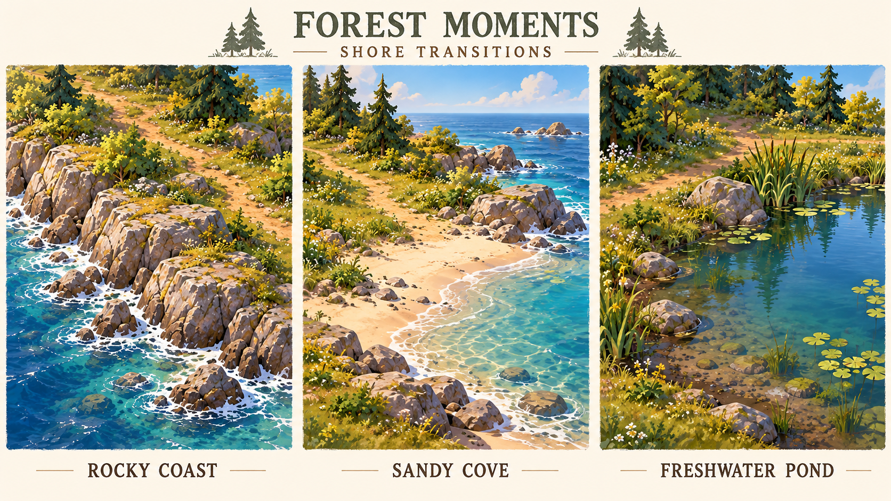

初版真实截图：轮廓已经变化，但水线仍受粗网格影响，岸边有明显折线锯齿，因此未作为最终效果接受。

**实际前后对比**

池塘：以下两张均为固定 `pond` 机位、白天、1440×900；水波与风动时刻未锁定。前版是规则圆池和单调环边；新版水面嵌入地形，岸线略有内凹，湿土与草地之间保留柔和过渡。局部加密后，首版明显的折线锯齿已消除；仍没有真实折射、水下植被或岸边芦苇。

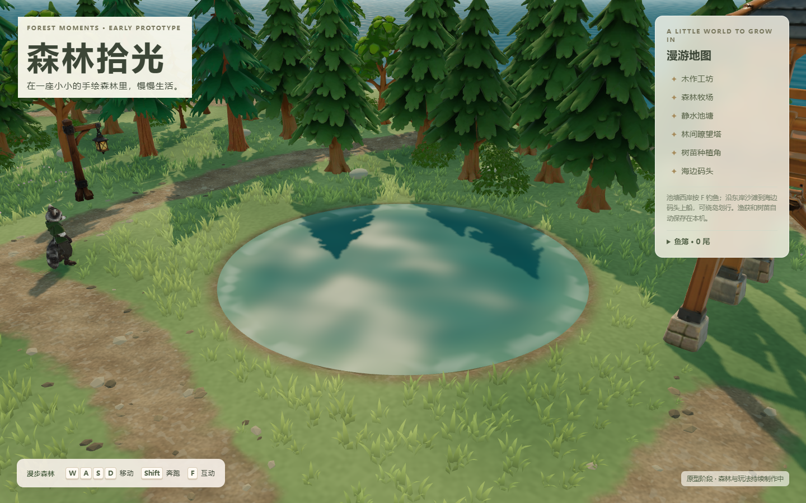

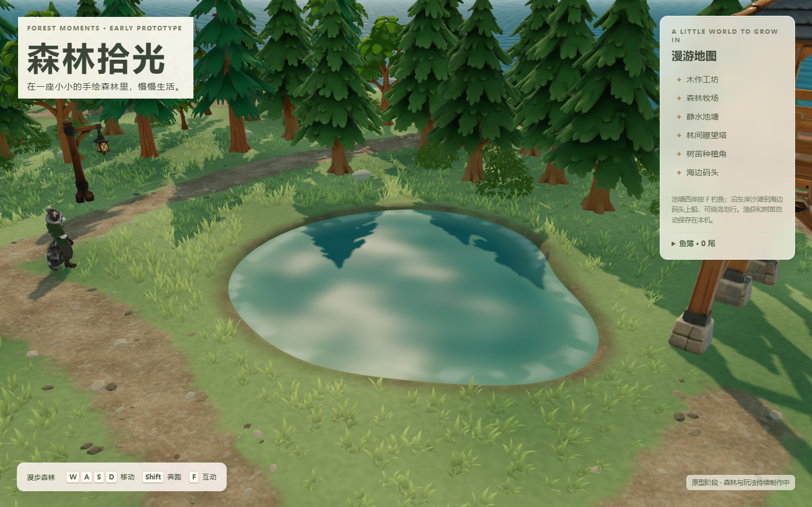

树冠遮挡：夜间环路第 24 个路点附近、相同跟随相机配置。实际键盘到点允许 0.2 m 偏差；新版截图额外等待 350 ms 让短暂切换结束，因此是相同路段的功能对照，不是逐像素固定相机对照。旧版树冠留下明显黑边圆洞；新版整棵前景树暂时隐去，角色和道路轮廓完整。树仍在场景中，其碰撞与阴影保留，离开遮挡后恢复。

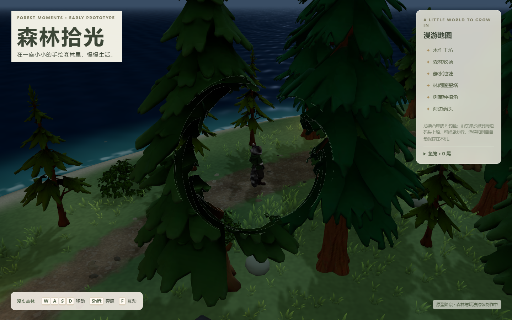

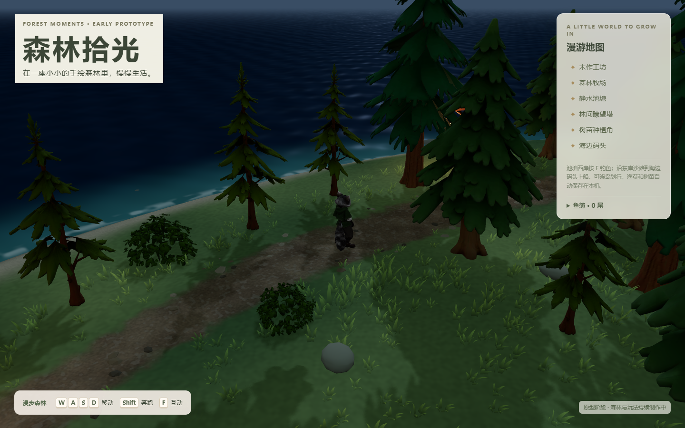

码头：相同 `dock` 机位与白天光照。甲板接沙滩的位置和可走高度不变，整体造型没有重做。桩脚埋深位于不透明水面下，不能仅靠这组截图证明；六桩的最低点/地形高度对比见 Blender 审计，外端由高于海床约 7.4 cm 改为进入约 6.6–6.7 cm。

**复测中的失败与修正**：首轮生产路线按固定时长行走，实际停在码头中段，界面仍提示「走到码头前端」，因此上船断言失败；改为继续用真实键盘小步前进，直到可见按钮变为「上船」。钓鱼脚本在高张力时先截屏后松开 Space，截图耗时期间持续收线导致过载；改为先松开真实按键，再截屏。两处都保留原失败图和 JSON，不修改游戏的上船距离、张力阈值或失败规则来迁就测试。记录位于 `visual-finish-production/` 和 `regression-visual-finish-fishing/`，最终复测另存目录。

水位调整后的实际钓获：仍从西岸抛竿，浮漂、鱼线和收线跟随共享水位，渔获进入鱼簿并跨刷新保留。此图是功能复测证据，不是新增鱼类或钓鱼动作。

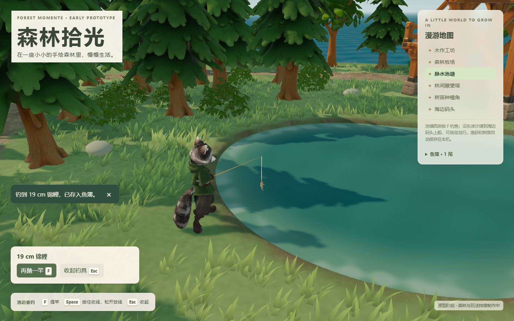

**验证结果**：26/26 单测、lint 无警告、TypeScript/Vite build 与 diff 检查通过。最终五组浏览器检查通过，共 72 张实际截图：三时段/多机位及布局 44 张、夜间完整陆地环路与返回 6 张、开发钓鱼 13 张、生产钓鱼 6 张、生产上下船 3 张。0 控制台异常；查看三时段联系表、池塘近景、环路、钓获与靠泊画面。钓鱼包含取消、早提竿、错过咬钩、过载、失焦暂停、成功与鱼簿刷新；生产版通过真实键盘和可见 DOM 控件操作，开发遥测未进入 dist。上一阶段完整海上绕岛与故障恢复记录仍保留，本轮未重复声明这些未重跑项目。

Edge 156.0.4314.42 / RTX 5060 Ti / 1440×900，固定池塘 30 秒 uncapped RAF + gl.finish 平均 1.782 ms / P95 3.0 ms / 最大 15.2 ms，157 calls / 3032988 triangles。前版对应为 1.613 ms / 3.1 ms / 12.4 ms，157 calls / 2989970 triangles；本轮局部加密增加了几何，未增加 draw calls。夜间环路 49.948 秒，平均 1.557 ms / P95 3.0 ms / 最大 123.9 ms（包含截图停顿和尖峰，未剔除）。这些不是屏幕 FPS，也不证明低配设备表现。

模型/轨迹/植被仍为 100326865 B（95.68 MiB），源文件和 public/dist 资源哈希核对通过；主 JS 1268.44 kB / gzip 356.39 kB，原有 >500 kB 提示保留。完整数据见 [本轮证据](../evidence/vegetation-expansion/2026-10-24/visual-finish/evidence.md)、[验证汇总](../evidence/vegetation-expansion/2026-10-24/visual-finish/validation.json)、[六桩审计](../evidence/vegetation-expansion/2026-10-24/visual-finish/dock-support-audit.json)。

**剩余问题与下一步**：遮挡物在短暂切换中可能出现点状覆盖，隐去期间保留碰撞和阴影；这里只完成指定视角和路线的局部收尾。池岸尚无芦苇/睡莲，牧场仍为灰盒，树苗仍只有一次栽种存档，登船仍直接切换且无浮力物理。下一步优先完成树苗三阶段成长与跨刷新状态；需要新模型时继续遵守「先参考图，再 AHOLO API，随后 Blender 和实机验证」。未提交、推送、部署或导出报告。

### 5.28 四阶段树苗资产与成长闭环（2026-10-24，本机限定验证完成）

用户要求树苗使用好看的真实模型，并追加「第一阶段尚未分叉，再加一个更小阶段」。因此原三阶段方案改为四阶段；已提交的分叉树苗保留作第二阶段，再单独生成约 22 cm 高的第一阶段。四阶段共用橡树式裂叶、暖棕树皮及手绘色彩，通过分枝和冠幅变化体现成长，不只是缩放同一个模型。

**参考图与生成**：以下均为内置 imagegen 生成的单体参考，不是游戏截图。以旧 `tree-growth-v2` 的种类/配色为风格依据，移除文字、花盆、土台和附属景物，逐件提交 AHOLO G1。完整提示词见 [首三阶段](../evidence/assets/2026-10-24-tree-growth/reference-prompts.json)及[新增小苗](../evidence/assets/2026-10-24-tree-growth/sprout-prompt.json)。

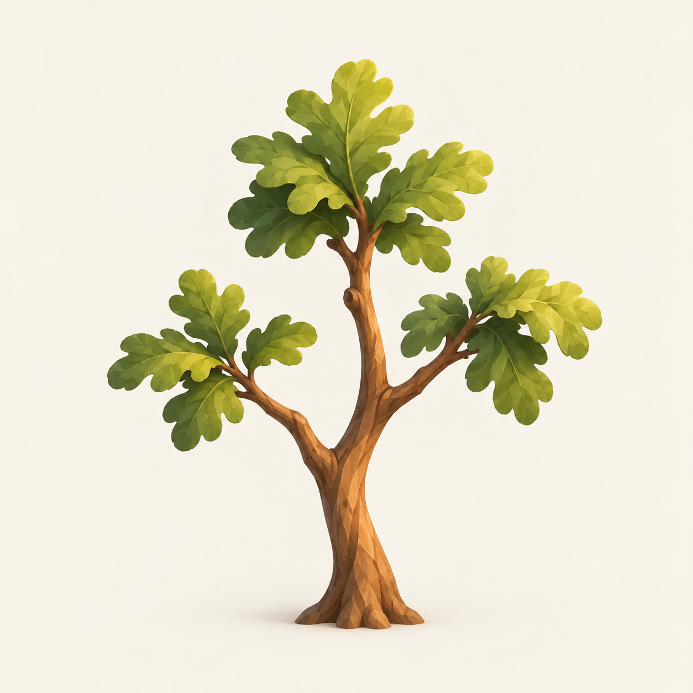

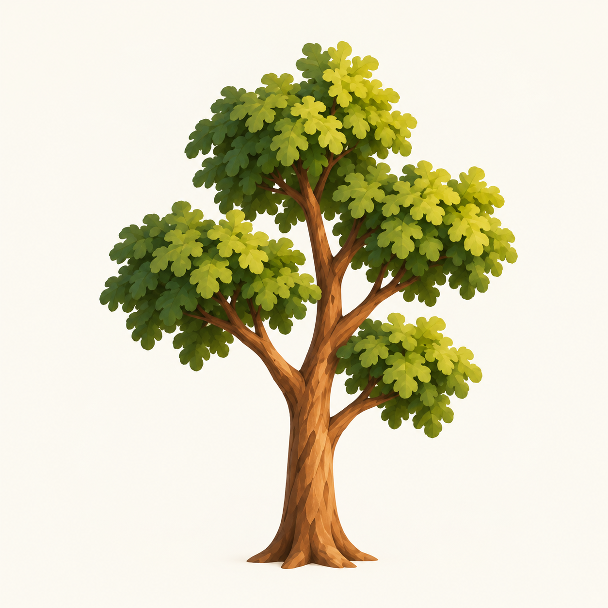

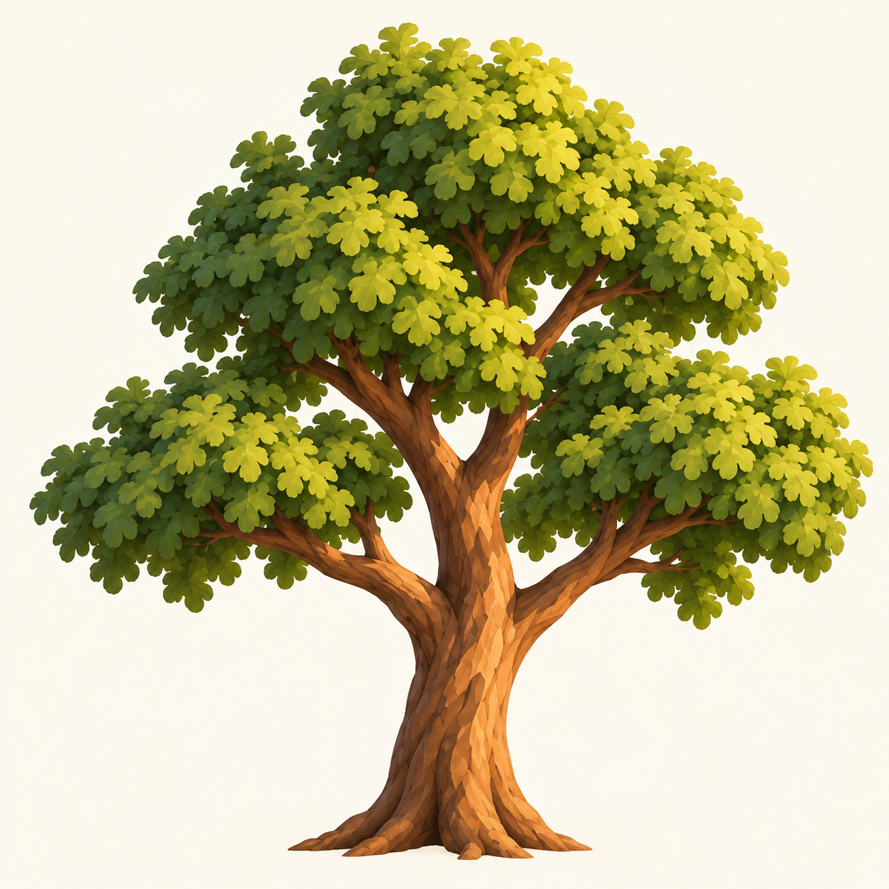

| 阶段 | AHOLO 任务 | 目标高度 | 请求面数 | 运行三角面 | 运行 GLB |
| --- | --- | --- | --- | --- | --- |
| 初生小苗，无木质侧枝 | 4323002 | 0.22 m | 10000 | 9758，含新增细茎 44 面 | 182300 B |
| 分叉树苗 | 4322894 | 0.55 m | 15000 | 14194 | 318368 B |
| 幼树 | 4322899 | 1.5 m | 40000 | 39715 | 722564 B |
| 成树 | 4322904 | 3 m | 80000 | 77992 | 1489516 B |

每笔任务只创建一次；密钥从本机 `AHOLO_API_KEY` 读取，不写入日志或仓库。单图 API 参数按[官方 OpenAPI](https://labs.aholo3d.cn/api-docs/openapi.json)核对，原始响应与签名下载地址只保存在被忽略的本地目录。结果没有扣费字段，实际扣费未核对；赛事 API 使用资格与具体商业许可分别记录，未新作商用授权声明。

**实际修整与取舍**：第一阶段生成结果的顶芽与茎断开；Blender 在断口添加短细茎，保留原主体网格与 UV，整体因新增 44 三角面发生拓扑变化。成树原模型宽冠轴向与其余阶段不同，绕竖轴转 90°，不重新生成。四件统一根部原点/高度、哑光材质；原始 2048 贴图派生为 1024 WebP，Meshopt 仅编码，未对主体减面。实机近景发现粗糙度贴图覆盖了常量设置、叶面偏亮，因此断开 Blender 金属/粗糙度贴图连接，并在运行材质设金属度 0、粗糙度 0.85，保留颜色贴图。最终总新增 2712748 B，约 2.59 MiB；原整体下载预算问题仍在。

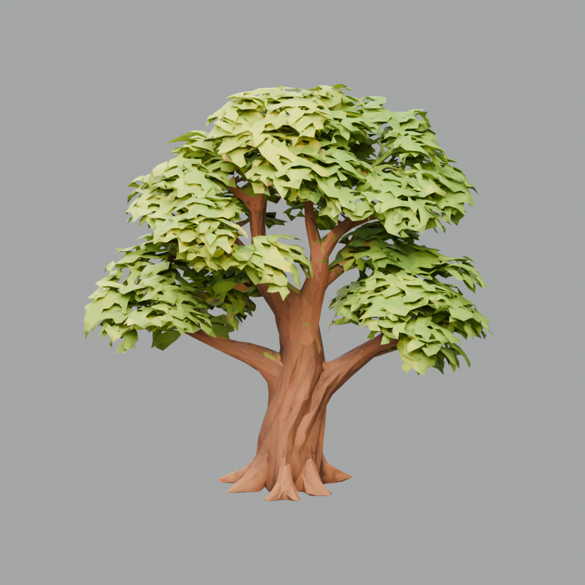

**玩法设计**：靠近种植角按 F，1.6 秒通用互动后小苗落地；Esc 或失焦可取消，不误存档。初栽后自动切近景，F 或方向键回到漫游；阶段分别在种下后 45 秒、120 秒、240 秒切换。用真实时间计算离线成长、保存已达到阶段以避免时钟回拨倒退，旧 `seedling:v1=true` 迁为分叉树苗，存储失败明确提示并保留本次会话。轻微风动响应减少动态效果；树干碰撞随阶段扩大，成长时避免角色留在树干内。

初步实机第一阶段如下：约 22 cm 的小苗与浣熊鞋子形成尺度对照；观察镜头让嫩叶可见。它确实是独立 GLB，不是圆锥占位。成长采用阶段模型替换，不是连续枝条生长模拟；使用现有通用 interact 动作，不将它宣称为专门挖土/浇水动画。

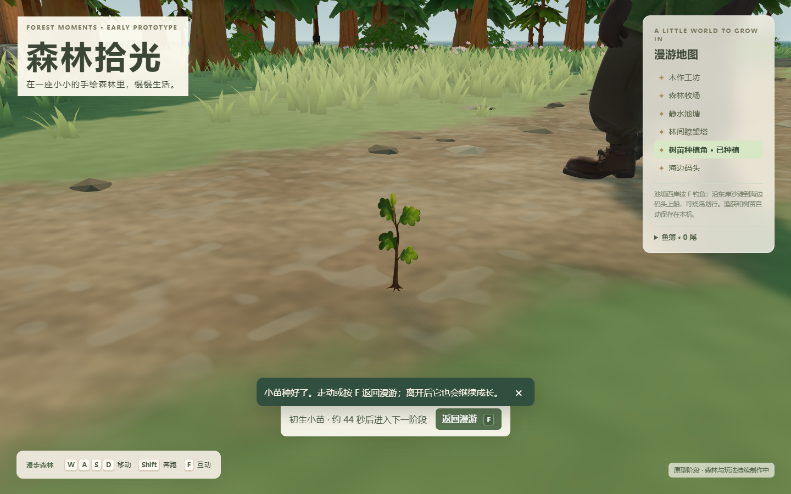

以下是最终白天同机位四阶段实图，以已保存的阶段数据分别采集，用于比较实际尺度与轮廓；这组不是连续生长录像。第一阶段在漫游距离下很小，种植后自动观察镜头承担近看作用。

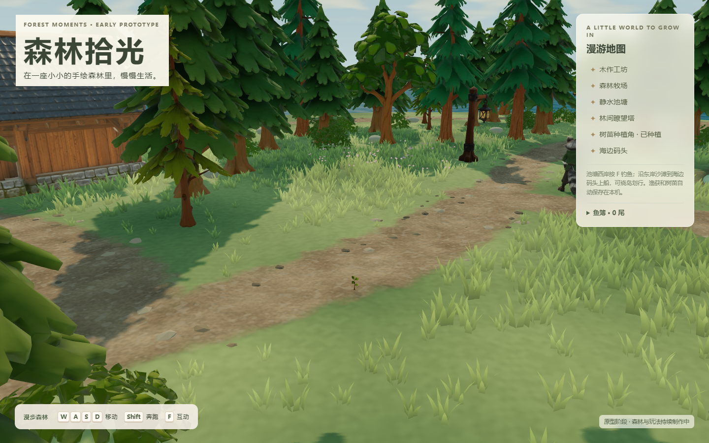

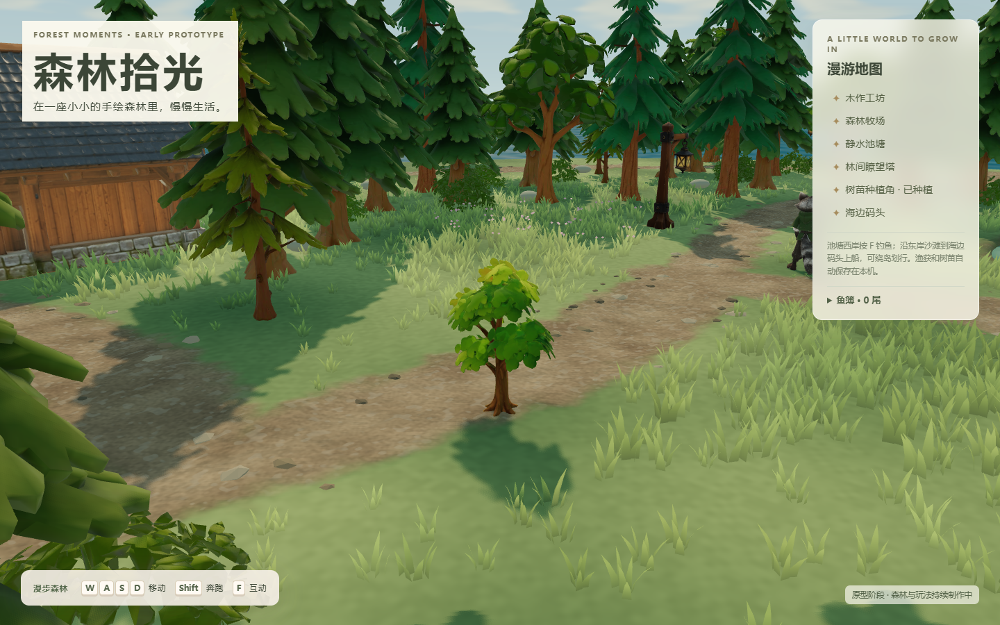

材质修订前后采用同一白天机位；风动瞬间可能不同。初版叶片亮斑明显，最终版保留叶色、压低反光，使其更接近森林现有材质。

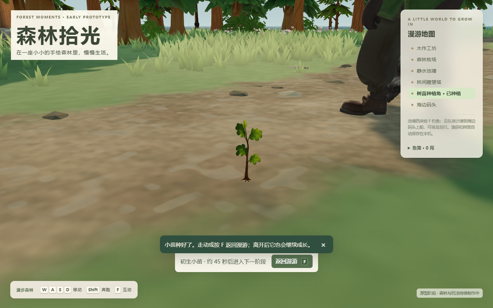

**验证与失败记录**：32/32 单测、lint 无警告、build 通过。六组通过记录合计 59 张实图，另有 242 个本地文档链接及截图文件头/尺寸检查通过。开发环境真实键盘完成取消、栽种、观察、45 秒/2 分钟/4 分钟成长、成树碰撞和刷新；另以明确存档夹具检查旧档迁移、离线成长、坏档及保存失败。四分钟流程发生在最后一次材质修订前，玩法代码一致；最终材质重新完成三时段四阶段、鸟瞰/角色/池塘/工坊/牧场/木塔画面复核。最终生产包真实种下并等待 45 秒，刷新和离线夹具复核通过，开发遥测未进入生产包；生产钓鱼、上下船与新小苗资源失败后的可见重试也通过。

首轮生产脚本重载后以固定时长走路，未到种植角就读取阶段控件，报空节点；失败 JSON/截图保留在 `browser-production/`。改为按可见种植按钮/阶段文字判断到达，最终 `browser-production-final/` 通过，未改动游戏移动速度或到达半径来迎合脚本。真实验证与截图清单见[证据说明](../evidence/assets/2026-10-24-tree-growth/evidence.md)及[验证汇总](../evidence/assets/2026-10-24-tree-growth/validation.json)，模型来源、原始哈希及 public/dist 一致性见[资产清单](../evidence/assets/2026-10-24-tree-growth/manifest.json)。

**边界与下一步**：当前只有一个种植点、客户端时间驱动、四个离散模型阶段，不是浇水经营或连续枝条生成；整体叶片仍可见多边形轮廓。初生顶芽细茎是局部连接修复，未宣称封闭流形。尚未做跨设备性能或公网下载验收，未生成专用种植动作。下一步为登船过渡/水面反馈及牧场动物，报告与资产没有上传或部署。

### 5.29 上下船镜头过渡与水面反馈（2026-10-24，本机限定验证完成）

**问题与方案**：上轮四阶段成长完成后，按既定顺序处理划船体验。原上下船立即切换两套角色显示并让镜头追赶新目标；旧尾流挂在船的父节点，会随船平移和转向。此次采用短暂遮罩中的相机切换、小幅整组起伏和固定水面上的有限水痕，延续安静森林的节奏。没有将未制作的跨舷动作或刚体浮力当作成果。

**参考与资产取舍**：继续使用已生成的海边码头参考及实际船/角色组合；参考图仅说明靠泊与暖木风格，不用来证明动作正确。模型、衣服、尾巴、骨骼、原划桨动画和 120 Hz 桨轨迹均保留，本轮没有重新建模，没有新增参考图生成、AHOLO 请求或 Blender 输出，原许可边界不变。

**实现和范围**：上下船总时长 0.85 秒，前 0.32 秒渐暗、0.32–0.48 秒全遮罩、其后渐亮；0.4 秒提交一次状态切换并将镜头定位到新目标。期间拦截重复 F 与移动，仍要求船已载入、角色到达泊位、船停稳且平行；失焦后清除按键，恢复渲染继续完成过渡。界面保留上船中/下船中反馈，正常行动在结束后恢复。

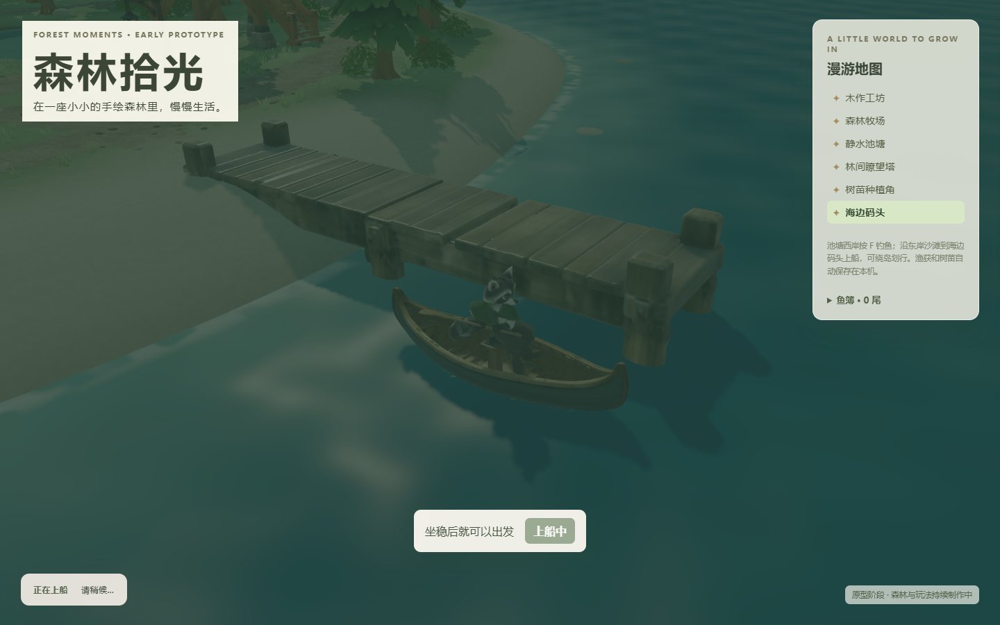

船体、已校准的角色与原桨整体加入不超过约 2 cm 的升沉，以及约 0.52°/0.69° 的俯仰/横摇。离泊点 0.8 m 内振幅为零，随后平滑增加；它们只影响显示，不改平均水面上的船体导航和边界判定，也没有让人物和桨各自独立摆动破坏握持关系。

尾流每行进约 0.28 m 产生一条，倒划时从相反一端产生；桨痕通过抽样原桨叶顶点的世界坐标判断触水，冷却 0.22 秒，近岸和码头范围检查通过后才发射。水痕存在于世界水面，扩散/淡出，桨痕寿命 1.6 秒、尾流 2.4 秒，循环复用最多 28 个槽。减少动态效果设置变化后立即隐藏水痕、关闭起伏，保留输入和航行。

**前后记录**：以下使用同一白天生产行走/上船流程和跟随相机采集；截图时船位、动作相位可能不同，只作行为与外观说明，不冒充严格逐像素同机位对照。初版是开发前保留的真实生产截图，优化版是本轮生产输出；旧圆环跟船移动的问题由原父子结构确认，新水痕留在原位置由连续坐标采样验证。

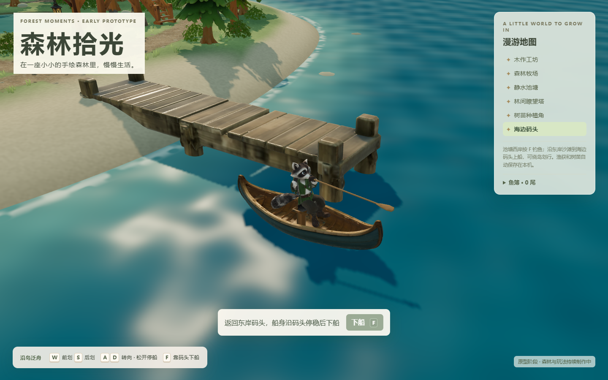

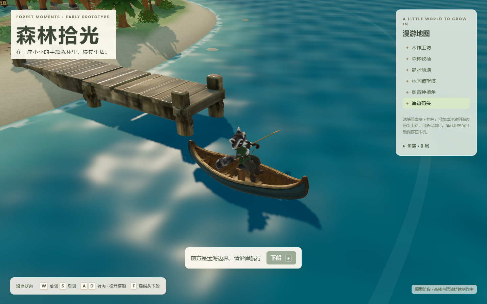

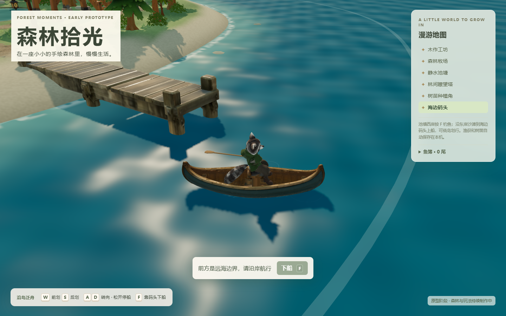

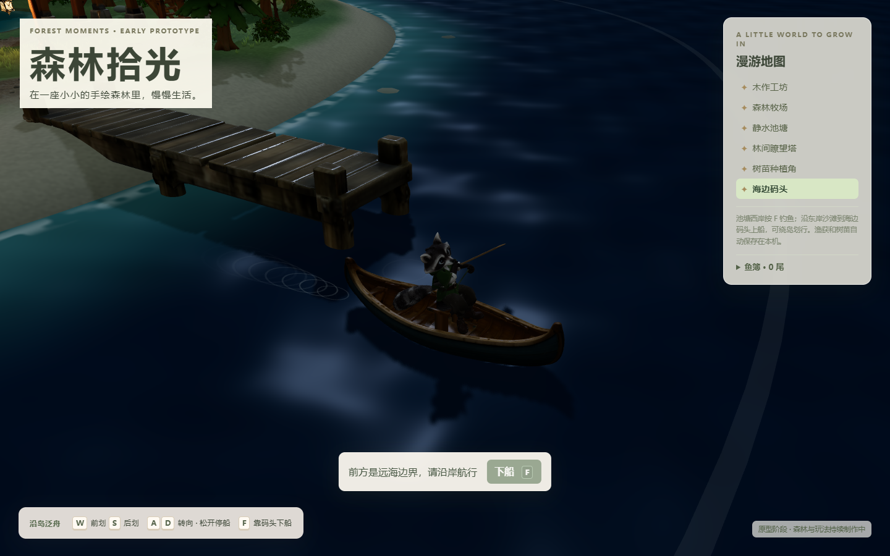

**验证与修正**：首次静态复核发现可变水痕数组放在 useMemo 内产生两条不可变性警告，改为 useRef 管理运行池；泊位零振幅的计算产生 JavaScript `-0`，导致精确比较失败，已明确返回零姿态。随后 lint 无警告、34/34 单测、build 通过。白天实机已验证遮罩提交点、重复输入锁定、真实桨叶触水、世界坐标水痕、停桨消散、动态减弱设置、失焦后过渡完成、重复上下船和步行回岛；实际记录 33 次桨痕、17 次尾流，80 个水面采样中最多同时存在 7 条。生产上下船与树苗成长检查通过，其余最终复核结果见下方证据汇总。

**当前边界**：本轮是上下船镜头过渡，尚无专门跨舷/扶舷/坐下/起身动画；船体是运动学控制，新增起伏不等于浮力、浪面或桨的动力模拟。触水使用约 128 个原桨叶顶点抽样，不是完整网格水线求交；水痕为克制的程序圆环，不是流体模拟。全项目下载仍约 98.27 MiB，主 JS 1277.34 kB / gzip 359.47 kB，既有拆包提示保留。下一步优先牧场动物/设施参考与最小喂养闭环，再细化专用登船动作；跨设备性能尚待复核。

补测曾同时运行多个重场景浏览器，随后出现纹理/着色器错误、截图超时和开发服务退出；尚未确定唯一根因，失败日志保留。重启服务后改为逐组复核，白天/黄昏/夜间完整划船流程、全场景视图及生产钓鱼均已通过。没有通过关闭错误或降低画质绕过问题，多预览资源压力仍是限制。随后核对临时目录迁移发现钓鱼回归生成脚本的相对导入失效，改为模块绝对 URL 并补项目临时脚本清理，真实回归通过且退出后临时目录已清除；未使用的视图辅助函数已移除，最终 lint 无警告。

最终七组浏览器检查保存 **71 张实图**：三时段真实上下船/水面各 11 张，全场景及减少动态效果 25 张，生产上下船 3 张，生产成长 4 张，生产钓鱼/鱼簿 6 张。最终各组均无控制台异常，十二 GLB、原桨轨迹与植被哈希不变、public/dist 一致。已实际查看三时段场景接触表、三时段航行、遮罩帧和钓获画面；失败与历史截图不计入这 71 张。当前测试只覆盖本机限定场景，没有重测完整海上环岛或 30 秒性能基线。

证据目录：`docs/evidence/rowing-polish/2026-10-24/`；[完整说明](../evidence/rowing-polish/2026-10-24/evidence.md)与[验证汇总](../evidence/rowing-polish/2026-10-24/validation.json)。未提交、推送、部署或导出 PDF/PPT。

### 5.30 牧场模型复用、食槽接触与喂养闭环（2026-10-24）

**问题与目标**：上一轮之后牧场仍是立柱和几何小屋，缺动物、设施和真实交互。本轮落实最小喂养：添料有手部与食物反馈，动物实际走到食槽再进食，吃完留下可刷新保存的次数；不把提示文字或计时奖励当成动物行为。

**设计依据与资产选择**：先复核现有 Forest Moments 动物 v3 总板，以及 `my-blog` 已有鸡、羊、鸡舍的原始参考图。暖褐羽毛、乳白羊毛与深色脸腿、暖木灰瓦符合当前场景；既有模型具有可用骨骼和原动作，决定复用并校准，而不是再次付费生成相同对象。用户要求的“需要重新建模先参考图、后 AHOLO”仍适用于后续新模型；本轮没有新建模型生成请求，也没有使用环境变量密钥。

当前风格总板（既有设计参考，不是游戏画面）：

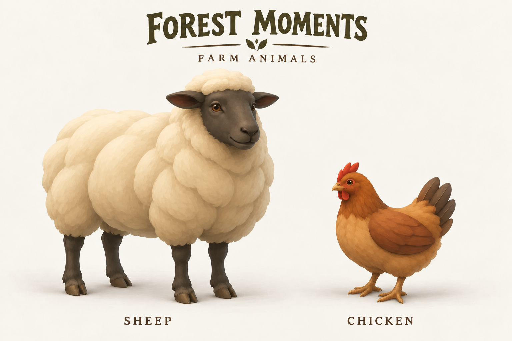

实际复用件的历史输入参考（来自用户本地 my-blog，原图只读复制；非本轮新生成）：

| 鸡 | 羊 | 鸡舍 |
| --- | --- | --- |
| 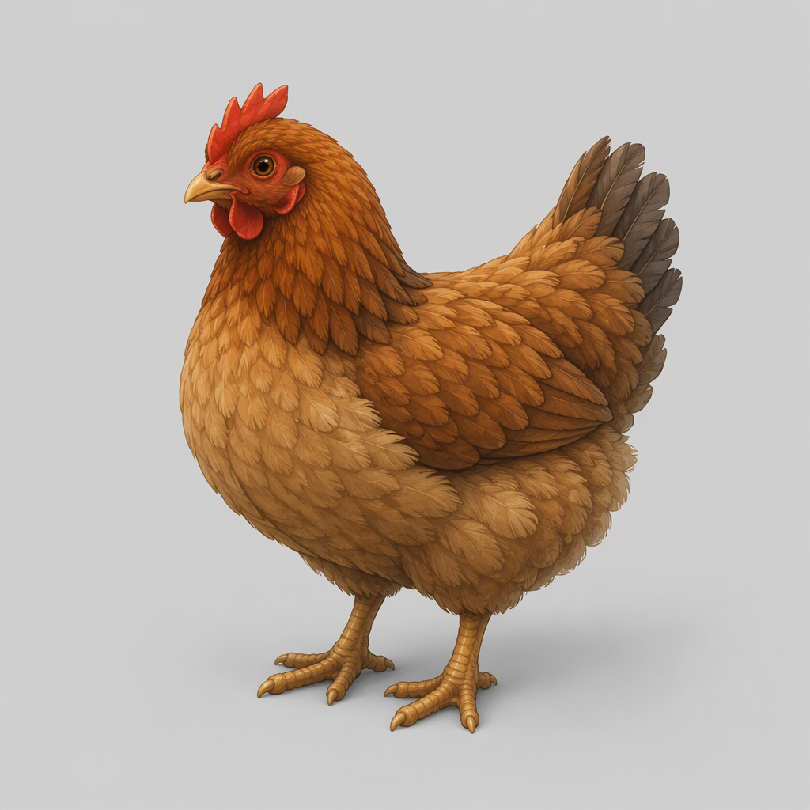 | 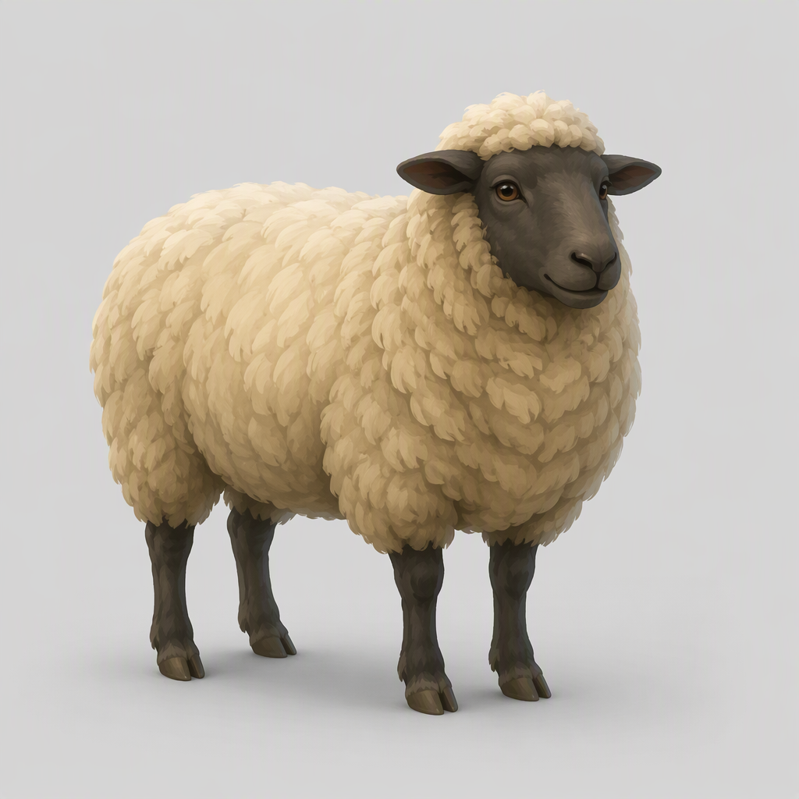 | 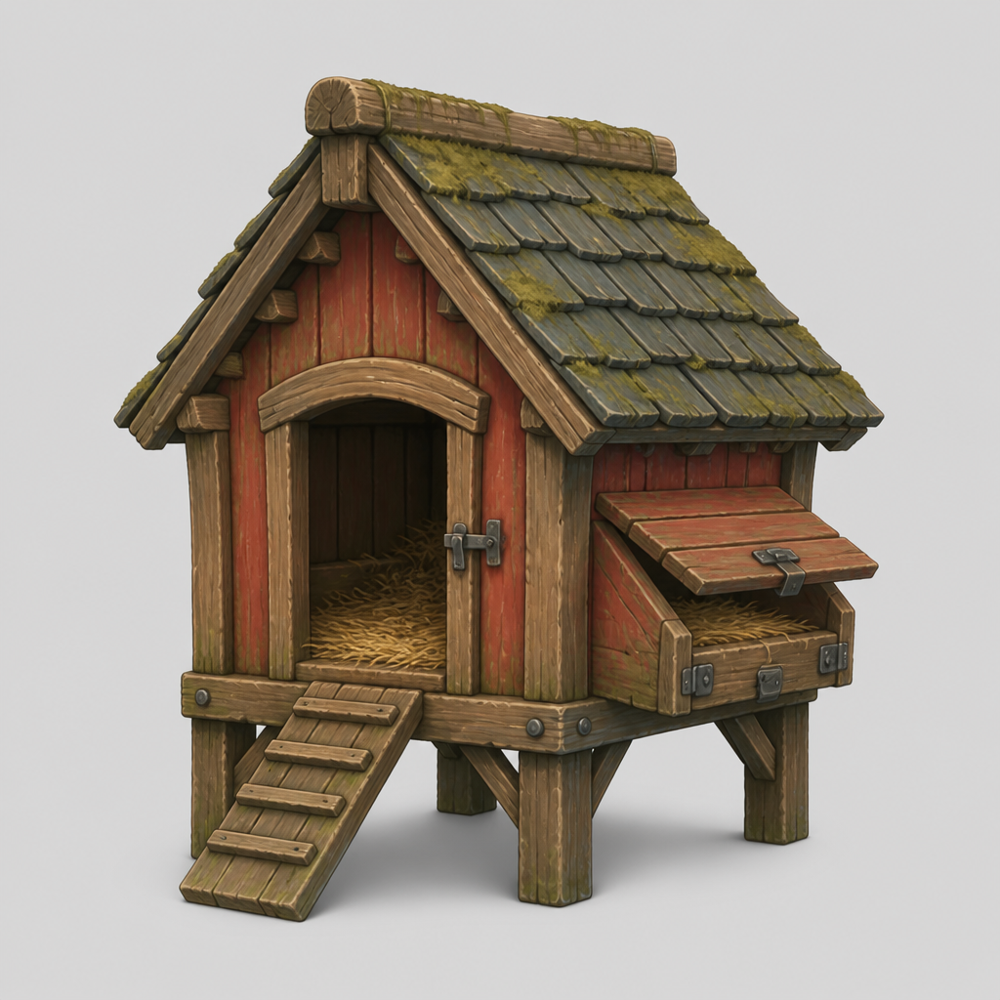 |

**来源与 Blender 处理**：这些辅助资产来自历史 Tripo + Blender 流程，不能记作本轮 Lux3D 生成。鸡任务 `85a7067b-c4b2-4509-947b-409ba4cc75cb`、羊 `43d2e553-109b-4d36-a3ea-08a7b5949f0a`、鸡舍 `4615d6e8-a2e2-4bfe-b14f-d7398217a6f4`；门柱南瓜饰件亦来自旧牧场包，来源记录中保留 `crop-pumpkin` 任务。生成账号和商业授权范围尚未独立复核，不新增商用授权声明。鸡/羊 GLB 与源文件哈希一致，各 7/12 骨、4 个原动作，4500/9000 三角形；设施包 15108 三角形。三件运行文件合计 **912984 B（约 0.87 MiB）**，两只动物均为 1024² WebP 贴图，设施两张 1024²。

旧牧场坐标位于另一张地形斜坡，不能直接整体平移使用。只读打开 `ranch.blend` 和旧地形，以 BVH 采样去除围栏/地表贴片的坡度，刚体鸡舍与干草单独接地，再把 7 × 5.6 m 围栏移到本岛 `(8,6)`。鸡舍置于后角、食槽靠近北侧开口，留下进出和动物路线；同步移除旧小屋碰撞、以可见设施范围扩大原过小代理，周围草丛为脚部和食槽让出视线。没有减面或改写原项目文件。工作文件 `assets/farm/ranch-grounded.blend`，脚本与数据见[本轮证据](../evidence/assets/2026-10-24-farm/evidence.md)。

以下为 Blender 对真实复用模型的离线复核，非参考插画，也非浏览器验收图：

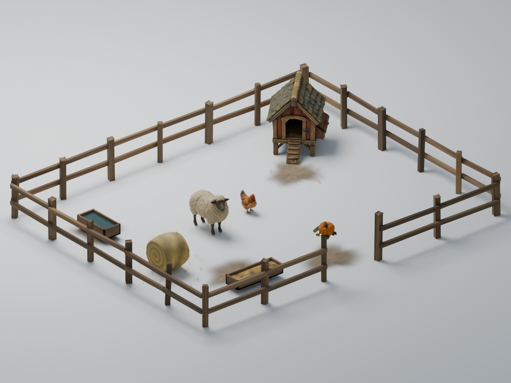

**场景前后对比**：下列同为 `view=farm`、白天、1440×900 的真实 Edge 固定机位。左侧为本轮开工前几何占位，右侧为接入后的真实设施与鸡羊。动物位置随巡游变化，不把它们的不同姿态当作完全受控静态对比。

| 改动前 | 改动后 |
| --- | --- |
| 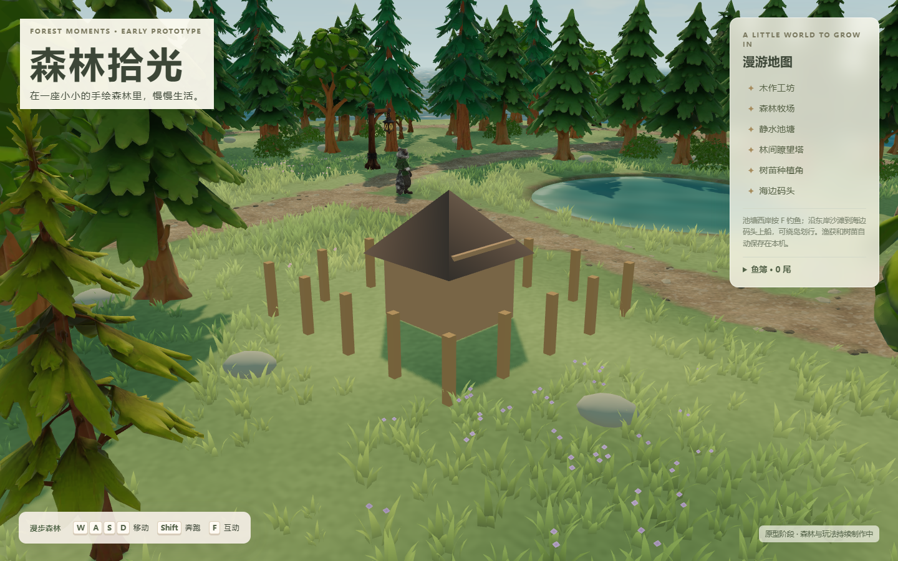 | 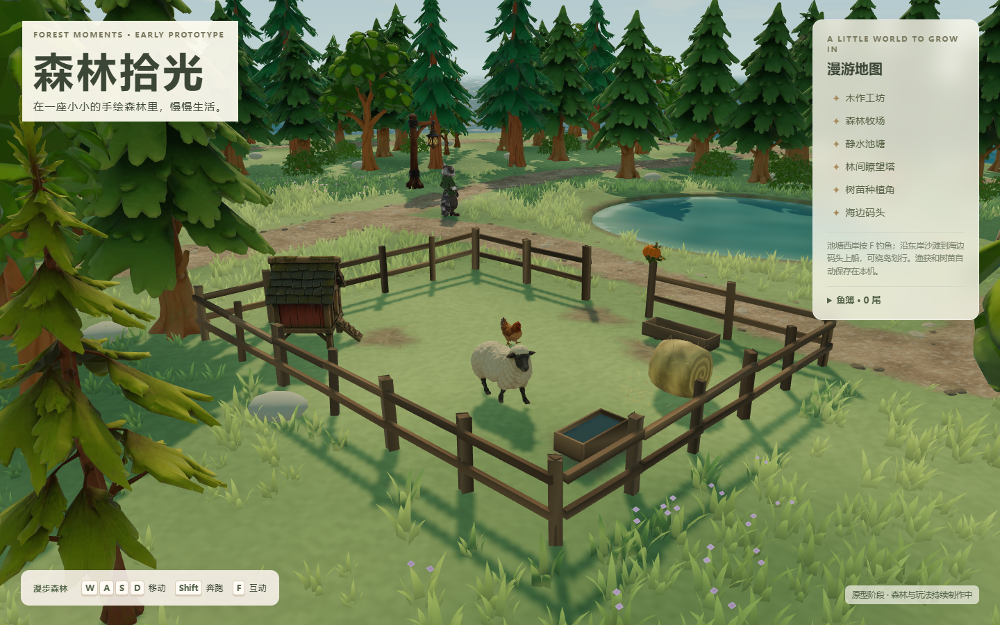 |

**方案调整与接触校准**：初版在地面撒谷粒，原 `peck/graze` 虽然会低头，嘴部仍高于食物；玩法计数通过不等于接触可信。保留失败近景，改用现有约 24.5 cm 高食槽。Blender 采样原骨架和嘴端顶点，鸡 Body/Neck/Head 局部 X 校准为 -0.22/-0.30/-0.10 rad，羊为 0/-1.38/+0.40 rad；运行时仅在进食期间平滑叠加校准和小幅啄食，出入动作淡化。原 GLB、原行走/坐姿轨迹不变。下图为相同 `farmFeed` 机位的真实进食画面，分别来自初版与修正版；进食相位不同，展示的是接触方式变化。

| 未采用：地面粮食离嘴偏远 | 采用：嘴部接近槽内食物 |
| --- | --- |
| 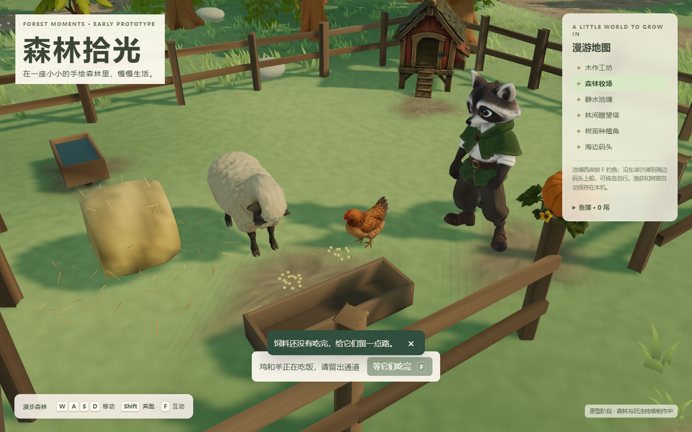 | 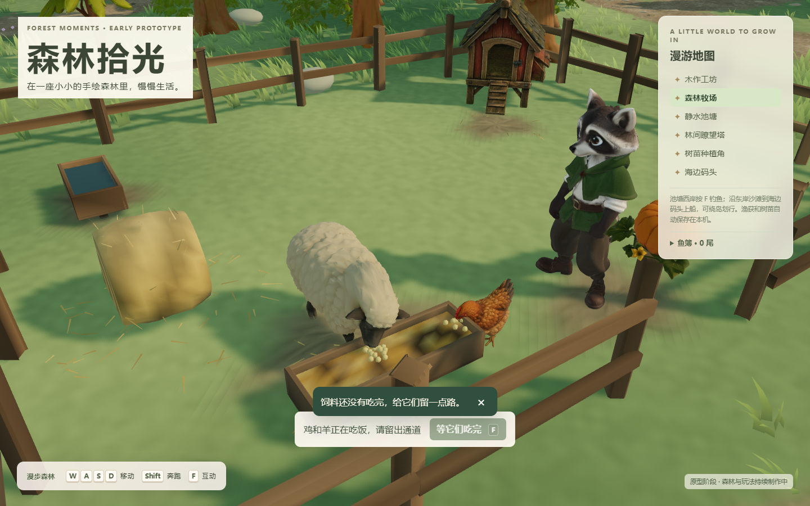 |

**实际交互**：从北侧开口进入，走到食槽左侧按 F；1.6 秒添料期间，谷粒从浣熊右手骨骼的实际世界位置落向槽内，Esc 或失焦取消。鸡和羊沿各自安全短路线走到两个进食点，挡路时等待；到达后各吃 5 秒，谷粒数量与槽内饲料减少，两只都完成才记一次并保存。有粮时禁止重复添料，吃完恢复巡游。靠近牧场时镜头转到能看见动物与食槽的前侧。

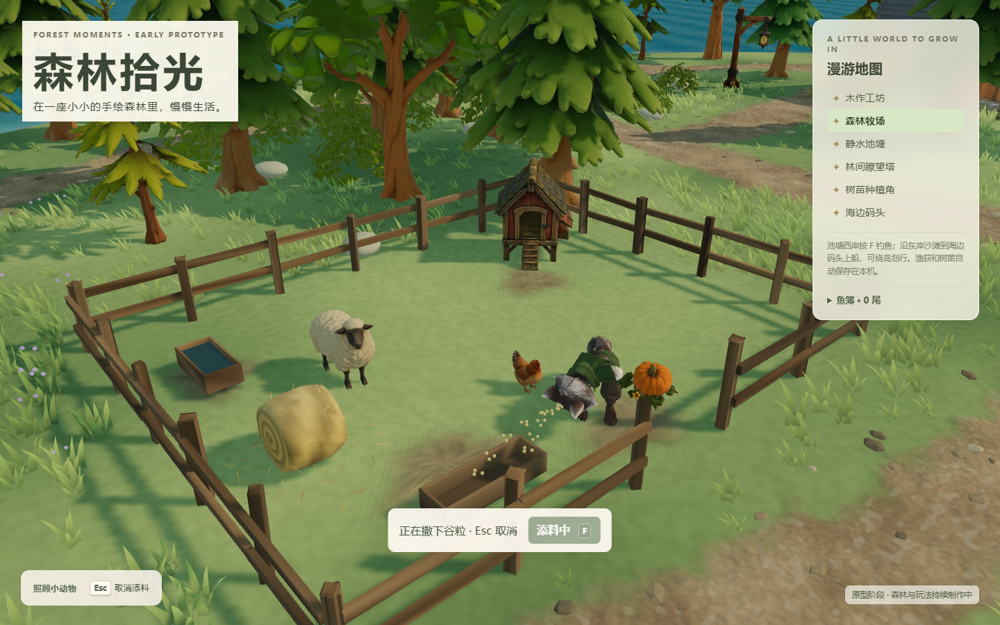

**验证与失败修正**：新增路径安全/挡路等待/到达后进食、损坏存档、取消/防重复和保存失败测试，40/40 单测、lint 无警告、构建通过。开发 StrictMode 曾在清掉 mixer 缓存后复用动作对象而报错，已修复并保留 `views-v1` 失败。旧碰撞测试仍检查原占位小屋，已改为新鸡舍；生产检查脚本漏配 Escape，修正后重新运行，生产键盘喂养/取消/刷新已通过且无控制台异常。最终截图与旧玩法回归汇总在本节收尾记录及 `validation.json`，不把早期通过轮次重复计数。

附加轨迹检查又发现全场景同名手骨查找会先匹配隐藏的船上浣熊，导致谷粒从远处飞来，行为检查此前未覆盖这个视觉错误。已将查找限定到步行 `asset-raccoon`，加入释放位置范围断言并重跑；最终采样位于实际角色和食槽之间，见上图。错误轮次保存在 `gameplay-v4-wrong-hand/` 与 `production-v2-wrong-hand/`，不混入最终成果。

**当前边界**：只做一鸡一羊、短路线巡游与一次添料的完整反馈；未实现繁殖、饥饿、采蛋、剪毛、夜间归巢或经营库存。刷新结束未完成的一餐，不计次数、不模拟离线进食。浣熊仍复用弯身互动动作，尚无手持饲料袋专用动作；动物嘴部是采样/视觉校准，不是逐三角形接触求解。新增资产约 0.87 MiB，整体下载仍明显高于初版预算。未提交、推送、部署或导出 PDF/PPT。

**最终收尾**：六组检查均通过且无控制台异常，共 **56 张最终实图**：开发喂养 9 张、昼/夕/夜十个场景机位 30 张、生产喂养 4 张、生产划船 3 张、生产成长 4 张、生产钓鱼 6 张。实际查看三时段接触表、手部谷粒释放、槽内进食和生产刷新画面；早期失败、离线图及接触表拼图不计入 56 张。生产自动化曾站在鸡的路径上导致等待超时，已保留现场并在脚本中按界面提示让出半步；没有禁用碰撞或跳过动物进食。原有十二 GLB 哈希保持，全部 public/dist 资源一致，临时浏览器配置已清理。[验证汇总](../evidence/assets/2026-10-24-farm/validation.json)保存各组报告、截图哈希、源文件与构建记录。

### 5.31 保留原面数与动作的运行文件编码（2026-10-24）

**问题与决策**：牧场完成后，模型、桨轨迹及植被达到 103952597 B（99.14 MiB）。检查发现，划船除实际使用的中央木座船外，还下载了 17.56 MB 的原整船，仅用于提取两个 `Paddle_*` 网格。因此先单独保存这支原桨，再对浣熊、工坊、瞭望塔和中央木座船做无损编码。本轮保持原面数、贴图尺寸、骨架和动作，不以降低精度满足预算。

**来源、参考与制作边界**：沿用前文已经采用的 Lux3D → Blender 资产和原桨随动轨迹；当前模型与本轮修改前的浏览器实图就是对照基准。没有重新设计或建模，因此没有新增参考插画、AHOLO/Tripo 请求、Blender 编辑或费用。原始 GLB 完整保存在 `assets/runtime-encoding/before/`，候选在 `candidate/`，工作文件不进入 dist；旧完整船移出 public，历史桨复核页改读归档。原素材使用权记录沿用历史证据，没有新增商业授权结论。

**实现与方案调整**：使用既有 glTF Transform 4.5.0、Meshoptimizer、Sharp 工具，只做缓冲编码与 PNG → WebP lossless，不运行 simplify/quantize，不改变顶点顺序或贴图分辨率。编码后逐项核对属性数值、带方向的三角形、节点层级及局部/世界矩阵、蒙皮关节与逆绑定矩阵、19 个浣熊动作的时间/数值/插值、材质参数与贴图绑定/采样器，以及全部解码 RGBA（包含全透明像素 RGB）。若 WebP 像素不一致便保留原 PNG。

首个候选未采用：导出库省略了约 1e-7 级的近单位骨骼变换分量，严格比较拒绝通过。最终在写入 GLB 后恢复原 JSON 的完整变换字段，再核对全部数据；没有放宽容差。保留[失败数据](../evidence/assets/2026-10-24-runtime-encoding/serialization-v1-failure.json)和本地失败候选。独立桨保留原两网格、224 三角面、材质及祖先变换，轨迹文件未改。[编码记录](../evidence/assets/2026-10-24-runtime-encoding/encoding.json)含每件前后哈希和数值摘要；`node scripts/encode_runtime.cjs --verify` 可重新进行严格核对。离线编码脚本使用本机 my-blog 工具依赖；网站运行和构建不依赖该目录。

| 运行资产 | 修改前 / B | 修改后 / B | 保留内容 |
|---|---:|---:|---|
| 浣熊 | 24777392 | 12763552 | 290520 三角面、19 个动作、原骨架 |
| 工坊 | 18892400 | 11852244 | 283794 三角面、原贴图尺寸与像素 |
| 瞭望塔 | 17295608 | 10884832 | 281574 三角面、原贴图尺寸与像素 |
| 中央木座船 | 17372336 | 10776108 | 280265 三角面、原材质 |
| 仅供取桨的整船 → 独立原桨 | 17562100 | 9536 | 两个原桨网格和原运动轨迹 |
| 全部模型、轨迹与植被 | 103952597 | 54339033 | 其余 10 个模型不变 |

**效果对比**：下面是修改前、后的同机位真实浏览器截图；风动、云影和动作时刻可能不同，不把截图当作逐像素相等的证据。数值一致性由上述解码审计确认；截图用于检查模型缺失、错姿态、材质异常和船桨集成。

| 部位 | 修改前 | 修改后 |
|---|---|---|
| 主角 | 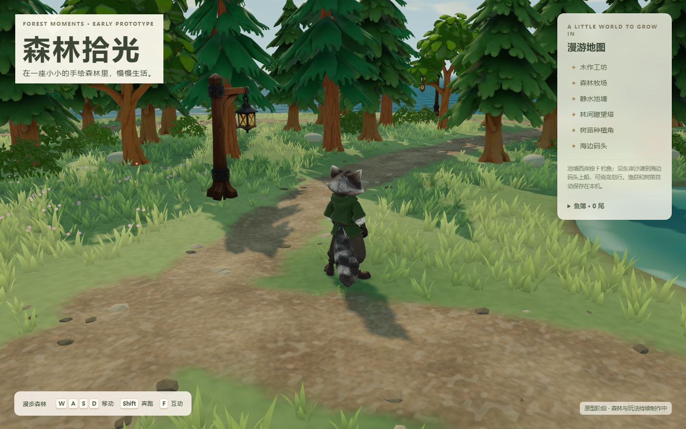 |  |
| 工坊 | 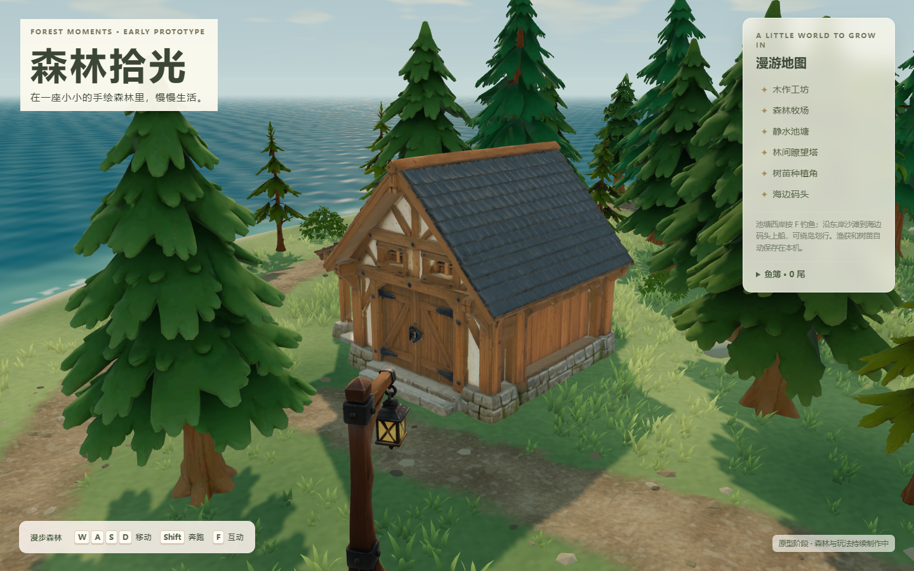 |  |
| 瞭望塔 | 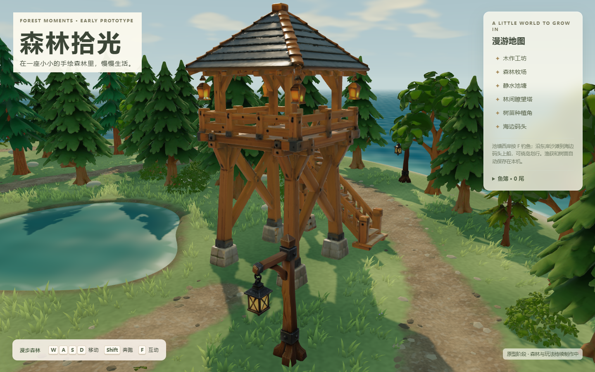 |  |
| 船体与码头 |  | 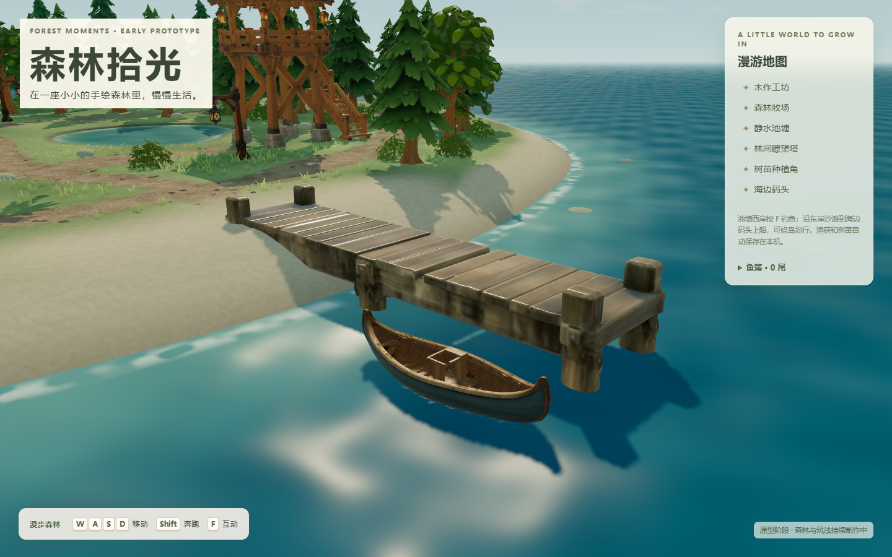 |

生产包实际划船，独立原桨已随原动作运行：

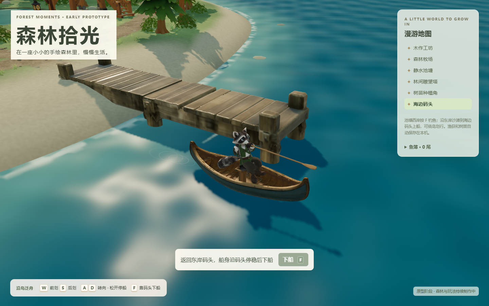

**验证状态**：lint、40/40 单测（12 文件）和构建通过；七组最终串行浏览器检查共 48 张实图：三时段六机位 18、划船动作/水痕 11、生产划船 3、成长 4、牧场 4、钓鱼 6、原桨错误恢复 2，另有修改前基准 6 张。原桨错误注入的预期报错单列，恢复后没有意外错误。首次生产牧场回归中，自动路线让开 450 ms 后角色仍挡住鸡，正常等待机制使进食无法完成；保留[失败实图](../evidence/assets/2026-10-24-runtime-encoding/farm-production-blocked/headless-failure.png)，测试改为真实按键让开 1200 ms 后喂食、取消与刷新通过，玩法代码未改。原件归档、其余 10 个模型、候选/public/dist 哈希、生产请求字节、截图尺寸与文档链接见[当前审计](../evidence/assets/2026-10-24-runtime-encoding/validation.json)。历史审计不覆盖改写，按各自阶段使用对应哈希。

**结果与限制**：资源降至 **51.82 MiB**，减少 **47.31 MiB（47.73%）**。生产网络请求已确认加载 9536 B 的原桨、不再请求旧整船，16 个模型/轨迹请求大小与文件一致。该成果是下载体积优化，不代表 GPU 三角形工作量下降或 FPS 提升；仍高于完整下载 25 MiB、首屏 15 MiB 目标。主 JS 1284.85 kB / gzip 362.44 kB，既有大包提示仍在。公网冷加载、跨设备性能、工坊制作、登塔与专用动作继续待完成。无提交、推送或部署。完整过程见[本轮证据](../evidence/assets/2026-10-24-runtime-encoding/evidence.md)。

### 5.32 塔上观景闭环与体积预算调整（2026-10-24）

**用户反馈与目标**：用户要求“目标体积不用定这么死，继续下一阶段”。因此保留 5.31 的无损编码成果，将体积作为参考指标，后续按真实加载、内存与渲染体验决定优化；本轮推进已有木塔的观景交互。选定最小完整范围：从楼梯脚进入平台视角，环顾/俯仰，返回原落脚点。工坊材料与制作仍是下一项，不把它写成已实现。

**参考与资产边界**：继续使用既有木塔主图和已采用 Lux3D → Blender 模型，不改变外形、原面数、材质或贴图。本轮没有重新建模、生成新参考图、调用 AHOLO/Tripo/Blender 或新增费用；下图是历史造型参考，不是本轮游戏截图或新产物。

**方案与几何依据**：东侧楼梯脚入口设在 `(15.45,-9.65)`，模型就绪且距离 0.75 m 内才可触发。直接解码当前 GLB，按场景变换采样得到平台约 3.6380 m、镜头正上方屋面下侧约 5.7620 m；固定眼点 `(13,4.9,-8)` 距最近三角形约 0.3170 m。[几何记录](../evidence/2026-10-24-lookout/geometry.json)保留模型哈希、采样数据和脚本。这里是平台观景相机校准，尚未建立楼梯步行碰撞面。

复用 0.85 秒遮罩，在不透明中点切换镜头，期间锁住移动与重复互动。观景时采用第一人称、隐藏步行角色；角色地面坐标保持不变，退出恢复原落脚点和跟随镜头。A/D 或左右方向键环顾，W/S 或上下方向键俯仰，俯仰限于 -0.48～0.18 rad；F、Esc、可见返回按钮都可退出，失焦清空按键。刷新从地面初始状态开始，不保存塔上模式。

**界面与方案调整**：观景时收起简介/地图，保留方向提示、控制说明和退出按钮，让木梁、栏杆和森林成为主体。初版仍沿塔脚隐藏角色计算树木遮挡；改为以固定眼点为焦点，避免隐藏与塔上视线无关的树木。静止时不重复写入观景状态。没有让角色沿台阶滑行来代替攀爬动画，也没有将镜头切换称为完整登塔动作。

**前后对比**：第一组为白天同机位，核对原木塔与场景保留；第二组为新交互实际视角，机位不同，用于说明体验，不作为受控画面差异。

| 固定塔外机位 · 修改前 | 固定塔外机位 · 修改后 |
|---|---|
|  |  |

| 平台看向岛内 | 转向海面 |
|---|---|
|  |  |

| 黄昏平台视角 | 夜间平台视角 |
|---|---|
|  |  |

**失败与验证状态**：44/44 单测（13 文件）、lint 无警告与构建通过；七组最终串行浏览器回归通过，共 65 张实图：三时段观景 18、三时段八机位 24、生产观景 6、生产划船 3、成长 4、牧场 4、钓鱼 6，另有修改前基准 6 张。最终各组无控制台异常，生产包不含开发遥测，全部运行资产与前轮哈希及 dist 一致；[最终审计](../evidence/2026-10-24-lookout/validation.json)核对资源、请求字节、截图尺寸及链接。初次测试直接导入无时间戳 store，得到不同 Vite 模块实例，入口夹具未作用于页面；脚本编辑又遇 Windows 默认 GBK 解码问题。改为 UTF-8 和页面实际模块 URL 后通过。一次测试期间热更新重置了场景状态，失败另存 `development-hmr/`，稳定代码后重测。这些都是测试执行问题，不用生产接口注入状态或改玩法绕过检查。[完整过程与失败记录](../evidence/2026-10-24-lookout/evidence.md)区分开发入口夹具和生产真实步行。

生产重测时，定时路线因落点偏差被路灯挡住，保留[挡路截图](../evidence/2026-10-24-lookout/production-lamp-blocked/headless-failure.png)。自动路线改为给路灯留足绕行间距，并以可见“进入观景”按钮判断最后接近；实际碰撞、路灯位置与交互距离保持原样。修订后的生产键盘路线、环顾与多次退出已通过。

**范围与后续**：本轮是可进入、控制和退出的观景模式；逐级爬楼、平台自由行走和专用攀爬动画未实现。所有运行模型/轨迹/植被仍为 54339033 B（51.82 MiB），没有新增下载资产；主 JS 1288.27 kB / gzip 363.43 kB，既有大包提示保留，未新测跨设备性能。下一项优先工坊材料→制作→可见物品闭环；需要新模型时先参考图、后 AHOLO，继续记录 Blender 和实际画面对比。没有提交、推送或部署。

### 5.33 可进入的工坊室内与木墩修整（2026-10-24）

**用户反馈与方案调整**：原计划先做材料→制作→可见成品，初版将木工台放在门外。用户明确提出“工作区不应该进入工坊室内吗，要有室内场景”，因此撤下门外工作台，改为从工坊正门进入独立室内，完成制作后由室内门口返回小岛。初版室外工作区不作为最终成果。材料仍选用“找回旧木墩→修整为木墩凳”，因为现有成品模型是天然树墩，不适合编造由几根劈柴拼装成凳子的过程。

**参考与资产来源**：复用已授权迁移范围内的 my-blog 历史工坊室内及家具，来源是历史 Tripo 单体＋Blender 房间搭建/烘焙；本轮没有生成新参考、重新建模或调用 AHOLO/Tripo 付费接口，不将这些辅助资产计为本轮 Lux3D 产物。新的重建需求仍遵循先参考图、后 AHOLO。本轮只确认项目内复用来源，不新增商用许可声明。

| 已有参考：木工台 | 已有参考：天然木墩凳 |
| --- | --- |
|  |  |

完整房间来自 `F:/Projects/my-blog/public/assets/world/interiors/workshop.glb`，Blender 源为 `assets/blender/interiors/derived/workshop-interior.blend`。房间约 8×6 m，高 3.4 m；包含木地板、墙窗、炉灶、工具架、工作台、货架、桶袋、柴堆、地毯和灯。GLB **1396104 B**，加六张昼/夜烘焙图共 **1686656 B（1.61 MiB）**，七文件逐字节与源文件一致。材质、纹理尺寸、历史任务 ID 和 SHA256 见[室内资源审计](../evidence/2026-10-24-workshop/interior-assets.json)，两张参考与历史任务证据见[来源记录](../evidence/2026-10-24-workshop/sources.json)。原角色、工坊外观、船、塔、植被等资产保留。

**实际迭代与取舍**：

- 最初用 Blender 从源房间提取木工台和凳子，准备放在室外。Blender 连接器找不到默认 `blender`，改用本机 `D:/Program Files/Blender Foundation/Blender 5.2/blender.exe`，实际版本 5.2.1 LTS。源 `.blend` 只读打开，没有覆盖保存。提取副本验证发现工作台一张完全重复面，修正后 8000→7999 三角形，不是减面优化；凳子 2900 面。原贴图/顶点保持编码验证记录见[提取](../evidence/2026-10-24-workshop/blender-extraction.json)及[候选编码](../evidence/2026-10-24-workshop/runtime-assets.json)。这两件候选共 4994712 B，已移出 public，归档到 `assets/workshop/rejected-outdoor-runtime/`；完整室内直接使用原有编译 GLB，不冒称采用了该候选的面修补。
- 初版室外工作台占用进门小路，移动到侧边后碰撞测试恢复；用户随后纠正为室内方案。最终取消新增室外工作台及其碰撞，门前小路保留，旧木墩位于东侧路边。
- 使用原房间的 15 个 Collider 节点生成行走障碍；凳子仅在制作或完成时出现，完成后按实际宽度增加碰撞。进出采用 0.85 秒遮罩，中点切换场景和落脚点，过渡期间锁定移动和重复 F；室内从门厅进入，室外返回进入前的位置。并非连续开门/跨门动画。
- 室外场景保留挂载、室内时隐藏，避免退出时重置牧场等状态。室内复用昼/夜烘焙光照与暖灯，窗色跟随三时段；场景共用缓存中的室内 GLB，路边旧木墩也从其原凳子克隆，不再额外下载一份完整道具。
- 原有观景生产回归首次在入口截图处发生 `CDP timeout: Page.captureScreenshot`，没有游戏控制台异常；保存 `lookout-production/headless-validation.json` 和出生点截图，入口/失败帧未能取得。使用新独立浏览器重跑，不覆盖失败证据。
- 第一次室内跟随镜头太近、过度俯视地毯；第二次拓宽后，门厅角色贴近画面下边缘。最终室内视角为 62°、相机限制在墙内，目标随人物前后位置调整；返回小岛恢复 46° 原镜头。室内收起岛屿地图和介绍，保留行走、材料、制作与出口提示。

| 原工坊门前 | 未采用：门外木工台 | 最终：室内工作区 |
| --- | --- | --- |
|  |  |  |

| 进门初版：镜头过近 | 调整后：门厅与室内陈设 | 实际修整操作 |
| --- | --- | --- |
|  |  |  |

| 原门前同机位 | 撤下室外工作台后的门前 | 夜间室内 |
| --- | --- | --- |
|  |  |  |

**当前交互范围**：东侧路边 F 收好旧木墩，1.6 秒拾取可取消；正门 F 进入工坊，WASD 走到木工台前，用 F 在绿色节奏区完成三次修整。按 Esc 或失焦暂停保留材料，未完成工序重新开始；成功一次后会有动作和木屑反馈，最后动作结束才记为成品。成品留在室内，再次进入可见；`forest-moments:workshop:v1` 保存 available/carrying/finished 三态，防止重复领取/制作。刷新安全回到小岛，材料与成品保留；存储异常时本次会话可继续并明确提示。凳子不是全局背包物品，本阶段不含坐凳、自由摆放、配方系统或经营库存。

**验证结果（本机限定通过）**：52/52 单测（14 文件）、lint 无警告、build 通过；主 JS **1301.27 kB / gzip 367.59 kB**，既有大包提示保留。最终独立 Edge **156.0.4314.42 / 1440×900**，八组共 **80 张实际截图**：开发真实流程 11、生产真实流程 7、昼/夕/夜十三机位 39、生产划船 3、成长 4、牧场 4、观景重跑 6、钓鱼 6。全部最终组无控制台异常，原观景截图超时记录保留；不计入最终通过截图。另保留修改前 8 张、室外未采用版 3 张、室内初版 4 张、两版镜头流程各 11 张。

开发流程通过实际地面碰撞计算路线，但拾取、进出、制作均由真实键盘触发；生产包只按可见界面和 localStorage 判断，无开发 store 导入、无 QA 遥测。固定机位室内图使用开发夹具放置角色/成品，不将其当作完整制作验证。原 **19 项模型/轨迹/植被**哈希不变，新增七项室内/光照文件与来源逐字节一致，全部 public/dist 一致，撤回的两件门外候选不随构建发布。当前合计 **56025689 B（53.43 MiB）**；`.gitattributes` 已覆盖室内 GLB。固定室内图观测 73 次绘制、约 102.84 万渲染三角形（含角色及渲染通道），不据此声称 FPS 提升或跨设备达标。详细浏览器、资源、路径检查见[验证汇总](../evidence/2026-10-24-workshop/validation.json)及[过程证据](../evidence/2026-10-24-workshop/evidence.md)。

**限制与后续**：当前沿用已有弯身 interact 动作并配合木屑反馈，尚无专用砂块、手部贴合与木面几何变化；初步可感知制作闭环不等于完整木工模拟。烘焙房间部分墙脚有亮缝、近看贴图精度有限，后续可做局部材质/烘焙修整；窗户以天空色表现，暂不能透过窗看实时小岛。未生成新模型，未提交、推送或部署。后续优先专用互动动作与接触细节，再扩展少量有实际用途的工坊配方。

### 5.34 行走方向驱动的跟随镜头（2026-10-24）

**问题与目标**：用户反馈“现在无法转动相机，要是无法转动，视角应该一直跟随浣熊移动方向”。检查发现原镜头只跟随人物位置：室外始终保持同一偏移方向，室内只在房间一侧平移，靠近牧场还强制切换固定机位。本节替代 5.33 的固定方位室内漫游镜头。此次采用用户提出的自动跟随方案，步行与奔跑时平滑转到浣熊实际移动方向的后方，停止移动后保留最后朝向；没有新增鼠标自由旋转控制。

**实施与决策依据**：

- 用碰撞处理后的实际位移更新目标方位，避免按住键撞墙仍转动相机；停止后只完成尚未结束的平滑转向，不回到固定世界方位。角度通过最短弧插值，越过 ±π 接缝不会绕一整圈。WASD/方向键仍沿原世界方向移动，未改为随镜头旋转的输入，以免持续按住方向键形成循环转向。
- 户外与工坊室内共用方向跟随；室外跟随距离 9 m，室内 3.4 m。保留原室内 62° / 室外 46° 视野。牧场仅在添料动作期间使用固定操作机位，普通走动不再被地标强行锁定方向。
- 钓鱼、划船、制作、树苗观察和塔上观景保留原专用镜头；进出室内、上下船和返回塔脚在遮罩中点同步相机朝向，避免从上一空间缓慢飞越场景。进入室内先面向房间内部。
- 镜头与焦点之间使用带 18 cm 余量的障碍盒缩短跟随距离，位置插值之后再次约束，避免转角插值跨过墙体。室内靠墙时升到 3.05 m 俯看角色；室外紧邻建筑时升到角色地面上方 3.2 m。原室内碰撞数据复用，室外建筑采用原行走占用尺寸、牧场使用设施盒；这是简化相机避障，不是完整三角面遮挡求解。
- 第一版功能与三时段测试通过后，复核室外障碍盒发现其尺寸比角色行走阻挡更大，可能将可站立点误包含在盒内。最终将工坊/塔平面尺寸与原行走碰撞对齐，并补上室外近距离抬高镜头的测试。原模型、骨骼、动作和全部材质文件未改变。

**参考与实际对比**：本轮参考是现有游戏中的移动体验与修改前截图，没有新增美术参考图、AHOLO 请求、建模或 Blender 产物。下面门厅比较使用同角色坐标和白天光照，镜头由方案决定，因此属于构图变化对比，不伪称相同镜头参数；四方向图通过实际按键转向采集。

| 原门厅固定朝向 | 自动跟随后的门厅 | 向出口行走后的朝向 |
| --- | --- | --- |
|  |  |  |

| 向右移动后的室内镜头 | 靠门墙自动抬高 | 室外方向跟随 |
| --- | --- | --- |
|  |  |  |

**验证结果（本机限定通过）**：57/57 单测（15 文件）、lint 无警告、build 通过；主 JS **1303.54 kB / gzip 368.40 kB**，保留既有大包提示。新增五项测试覆盖四方向后随/停步、±π 接缝与无效 dt、墙体缩臂、室内边界及门前建筑抬高。最终 Edge **156.0.4314.42 / 1440×900** 八组检查共 **96 张实际截图**：三时段方向/墙边 36、三时段十机位 30、生产工坊 7、观景 6、牧场 4、成长 4、划船 3、钓鱼 6，最终组均通过且无控制台异常。另保留修改前 3 张和初版方向检查 33 张，不计入最终截图数。

方向测试使用开发夹具放置角色，再用实际按键转向，检查相机后随、停步方位和房间边界；生产工坊及其余玩法使用实际键盘/可见界面完成，不导入开发 store，生产遥测为空。固定机位组用于场景回归，不冒称它证明了自动转向。原 **26 项运行资源** SHA256 不变，public/dist 逐字节一致，总计仍 **56025689 B（53.43 MiB）**；没有改变存档结构。本轮临时浏览器目录已按约定清理，历史目录保留。[验证汇总](../evidence/2026-10-24-camera/validation.json)和[过程证据](../evidence/2026-10-24-camera/evidence.md)保存原始数据。

**限制与后续**：本轮采用自动跟随，尚无鼠标拖动/自由环绕；靠墙时有明显俯视变化，是为保留可见角色而做的取舍。相机障碍为简化盒，非所有细小梁柱、吊灯和道具均有独立阻挡；树木仍沿用已有淡出遮挡策略，未完成全场景精细遮挡验收。室内原墙脚亮缝、专用木工动作及跨设备性能问题继续保留。未提交、推送或部署。

### 5.35 以浣熊为基准的全场景模型比例复核（2026-10-24）

**状态：已实现，并完成本机限定比例/实机验证。** 用户指出工坊小、路灯大，要求检查全部模型。以已确认的浣熊约 1.4 m 身高为尺度基准，保留角色、衣服、骨骼及 19 个原动作。先读取全部 18 个现役 GLB（含室内与植被 LOD）的节点尺寸，再在浏览器测量实际姿态；蒙皮模型不能直接用未求值的顶点包围盒作比例依据。

**设计依据与调整。** 工坊原整体高 3.867 m、宽 5.10 m，站在前面的浣熊让双门与低檐显得局促。整体缩放从 0.85 调到 1.25（增加 47.1%），屋顶高 5.687 m、宽 7.50 m、深 6.421 m，仍低于 6.8 m 的瞭望塔。10 盏木灯从 1.65 缩放调到 1.30（缩小 21.2%），总高从 2.3925 降至 1.885 m；保留手绘木柱和灯笼造型，光源锚点和柱体碰撞随实例变换。

工坊入口依据缩放后的正面边界加 0.85 m 站位余量，z 从 11 移到 12.061 左右；同步扩大实体碰撞、相机遮挡盒及平整地基，门前土路向外移约 1.027 m，CPU 地形与着色器采用同一偏移。靠门路灯向外移 0.5 m，让开道路。植被保持原随机采样位置，只过滤与新建筑冠幅/通行区域冲突的 4 棵普通松树，树木 65 → 61，灌木 38 与木灯 10 不变，草地依据新碰撞避开建筑。首轮道路渐变太晚导致东南角挡路，单测检出后把渐变区提前，新增入口可站面积、地面平整、旧入口被建筑占据、材料拾取点可达检查。

**逐类复核与决定（单位 m）。** 下表为本轮尺度依据，宽/深随姿态和朝向变化；建筑高度包含屋顶，码头总高度包含水下支撑，不当作可行走空间净高。

| 类别（覆盖现役 18 个 GLB） | 尺度核对 | 处理 |
|---|---|---|
| 浣熊 | 实机待机约 1.37 高，约定 1.4 | 保持，所有尺度的基准 |
| 工坊外观 | 5.10×3.87×4.37 → 7.50×5.69×6.42，宽×高×深 | 放大 47.1%；入口/道路/碰撞/镜头联动 |
| 瞭望塔 | 高 6.8，平面约 3.67×4.86 | 保持，较工坊有更高的观景层级 |
| 海岸码头 | 长 9.2、宽 2.2，总高约 2.91 含支柱 | 保持，浣熊通行宽度充足 |
| 独木舟 / 桨（2 GLB） | 船长 3.35、宽 0.99、高 0.73；桨姿态长轴约 1.61 | 保持既有落座、握桨与划水配合 |
| 鸡 / 羊（2 GLB） | 求值姿态高约 0.44 / 0.81；原始未求值盒远大于此 | 保持，与浣熊和食槽匹配 |
| 牧场设施 | 平面约 7.21×5.95、最高 1.57 | 保持，鸡舍、围栏和动物分层清楚 |
| 萌芽 / 小树苗 / 幼树 / 成树（4 GLB） | 高 0.22 / 0.55 / 1.50 / 3.00 | 保持，四阶段递进，不压缩第一阶段差异 |
| 森林植被与 LOD（2 GLB） | 针叶/阔叶约 3.58–7.55 高，灌木约 0.74–1.18；木灯改为 1.885 | 树木灌木保留，只缩小灯；LOD 不另行改比例 |
| 工坊室内（1 GLB，多件家具） | 行走地板 8×6、顶高 3.4；工作台 2.5×0.95×1、凳高 0.46、桶高 1.30、炉/烟道总高 2.45，箱高约 0.60–0.62 | 保持；高工作台适用于站姿制作，独立切换室内不声称与外壳精确连续 |
| 鱼 / 鱼竿（2 GLB） | 原始网格长轴均 2 m；求值后鱼的未缩放长轴 1.00、鱼竿 1.10；标签 30 cm 的鱼实测 0.3000 | 实测确认原鱼缩放正确，保留原尺寸与握竿布局 |

程序化海岸岩石、碎石、草花也检查了既有尺寸范围与实机画面：海岸石为直径约 0.7–2.3 m 的变化基础，碎石为厘米级薄片，草叶基础高 0.20–0.36 m、花头约 0.33–0.40 m，再叠加实例缩放与风动；本轮不做整体放缩。

**测量偏差与撤回。** 初次按鱼原始网格 2 m 长轴判断鱼过大，尝试把缩放减半。新增真实姿态断言发现 30 cm 鱼变成了 15 cm：其骨骼逆绑定已包含 0.5 的缩放。该候选撤回，恢复原公式，最终已通过三个时段的 30 cm 实机测量；失败的 `views-final`、`fish-diagnostic` 原始记录保留，不计入通过组。这个过程同时说明为何浣熊、鸡、羊、鱼竿均须读取求值姿态，不能机械按原始包围盒归一化。

**参考与前后实图。** 本轮沿用现有模型的历史参考与授权记录，工坊是已有 Lux3D 产物、木灯是已迁移的 my-blog 模板；没有新增模型，没有调用图像生成、AHOLO、Tripo 或 Blender，不产生新积分/费用。以下均为实机截图，固定机位、时段和角色位置，待机与风动相位允许自然变化。

工坊修改前：

工坊最终修改后：

木灯修改前：

木灯最终修改后：

**验证与边界。** 当前 lint 无警告、58/58 单测（15 文件）、TypeScript 与生产构建通过，主 JS 1304.23 kB / gzip 368.64 kB；既有大包提示保留。最终四组浏览器检查通过且无控制台异常：三时段十机位 30 张、开发版工坊真实键盘流程 11 张、生产版工坊 7 张、生产版钓鱼 6 张，共 54 张。另保留修改前 8 张、第一版改后 8 张、鱼尺寸失败候选 11 张，不计入最终通过数量。18 个 GLB 全覆盖，26 项运行资源 SHA-256 与上一阶段一致，public/dist 字节一致，合计 56025689 B（53.43 MiB）；生产构建不含开发尺寸采样器。资源文件不做几何或贴图变更，不据此宣称性能提升。门板开启、专用木工手部接触、细小相机障碍、近墙自动镜头较陡的俯角、室内墙脚亮缝仍属既有后续项。

[原始尺寸清单](../evidence/2026-10-24-scale/source-dimensions.json) · [本轮过程证据](../evidence/2026-10-24-scale/evidence.md) · [最终验证汇总](../evidence/2026-10-24-scale/validation.json)

夜间灯高与照明补充（效果说明，不与白天作受控对比）：

### 5.36 第三人称跟随镜头的转向节奏（2026-10-24）

**状态：已实现，本机限定验证通过。** 用户反馈相机转动太快，并要求参考动作游戏第三人称视角。此前虽然使用指数平滑，但角色一改变方向，镜头立即以较高速度追转，180° 掉头尤其明显。本轮以角色操作保持灵敏、镜头独立平稳跟随为目标。

**参考与方案。** 参考 Epic 官方 [Spring Arm 的旋转滞后与碰撞收臂机制](https://dev.epicgames.com/documentation/en-us/unreal-engine/API/Runtime/Engine/USpringArmComponent)。这是第三人称相机机制参考，不是复刻某款动作游戏的完整操作或引用其专有参数。本项目自行采用：实际行走方向持续约 0.18 秒后才接受新方向；6° 小方向变化不触发重新定向；独立的阻尼弹簧控制镜头方位，角速度上限 90°/s、角加速度上限 360°/s²，最大 1/120 s 子步积分。角色自己的转身速度保持原样。

短促左右点按不立刻绕角色转镜；持续转弯时镜头先缓起，再逐渐追上；松键后完成已确认的转向并稳定停住。进出房间/船/塔的遮罩切换同步清空转向速度与延迟状态。现有距离、俯角、FOV、位置跟随与碰撞收臂继续保留。WASD 仍为世界方向，鼠标自由环绕和镜头相对移动尚未实现；这次聚焦自动跟随的转向节奏。

**验证过程。** 新增短促点按、微小偏航、停步后收敛、180° 掉头的速度/加速度限制、±π 接缝，以及 30/60/144 Hz 一致性测试。60/60 单测、lint 无警告、build 通过，主 JS 1304.89 kB / gzip 368.90 kB，既有大包提示保留。初次旧版基准脚本对 +π / -π 使用严格相等而失败；改成最短角差后基准通过，失败文件保留，不视为运行时故障。

前后采用相同初始位置、时段与按键流程，在转向早期和稳定后截图，同时记录逐帧方位。截图采集存在调度时间差，动态对比以实际轨迹数据为准，不称为逐毫秒同步拍摄。实测白天旧镜头在反向输入后约 350 ms 已转过 151–153°；新版三时段约 6.35–7.26°。新版 180° 掉头完成 95% 约需 2.39–2.41 秒，90° 转向约 1.62–2.00 秒。这是本机渲染/调度下的轨迹结果，角速度与加速度限制针对跟随臂方位，不能外推为贴墙避让后的最终视线角速度保证。

| 旧版：掉头早期已快速绕到身后 | 新版：角色先转，镜头渐进追随 |
| --- | --- |
|  |  |

新版夜间室内掉头稳定后（单独效果说明）：

最终 Edge 156.0.4314.42 / 1440×900 两组验证通过且无控制台异常：三时段室内/室外 90°/180° 早期及稳定视角 24 张、四方向连续移动/工坊门前/室内门边/东墙/工作台 36 张，共 60 张。另保留旧版基准 8 张及初次脚本失败 3 张，不计入最终通过数。26 项运行资源 SHA-256 与 v0.39 一致，public/dist 字节一致，共 56025689 B（53.43 MiB）。[轨迹与证据](../evidence/2026-10-24-camera-speed/evidence.md) · [验证汇总](../evidence/2026-10-24-camera-speed/validation.json)。

未生成参考插画或新模型，没有调用 AHOLO/Tripo/Blender，无新增费用，未提交/推送/部署。近墙仍可能明显俯视，细小道具遮挡、自由环绕与跨设备手感继续待完善；本轮未重跑与转向无关的全部玩法闭环，不把旧验证重复计入新结果。

### 5.37 开发热更新缺失导出报错（2026-10-24）

**状态：开发环境防护与复核已验证。** 用户报告 `ScaleReview.tsx` 导入 `/src/game/store.ts?t=1792832209294` 时提示未导出 `useForestStore`。检查源码和该精确 URL 当前响应，均包含正确的命名导出，因此没有改成默认导出，也没有用空值回退掩盖链接错误。

**定位与修改。** 在项目 `.tmp/` 的一次性 Vite 测试目录模拟“先清空、100 ms 后写完”的保存方式：默认监听先读取 0 字节，转换结果不含导出，随后才读到完整的 38 字节模块。按 [Vite 的 server.watch 配置](https://vite.dev/config/server-options#server-watch)与 [Chokidar 写入稳定等待](https://github.com/paulmillr/chokidar#performance)增加 `awaitWriteFinish: { stabilityThreshold: 300, pollInterval: 50 }` 后，相同测试只发布完整模块。只截断一次性测试文件，未截断真实 store；开发服务器随配置变更重新加载。本轮复现证明这一故障机制存在，未捕获用户原标签页当时的缓存或实际响应，不能断言那次报错只有这一种原因。旧标签页若仍保留失败模块，需要强制刷新一次。

**验证与效果。** lint 无警告、60/60 单测、build 通过，主 JS 仍为 `index-CyZWxgHd.js`，1304.89 kB / gzip 368.90 kB，保留既有大包提示。实际 Edge 156.0.4314.42 / 1440×900 验证：精确旧时间戳与当前 store 均能导入函数；页面显示、键盘移动、启用 `scaleqa` 的尺寸采样均正常，无控制台异常，保存 3 张实图。26 项运行资源哈希不变，public/dist 一致。仅开发文件监听增加约 300 ms 等待，不改变相机、模型、存档和生产玩法。

恢复后的实际页面（没有伪造报错前截图；前后错误机制以测试 JSON 对比）：

[写入前后复现](../evidence/2026-10-24-hmr/write-stability.json) · 浏览器导入与画面验证（本地原始记录：`../evidence/2026-10-24-hmr/browser/headless-validation.json`） · [汇总](../evidence/2026-10-24-hmr/validation.json)。未生成参考图或新模型，没有 AHOLO/Tripo/Blender 调用、费用、推送或部署；后续批量修改源文件应尽量采用原子替换，避免暴露中间写入状态。

### 5.38 WASD 改为视角相对移动（2026-10-24）

**状态：已实现，本机限定验证通过。** 用户指出镜头已经转向，WASD 却仍固定在地图方向。本轮按第三人称操作约定修正：W 为当前画面前方、S 后方、A/D 为画面左右，浣熊再朝碰撞处理后的实际行进方向转身。不是用浣熊当前转身动画每一帧作为输入坐标轴，否则持续侧移也会产生旋转反馈。

**方案与取舍。** 将相机朝向投影到水平面，排除俯仰影响；近乎垂直俯视时沿用稳定的跟随方位。新方向键组合按当前可见相机计算移动向量，斜向归一化。保持同一键组合时锁定该段路线，避免“侧移改变跟随镜头，镜头再改变侧移方向”形成自转绕圈；松开再按、W+D 切回 W 等组合变化，会重新读取当前视角。失焦、停止、进入互动或过场都清空输入路线。保留之前的慢速镜头追随、角色转身响应、行走/奔跑速度与碰撞逻辑；划船与塔上观景继续使用各自的原始输入语义。HUD 改为“按视角移动”。

**验证进度。** 64/64 单测（16 文件）、lint、build 通过；包含 16 个镜头方位的四方向映射、斜向等速、按住侧移不随镜头绕圈、重新按键换基准、垂直视角回退。三时段室内/室外四方向 24 张实机及移动向量检查通过；原世界方向基准 8 张保留。长按侧移、重新向前、失焦停止、工坊进入/制作取消/退出检查通过，共 6 张；生产版实际按键/提示/无开发遥测及截图复核通过，共 4 张，三个最终组共 34 张，均无控制台异常。旧脚本中的绝对地图方向按键路线已不适用于新控制，不将这些历史流程冒充本轮已重测；本轮新增按实际镜头选择按键的导航检查。

**效果与过程证据。** 原初始斜视角下，四方向的实际/期望位移向量点积约 0.7071（偏 45°），改后三时段均约 1.0。长按侧移 3 秒约前进 3.288 m，横向偏离预定直线小于 3 cm。初次长按检查的距离断言失败，路线贴近池岸且使用墙钟计时；改到开阔起点并按游戏帧步计时后通过，失败图另存，没有放松实际碰撞。工坊检查由开发夹具设置起点与携带材料，之后真实按键进入、走到工作台、开始/取消制作、退出；未把夹具当作已测完整材料拾取和生产制作闭环。

| 原来：W 固定向地图方向 | 现在：W 顺画面前方 |
| --- | --- |
|  |  |

两图使用相同初始位置/视角和输入流程；截图时相机已随运行改变，方向判断以位移数据为准。进入工坊并按视角走到工作台的实际结果：

[过程与分组结果](../evidence/2026-10-24-controls/evidence.md) · [最终审计](../evidence/2026-10-24-controls/validation.json)。主 JS 1305.50 kB / gzip 369.12 kB；26 项运行资源哈希不变、public/dist 一致，仍为 56025689 B（53.43 MiB）。本轮没有新模型、参考插画、AHOLO/Tripo/Blender 产物或费用。输入变化以实际同场景按键前后图和轨迹为参考，不调整已确认的模型比例。鼠标自由环绕仍未实现；长按期间保持路线是自动跟随模式的明确取舍，不能宣称为完整动作游戏自由镜头控制。

### 5.39 修正 A/D 后 W 被旧镜头方向带回（2026-10-24）

**状态：本机限定验证通过。** 用户指出 A/D 转向后再按 W，应该沿最新朝向前进。本轮确认 5.38 的方向机制不符合该要求：每次换键读取可见镜头，而镜头本身有刻意设置的跟随延迟，因此刚转向后 W 会把路线拉回。上一版测试以镜头向量为正确答案、部分场景等待镜头稳定，验证了错误的规则，漏掉了用户实际的连续换键场景。

**统一后的方向机制。** 移动使用独立的“最新成功行进朝向”，由碰撞处理后的真实位移更新；相机只消费该朝向，不能反向决定移动。新按键段以最新朝向计算：W 延续，A/D 向左/右改变行进方向，S 反向，斜向组合等速。按住同一组合保持路线，避免将已经转过的角度每帧再叠加；松开再按、A/D→W 和 W+D→W 均使用最新行进朝向，摄像机是否追上、是否贴墙俯视不影响结果。角色显示的转身仍平滑，松键后继续完成已确认的转身，不停在半途。

进入室内、上下船或返回塔脚时与场景切换一起重置朝向；制作、喂食、钓鱼等专用动作结束后以动作结束的角色朝向开始下一段移动。HUD 改为“按朝向移动”。这轮明确替代 5.38 的“每次换键读取相机”规则；未新增手动自由镜头。

**针对用户问题的验证。** 新建直接测量“先 A/D，再 W”的回归，不以相机作为期望基准。修改前白天室内外四组 W 相对最新行进方向偏差约 40.32–77.66°；修改后三时段室内外 12 组均为约 0°，共 24 张实图。新增单位测试覆盖 16 个角色方位、A/D 快速接 W、松开再按、持续长按不累计转角、斜向接 W、S 接 W、无效输入。66/66 单测、lint/build 通过；短按立即接 W、短按等待后接 W、长按 3 秒、S→W、W+A/D→W 共 6 张扩展检查通过。失焦释放、工坊进门/走到工位/开始并取消修整/出门 6 张、生产版真实按键 4 张通过，四组共 40 张最终截图，Edge 156.0.4314.42、1440×900，控制台错误为零。生产组不注入开发遥测，方向数值断言来自开发组；没有宣称重跑全部历史玩法脚本。

**实际前后图与观察。** 以下均为白天室外、相同起点的 D→W 操作；由于路线与自动镜头随修复改变，最终机位不同，只作交互效果说明，方向判断以位移数据为准。修复后角色保持新路线，HUD 显示“按朝向移动”。昼/夕/夜室内外抽查中角色与 HUD 可见；工位墙脚原有亮缝仍在，不属于本次修复成果。

[检查范围与复现方式](../evidence/2026-10-24-heading/evidence.md) · [审计汇总](../evidence/2026-10-24-heading/validation.json)。主 JS 1305.49 kB / gzip 369.09 kB，保留原有大分块警告；26 项运行资产哈希与 public/dist 一致，合计 56025689 B（53.43 MiB）。

没有新增模型、参考图生成、AHOLO/Tripo/Blender 调用或费用；旧测试与失败规则保留为历史，不再作为当前输入约定。对比以同初始状态和实际按键流程进行，动态相机截图不是逐毫秒同步照片。

### 5.40 参考 my-blog 的 WASD 与鼠标自由视角（2026-10-24）

**状态：本机限定验证通过。** 用户要求 WASD 参考本机 my-blog，并提供鼠标自由转动相机。本轮实际阅读 `F:/Projects/my-blog/src/world/player/PlayerController.ts` 的 `getCameraRelativeDirection`、`Player.tsx` 的逐帧输入，以及 `camera/CameraHeading.ts`、`FollowCamera.tsx`、`WorldCanvas.tsx` 的镜头接线。结论是：步行每帧相对独立镜头方位计算方向，角色转向位移方向，步行镜头不自动追着角色旋转；船上才有延迟回正。没有凭经验继续修改旧角色朝向算法，也没有修改 my-blog 项目。

**方案调整。** 5.38 将视角输入与自动追转混在一起，5.39 又改为按角色行进朝向解释换键。本轮整体替换成参考项目的控制关系：独立轨道方位同时驱动相机和 WASD，鼠标转镜头可以改变按住 W 的路线，A/D 相对视角左右走，切回 W 回到镜头前方；不再锁住按键段，也不再因为角色转身而自动改变步行镜头。角色平滑转身、等速斜向、走跑速度和既有碰撞保留。

右键拖动以 CSS 坐标差计算，按下第一帧不继承旧 movementX；横向 0.004 rad/px、俯仰 0.003 rad/px、指数阻尼 10，与参考项目一致。Q/E 以 1.8 rad/s 环绕，滚轮指数缩放范围 0.55–1.6，俯仰 10–64.8°。项目原有室内外取景距离保持，室内加天花高度约束，并继续缩短穿墙镜头臂与保护角色可见。pointer capture 支持拖出画布释放；失焦、取消拖动、进入交互/过场都会释放输入。

划船仍是 W/S 前后划、A/D 舵向，右键/滚轮调镜头，停止手动调整 1.5 秒后逐渐回到船后；船体的正向轴与角色不同，接入时明确转换。塔上右键环顾与俯仰，保留原角度限制和键盘操作。钓鱼、制作、添料、观察小树等专用机位锁定自由视角，结束后恢复；场景转移时重置适用的初始方位。步行 HUD 直接说明“按视角移动 / 右键拖动视角 / 滚轮远近 / Q E 环绕”。

**参考与前后效果。** 本轮参考是本机 my-blog 的真实实现及本项目实际操作图，没有生成新插画或模型。下列均为白天同初始位置，右键向右 250 px、向上 100 px；旧版没有转镜响应，新版环绕约 57.3°、俯仰增加约 17.2°。由于相机发生变化，最终机位不同，这是一组交互响应对比，不冒充同机位美术对比。室内夜间图补充呈现可环顾的工坊；在可见样本中角色和 HUD 清楚，低俯仰也能看到远处树冠。

**验证。** 70/70 单测、lint、build 通过。初次单测遇到俯仰极限的浮点尾数差异，断言改为 12 位精度比较；React 对 DOM 属性/跨 hook ref 直接赋值的警告已通过 DOM API 和调用方持有 ref 的结构消除，最终 lint 无警告。三时段室内外四方向、拖动首帧、按住 W 拖动、长 D 不绕圈、Q/E、滚轮与俯仰极限、失焦、交互退出、船上和塔上鼠标，共 26 张通过；工坊真实键盘进出/开始并取消制作 6 张、生产版按键/鼠标/滚轮 4 张通过。墙边高低俯仰/缩放、移出窗口释放、独立 pointercancel 7 张通过，最终四组 43 张，Edge 156.0.4314.42、1440×900，控制台异常为零。初次墙边图出现重复拼块，原图保留；新隔离浏览器重采同场景正常，未据此推断根因，也未将异常图计入最终视觉验收。生产组只做实际操作画面检查，方向数值断言来自开发组。

[分组证据与复现](../evidence/2026-10-24-orbit/evidence.md) · [参考源码版本](../evidence/2026-10-24-orbit/reference-sources.json) · [最终审计](../evidence/2026-10-24-orbit/validation.json)。主 JS 1308.37 kB / gzip 369.89 kB；26 项资源哈希与 public/dist 一致，总量仍为 56025689 B（53.43 MiB）。

没有新增资产、Lux3D/Blender 产物或付费调用。塔上某些朝向仍会被真实木柱/横梁遮挡，室内墙脚既有亮缝未处理；本轮未重做观景点或所有细小遮挡，未宣称重跑全部历史玩法宏。鼠标操作限定画布区域和当前可用的漫游模式，不使用指针锁定。未提交、推送或部署。

### 5.41 临时文件清理与累计成果归档（2026-10-24）

**状态：提交前复核通过；用户已授权提交并推送 origin/main。** 本次归档包含场景升级、四阶段树苗、海岸与划船、牧场、工坊室内、模型比例、控制机制、验证脚本和持续报告等累计成果，远程目标为现有 `github.com/flttx/forest-moments`，不执行部署。

已停止 `.tmp/baseline-app` 的旧预览服务，删除 19 个顶层临时参考/试验文件和 5 个 `.blend1` 自动备份，原 `.blend`、GLB、正式脚本及完整证据保留。该临时副本内有指向项目 `node_modules` 与 `public` 的目录联接；递归清理和联接删除被自动审批拦截，只返回 `blocked by policy`，故 `.tmp/baseline-app` 与 `.tmp/browser-temp-fix` 暂留并继续忽略，未冒险跟随联接删除实际资源。

未追踪 PNG 批次约 886.5 MB。沿用仓库已有“完整批次本地留存，已选用图显式归档”策略，将规则扩展到整个 `docs/evidence/`，从文档引用解析得到 261 张图片，逐项核对存在并显式纳入 Git；其余批次截图仍留本地，精简验证汇总、说明文档、正式脚本正常归档。克隆仓库可查看报告引用图，运行全部本地审计前仍需重新采集或取得完整本地批次，不宣称每张历史截图和原始日志均上传。模型继续使用现有 Git LFS；密钥、带签名临时响应、依赖、编译产物和建模工作文件仍忽略。

**归档范围纠正。** 用户指出 `headless-validation.json` 等原始输出不应提交。初次归档把“保存验证证据”扩大成“上传全部原始数据”，范围过宽。本次从版本控制移除 306 个文件，共 58,534,305 B：包括 headless 原始日志、逐帧动作轨迹、扫描/拟合搜索结果、详细网格诊断、单次渲染记录以及源码文本快照。本地副本保留用于复核，新增忽略规则防止再次误入；精简验证汇总、来源与许可证信息、生成提示/记录、引用图和可复现脚本继续保留。51 处 Markdown 链接改成“本地原始记录”说明，不留下指向未上传文件的下载链接。按用户要求 amend 上次提交，并在远程仍是已核对版本时使用显式 `--force-with-lease` 更新 main，不重写更早的提交。

提交前重新执行 lint（无警告）、17 文件 70/70 单测和 build（通过，保留既有分块警告）。检查待归档文本，未发现实际环境密钥、常见访问令牌或私钥标记。本轮没有视觉代码改动，沿用 5.40 的真实浏览器证据，没有生成新模型、参考图或 Lux3D/Blender 产物。

### 5.42 扩岛地形概念与生活功能追加（2026-10-25，历史概念评阅阶段）

本节保留用户要求“先出概念图”时的状态。其后用户指令“开始进行”，实施结果与最新验证见 5.43。

**问题与目标。** 用户认为现有小岛太小，追加工坊专用动作、工具接触与坐凳，精细模型使用 AHOLO；新增可进入的卧室、睡觉与养渔获的鱼缸，以及溪桥、礁石、沙滩、观赏点、篝火营地。随后明确椅子复用 my-blog 已适配模型，并要求先做包含地形起伏、高地、沙滩和悬崖的整体概念。

**方案调整。** 初期草稿扩大可走半径并加入溪流与互动逻辑，但未完成资产接入、接触校准或实机检查。该方案不足以表达完整地形层次，已按最新指令停止实施。29 个源文件改动副本和补丁保留本机 `.tmp/expansion-draft-2026-10-25/`；当前 src 恢复 fa86c2e。候选运行资源移至 `assets/expansion/draft-runtime/`，不进入当前 dist。旧场景继续可用，草稿不是已实现的新玩法成果。

**地形设计。** 新概念用北部松林高地与东北瞭望塔形成高处目的地；卧室位于西北林缘坡地，通过缓坡与溪桥连接低地。西部海崖分层退台，小溪从林间穿桥流入海湾；中部独立淡水池塘、牧场和西南工坊保留活动空间。南部宽沙滩和礁石形成海岸步行段，东南营地与海上码头连接；观景椅设置在安全退后的崖顶与海湾。路线以实际缓坡连续可走为后续几何目标，图中约 8–12 m 高差及更大面积仅是设计意图，未形成测量结果。

以下第一张为本轮修改前实机基线；第二张为 imagegen 概念插画，两者机位、光照、媒介不同，不能作为同机位效果对比。

**参考与迭代。** 使用历史整体概念 v2、上述实机图和新卧室单体图作为参考。v3 初版已归档；二次编辑移除工坊烟囱并补清小溪入海段。概念中的椅子仅表示位置，实际模型按用户最新指令复用 my-blog 低座椅及原有坐下/坐稳/起身动作。鱼缸以 my-blog 的 library-fish-tank 图为参考。7 张新单体参考中长椅图已撤回，不调用其模型生成。

**AHOLO 与 Blender 产物。** 木工刨 4351839、卧室 4351842、床 4351845、桥 4351848、礁石 4351851、篝火 4352048、鱼缸 4352051，7 项均成功下载 GLB/ZIP。余额接口返回 HTTP 500/非 JSON，上传与生成接口正常，因此实际积分未核实，不编造费用。篝火首次提交因并发上限明确拒绝，释放名额后重新提交；没有重试未知状态创建。商业许可仍待独立核对。

Blender 5.2.1 LTS 完成木工刨、桥、礁石、床的尺寸归一化候选及离线截图；没有减面。木工刨/桥/礁石编码分别 3679064 / 4788460 / 7130236 B，不代表全部新资源总量。室内壳体是 Blender 本地制作候选，不能记为 AHOLO 产物。候选尚缺实际桥面、握持、坐姿、卧姿与玻璃通透的浏览器验证。

**状态与验证边界。** 概念图已生成并查看；新地形、卧室、睡觉、养鱼、营地和专用木工动作均为计划/未采用草稿。草稿最后单测 69/70、有 lint 警告，未通过视觉门禁，不能标为已验证。恢复后的 lint 无警告、70/70 单测与 build 通过，保留既有分块提示。初次验证误扫描 `.tmp` 中不完整源码副本造成 6 个额外套件失败，源项目 70 项本身通过；将归档副本扩展名改为 `.draft` 后完整重跑通过，没有修改测试发现规则或跳过正式测试。后续先以用户评阅的整体概念确定高程、岸线、路径和地标位置，再恢复适用的互动逻辑。没有提交、推送、部署或导出 PDF/PPT。任务、来源与失败说明见 [证据](../evidence/2026-10-25-expansion/evidence.md) 和 [脱敏生成汇总](../evidence/2026-10-25-expansion/generation-summary.json)。

### 5.43 起伏扩岛、卧室养鱼与营地首版（2026-10-25，本机功能验证通过；动作美术继续细化）

**问题与方案。** 用户在概念 v3 后指令“开始进行”，恢复适用的互动草稿并重新设计真实高程。中央池塘、牧场和工坊保留低地，北侧抬升松林高地；卧室地基 7.3 m，瞭望塔地基 7.8 m，西侧为下切溪谷与海崖，南岸留出宽沙滩，东南营地点火休息。概念 v3 是空间参考，当前实现不是插画逐像素复刻；海岸仍采用连续程序轮廓，崖壁纹理和溪岸形态有进一步美术空间。

**地形与路线。** 岸线基准半径从旧 28 m 调整到 41 m，渲染地形覆盖 96 m；步行按实际地面、海平面与坡度判断，不能把 35 m 植被参考半径视为整岛硬边界。树木、路灯、草花、碰撞和相机一起读取高程；淡水池塘附近保持原水线与钓点高度。桥面通过 Blender 向下射线实测，不再沿溪床行走；栏杆侧留出角色宽度。第一次真实按键过桥发现南侧平台边缘过陡，改为连续缓坡，并对所有新增路径中心线及新旧交互点运行连通测试。卧室后方道路改绕屋侧，北侧路径绕塔后到楼梯脚，礁石观赏点路径停在座椅前方。桥上清除地面草石，南岸退让树线，保留沙滩开阔面。

**资产与比例。** 采用 5.42 的七项 AHOLO 结果：木工刨 4351839、卧室 4351842、床 4351845、桥 4351848、礁石 4351851、篝火 4352048、鱼缸 4352051。完成 Blender 5.2.1 方向/尺寸/落地归一化、无损 WebP 和 Meshopt 编码，未为体积数字强制减面。卧室室内墙地板、窗帘、地毯、顶棚和木梁由本地 Blender 脚本制作，不能算作 AHOLO 资产。座椅直接复制 my-blog 的 `low-bench.glb`，哈希一致，保留其坐下/坐稳/起身动作；模型统一使用既有角色比例。本轮实施没有新增 AHOLO 创建调用，原七项实际积分仍未核实；用户授权生成与复用不等于第三方商用许可结论。

用户指出鱼缸比床过大：初版高 1.8 m、宽 2 m，整体缩为 72%，现宽 1.44 m、高 1.296 m、深 0.612 m。透明玻璃、水面、游动空间与碰撞同步缩放。床为 1.65×2.7 m、高约 1.05 m，以现役浣熊作为同场尺度参照；同时补齐顶棚，避免室内上方露出天空。

**生活与工坊闭环（历史首版，睡觉交互现由 5.44 替代）。** 卧室从门前 F 进入/退出，短遮罩中点切换位置，家具和墙有碰撞。床边 F 进入侧卧休息，7 秒后起床并转白天、记录休息次数，F/Esc 可提前起床；当前侧卧基于原动作姿态和整体变换，未制作完整爬床/盖被/起床动画。鱼缸仅接受鱼簿中真实已有的渔获，最多 5 条，以捕获时间和尺寸标识防重复，刷新恢复；放归后不能再次使用同一条记录。鱼在缸内游动，尚无喂食、成长、繁殖或鱼缸经营系统。篝火 F 点燃/熄灭，火焰、火星、暖光和状态保存联动；营地三张椅子和东西两个观赏点均支持原坐姿循环。

木工保留三次节奏修整闭环，增加 AHOLO 刨刀、推进/抬起动作与接触期间木屑。初版双手不可达，调整工作站位、基准姿态与握点后采用双骨骼 IK 和向外肘部方向；最终三次完整刨削中握点采样最大误差约 3.04 mm。成品 F 坐下，起身动画完成才恢复行走位置。该数值只证明选定握点对齐，不能等同整只手掌、衣袖及尾巴的所有接触都已验收；大幅屈臂时衣袖折叠仍需细化，保留原角色网格和动画源文件。

**验证与边界。** `pnpm lint` 无警告；75/75 单测通过，含原玩法回归、地形水线、步行连通、路径中心线、家具碰撞、休息/坐姿状态机、存档错误和鱼的去重/容量。`pnpm build` 通过，保留已有的大分块提示。Windows Edge 156.0.4314.42、1440×900：最终功能/三时段图组 40 张，真实按键路线和实钓转缸 8 张，最后沙滩/顶棚补充图 6 张，生产包键鼠冒烟 4 张，共 58 张，四组控制台错误均为零。固定机位组含测试状态夹具；连通测试不等同玩家走遍所有地面，按键路线只覆盖报告列出的桥/卧室/新码头等流程。首次路线失败已保留，另一次刷新检查过早读取已销毁 Canvas 的测试竞争问题已修复，不伪称产品存档丢失。减少动态设置应用于鱼缸、溪面和火星，未重新宣称所有旧玩法浏览器用例都已重跑。

主 JS 1332.12 kB / gzip 377.79 kB；当前 public/assets 与 dist/assets 逐项哈希一致。完整运行资源约 94.18 MiB，其中本轮 9 个新增 GLB 约 40.75 MiB。生产包本地 HTTP、全新浏览器配置的载入检查约 5.91 秒（含轮询等待），不是公网耗时或跨设备性能承诺。源路径、字节数、哈希、浏览器结果见 [精简验证汇总](../evidence/2026-10-25-expansion/validation.json)；全部批次和逐帧采样保留为本地原始记录，可用 `scripts/check_expansion_*.mjs` 重现。本轮未提交、推送、部署或导出 PDF/PPT。

## 5.44 上床后的全岛日出与日落（2026-10-25）

**问题与决策。** 用户明确不要上下床动画，希望点击上床后俯瞰小岛，白天经历日落、夜晚经历日出。本轮移除上一版整体侧卧表现，以观景作为休息过程。采用小岛当前存档时段判定，不绑定电脑时钟；黄昏继续走向夜晚。两条路径分别朝向太阳落下/升起的一侧，镜头全程固定，保留全岛和海天空间，隐藏角色、室内及漫游 HUD。完成或跳过后恢复床边位置与室内相机，清除残留移动键，累计一次休息并保存目标昼夜状态。

**技术方案。** `dayCycle.ts` 定义 18 秒过程（首尾各约 1 秒停留、中间 16 秒平滑插值），`dayLighting.ts` 定义连续色温、太阳高度与光照强度；天空、海面、月光和路灯读取同一进度。日落太阳降到海平面下方，夜晚保留可辨识的蓝色环境光与灯火；日出逆向进入暖晨光，再回白天。低高度太阳的硬阴影逐渐减弱，避免海面上出现过长的尖锐阴影。沿用静态环境反射贴图并改变强度，不在逐帧过程中反复生成 PMREM。

**实际复核与修正。** 初版状态测试通过，但截图发现两项视觉问题：Atmosphere 位于室外 group 下，原 JSX fog 未挂到真正 Scene，远海露出平面边界；天空材质复制了 uniform 包装，标量 night/disc 未随输入对象更新，夜晚仍残留暖云与夕阳光晕。现改为直接绑定 Scene 雾、更新实际 ShaderMaterial uniforms，并对地平线以下的光晕收敛。浏览器断言增加实际 night/disc 与灯光一致性，不能只凭状态机 PASS 判断画面正确。

下列为实际 Edge 1440×900 截图，不是概念图或新生成资产。同一日落俯瞰机位、约 12 秒阶段对比，云与水纹采样瞬间略有差别：

| 初版：远海硬边 | 修正后：雾与海天连续过渡 |
| --- | --- |
|  |  |

**验证与范围。** lint 无警告、80/80 单测（19 文件）、build 通过，保留已有大分块提示。单测覆盖两方向/黄昏、连续光照、地平线交叉、跳过、防重复计次、异常 delta、存档恢复及保存被禁用。Windows Edge 156.0.4314.42：完整过程/跳过/刷新/减少动态 22 张、日出关键帧补拍 1 张、三时段鸟瞰/角色/工坊/池塘/牧场/塔/卧室 21 张、生产包键鼠与无开发遥测冒烟 4 张，共 48 张最终实图，错误 0。床边起始位置和时段使用明确测试夹具，随后实际点击或按键并自然等待渲染帧；未伪称重新走过整条上山路线。主 JS 1335.23 kB / gzip 379.03 kB。

本轮无新 Lux3D/AHOLO/Blender 模型产物、无新增付费调用；既有床、鱼缸、座椅和岛屿资源继续沿用 5.43 的来源及比例。没有新增设计参考图，采用用户本轮文字要求和已有场景美术方向。当前是休息触发的风格化昼夜过渡，不是天文模拟或全天自动时间系统；跨设备帧率、公网加载与旧玩法全套浏览器验收不在本轮结论内。完整记录、复现命令与真实限制见[证据](../evidence/2026-10-25-sleep-cycle/evidence.md)和[精简验证](../evidence/2026-10-25-sleep-cycle/validation.json)。

## 5.45 崖壁、溪岸与入海口细化（2026-10-25）

**问题与选择。** 用户要求继续推进。根据上一轮全岛俯瞰中暴露的问题，本轮优先清理扩岛画面的明显人工痕迹：崖壁横向条纹、岩草交界三角形锯齿、海上矩形溪面以及崖脚一圈圆球状石块。继续采用已批准的扩岛概念与温暖手绘色调；没有新增概念图或资产生成，修正依据为真实场景截图。

**实现与迭代。** 溪面按每个横截面的实际地形求岸线，而不是恒宽条带；纵向 320 段、横向 8 格，共 5120 三角形，在海平面上方渐隐，与海水自然衔接。源头通过收窄和透明渐变收圆，边缘去掉恒宽白线，水纹方向修正为下游。原河床与桥面采样、建筑地基、行走碰撞不变。沿岸小石块继续使用程序几何，改为扁平切面石，落在潮线并避开河口和码头，不能称为新增 AHOLO 精细模型。

初次调整去掉周期色带后，固定机位仍能看到斜向崖壁的拉伸；原因是二维投影在部分法线朝向上压缩。最终改用三维噪声生成低对比矿物色块、细裂纹和凹凸，岩草过渡用插值法线，消除以三角面为单位的阶梯边。中间版溪源硬截口也在本轮再次收圆。首次最终批次的首张鸟瞰撞上延迟出现的模型加载提示；截图脚本已改为连续 1.5 秒确认加载结束，再重采集，不能将含加载遮罩的图作为最终画面证据。一次重拍还出现侧栏合成残影，独立 overview 补拍正常，原异常图留档并从最终有效计数排除。

以下均为 Edge 1440×900 实机，同机位、同白天时段；植被与水纹时刻可能不同。

| 调整前：横纹与圆球状沿岸石 | 调整后：不规则矿物纹理与潮线石 |
| --- | --- |
|  |  |

| 调整前：矩形溪水伸入海面 | 调整后：溪面沿岸收束并融入海水 |
| --- | --- |
|  |  |

**验证。** lint 无警告、82/82 单测（20 文件）、build 通过，保留大分块提示。新增测试检查两侧岸线、水位与桥下净空、源头收束、海面共面尾片透明及几何有效性；原地形连通、室内、休息与交互单测通过。本机 Edge 156.0.4314.42：最终三时段四机位 12 张、三时段七个场景回归 21 张、实际按键休息并等待日出 1 张、最新生产包键鼠冒烟 4 张，共 38 张最终实图，无控制台错误。固定视角使用开发夹具，不等同重新实走全部路线或重新完成所有旧玩法。主 JS 1336.85 kB / gzip 379.64 kB。截图与复现、源/构建哈希见[证据](../evidence/2026-10-25-coast-polish/evidence.md)及[验证汇总](../evidence/2026-10-25-coast-polish/validation.json)。

**范围与后续。** 35 项运行资源继续沿用，未新增 Lux3D/AHOLO/Blender 产物或费用；本轮只修改程序材质、溪面与沿岸小石几何。高地外形仍是原连续函数形成的平滑崖坡，尚未做手工岩壁雕刻、侵蚀或水流物理；本机局部画面复核不能替代跨设备性能验收。已取消的上下床动画不恢复为待办；木工衣袖和养鱼经营仍是其他独立阶段。未提交、推送或部署。

## 5.46 鼠标滚轮拉远至完整小岛（2026-10-25）

**用户反馈与方案。** 扩岛后原最大 1.6 倍缩放只能把步行相机拉到约 16.5 m，无法看到整岛。现将室外上限扩大至 14 倍：步行约 144.1 m、划船约 121.8 m；近景初始距离、滚轮灵敏度、右键环绕与室内上限保留。只增加距离仍会使站在岸边的玩家偏离全岛构图，因此 2.5–10 倍之间平滑把焦点从角色移向岛心，远景最低俯角逐渐抬高至约 33°，避免低角度被地形遮挡。拉近自动回到角色跟随。

**实现。** `orbitCamera.ts` 区分室外/室内缩放限制，`followCamera.ts` 共享岛心取景规则，船上采用同样焦点与俯角规则并保留原近景臂长。雾范围随远景距离平滑延伸，防止岛屿变白；4:3 实机初版发现右侧地图挡住部分海岸，最终在远景临时隐藏顶部介绍和地图，底部操作提示保留，拉近与进入室内时恢复。

以下为实际 Edge 截图。前后使用出生点、白天、同一初始方位以及实际滚轮到上限；距离和俯角随新规则改变，属于完整交互效果对照，不是同机位材质对比。

| 原最远缩放：局部树林 | 新最远缩放：完整小岛与海岸线 |
| --- | --- |
|  |  |

**验证。** lint 无警告、84/84 单测（20 文件）、build 通过，保留既有大分块提示。新增投影检查从出生点、高地卧室前、码头三个位置，在 16 个方位和两个俯角极值下确认最大距离能容纳完整岸线；近景位置与室内上限也验证。首次测试有一个浮点严格相等断言不适用，改为容差；同时运行构建时旧划船长序列测试触及 5 秒超时，顺序运行全部 84 项通过，未修改玩法逻辑或放宽超时来掩盖结果。

本机 Edge 156.0.4314.42：开发环境 10 张覆盖三时段、岸边取景、右键低俯角、1024×768、拉近恢复、实际进卧室后的上限与实际登船后的拉远；生产包 6 张覆盖加载、键鼠、最远滚轮和拉近。最终 16 张，无控制台错误。位置/时段起点使用显式夹具，缩放和进出交互由实际鼠标/键盘触发；没有伪称重走全部岛内路线。主 JS 1337.54 kB / gzip 379.92 kB。复现、采样和版本见[证据](../evidence/2026-10-25-wide-zoom/evidence.md)及[汇总](../evidence/2026-10-25-wide-zoom/validation.json)。

**范围。** 既有 35 项运行资源不变，本轮无 Lux3D/AHOLO/Blender 新资产、参考图或付费调用。休息、钓鱼、木工等专用交互镜头沿用原规则；全岛远景主要用于观察，角色会较小。未重新测量跨设备性能，未提交、推送或部署。

### 5.47 树木保持可见并保留碰撞（2026-10-25，本机限定验证）

**用户反馈与参考。** 靠近树木后画面里的树消失，但树干碰撞仍在，形成不可见障碍；用户要求树木不消失、参考 my-blog。核对本机 my-blog 的 `FoliageFade.tsx` 和 `RuntimeCollisionWorld.ts`：它的相机/视线叶片消隐也与底部树干圆碰撞分离。因此本轮保留已有树干碰撞，按最新明确要求删除本项目整株消隐，不复制参考项目的叶片裁剪。历史 5.27 的消隐方案由本节替代。

**实现与取舍。** 删除遮挡椭球检测、逐实例覆盖率和片元 discard；叶片色彩变化、阴影、路灯及 27/31 m 迟滞 LOD 保持。各分块直接共享几何，减少每块覆盖率缓冲。删去废弃消隐函数及两项对应测试，未更改 movement.ts 的树干碰撞。参考用途为本地源码对照，无新增概念图、Lux3D/AHOLO/Blender 产物或付费资源。

以下实际 Edge 截图为同一棵松树、白天、同一初始方位，实际 W 按键走到树干；位置差小于 1 mm，属于同机位前后对比。

| 原版：树消失，碰撞仍阻挡 | 修改后：树冠与树干保持可见 |
| --- | --- |
|  |  |

**验证。** lint 无警告、82/82 单测（19 文件）和 build 通过；从 84 减至 82 是删除了两项旧消隐测试。主 JS 1335.75 kB / gzip 379.14 kB，既有大分块提示保留。Edge 156.0.4314.42，1440×900：前后各 6 张同路线截图；新版连续按 W 700 ms 的位移为 0，距树干中心约 0.6052 m，吻合树干半径 0.3249 m 加角色半径 0.28 m。昼/夕/夜、环绕和拉远采样中，162 株植被始终各有一份活动 LOD，无缺失/重复块、无覆盖率属性；这里的实例统计不等于所有树都在当前屏幕内。另复核三时段七机位 21 张、生产包 4 张，最终版本共 31 张，无控制台错误。夹具起点/时段与实际键鼠动作边界见[证据](../evidence/2026-10-25-tree-visibility/evidence.md)和[汇总](../evidence/2026-10-25-tree-visibility/validation.json)。

**剩余限制。** 树木会真实遮挡浣熊；特定近距离环绕会进入其他树冠，叶片可能遮满画面，需调整角度或拉远。本轮没有新增树冠相机避让，不把该角度列为相机避障通过。固定塔楼/牧场审查机位的部分前景也被真实树冠覆盖。无新模型或运行资源，未重测跨设备性能，未提交、推送或部署。

### 5.48 整体 UI 升级方案归档（2026-10-25，计划，尚未实施）

**问题与目标。** 用户要求整体升级 UI，简化提示界面和操作说明。现有大标题、常驻地点列表、底部键位条与玩法卡占用场景并重复说明动作，需要统一信息层级与视觉风格。

**已确认决策。** 轻手绘纸感；首次引导＋按需提示；打开帮助、地点、鱼簿或鱼缸时暂停角色操作与当前玩法计时，关闭后继续。主界面保留小标题与轻量菜单入口；靠近物体只突出一个动作，钓鱼/木工等保留必要进度与反馈，普通通知简短且自动收起，错误信息保留明确原因和处理入口。

**方案与交付边界。** 已保存完整 [UI 升级方案](../UI_UPGRADE_PLAN.md)，包含各玩法文案、面板互斥、输入隔离、暂停恢复、兼容约束和实机验收标准。本轮仅归档文档；没有 UI/玩法代码改动、新参考图、实机对比图或 Lux3D/AHOLO/Blender 产物，不能宣称新 UI 已实现或通过视觉验收。方案中的浏览器场景与新增行为测试留待实施后执行。未提交、推送或部署。

**归档验证。** pnpm lint 无警告、pnpm test 82/82（19 文件）、pnpm build 通过；保留既有大分块提示。以上是现有代码的回归检查，不构成计划中 UI 功能的验证。

**同日本地提交整理。** 用户随后要求分批提交，按模型与制作资料、场景玩法、树木显示修复、验证证据与报告、UI 方案五批整理。9 个扩岛 GLB 沿用项目 Git LFS 管理，完整性检查通过；原始日志和未选截图继续按忽略规则留本地。重新执行 lint、82/82 单测及 build 通过，构建保留已有大分块提示；未推送或部署。本段更新的是提交状态，前述各轮“未提交”保留为当时记录。

### 5.49 场景视觉审查与整体升级计划（2026-10-25，计划已确认，尚未实施）

**问题与目标。** 用户对当前场景视觉不满意，要求结合已归档的 UI 方案自行审查界面并重新制定计划。

**审查方法。** 在 main（80b8eb6）开发服务上，以隔离无头 Edge 156.0.4314.42、1440×900、DPR 1 采集默认游戏镜头（带 HUD）昼/夕/夜、滚轮拉远，以及 21 个 QA 机位 × 三时段，共 66 张，控制台错误 0。22 张代表图归档为[同机位基线](../evidence/2026-10-25-visual-review/baseline/)，脚本为 `scripts/check_visual_review.mjs`，使用项目 .tmp 隔离配置并在 finally 清理。同时核对 Atmosphere、dayLighting、IslandTerrain 与 Canvas 设置。

**主要发现。** 单体模型质量可用，问题集中在大面积元素：① 半球补光与环境光偏高且无任何后期，物体缺少接触阴影，黄昏无暖色主光、夜晚呈暗绿；② 海面法线为固定频率正弦且无距离衰减，远处形成规则重复纹理，雾与天空间有灰白带；③ 海崖与溪口为高度场拉出的光滑竖墙，与写实礁石、低多边形碎石风格并存；④ 地表底色单一、草丛撒点露底、近景小路发糊；⑤ 全岛树木均匀铺满，缺少林窗与草甸，池塘岸边无细节；⑥ 默认镜头过陡看不到天空，连续 6 次滚轮即到全岛远景；⑦ 四角常驻界面遮挡，与 UI 方案判断一致。

**计划。** 新增[场景视觉升级计划](../VISUAL_UPGRADE_PLAN.md)：V1 光照与后期 → V2 海面与天际线 → U 界面（原 UI 方案不变）→ V3 海岸与崖壁重做 → V4 地表与植被构图 → V5 地标点缀与生活感，V6 默认镜头与中景待确认。每阶段以基线同机位复拍对比并记录帧时间。用户已确认四项决策：后期采用 @react-three/postprocessing（实施前做版本兼容与 pnpm audit）；默认镜头降低俯角并增加中景档，并入 V1；崖壁岩石模块本地 Blender 手作，不调用付费服务；顺序 V1→V2→U→V3→V4→V5。

**边界。** 本轮只做截图审查、基线归档、新增截图脚本和计划文档；未改渲染/地形/模型/镜头/UI 代码，未生成资产或调用付费服务，未测帧时间，未提交、推送或部署。

### 5.50 V1 光照、后期与开局镜头（2026-10-25，本机限定验证，用户查看通过）

**问题与目标。** 5.49 审查认定光照扁平、无后期、黄昏无暖光、夜晚呈暗绿、开局看不到天空，是场景不好看的首要原因。V1 只解决光影与开局构图，不改模型、地形和海面。

**方案。** ① 三时段光照：半球补光改为冷天空/暖地面并随时段插值，白天补光 1.1→0.72、环境光 0.55→0.40、主光 2.5→2.9；太阳轨迹改为缓动，黄昏太阳由约 5° 抬到约 10°，阴影强度阈值相应下调，原先黄昏阴影强度只有约 0.04；夜间改为蓝灰补光与更强月光。② 后期：按用户确认采用 @react-three/postprocessing 3.1.3 与 postprocessing 6.39.5（锁定精确版本，均发布两周以上，npm 官方源 audit 无已知漏洞）。依次为 N8AO 半分辨率环境遮蔽、阈值 2.0 的泛光（只让灯笼、窗光、火焰、太阳盘产生光晕）、ACES、轻暗角；掉帧时自动关闭环境遮蔽与 MSAA，`?quality=low` 强制低档。③ 发光体：小屋窗玻璃按贴图集中高亮琥珀色像素做遮罩，随路灯曲线发光；屋面加粗糙度下限，消除白天过曝。路灯发光提高，火焰改为 HDR 颜色，篝火熄灭时余烬夜间微亮。④ 开局镜头：俯角约 29°→18°，朝向改为越过池塘看工坊与海面，浣熊背对镜头；操作规则不变。

**调整过程。** 首版泛光阈值 1.35，白天小屋屋面在远景出现白色光斑；把阈值提到 1.7 并加屋面粗糙度下限后光斑消失，又因木塔屋脊高光把阈值提到 2.0。白天天空经 ACES 后偏灰，加深了白天天顶色。仅降低俯角时开局仍正对岛内山坡、看不到天空，所以实拍四个朝向后选了现在的朝向。

**验证（本机限定）。** 22 张同名同机位前后对比见 [V1 证据](../evidence/2026-10-25-visual-v1/evidence.md)，改后全机位 66 张控制台错误 0，另有 1920×1080/1024×768 抽查。无头不限帧 RAF 每帧均值约 1.4→2.2 ms、P95 2.8→4.1 ms，低档与改动前持平，仅作同机对比。lint 无警告、83/83 单测（新增默认俯角用例）、build 通过，主 JS 1335.75→1582.06 kB（gzip 379.14→484.48 kB）。滚轮全岛、树木碰撞、睡眠昼夜、扩岛导航、生产包回归通过；三个脚本中写死的旧朝向/旧月光常量已改为跟随实际值。check_camera_headless（读取已移除的 followYaw）与 check_orbit_controls（断言旧缩放上限 1.6）在本次之前就失败，未修。

**更正与剩余问题。** 5.49 中“滚轮 6 下到全岛、缺中景”系每次 deltaY 300 的测试事件所致；标准滚轮约 18 格，中景存在，因此未另加中景档。实际的中景问题是镜头在中距离会进入阔叶树冠（沿 5.47 的已知限制）。木塔屋脊白天仍有材质高光；夜间亮度需在真实显示器确认；海面纹理与天际带留到 V2。未在集显或其他设备上测试，未提交、推送或部署。

### 5.51 V2 海面、天际线、潮线与树冠镜头避让（2026-10-25，本机限定验证，用户查看通过）

**问题与目标。** 5.49 审查中全岛远景最刺眼的问题，是海面规则网格/摩尔纹与灰白天际带；近岸潮线呈虚线，沙滩没有湿沙。V1 验收时又确认，中景距离镜头会进入阔叶树冠，用户选择“被树冠挡住时自动拉近”。

**方案。** ① 海面法线由两组正交正弦相乘，改为三层方向错开的值噪声坡度加两层低频涌浪，每层按 `fwidth` 像素尺度淡出。② 新增 haze 色（海色与地平线色混合）：海面专用雾淡入 haze，天空穹顶地平线以下也画 haze，替代远平面以外的海。③ 潮线改为沿整条岸线往复推进的连续浪线加贴岸泡沫。④ 地形在潮线以上 0.3–0.48 m 混入湿沙色，上缘做不规则处理。⑤ 海面不再接收阴影，池塘保留。⑥ 树冠避让：按树种估算树冠球体，只有镜头本身在树冠内时，才沿镜头臂移到树冠外侧，横跨中段的树冠不处理，避免镜头来回伸缩。

**调整过程。** 第一轮只给正弦加了像素尺度衰减，远景摩尔纹消失，但中距离仍能看出网格，判断为正弦本身的周期性，于是改为噪声。湿沙第一版按乘法压暗，与原有近水暗化叠成长渐变；用红色调试图确认遮罩位置后，改为明确的湿沙色并收窄边界。

**验证（本机限定）。** 同机位 22 张见 [V2 证据](../evidence/2026-10-25-visual-v2/evidence.md)，改后全机位 66 张错误 0。lint 无警告、84/84 单测（新增树冠避让用例）、build 通过（主 JS 1584.70 kB / gzip 485.58 kB）。树木碰撞、滚轮全岛、扩岛导航、睡眠昼夜、海岸细化回归通过；白天、黄昏码头登船各划行 3.64 m。check_coastal_gameplay、check_rowing_polish 的步行改为按镜头朝向换算按键；它们剩下的失败经 HEAD 原脚本加旧开局朝向对照，失败点相同，属于本次之前就存在的问题。帧时间比 V1 多约 0.1–0.15 ms，每 10 秒有 1 帧约 54 ms 的单次峰值（V1 约 36 ms），原因未定位。

**剩余问题。** 夜晚远景仍有少量方向性月光反射纹理；开局朝向改变后，全岛远景默认看向海崖，光滑崖面更显眼，留给 V3。树冠体积为估算值。未提交、推送或部署。

### 5.52 整体 UI 升级（U 轨道，2026-10-25，本机限定验证，用户查看通过）

**问题与目标。** 按 5.48 归档、用户已确认的方案（轻手绘纸感、首次引导＋按需提示、菜单暂停），让场景成为主体，减少常驻面板、长说明和重复按键提示。

**方案。** ① `App.tsx` 中分散的界面判断收敛为统一的 `Hud`：左上小标题，右上“地点 / 鱼簿 / 帮助”，其余按需出现。② `prompt.ts` 按 `interact()` 的判断顺序，计算底部唯一的提示（动作、指引或状态）；不在操作位置时不显示误导性按钮，按 F 也不再重复弹出提示。③ `uiStore.ts` 负责面板、首次引导和各模式首次提示，存储不可用时降级为本次会话有效。④ store 新增 `menuPaused`（面板打开时停止移动、推进、玩法计时和输入）和 `messageKind`（保存失败显式标为 error，不靠匹配中文）。⑤ 面板为模态对话框：焦点限制在面板内，Esc 只关闭最上层，关闭后焦点回到触发按钮；鱼缸与菜单互斥。⑥ 各玩法卡片按方案精简：钓鱼结果只在卡片中出现一次，咬钩时琥珀色强调，张力高时按钮改为“松开”；睡眠只留“日出 / 日落”和“跳过”。

**调整过程。** 首次引导最初依据“加载状态不活跃”来显示，但页面刚打开、加载还没开始时，这个条件也成立；改为等木船与钓具都就绪后再显示。帧时间测量发现入场动画引起 140–212 ms 的长帧，经“预先关闭引导”与“禁用动画”两组对照确认后去掉动画。验收脚本在同一标签页重载约 9 次后出现 WebGL 上下文丢失，全新浏览器下不复现，因此拆成交互和布局两段运行。

**验证（本机限定）。** 详见 [U 证据](../evidence/2026-10-25-ui-upgrade/evidence.md)。真实键鼠验收：交互 7 项（首次引导、按住 W 开菜单、Esc 优先级与焦点归还、咬钩时打开帮助不超时、鱼缸互斥、通知寿命、睡眠卡）与三分辨率×三时段布局（无重叠/出界，按钮 ≥ 36px，正文 ≥ 14px）全部通过，控制台错误 0。lint 无警告、88/88 单测（新增 4 项）、build 通过（主 JS 1587.30 kB / gzip 486.91 kB）。滚轮全岛、睡眠昼夜、扩岛导航、树木碰撞、生产包回归通过；有两个脚本依赖已移除的 DOM，已改为检查新界面。工坊、牧场、种树、瞭望塔旧脚本的失败经核实与界面无关、本次之前就存在。运行工坊脚本时曾覆盖已提交的路线证据文件，已用 git 恢复。帧时间与 V2 相当。

**剩余问题。** “减少动态效果”未在系统设置开启状态下实拍；地点说明沿用原文，部分偏长；未在真实显示器和其他设备上查看。未提交、推送或部署。

### 5.53 V3 海岸与崖壁（2026-10-25，进行中，未接入场景）

**目标。** 5.49 指出的光滑海崖竖墙、溪口两侧的光滑崖壁和三种风格混用的岩石。按决策 D3 由本地 Blender 手作，不调用付费服务。

**已完成。** `scripts/build_coastal_kit.py` 在 Blender 5.2.1 中程序化生成并导出 `public/assets/expansion/coastal-kit.glb`（97,244 B）：三层岩层、垒叠高岩、巨石、碎石组与长/短漂流木，每个模块 276–694 面，单一材质加顶点色（暖灰岩色、潮湿暗部、顶部苔藓）。经 4 轮审阅渲染迭代：软垫状 → 平面切削但面数过高 → 去细分后接缝被撕开 → 改用连续噪声位移的当前版。

**进行中。** 运行时布局 `coastalLayout.ts` 已作为独立 WIP 草稿提交、尚未接入场景：崖面按落差分行铺岩块，溪口沿两侧崖壁铺巨石，碎石与漂流木只放在既不能行走、也不能划船的潮间带，底排岩块伸进可划船水域时向岸内回收。当前单测 3 项中 1 项失败：溪口有 7 块巨石落入溪床，原因是入海口溪床低于海面，被航行规则算作可划船水域。尚未替换现有碎石、调整崖面着色、为礁石调色或做实机截图，画面目前没有任何变化。详见 [V3 进度](../evidence/2026-10-25-visual-v3/evidence.md)。

### 5.54 分批提交与推送复核（2026-10-25）

本轮按用户要求归档并推送文件。实际 Git 显示开始时 `main` 只有此前 5 个未推送提交，V1/V2/U 与海岸套件仍在工作区；因此更正 v0.58 中“已分批本地提交”的不准确记载。本轮将相互依赖的视觉/UI 运行时代码合并一批，验证脚本和证据、Blender 套件、未接入的 V3 布局草稿、项目记录分别提交。V3 单独标为 WIP，未修复其已知失败，不作为完整海岸效果交付。

重新执行 `pnpm lint` 通过，`pnpm test` 90/91 通过（唯一失败为 `coastalLayout.test.ts` 可航行水域净空断言），`pnpm build` 通过，主 JS 1587.30 kB / gzip 486.91 kB，保留大分块提示。Git LFS 完整性与报告图片引用跟踪检查通过，常见凭据格式扫描未发现匹配。36 张报告引用图、审查基线与海岸资产迭代图纳入版本控制，其他原始截图批次保留本地。

本轮没有功能或画面修改，没有新增 Lux3D/Blender 生成及浏览器截图，视觉结论仍来自 5.49–5.53 的历史证据。既有 GitHub `origin/main` 已确认接收至 `b033de7`（此前 5 个提交加本轮前 4 批），10 个 LFS 对象共约 43 MB 已上传。本条项目记录作为最后一批提交并随后推送；没有 ModelScope 部署。

### 5.55 V3 海岸套件接入场景（2026-10-26，本机限定验证，待用户查看）

**问题与目标。** 5.49 审查指出海崖与溪口是“翻糖蛋糕”式光滑竖墙，入海口两根光滑柱体，三种岩石风格并存。5.53 已有本地 Blender 手作套件和 WIP 布局，但布局单测失败、尚未接入。本轮目标：修复布局、接入场景，使 `day-seaCliff`、`day-creekMouth`、`day-reef`、`day-stream` 不再出现大面积光滑墙面，且可走高程、桥面、溪流和划船边界不变。

**布局修复与决策依据。** ① 溪口失败的根因是入海口以西已是开阔海面，原规则仍在那里放巨石，再沿岛心径向回收，结果被拖进溪床中线；改为从溪床横向逐步向外找墙面贴放，压到可划船水域就不放。南岸岬角是墙后又落回海面的窄脊，二分查找会落到海侧，所以用逐步前进。② 净空检查从朝海半圈改为四周 8 向，因为溪口是侧向开口。③ 原测试遇首个失败即中止，掩盖了溪谷巨石落在可走崖顶、漂流木被拉上可走沙滩两处问题；现在潮间带物件落到可走地面就跳过，溪谷岩块要求坡度大于 0.85。④ 为不改变碰撞与通行，岩块一律不加碰撞，只放在不可站立处；崖面岩块中心落在可走地面上的为 0 块，0.6 m 内邻近可走区的 1 块。

**接入方案。** `CoastalRocks.tsx` 以 5 个 InstancedMesh 加载 `coastal-kit.glb`（97,244 B），替换原二十面体碎石；几何与材质复用 GLTF 缓存。地形着色：沿岸沙色只留在低处，崖顶草皮铺到边缘；崖面岩色压暗约 40% 以接近套件；崖面遮罩下限移到海平面附近，岩色延伸到水线。AHOLO 礁石在材质中向暖灰去饱和、压缩反差。

**调整过程。** 首次接入时岩块成竖列，缝里露出浅色墙，底层像倒挂石柱；改为错缝铺排（奇数层错开半格）、以层岩为主、高岩只作坡脚支墩后，墙面基本被覆盖。崖脚仍有一条奶油色带，用红（岩）/蓝（沙）调试色确认是沙色遮罩盖住了崖脚 1–1.5 m，改遮罩后消失。溪口用临时俯视机位定位出浅色楔形是南岸岬角尖端。曾怀疑礁石发青是 glTF 默认金属度 1，取出贴图核对金属通道均值仅 10/255，推测不成立并撤回。曾把崖顶门槛 1.6→0.8 m 以覆盖礁石旁陡面，改善有限且大岩挡住礁石观赏点，未采用。

同机位对比（每组先基线、后改后，基线见 5.49）：

**验证（本机限定）。** lint、build 通过（主 JS 1590.65 kB / gzip 488.21 kB，保留大分块提示）。单测 90/91：海岸布局 3/3 通过；唯一失败为 `rowing.test.ts` 一项超过 5 s 默认超时，暂存本轮改动后 HEAD 上同样超时，加长超时后 7/7 通过，与本轮无关，未改超时设置。三时段全部机位 68 张、控制台错误 0；扩岛导航回归 6/6 通过（过桥进卧室、卧室走动与提前醒来、码头登船划行返回、钓获入缸与刷新）。`movement.ts`、`rowing.ts` 未改。帧时间：本轮机器负载异常，两组改前/改后对比中同一段均值在约 4.0–9.3 ms 间波动，没有测出稳定差异，不作结论；三角面按套件面数计算每个渲染 pass 约 +18.3 万。详见 [V3 证据](../evidence/2026-10-25-visual-v3/evidence.md)。

**剩余问题。** `day-reef` 礁石旁的大片光滑坡面主要是可走高地坡道，不能铺岩，留给 V4 地表；溪口南岬尖端仍有一小条浅色面；漂流木在规则下只剩 2 根短木；路边碎石尚未统一到套件风格；未做生产包与跨设备性能实测。本轮未生成新模型、未调用付费服务，未提交、推送或部署。

### 5.56 界面隐藏、中英切换与风格精修（2026-10-26，本机限定验证，待用户查看）

**需求与决策。** 用户要求界面增加隐藏入口、中英文切换和交互风格优化，并补充“森林拾光可以用特殊字体，不需要每个界面元素都用背景框加圆角”。经确认：隐藏为“全部收起、只留一个小按钮，H 键切换，错误提示和进行中玩法卡片保留”；语言“默认中文，菜单加中 / EN，记在本机”；风格保留纸感方向，提升交互反馈、层级排版与精致度。

**方案。** ① 新增 `src/i18n.ts`，228 条文案，中文为源、英文以类型约束补全；界面在渲染时翻译，钓鱼失败原因与木工反馈改存代码，地点与成长阶段名移入词典；中文值与原文逐字一致，原有测试与浏览器脚本不受影响。② 隐藏状态放在界面 store，不跨刷新记忆，避免新访客进来看不到界面。③ 标题改用霞鹜文楷（SIL OFL 1.1，作者附加许可允许子集化为网页字体并沿用原名），按界面实际用字子集为两字重 WOFF2，共约 208 KB，自托管、不依赖外部字体服务；标题去掉背景框，以奶白字和柔和投影直接写在场景上。④ 右上三个按钮框合为一条纸面工具条（地点 / 鱼簿 / 帮助 | 中 / EN | 隐藏），按钮不再单独加框；只读的状态、去向提示与引导改为半透明墨色条，可操作的按钮、面板、卡片、通知保留纸面，底部动作去掉“框里套框”。⑤ 图标统一为 Lucide 线性 SVG，替换 `×`、`←`、`→`；错误通知去掉左侧色条，改用警示图标。⑥ 所有按钮补齐悬停、按下、禁用、焦点状态，只用小尺寸颜色与位移过渡，不加浮层入场动画。

**调整过程。** 首轮发现文楷省略号是中文居中样式，英文显示成“Casting···”，改为英文时以 `unicode-range` 排除该字符，由系统字体显示基线省略号；键帽中的“右键”“滚轮”偏挤，放大字号。旧 UI 回归的布局扫描在 1024×768 发现更宽的工具条与居中引导条重叠，宽度 ≤1320 px 时把引导条移到工具条下方。字体先以 WOFF 生成（本机一度无法安装 brotli），装上后改为 WOFF2。

**验证（本机限定）。** lint、build 通过（主 JS 1614.15 kB / gzip 492.92 kB）。单测 93/94：新增 i18n 与隐藏界面 3 项通过，唯一失败为既有 `rowing.test.ts` 超时，与本轮无关。新增 `scripts/check_hud_i18n.mjs` 真实键鼠验收 9/9、15 张截图、控制台错误 0，覆盖默认中文、悬停、面板、切换英文、刷新记忆、H 键与恢复按钮、隐藏时错误提示与钓鱼卡片保留、夜间与手机宽度。旧 `check_ui_upgrade.mjs` 交互 7/7、三分辨率 × 三时段布局扫描通过。impeccable 设计检测无问题。详见 [证据](../evidence/2026-10-26-hud-i18n/evidence.md)。

**剩余问题。** 切换语言时已显示的单条通知保持原语言；英文文案未经母语者校对；修改文案后需重跑字体子集脚本；未做生产包与跨设备实测。未提交、推送或部署。

**补充：加载画面与错误页。** 用户反馈加载时浅绿底和文字不好看，以 my-blog 为参考，并允许有所变化。移植 my-blog 的浣熊刺绣徽章与斜纹配色，在此基础上加中心琥珀暖光与四角压暗，标题用文楷“正在走进森林”，进度条改为奶白针脚轨道上的琥珀缝线；进度只增不减、仅首次进入显示、加载完直接移除不做淡出；首屏 HTML 改为同色底，错误页统一风格。首版徽章弧字被裁，改为按弧长适配。20 Mbps 限速截图中、英、手机宽度均正常，进度单调到 100%，加载全程错误 0；界面回归 9/9。

### 5.57 V4 地表植被构图与 V5 地标点缀（2026-10-26，本机限定验证，待用户查看）

V4：新增树冠遮蔽图，地面按空地/树下分色并加松针斑；三处无树草甸（两处朝向看海廊道），草甸草与花连成片、树下变稀；路面近景加细颗粒与湿润路缘。V5：池塘香蒲、岸石、睡莲；营地、农场、工坊门口和钓鱼点的踩踏土斑；农场草垛和工坊原木堆；白天蝴蝶、黄昏飘絮、夜晚萤火虫，均遵守减少动态效果。lint、tsc、97/97 单测、build 通过，截图控制台错误 0。**未做**：阔叶树近景修整、车辙；帧时间前后无差异（草实例数未记）；`check_ui_upgrade`、`check_expansion_navigation`（含钓鱼、划船）通过，农场/种树脚本在原提交上同样失败；原木堆无专门截图。证据见 [V4/V5 证据](../evidence/2026-10-26-visual-v4/evidence.md)。未推送或部署。

### 5.58 相机进出门、木工台、木墩坐姿、坡道与钓鱼水面（2026-10-26，本机限定验证，待用户查看）

用户反馈了五个问题：进出工坊变俯视；走到木工台前无法操作；坐木墩穿模；池塘钓鱼不真实；一段斜坡走不上去。实测根因如下。镜头臂被墙截短到 1.35 m 内时，相机直接跳到 3.05 m（室内）或 3.2 m（户外）高度；出门时相机按"角色身后"重置，正好在房子里。木工台的交互点在台前约 1 m，贴着台子站反而判定不到。浣熊坐姿按 0.593 m 后移、抬高 0.12 m 摆位，与实测（臀部后移 0.296 m、大腿底面 0.20 m）不符，而木墩顶面有 0.46 m。高地横路在 1.25–4 m 内被压成平台，穿过它的主路和环岛路坡度达 1.0–1.35，超过 0.85 的通行上限。

修改：截短镜头臂时保留高度、平滑变陡；出生点离开入口墙；进门朝向室内，出门朝外、相机放在门前斜侧。木工台沿台 0.6 m 内都可交互。成品木墩压低到 0.21 m，臀部对准中心。横路改为平移山坡高度。钓鱼加入扩散渐隐的波纹、吃水浮漂、半透明鱼线、水花、鱼影和收线水痕；钓到后卡片可直接放入鱼缸或放回池塘。俯角改前→改后：进工坊 63.5°→34.5°，出工坊 77.6°→17.8°，进卧室 83.3°→38.9°，出卧室 81.1°→17.8°。主路与环岛路实走从卡住变为全程到达。lint、tsc、100/100 单测、build 通过；新增路面坡度单测在旧地形上失败、新地形上通过。改后浏览器脚本连续两次 PASS、错误 0，`check_ui_upgrade`、`check_expansion_navigation` 回归通过。**未做**：户外长凳的坐姿偏差（只做了几何推算）；羊与浣熊重叠（用户要求停止排查，根因未定）；鱼影和波纹是水面贴片，不是真实折射或法线扰动；减少动态效果模式未截图。证据见 [相机/工坊/钓鱼证据](../evidence/2026-10-26-camera-workshop-fishing/evidence.md)。未提交、推送或部署。

### 5.59 全模型碰撞审计与修复（2026-10-26，本机限定验证，待用户查看）

用户要求检查所有模型的碰撞。新增 `scripts/audit_collisions.mjs`：读取运行中的场景，把身体高度（离地 0.15–1.1 m）内的模型三角面采样到 10 cm 网格，与游戏站立判定逐格对比，统计穿模（能站的位置 0.1 m 内有模型）和空气墙（可走边缘挡人，但 0.5 m 内没有模型）。判定原因取自 `canStandAt` 拆出的 `standBlocker`。

主要发现：V5 的草垛和原木堆、路边石、池塘岸边石、V3 海岸岩石和漂流木、桥栏杆端柱、路灯灯笼都没有碰撞；灌木碰撞只有模型的三分之二；松树和幼树只有树干碰撞，低枝落在浣熊头部高度；小屋、工坊、礁石的碰撞比实际外形大。

修复：补上上述碰撞。灌木、松树、幼树按用户选择挡到枝叶外缘。松树、圆冠树和海岸岩石按坡度逐方向计算碰撞，下坡枝叶高过头顶、或岩石埋进草皮的方向不挡。建筑和礁石按实测外形分段。工坊门口停在门前。旧木墩移出松树下。

结果（室外，改前→改后）：明显穿模 163.19 → 8.19 m²，擦边 87.10 → 26.07 m²。物体空气墙边长 50.9 → 280.3 m，其中 235.5 m 来自松树放射状枝条之间的空隙；试过缩小碰撞，收效有限而穿模明显增加，按用户选择保留。lint、tsc、build 通过，101/101 单测，四个浏览器回归通过。证据见 [碰撞审计证据](../evidence/2026-10-26-collision-audit/evidence.md)。未提交、推送或部署。

### 5.60 音频系统（2026-10-26，本机限定验证，未人工试听，待用户查看）

用户在讨论玩法时要求加入音频系统并参考 my-blog。按 my-blog 的世界音频移植：WebAudio 引擎在首次点击或按键后创建，分音乐、环境、音效三条总线。环境声（鸟鸣、虫鸣、海浪）按岛上连续的日照值和离海远近交叉，室内低通变闷；篝火噼啪声、风声、室内底噪用噪声合成。游戏逻辑不直接调用音频：`soundCues` 对比前后两帧的游戏状态生成音效（纯函数，可单测），`SoundDirector` 每帧处理听者位置、混音、脚步、收线声和鸡羊海鸥。划桨声挂在已有的桨叶入水检测上，与桨痕同步。工具条新增声音设置，M 键静音。

素材为 my-blog 的 46 个 CC0 MP3（Kenney 音效包与 Freesound，约 1.0 MiB），哈希一致，来源记录归档在 `docs/evidence/assets/2026-10-26-audio/`，本轮未重新联网核验。验证中发现：首个按键是修饰键时音频会一直停在暂停状态，已改为每次操作都重试。lint、tsc、build 通过，107/107 单测，`check_audio.mjs` 12/12，四个既有浏览器回归通过。无头浏览器听不到声音，音量平衡与观感待用户试听。证据见 [音频证据](../evidence/2026-10-26-audio/evidence.md)。未提交、推送或部署。

### 5.61 当前进度归档与手账初版快照（2026-10-26，实现待验证）

**目标与范围。** 用户要求记录当前进度并提交。本轮只整理现有工作区、核对实现与文档、运行检查并提交本地 Git，不继续扩展功能。此前文档称手账“未实施”，实际已有 `journal.ts`、`journalStore.ts`、`JournalPanel.tsx` 及菜单接入，故更正为 J1/J2 初版实现待浏览器验证；音频待试听，拍照仍为计划。未生成 Lux3D/Blender 资产，未调用付费资源、推送或部署。

**设计与实际实现。** 手账用纯函数抽取每页三件可做的小事，订阅游戏状态推进进度，通过 Zustand 与 localStorage 保存；完成时提示、盖章，玩家可翻新页。面板已含完成时间、最近十二枚印章、中英文与工具条进度；拍照未接入，因此拍照两题不参与抽取。四项新增单测覆盖抽题、进度/盖章/翻页、部分游戏事件、存档读写及失败。保留当前成果作为开发快照，不据此把方案全部标为完成。

**差距与下一步。** 尚无历史页回看与滤镜解锁；当前划船距离、烤火时间按页累计，未限定为方案要求的一次出海或连续停留。J2 的至少六类真实操作、三分辨率截图、刷新持久化及浏览器回归尚待完成；之后推进拍照基础和相册，再做滤镜相框联动。

**证据与画面。** 本轮未修改视觉、未新采截图或重跑浏览器。下图是音频阶段已保存的 Edge 156、1440×900 实机图，显示静音与四个音量控制；并非当前手账界面，也不是本轮前后对比。音频原始验证为 12/12、错误 0，精简记录见 [音频验证摘要](../evidence/2026-10-26-audio/validation-summary.json)；本轮静态检查见 [提交检查](../evidence/maintenance/2026-10-26-checkpoint/validation.json)。

**本次检查。** `pnpm lint`、`pnpm test`（26 文件、111/111）与 `pnpm build` 全部通过；主 JS 1,666.13 kB、gzip 510.20 kB，保留既有大分块提示。代码检查通过不替代人工试听和手账完整玩法/视觉验收。提交分支为 `fix/camera-collision-fishing`，本地保存，未推送或部署。

### 5.62 手账 J1/J2 收尾与 PC 范围确认（2026-10-26，本机限定验证，待用户查看）

**问题与目标。** 手账初版把多次划船、烤火累计到一页，偏离单次活动条件；每帧进度变化同步写 localStorage，历史只存印章。按用户“继续”先完成 J1/J2。用户随后明确“不兼容手机界面”：已将仅 PC 键鼠写入 AGENTS、PRD 和 UI 方案，撤回本轮新增窄屏工具条适配，移除手机验收；既有历史小屏样式不是移动端支持承诺。

**设计与实施。** 事件转换层增加中断事件：离船、离开篝火座位、换座位或熄火后清零尚未完成的对应任务；菜单暂停不重置，已完成任务不撤销。刷新视为新活动，未完成米数/秒数清零，界面说明条件。初始抽页、任务完成和翻页才保存，避免逐帧写入；工具条只订阅完成数量。每个新印章附三项任务及完成时刻，支持前后翻阅、按印章选择、返回当前页和焦点恢复；旧 v1 印章保留，只有当前页仍有真实任务时才补明细，其余明确显示缺失提示。没有生成 Lux3D/Blender 资产、参考图或调用付费资源。

**实际前后对比。** 下两图来自旧/新生产包，1440×900、白天、默认出生点与相机、相同预设任务。增加页码两侧翻阅入口，纸面/字体沿用现有 UI；草木动态相位不同，不据此评价场景变化。

下图是实际通过键鼠完成两页后回看第一页：保留任务、完成时刻、日期与印章选择；船上夜景与上图机位不同，仅展示功能。

**验证与修正过程。** 新增 5 项单测，全项目 116/116，lint 与 build 通过，主 JS 1,669.01 kB / gzip 511.14 kB，既有大分块提示保留。Edge 156 无头手账检查 11 组、33 张图、错误 0，覆盖 8 类实际任务（观景、海边坐下、种树、烤火、睡眠、划船、钓鱼、入缸）；脚本预设任务和地标起点，完成由实际键鼠触发，不注入已完成标志。检查两次活动不拼接、菜单暂停、刷新与历史保留、旧档提示、拒绝存储仍可完成任务。100 次累计事件单测不增加存档写入；实际烤火完成前写入不增加，完成时增加 1 次，未把这等同于帧率提升。

1920×1080、1280×720、1024×768 × 中英 × 三时段的 18 组手账布局通过；首次引导在较窄 PC 窗口下移，小字统一至少 14px。旧 UI 交互 7 组与中英 PC 回归 7 组通过。当前代码另采集三时段全岛/角色/工坊/池塘/牧场/木塔/营地等 26 张场景图，错误 0，代表图抽查不替代新的几何与动作验收。首次截图出现拼块失真，改用截图预热并重采旧生产基线；首轮点火测试起点误触座位，改测试位置后通过；390px 旧回归失败按用户范围排除，本轮手机适配试稿已撤回，未把被撤回的测试结果计为最终验收。

**限制与下一步。** 本轮没有重新实走喂养和大鱼任务，纯规则单测覆盖；未测帧率/公网加载/跨设备，未人工试听。历史旧页没有保存过的任务无法恢复。拍照、相册、滤镜解锁仍待 P1/P2，后续保持 PC 范围。完整证据与复跑方式见 [手账证据](../evidence/2026-10-26-journal/evidence.md) 和 [验证摘要](../evidence/2026-10-26-journal/validation-summary.json)。未提交、推送或部署。

### 5.63 篝火参考 my-blog 重做（2026-10-26，本机限定验证，待用户查看）

**问题、参考与决策。** 用户指出篝火“太假”，指定参考 my-blog。旧版是七个浅色硬边几何火苗，主要通过缩放起伏，轮廓像实体锥片。本轮直接参考本机 `F:/Projects/my-blog/src/world/scene/CampfireFlame.tsx`（提交 `14d4c1d`），采用其程序噪声火焰、火星与照明方案，适配现有石圈柴堆；没有改建营地，也没有生成 Lux3D/Blender 资产。下图为 my-blog 项目内参考截图，只说明火焰方向，场景与本项目不同，不作为改前图。

**实施方案。** 新增独立 `CampfireFlame.tsx`：三层竖直朝向相机的面片用上升噪声控制透明轮廓，火心偏亮、边缘橙红，持续摆动；28 个 GPU 火星向上漂移、缩小并渐隐；暖色点光轻微多频波动。火焰根部对齐原柴堆，接入已有点火状态，不拦截交互或相机射线。熄灭时整组火焰/火星/点光隐藏；减少动态效果时火焰静止、火星关闭、光照固定。原炭火、模型与玩法保留，未调整全局后期。来源路径、哈希及适配范围见 [来源记录](../evidence/2026-10-26-campfire/source.json)。

**实际前后对比。** 下两图均为 Edge 156、1440×900、白天、相同 `fireClose` 机位及角色起点；动态相位不同。旧火苗的多边形浅色块被连续变化的柔软橙色轮廓替代，火根位于木柴之间。

夜景补充显示暖光落在石圈、柴堆与邻近长凳上；这张与白天图光照不同，仅展示夜间效果。

**验证与过程。** `pnpm lint`、116/116 单测、`pnpm build` 通过，主 JS 1,673.41 kB / gzip 513.14 kB，既有大分块提示保留。新增 `check_campfire.mjs`，默认与低画质分别通过 2 组检查、各 19 张截图、错误 0；覆盖昼夕夜的近景/侧面/俯视/营地、连续动态帧与熄灭、减少动态效果。自动检查着色器时间推进、火星数量/显示、静止光照和整组熄灭；通过真实 F 键点火、坐下等待连续 8 秒完成手账，再起身熄火。脚本仅设置地标起点和待办任务，不注入完成标志。另采集三时段全岛/角色/工坊/池塘/牧场/木塔/营地等 26 张场景图，错误 0；代表图抽查不替代全部玩法重新验收。初版 `after-v1` 已复核，随后补齐手账联动检查并重采最终图，未虚构第二套视觉优化方案。

**限制与下一步。** 这是风格化面片效果，俯视会缩短，不是体积火焰或燃烧/烟雾物理模拟。已检查本机默认与低画质，未做跨 GPU 性能比较、公网加载或人工音频试听；视觉仍待用户查看。保持仅 PC 键鼠范围。完整记录与复跑方式见 [篝火证据](../evidence/2026-10-26-campfire/evidence.md) 和 [验证摘要](../evidence/2026-10-26-campfire/validation-summary.json)。未提交、推送或部署。

### 5.64 长凳坐姿与穿模修复（2026-10-26，本机限定验证，待用户查看）

**问题与依据。** 用户截图指出营地西侧角色坐偏并穿进椅子。复现发现，沿用的根节点位于椅前约 0.593 m，但当前动画的臀部只后移约 0.296 m；长凳座面约 0.35 m，角色大腿底面约 0.20 m，原代码没有适配高度。尾巴仍向后下垂，穿过座面和靠背下沿。三张营地长凳、两张海边长凳共用该配置，统一修复。沿用既有 my-blog 长凳和当前浣熊 GLB，以实际模型与用户截图为参考，无新概念图、Lux3D/Blender 产物或付费调用。

**方案与迭代。** 坐稳根节点距椅心前方 0.45 m，较原来后移约 14.3 cm；抬高 15 cm，并在坐下/起身过程中平滑变化，站立锚点、原离座返回位置与木墩保持。高度按长凳中心取地面值，避免坡地角色脚下高度与椅子不一致。尾根增加渐变侧转和轻抬，保留原分节动画；每帧先恢复上一帧附加量，防止累积变形。

初版只调整锚点与坐高仍有尾巴穿靠背；侧转尾巴后，顶点检查又发现臀部/衣摆低轮廓仍进入座板。尝试整体抬到 0.24/0.32 m 会使腿部悬空，未采用。最终保持 0.15 m 坐高，仅在实际座面范围内对臀部/衣摆、大腿和尾尖做局部接触投影：先读当前蒙皮位置，将低于座面的轮廓托到 0.358 m，再经蒙皮逆矩阵写回克隆顶点；离座恢复原数据，源 GLB 不变。这是有限范围的姿态接触处理，不是布料/软体物理。首次合成单测暴露矩阵更新问题，改为更新 SkinnedMesh 世界矩阵后通过；起身抽样曾有腿部与尾尖穿入，扩大接触部位后复测通过。

**实际前后对比。** 下两图均为白天、1440×900、营地西侧长凳、同一 `seatSide` 机位；坐姿呼吸相位不同。改前身体陷入座板且尾巴穿木板，改后身体位于座面、尾巴绕向身侧。

正面补充用于检查身体支撑与尾巴位置，机位不同，不代替上述受控对比。

**验证。** lint、118/118 单测（27 文件）、build 通过，主 JS 1,676.24 kB / gzip 514.10 kB，保留既有大分块提示。新增 2 项单测覆盖旋转/不同高程下接触、克隆不污染源顶点、离座与木墩恢复、过渡边界连续。独立无头 Edge 156、1440×900，通过真实 F 键操作五张长凳；各采坐下中段、坐稳、起身中段共 15 个姿态，全部未检出超过 3 mm 的顶点穿入，坐稳接触间隙 7.98 mm 左右。检查采用实际长凳三角形垂直相交区间与角色蒙皮顶点，脚本断言上限为 10 mm，最终实测均为 0 个超 3 mm 点。27 张图包括五张长凳三机位/过渡图及营地昼夕夜补图；另采集 26 张整体场景图，浏览器错误 0。

最终代码另通过篝火回归 2 组、19 张图：点火/熄火、减少动态效果、真实坐满连续 8 秒完成手账，再起身熄火，浏览器错误 0。

**限制。** 几何检查是有限姿态的顶点穿入抽样，不能证明动画每一帧或所有三角形边都不相交；没有进行跨 GPU 性能对比。海湾正面有前景草遮挡，结合其他机位及几何检查判定，未顺带改植被。坐姿视觉仍待用户查看。完整迭代与复跑见 [证据](../evidence/2026-10-26-seat-fit/evidence.md)。未提交、推送或部署。

### 5.65 拍照模式、遗留脚本与松树空气墙（2026-10-27，本机限定验证，待用户查看）

**拍照模式。** 按 `docs/JOURNAL_PHOTO_PLAN.md` 的 P1/P2 实现，并按用户选择加入自由取景。P 键或工具条相机按钮进入，玩法暂停；步行、船上、瞭望塔、坐稳时可进入，钓鱼、种树、刨木、睡觉及转场中不可进入。环绕取景范围放宽到俯仰 −10°～80°、距离约 1～20 m；自由取景用 WASD/Q/E 飞行、右键转向、滚轮前后，限定在浣熊周围 15 m、地面以上，并被建筑碰撞盒和树冠球推出，约束写成纯函数并有 6 项单测。快门在渲染后同一帧读取画布，输出与画布同尺寸的 PNG，存入 IndexedDB 相册（最近 12 张），可下载与删除。滤镜 6 档（原色、暖阳、景深、胶片、黑白、夜灯）与相框 3 档（无、纸边、印章）按手账写满页数（2/4/6/8/10/12）解锁；景深对焦浣熊，低画质关闭。拍照任务并入手账任务池。

**验证。** lint、tsc、build 通过，133/133 单测。`check_photo`（11 组）、`check_photo_looks`（6 组）、`check_photo_free`（6 组）在 1440×900 无头 Edge 通过，包括非空白 PNG、尺寸、相册刷新保留、解锁阈值、各滤镜对同机位的亮度/饱和度/颗粒实测差异、相框尺寸、15 m 范围与地面约束。详见 [证据](../evidence/2026-10-27-photo/evidence.md)。

**未验证与限制。** 自由取景穿墙防护只有单元测试；低画质关闭景深只验证了可选中，没有对比画面；新增文案部分汉字不在字体子集内，会回退系统字体（没有原始字体文件，未重生成子集）；快门声借用剪刀素材，未试听；景深/胶片没有实机体验和帧时间测量。

**遗留脚本。** 工坊、牧场、种树、瞭望塔四个浏览器脚本此前失败，原因是脚本仍按世界轴向行走（现在移动随相机朝向）以及瞭望塔脚本使用扩岛前的坐标，与界面或玩法无关。已改为按实时相机朝向换算按键，瞭望塔坐标改到扩岛后位置，俯仰限位改为按到限位为止；四个脚本改后通过（瞭望塔三个时段）。

**松树空气墙。** 松树枝条是一层层放射状的，原先的圆形碰撞也挡住枝条之间的空隙。现在由 `scripts/extract_pine_extents.mjs` 从运行中的模型测得“高度×方向”枝叶外伸范围（`src/world/pine-extents.json`），碰撞按每个方向、按当地地面高度判断，取扇区及邻近扇区的最大值以覆盖间隙。碰撞审计对比（同一脚本、同一场景）：

| 方案 | 松树空气墙边长 | 松树明显穿模 | 全岛明显穿模 |
| --- | --- | --- | --- |
| 圆形 1.5×缩放（改前） | 235.5 m | 3.36 m² | 8.19 m² |
| 逐方向、裁边 8 cm | 51.4 m | 5.53 m² | 10.71 m² |
| 逐方向、不裁边（采用） | 55.9 m | 5.19 m² | 10.36 m² |

取舍：空气墙减少约 76%，针叶尖更多地擦入身体；此前试过的缩小圆形半径方案（1.3：198.6 m / 26.9 m²）明显更差。瞭望塔 12.5 m、海岸岩石 15.1 m、圆冠树 6.2 m 等其余空气墙未动。

### 5.66 玩法扩展 X1–X3 逻辑（2026-10-27，部分本机限定验证，部分仅单元测试）

**方案。** 用户选定 9 项扩展（工坊配方、钓鱼深化、牧场互动、篝火营地、照片任务、相册升级、天气季节、岛上采集、隐藏角落），并确认：正式小道具用 Lux3D（调用前先确认清单与积分）、家具固定展示位、春夏秋三季按睡觉推进、顺序 X1→X4。原则：不新增角色动作，复用现有互动、钓鱼、木工、坐下动作。

**X1–X2（已实现，本机限定验证）。** 背包与“图鉴”面板；池塘 5 种鱼按时段出现，复用锦鲤模型换色（夜光鱼发光），旧鱼簿读作锦鲤；坐在篝火边按 R 烤鱼进背包、夜里坐着按 V 看星空（星星增强与流星）；快门按视锥与射线判定拍到的小屋、落日、萤火虫、篝火边浣熊、船上落日，对应 5 项手账任务；相册按内容筛选、卧室北墙 6 个相框。新脚本 `check_fish_kinds`、`check_campfire_evening`、`check_photo_tasks` 通过。

**X3 逻辑（几何体占位，仅单元测试）。** 岛上采集（四类，候选点自动生成并保证可站立，每次睡醒刷新）、牧场捡鸡蛋与梳羊毛、原木堆取木料与 4 件新家具配方。尚无浏览器验证，家具尚未在场景中摆放。

**回归与问题。** 既有回归第二轮 10 个脚本 7 个通过；发现 1024/1280 宽下标题与工具条重叠（拍照与相册按钮加入工具条后出现），已改为 1280 以下只显示图标，另修两个脚本问题，均未重新验证：重跑时本机内存耗尽，随后用户要求暂停浏览器脚本。lint、tsc、166/166 单测、build 通过；主 JS 1,772.23 kB（gzip 544.50 kB），较 v0.70 多约 96 kB。

**未做。** 码头海钓（与上船共用交互点）、家具展示位、隐藏角落、X4 天气季节；X3 正式道具 12 件的 Lux3D 生成（约 240–480 积分）待用户确认。证据见 [玩法扩展证据](../evidence/2026-10-27-expansion/evidence.md)。

### 5.67 X3 十二件道具参考图（2026-10-27，设计插画，待用户确认）

- **目标与设计依据**：用户要求按玩法扩展清单生成参考图，存放到同一目录。读取当前美术方向，实际查看环境总板 v3 与木墩凳单体图，沿用温暖木色、低饱和自然色、手绘材质与清晰大形体。使用文字描述生成新图，未把环境总板整体作为模型输入。
- **实际产物**：内置 image_gen 共调用 12 次，每件 1 张 v1，无二次优化版；蘑菇簇、浆果小枝、贝壳、松果、草窝鸡蛋、羊毛团、小木桌、鸟屋、钓竿架、木路牌、漂流瓶、发光水母均以独立白底无文字 PNG 保存到 `docs/`，与计划文件同目录。[全部预览](../GAMEPLAY_EXPANSION_REFERENCES.md)，[提示词与证据](../evidence/2026-10-27-x3-references/evidence.md)。
- **图像复核**：逐张查看，主体完整，无场景或文字；家具为清晰独立木作，钓竿架留空，木路牌不生成牌面文字。草窝草条较密，水母触手局部相互遮挡，后续建模需简化和检查。辅助数量提示不作为精确几何规格。

- **验证**：12/12 文件可解码，均为 1254×1254，源文件与项目副本 SHA-256 一致。lint、38 文件 166/166 单测、build 通过；主 JS 1,772.23 kB / gzip 544.50 kB，既有 >500 kB 提示保留。本轮只新增参考图和文档，未运行浏览器脚本，无新增游戏截图或前后画面对比。
- **边界与下一步**：参考图待用户查看；未调用 Lux3D，模型任务 ID、积分、原版/优化版、Blender 网格与运行时验证均未产生。商业使用权未独立核实。玻璃与水母的透明/发光须后续处理材质，背面、尺度和家具结构在唯一模型中验证。Lux3D 调用授权维持原方案。未提交、推送或部署。

### 5.68 玩法扩展收尾：Lux3D 道具、取景器界面、家具、隐藏角落、海钓与天气季节（2026-10-27–28，本机限定验证，待用户查看）

**Lux3D 小道具。** 用户确认 12 件清单并提供参考图后，经 Aholo Lux3D G1（中国区 API）分三批生成：首次同时提交时第 6 件起创建失败（推测平台限制并发，是否扣费未确认，台账保留为“创建未确认”），之后按每批 5 件成功生成 12 件（任务 4409621–4410234，约 240 积分，按第一轮单价估算）。Blender 归一化真实尺寸、底部原点、减面（4k 面时贴图接缝撕裂，最终小件 8k、家具 16k、水母 14k）、贴图 512/1024 WebP，金属度归零；运行时 12 件共 5.5 MB（原始约 60 MB）。实机复核发现蘑菇落在沙滩、草窝金属反光，均已修正。

**取景器式拍照界面。** 用户反馈原拍照工具条“不好看、和森林不搭、不够简约”，改为底部一条墨绿半透明图标胶囊、环形快门、按需展开的滤镜条、淡出提示与四角取景框；低画质档下“景深”置灰并说明原因。四个拍照脚本重跑通过。

**家具与隐藏角落。** 做好的家具出现在固定位置并参与碰撞（卧室小木桌、营地树干鸟屋、池塘钓竿架、岔路口路牌）；浏览器首跑发现未做家具时界面无限重渲染、游戏启动即卡死，已修。隐藏角落 3 处：漂流瓶（F 查看）、夜光水母与浣熊星座（夜间拍照发现），图鉴新增页；方案中的刻字、心形石、狐狸洞、小瀑布未做。

**码头海钓。** 钓鱼改为按钓点配置（站位、朝向、浮漂落点、水面高度），栈桥南沿面朝深水抛竿、与北侧上船分开；海鲈、鲭鱼两种海鱼，图鉴共 7 种。钓竿原按“面朝 +x”的写法一并改为按钓点朝向。

**天气与季节（X4）。** 春夏秋每 4 晚一换，每天睡醒抽晴/多云/小雨/薄雾，不读电脑时钟、不新增存档；天空、光照、雾、地面湿度、季节色、雨丝、秋叶与雨声随之变化，标题下显示当天，拍照可预览。首轮薄雾不可见、小雨不够暗，修正后复拍。

**验证与限制。** 新浏览器脚本 `check_x3_props`、`check_furniture`、`check_secrets`、`check_sea_fishing`、`check_weather` 及拍照、钓鱼、手账回归均通过（单浏览器串行）；lint、tsc、178/178 单测、build 通过，主 JS 1,789.63 kB（gzip 550.40 kB）。帧时间仅无头同机对比（雨天中位数 +0.3 ms）。雨声、快门声需人工试听；水母因海面不透明只见伞顶；小雨无水面涟漪。证据：[道具](../evidence/assets/2026-10-27-x3-lux3d/evidence.md)、[扩展](../evidence/2026-10-27-expansion/evidence.md)、[天气季节](../evidence/2026-10-28-weather/evidence.md)、[拍照](../evidence/2026-10-27-photo/evidence.md)。

### 5.69 水面雨点涟漪（2026-10-28，本机限定验证，待用户查看）

**需求与原因。** 5.68 的小雨主要靠雨丝和压暗区分，水面没有反应。用户要求加入水面雨点涟漪。

**实现。** 共享着色器片段 `rainRingsGLSL`（`src/world/climateUniforms.ts`）把水面切成 0.8 m 网格，每格一滴雨落在固定位置，并有固定起始相位。圆环约 0.9 秒扩散到 0.4 m 并淡出，每个像素叠加相邻 9 格。结果同时写入水面法线（反光随圆环起伏）和亮度。海面与池塘共用 `WaterSurface`，都已接入。强度 `climateRain` 每帧跟随缓动后的雨量，所以雨停时圆环逐渐消失。圆环宽度小于像素时按屏幕导数淡出，避免远处闪烁。不使用随机数和额外几何，晴天跳过计算。

**验证与限制。** `check_weather` 新增池塘与海面的晴、雨同机位对比，共 4 组通过，截图复核确认雨天有圆环、晴天没有。无头同机帧时间中位数：雨天 5.8 ms，晴天 5.0 ms。这不是真机帧率。lint、178/178 单测、build 通过，主 JS 1,790.71 kB（gzip 550.87 kB）。溪流是流动水面，材质没有世界坐标，未加涟漪。也没有积水反光。见 [天气证据](../evidence/2026-10-28-weather/evidence.md)。已提交为 `8aede18` 并推送。

### 5.70 雨天细节、水母、隐藏角落补完与季节差异（2026-10-28，本机限定验证，待用户查看）

**起因。** 用户要求：修正报告里过期的状态，让小雨更有雨天感，补完隐藏角落，处理水母和溪流，让季节更明显。

**小雨。**
- 土路上成片出现水坑，有雨点涟漪，并有真实倒影：用 three 的 `Reflector`，以浣熊脚下的地面为镜面，渲染半分辨率镜像贴图，地形在水坑处采样。镜像不画草和雨丝，每帧只渲染一次，低画质档关闭。首版倒影一片白，原因是投影矩阵映射的是镜面平面的本地坐标而不是世界坐标，修正后能看到倒过来的树和云。
- 浣熊周围有随视角压扁的落地溅点，最多 240 个。
- 小雨整体更暗：光照 0.55→0.48，云量 0.9→0.95。
- 溪流网格的顶点本身就是世界坐标，所以复用水面涟漪，涟漪随水流稍向下游漂。

**水母。** 海面不透明，所以改在海面着色器里画：白天水母位置有一块淡青色的伞影，夜里是缓慢脉动的光晕，跟随水母上下浮动。首版光晕带放射纹，泛光后像星芒，已减弱。

**隐藏角落（共 6 处）。** 选点前用可站立与连通性探针确认能走到。另做过一处崖壁小瀑布，用户看过后认为观感奇怪，已整体删除（代码、文案、脚本和截图）。

| 角落 | 位置 | 发现方式 | 外观与首版问题 |
| --- | --- | --- | --- |
| 狐狸洞 | 瞭望塔小路旁的土坡下 | 按 F | 白天露尾巴尖，夜里有会眨的眼睛。首版贴着路灯、像卡通黑半圆，已移位并改用渐变洞口 |
| 心形石 | 东草地 | 大致正面拍照 | 只有正面看得出心形，从小路方向看是一块石板；有碰撞 |
| 塔梁刻字 | 瞭望塔平台身后的木柱 | 拍照 | 运行时射线贴到真实木构件上。首版偶发放不上：塔刚就绪时世界矩阵未更新，改为更新祖先矩阵并逐帧重试 |

**季节。**
- 春：花约为夏天的 2.2 倍，并加入小雏菊。
- 夏：萤火虫最多，黄昏也有。
- 秋：
  - 花少，草地带落叶色斑。
  - 阔叶树冠按每棵树偏向锈红或琥珀色，松树不变。首版只用颜色相乘，绿叶乘不出橙色，改为按亮度偏色。
  - 落叶更多，蝴蝶更少。
- 拍萤火虫任务的亮度阈值从 0.5 降到 0.3，所以秋天稀疏的萤火虫也能完成。

**验证与限制。**
- 新脚本 `check_world_details` 7 组通过（删除瀑布后重跑）。前一轮刻字偶发失败，修复后整轮重跑通过。
- 回归 `check_secrets`、`check_weather`、`check_photo_tasks` 通过。
- lint、tsc、183/183 单测、build 通过，主 JS 1,808.37 kB（gzip 556.74 kB）。
- 无头同机帧时间中位数（加倒影后）：雨天 6.4 ms，晴天 5.2 ms；不是真机数据。

限制：
- 狐狸洞、心形石仍是简单几何体，狐狸只有尾巴尖和眼睛；建模资产的参考图清单已列在玩法方案第 8 节，等用户提供参考图并确认 Lux3D 调用。
- 斜坡上或高差大的水坑倒影会淡出；没有屋檐滴水。

证据：[本轮证据](../evidence/2026-10-28-details/evidence.md)。

### 5.71 X5 隐藏角落单体参考图（2026-10-28，设计插画，待用户确认）

- **需求与做法**：用户要求依据玩法方案现有提示词出图。逐字保留第 8 节四条英文提示词，补充共同白底、完整入画、尺寸与成熟手绘质感要求；不另改主体设计。包含可选的探头狐狸，最终建模是否采用仍待确认。
- **产物**：内置 image_gen 4 次调用、每件一张 v1，无重试或优化版；蜷睡狐狸、狐狸洞洞口、心形立石、探头狐狸均保存到计划同目录 `docs/`。[四张预览](../GAMEPLAY_X5_REFERENCES.md)，[完整提示词、源路径和哈希](../evidence/2026-10-28-x5-references/evidence.md)。

- **观察与边界**：主体完整、白底无文字；狐狸姿态和配色、拱形洞口与薄石板侧边符合主要描述。狐狸毛块和洞口根草较细密，建模后需合并；洞口背底平面与狐狸肩后切面不可由当前视角证实；石板准确尺寸须在模型中校正。两只狐狸独立生成，不是同一模型的不同姿态。没有新增运行时前后截图。
- **验证**：4/4 PNG 可解码，均为 1254×1254，副本与源文件 SHA-256 一致；lint、41 文件 183/183 单测、build 通过。主 JS 1,811.32 kB / gzip 557.68 kB，既有大于 500 kB 警告保留。未改运行时代码，未运行浏览器脚本。
- **下一步**：用户确认参考图与 X5 Lux3D 调用。本轮无新增 Lux3D/Blender 模型、积分消费或模型授权核验；原占位状态维持。未提交、推送或部署。

### 5.72 隐藏角落建模资产：狐狸洞、狐狸与心形石（2026-10-28，本机限定验证，待用户查看）

**起因。** 用户要求把简单几何体换成建模资产，狐狸也要完整。我先在玩法方案第 8 节列出参考图清单。按清单生成 4 张参考图（5.71）后，用户授权全部 4 件，并同意心形石用现图、在 Blender 里压薄。

**生成与优化。**
- Lux3D G1 四个任务一次成功（4434100–4434132），没有重试；按第一轮单价估算约 80 积分，报价接口仍不可用，未核对账单。
- Blender 处理：归一化到真实尺寸，减面，贴图压到 1024 WebP，金属度设为 0。
- 两只狐狸首版减面后皮毛折面明显，提高到 1.6 万和 1.4 万面。
- 心形石厚度压到一半（0.18 m）。
- 4 件合计约 2.8 MB，走 Git LFS。

**接入。**
- 洞口土丘放在坡脚，顺坡前倾，后半埋进坡里。首版放在坡腰，几乎被整个埋住，已调整。
- 狐狸按时段切换：白天在洞口左前方睡觉，有呼吸起伏；黄昏从洞里探头；夜里只露眼睛。睡狐首版被灌木挡住，已挪开。
- 洞口和睡狐有碰撞，按 F 的站位前移。
- 心形石换成模型，拍照判定不变。刻字保持贴在真实木构件上。

**验证与限制。**
- `check_world_details` 7 组通过，新增黄昏截图和模型加载检查；lint、183/183 单测、build 通过，主 JS 1,809.95 kB（gzip 557.24 kB）。
- 狐狸是静态模型，没有骨骼动画和过渡；洞口的洞较浅，靠叠加暗色加深。

证据：[X5 资产](../evidence/assets/2026-10-28-x5-lux3d/evidence.md)。

### 5.73 第一档玩法扩展：天气联动、季节回顾、多处种树、河灯与导览（2026-10-28，本机限定验证，待用户查看）

**起因。** 用户把此前“待用户查看”的各项视为验收通过，让我分析后续还能扩展哪些玩法，并选定先做第一档。第一档按“投入小、收益明显”挑选：让评审几分钟内看全岛的导览，兑现“会慢慢长成森林的小岛”的多处种树，适合宣传画面的放河灯，以及两项把已有系统串起来的小改动（季节回顾、天气联动）。全部遵守玩法方案第 0、6 节的约束：不加新角色动作，不做经营和货币，不调用付费资源；彩虹、纸灯、种植地都用几何体或着色器。

**实现。**
- T1 天气联动：
  - 雾鱼只在薄雾天的池塘咬钩，任何时段都可能出现，复用锦鲤模型换色。
  - 前一天下雨、当天转晴或多云时，白天在背对太阳的海面上方出现彩虹，是一条加法混合的着色器弧带。拍照判定看彩虹弧上 5 个点是否进入画面。
  - 雨天蘑菇从 5 个增加到 8 个。
- 修复既有问题：`weatherFor` 原来用线性哈希，在 2000 天里，晴天平均连续约 20 天，并固定按晴→多云→雨→雾轮换，雨后从不出现晴天。改为混合哈希后，16 种前后天组合都会出现。天气不存档，所以旧存档同一天的天气会与以前不同。
- T2 季节回顾：
  - 存档 `seasons:v1` 记录季初的计数快照。睡醒跨入新季节时，用两次快照的差值生成回顾并自动打开。
  - 照片记录新增 `day` 字段，用来选出该季的照片（相册只保留最新 12 张）。
  - 手账面板列出历季回顾，可以回看。
- T3 多处种树：
  - 种植地从 1 处增加到 6 处：原种植角，以及工坊旁、牧场旁、营地东侧草地、瞭望塔下、西岸海湾。新 5 处由单测保证离路超过 1.2 m、离植被超过 3 m、离采集点超过 1.6 m，周围 1.3 m 一圈都可站立，两两相距超过 6 m。
  - 每天能新种 1 棵；空地画出土壤和小石子，周围不长草。
  - 存档升级到 `tree:v3`，旧 v2 存档迁移到 1 号位。碰撞、推开、观察镜头都改为按棵计算，观察镜头补上了地面高度。
- T4 放河灯：
  - 放灯石在木桥上游北岸。黄昏或夜里按 F，播放 1.4 秒“互动”动作后，纸灯落水，沿溪流 60 秒漂到西岸入海口，再在海上漂 20 秒，最后 10 秒淡出。同时最多 6 盏，不存档。
  - 纸灯是木底座加四棱纸罩，纸罩自发光，靠泛光出光晕；没有点光源。
- T5 镜头导览：
  - 工具条“导览”按钮。镜头沿 7 站飞行，站间按距离抬高越过树冠；每站停留时缓慢推近。全程约 90 秒。
  - 导览期间暂停玩法，最后一站切换黄昏光，结束或按任意键退出后还原；不写存档。
  - 各站机位用射线网格给候选位置打遮挡分，选出前景遮挡为 0 的位置。

**验证。**
- lint 通过；46 个文件 205/205 单测通过（新增雾鱼、彩虹、雨天蘑菇、天气独立性、季节快照与坏档、多树迁移与每天一棵、种植地净空、河灯路径与可达性、导览路径连续与光照还原）；build 通过，主 JS 1,834.45 kB（gzip 564.83 kB）。
- `check_tier1` 浏览器检查 9 组通过，控制台错误 0，全部用真实按键或点击完成闭环：
  - F 种树，第二块地提示“明天再来”；
  - 拍照后进木屋睡觉，醒来自动弹出春季回顾，带照片；
  - 第二天在第二块地种树；
  - 薄雾天钓到雾鱼，晴天同一随机数钓不到；
  - 雨后彩虹拍照完成手账任务，晴天同机位没有彩虹；
  - 白天放灯被拒，夜里放 3 盏，拍到并跟拍至溪谷；
  - 6 棵成树；
  - 导览全程、按任意键中途退出、焦点回到导览按钮；
  - 英文字幕。
- 第一轮截图复核发现导览塔顶镜头卡在屋顶里、牧场站和码头站被树冠挡住、河灯拍照判定漏了遮挡检查，修复后重跑通过。
- 帧时间（无头同机中位数，不是显示器 FPS）：导览俯瞰时种植地全空 6.4 ms，6 棵成树 7.8 ms；夜里 3 盏河灯时 4.4 ms。

**限制。**
- 依赖旧单棵树字段的 5 个脚本已改读 `garden` 和 `tree:v3`，并按当前地图修复了其中 3 个脚本原本就跑不通的问题。复跑全部通过：
  - `check_growth_headless` 通过；`audit_collisions` 跑通。
  - `check_growth_views` 改为单次加载页面、在页面内切换场景，避免无头 Edge 连续跳转后卡住（改动前的代码上也会卡）。34 张截图，错误 0。
  - `check_growth_production` 改为按开局镜头朝向直走到种植角，生产构建上的真实成长、刷新、离线成长都正常。
  - `check_coastal_gameplay` 按扩岛后的地图重写：页面内按游戏碰撞规则做网格寻路，坐标读游戏常量。7 组通过。海域边界一项改为从离边界 5.2 m 处向外划，实测前进 5.29 m 后停住；原来的出发点贴着边界，测不到东西。
  - 报告见 `docs/evidence/2026-10-28-tier1/legacy-scripts/`。
- 季节回顾只统计功能上线之后的数据。
- 河灯没有点光源，不照亮岸边。
- 导览只走固定路线，不会根据存档内容调整，例如还没种的树也不会特意展示。
- 未人工试玩。

证据：[第一档证据](../evidence/2026-10-28-tier1/evidence.md)。

### 5.74 坡地跟随镜头（2026-10-28，本机限定验证，待用户查看）

**问题。** 跟随镜头的俯角固定。浣熊下坡时，相机在身后更高的坡上，常常陷进草丛看不到浣熊；上坡时坡面挡住前方。

**做法。** 户外步行时，按视线方向前后各 1.4 m 采样地面高度得到坡度，乘 0.6 转成俯角偏移：上坡降低俯角（最多 0.16 rad），下坡抬高（最多 0.20 rad），再按约 0.4 s 时间常数平滑，结果限制在原有俯角范围内。采样跨度较大，路石和小起伏不会让镜头抖动。滚轮拉远到全岛视角时偏移逐渐归零；室内、划船、钓鱼不受影响；穿门、睡醒等镜头直接切换时偏移也直接到位。

**验证。**
- lint 通过；45 个文件 205/205 单测通过（新增坡度方向、横坡不偏、限幅、NaN 回退）；build 通过。
- `check_slope_camera` 在同一镜头朝向下搜索最陡的上坡、下坡可行走点。镜头实际俯角（设定 0.31）：平地 0.310→0.311，上坡 0.310→0.175，下坡 0.318→0.509。
- 截图复核：改动前下坡时相机陷在草里，改动后能俯视看到浣熊和坡下小路；上坡视线放平，能看到坡顶外的林线和海面。

**限制。** 未人工试玩；下坡截图左侧有阔叶树冠挡住部分画面，属于既有树冠避让规则（只处理包住相机的树冠），本轮未改。

证据：[坡地镜头证据](../evidence/2026-10-28-slope-camera/evidence.md)。

### 5.75 瞭望塔移到北侧崖顶（2026-10-28，本机限定验证，待用户查看）

**问题。** 原塔在北侧山顶 (13,-26)，四周是林带，登塔看海被树冠挡住。用户要求改到岸边、能眺望大海。

**选址。** 沿北岸采样塔身占地的地面高差、塔脚可达性和平台视线被树冠遮挡的比例，给出北侧崖顶与南岸沙滩两个候选，用户选崖顶。新塔址 (11.5,7.8,-31.5)，占地内高差不超过 0.12 m，不改地形；塔转 180°，楼梯朝内陆，入口、碰撞、相机避让都由 `lookoutPosition` 和 `lookoutYaw` 推出。

**随动。**
- 植被：塔周排除区随塔移动，最近挡西北视线的松树不再生成。原山顶保留同样大小的空地，因为岛中央树林是按随机种子逐个撒的，改动那里的排除区会让整片树林重新洗牌。
- 小路：崖顶步道与东侧上山小路都改接新塔脚。
- 平台初始朝向改为西北落日方向，与导览一致；地点名改为“崖顶瞭望塔”。

**验证。**
- lint；单测 45 个文件 205/205；build 通过。
- 隔离无头 Edge：`check_lookout_headless` 三时段、`check_world_details` 7 组（塔身刻痕仍自动贴在平台背后的木柱上）、`check_tier1` 9 组（导览塔站）、`check_expansion_navigation` 5 组、`check_journal` 11 组通过，控制台错误 0。
- `check_world_details` 在改动前的代码上同样失败：第一档的季节回顾会在脚本切换天数时弹出，挡住拍照键。已在脚本换天后关闭面板。

**限制。** 未人工试玩；正西沿海岸方向仍有两棵松树挡住一部分，西北和正北无遮挡。

证据：[崖顶瞭望塔证据](../evidence/2026-10-28-cliff-lookout/evidence.md)。

### 5.76 南沙滩玩沙：脚印、堆沙模式与沙面优化（2026-10-28，本机限定验证，待用户查看）

**需求与确认。** 用户提出沙滩效果优化、浣熊脚印、堆沙模式（快捷栏，快速堆沙堡、小河、沙坑，或印出浣熊轮廓），以及捡贝壳。确认：作品当天保留、睡一觉被潮水抹平；浣熊动手逐步成形；贝壳保持现有每天 5 个。玩沙区最初做在码头旁，用户看到后指出要的是南侧大沙滩，已整体移到月牙湾（x −14.1～14.1、z 23.4～39.6）。方案 `docs/BEACH_SANDPLAY_PLAN.md`。

**技术方案。**
- 可变形沙面：一张 940×540 半浮点贴图（3 cm/像素），R 存挖堆高度、驱动地形顶点位移，G 存脚印、只参与着色与法线；写入只上传改动的行段。沙滩矩形内地形网格细分到 10 cm，三角面约 27 万 → 33 万。
- 作品：沙堡为程序几何（主堡、四角塔、城墙城垛、门洞、小旗），约 3 秒自下而上长出，有碰撞；小河沿离岛心方向挖到潮线，挖通后海水沿沟流入；沙坑让浣熊随坑底降低；浣熊印为俯视剪影（耳、头、四肢、环纹尾）。摆放判定：出界、压到漂流木/礁石/树、太靠近水、重叠、超过 12 件、小河离海超过 5.5 m。
- 脚印：走 20 cm、跑 36 cm 一步，左右交替，掌垫加五趾；22 秒后开始变淡，40 秒消失，最多 120 个，不存档。
- 存档 `forest-moments:sand:v1` 按天数保存，跨天清空。只用现有“互动”动作，不新增角色动作。
- 沙面优化：干沙风纹（颜色与法线）、潮线湿沙降低粗糙度。近景沙粒斑点在近处出现方块纹，试过后去掉。

**验证。**
- lint；单测 46 个文件 212/212（新增 `sand.test` 7 项）；build 通过，主 JS 1,863.72 kB（gzip 574.72 kB）。
- `check_sandplay` 9 组（真实键鼠）通过，控制台错误 0：走沙留爪印；沙滩外按 B 被拒；四种作品各堆一次；礁石旁被拒并说明原因；Esc 中途取消不留东西；刷新后仍在；换天平整；英文快捷栏。
- 帧时间（无头同机中位数/95 分位，不是显示器 FPS）：空沙滩 3.5/15.8 ms，12 件作品 3.8/16.1 ms。
- `terrainGeometry.test` 的三角面上限按沙滩格数明确增加预算（这条测试防止整岛细分，不删除）。

**限制。** 未人工试玩；脚印淡出未在浏览器等满 40 秒验证；浣熊印远看偏淡；沙堡在树影里与沙子对比度低；方案 S4（沙堡拍照主体、手账任务）未做。

证据：[玩沙证据](../evidence/2026-10-28-sandplay/evidence.md)。

### 5.77 天气设置按钮（2026-10-28，本机限定验证，待用户查看）

用户要求能手动改天气。天气原本只由睡过的夜数决定、不存档。现在工具栏有“天气”按钮，面板选项为跟随天数（括号显示按天数本来的天气）、晴、多云、小雨、薄雾；选择立即生效，记在本浏览器 `forest-moments:weather:v1`，选回“跟随天数”则清除。强制天气覆盖画面与声音、顶部天气文字、拍照界面今日天气、钓鱼（雾鱼）、雨天蘑菇数量和手账雾天任务，不改睡觉天数和其他存档。彩虹仍须“按天数前一天确实下过雨”，避免被强制出彩虹。夜晚月亮本来就有：天空着色器里一轮满月，位于西北高处，与月光方向一致。

验证：单测 215/215（新增强制与恢复、彩虹条件、坏存档回退）；真实点击选雨/雾、顶部文字变化、刷新保持、选回跟随后恢复且存档清除，控制台无错误；lint、build 通过。限制：未人工试玩，强制天气下的声音未单独听验。证据：[天气证据](../evidence/2026-10-28-weather/evidence.md)。

## 6. 核心功能实现状态

### 开发工具维护：测试临时目录（2026-10-24）

**2026-10-25 停服后重试补记。** 用户要求停止开发预览服务，已停止本项目 Node 进程 48632（5176）与 44096（5178），确认端口释放。用户随后要求继续清理；重新检查无项目服务进程，将闲置 Vite 缓存纳入候选，并改为排除目录联接、校验项目边界和未跟踪状态的缓存/日志清理。自动审批仍以 `blocked by policy` 拒绝，未给出具体原因，命令未执行、删除 0、释放 0。停止服务未解除删除限制，未改用其他工具绕过。本次仅检查、重试和补记，未重跑会生成缓存的测试/构建；上次 82/82 等结果仍为上次记录。

**2026-10-25 清理补记（删除受阻）。** 用户要求清理临时文件，检查发现 `.tmp/baseline-app` 旧测试副本约 19.09 MB、`.tmp/browser-temp-fix` 脚本备份约 0.15 MB、5 个临时日志及约 3.5 MB 测试缓存。扩岛草稿包含历史源码，继续保留；5176/5178 开发与预览服务仍运行，其 Vite 缓存与 dist 保留。旧副本中两个目录联接分别指向正式 node_modules/public，计划先核对目标并非递归移除联接本身，再删除副本。自动审批拒绝该命令；随后缩小为 5 个明确绝对路径的普通日志删除仍被拒绝，两次仅返回 `blocked by policy`，没有具体原因。命令均未执行，10 个候选路径及两个联接复核仍在，实际删除 0、释放 0。没有改用其他解释器绕过限制，没有终止进程、生成资产或改变画面。检查期间 lint、82/82 单测、build 通过，既有大分块提示仍在；这些结果不代表清理成功。下文为历史维护记录。

**问题与原因**：系统临时目录仍是 C 盘用户 Temp。18 个无头 Edge 测试脚本使用 `mkdtemp(resolve(tmpdir(), ...))`，每次创建完整独立配置，却在结束时只关闭浏览器。最初扫描的 72 个 `forest-moments-*` 配置约 40.48 GiB，扫描期间继续新增；抽查一个配置的扩展文件约 419 MiB、网页缓存约 127 MiB。Android 工具链在 D 盘，与这些浏览器测试配置无关。

**方案与实现（已验证）**：公共 `scripts/browser-session.mjs` 根据模块自身位置定位项目 `.tmp/`，不依赖启动目录。18 个浏览器检查和 AHOLO 辅助检查统一接入；浏览器 TEMP/TMP/TMPDIR 和磁盘缓存置于每次独立配置内，网页磁盘缓存参数设为 64 MiB，禁用扩展和后台组件更新。最外层 `finally` 保证报告写入失败后仍终止本次专用浏览器并删除本次配置；启动失败、SIGINT/SIGTERM 有清理路径。历史 C 盘目录迁入 `.tmp/legacy-browser-profiles/` 保留，避免误删既有资料，活动配置跳过。项目 `.tmp/` 已被 Git 忽略。 最终迁移 75 个历史配置，C 盘同类目录剩余 0 个，C 盘可用空间恢复至约 40.95 GiB。 [验证记录](../evidence/maintenance/2026-10-24-browser-temp/validation.json)、[迁移记录](../evidence/maintenance/2026-10-24-browser-temp/migration.json)。

**验证与边界**：从项目外运行 `node scripts/check_browser_temp.mjs`，实际 Edge 156.0.4314.42 启动、两个并发配置互不干扰、重复清理、报告写入失败清理及无效浏览器路径清理均通过；19 个迁移脚本语法检查、AHOLO 辅助检查、34/34 单测、build 通过。lint 退出码 0，但原 `check_rowing_views.mjs` 有未使用 `check` 函数警告；保留构建大包提示。64 MiB 参数只约束网页磁盘缓存，不代表配置总量；强杀宿主/断电可能在项目盘留下目录。本轮没有游戏视觉修改或新增截图、参考图、Lux3D/Blender 产物，不新增视觉验收结论。

| 模块 | 当前阶段 | 证据与待办 |
| --- | --- | --- |
| 音频 | 已实现，本机限定验证，待人工试听 | 46 个素材、环境/音乐/动作音效与声音设置，见 5.60；音量平衡待试听 |
| 小岛手账 | J1/J2 已实现，本机限定验证，待用户查看 | 单次活动、保存频率、历史页与旧档兼容完成；8 类实际任务、18 组 PC 布局通过，见 5.62 |
| 拍照模式与相册 | 已实现，本机限定验证，待用户查看 | P 键拍照、环绕与自由取景、6 档滤镜与 3 档相框按手账页数解锁、IndexedDB 相册与内容筛选、卧室照片墙、照片任务，界面为取景器风格，见 5.65、5.66、5.68；快门声未试听 |
| 场景渲染 | 已接入并完成本机限定视觉复核 | V3 海崖/溪谷岩块与礁石调色见 5.55（待用户查看）；此前见 5.43：高地/溪谷/海崖/宽沙滩、卧室与营地已接入；崖壁/溪口完成 5.45 局部细化，最终美术与衣袖仍待完善；休息采用 5.44 日出/日落 |
| 植被/路灯迁移与扩岛 | 已实现，本机限定验证通过 | 最新 5.47：靠近树木保持可见，树干碰撞保留；扩岛见 5.43；约 41 m 岸线基准半径，树灯随高程，溪桥与坡道可通行，南岸留出宽沙滩 |
| 参考图适配 | 9 张专题图已生成并初步图像复核，待用户确认 | 原参考保留 15 张当前、20 张历史；另有 1 条缺失记录；不等于模型或动画通过 |
| 海上小岛概念设计 | v3 空间方案已开始落地，仍非插画完整复刻 | 见 5.20；不是概念图的完整场景复刻，仍待用户画面反馈 |
| 漫游走跑与相机 | 已接入动作与鼠标自由镜头，本机限定验证通过 | 参考 my-blog，每帧按独立镜头朝向移动；右键环绕/俯仰、滚轮可拉至全岛（5.46）、Q/E 转镜，步行不自动追转，近墙避让，见 5.40；上下坡按坡度调整俯角（5.74）；完整足底/细小遮挡未全面验收 |
| 地点标记与提示 | 已实现待互动验证 | src/game/landmarks.ts、src/App.tsx |
| 种树 | 6 处种植地、每天一棵，本机限定验证，待用户查看 | 四件 AHOLO GLB、真实 45/120/240 秒成长、刷新/离线/旧档迁移/保存失败与阶段碰撞（5.28）；种植地扩到 6 处，`tree:v3` 存档、旧档迁移到 1 号位、每棵独立碰撞与观察（5.73）；没有浇水、采收或专用栽种动画 |
| 钓鱼/图鉴 | 池塘与码头两处钓点已实现，本机限定验证 | 原四段动作、浮漂/鱼线、提竿、张力收线、成功/失败（5.19）；池塘 5 种按时段出现、码头海钓 2 种，可入缸或烤鱼（5.66、5.68）；薄雾天的雾鱼使图鉴达到 8 种（5.73） |
| 划船 | 海域航行已验证；新增镜头过渡与水面反馈完成本机限定验证 | 原角色/原桨、中央落座、海岸泊位、沿岛外缘与浅水/码头阻挡见 5.25；本轮短遮罩过渡、轻微起伏、桨痕/尾流见 5.29；专用跨舷动作和浮力物理未实现 |
| 牧场 | 喂养与产物已实现，本机限定验证 | 一鸡一羊巡游、添料进食（5.30）；喂过后可捡鸡蛋、梳羊毛进背包（Lux3D 道具），见 5.66、5.68；无繁殖或经营系统 |
| 运行资源编码 | 已实现，数值与浏览器限定验证 | 四大模型无损编码、独立原桨；模型/轨迹/植被 51.82 MiB，见 5.31；用户已将体积预算改为参考指标 |
| 瞭望塔观景 | 已实现，本机限定验证通过 | 楼梯脚触发、平台第一人称环顾/俯仰、F/Esc 返回原位；不是逐级爬楼或平台自由行走，见 5.32；2026-10-28 移到北侧崖顶看海，见 5.75 |
| 工坊室内与制作 | 已实现，本机限定验证通过 | 正门进入、收集/修整/保存、程序化双手刨削（5.43）；原木堆取木料、木工台图样 4 件家具配方，做好的家具出现在固定展示位并参与碰撞，见 5.66、5.68；衣袖折叠待细化 |
| 卧室与鱼缸 | 最小闭环已实现，本机限定验证通过 | 进入/退出、俯瞰日出/日落休息、实际渔获入缸/游动/放归/持久化；按用户要求取消上下床动画，养殖经营未实现，见 5.43–5.44 |
| 篝火与座椅 | 已实现，本机限定验证通过，最新视觉待用户查看 | 点燃/熄灭、my-blog 火焰与烤火手账；五张长凳坐高/偏移、尾巴及接触穿模修复（5.43、5.63–5.64）；坐着按 R 烤鱼、夜里按 V 看星空与流星，见 5.66 |
| 骨骼/动作 | 38 骨/19 动作已保留，走跑待机、划桨及四段钓鱼已接入 | 用户确认当前尾巴；保留 v6，不改衣服或尾巴；其余动作和完整玩法仍待完成 |
| 模型视觉优化 | 比例复核与工坊/路灯调整已验证 | 18 个 GLB 尺寸核对、54 张最终实机截图；模型原文件不变，见 5.35；细节与跨设备性能仍待完善 |
| Lux3D 首轮模型 | 四项采用版本已集成，并取得浏览器画面 | 原稿未覆盖，源/public/dist 哈希核对；不等于全部模型细节与场景视觉通过 |
| 浣熊四视图重生成 | 已生成并迭代到保留版 | 4268120；原始尾根问题与后续修改留证，当前采用 v6 作为后续接入基线 |
| 浣熊尾根局部修整 | 用户确认当前尾巴可以，停止继续调整 | 保留已有模型与动作；外观意见不替代场景中的碰撞、脚底与连续过渡验证 |
| 背包与岛上采集 | 已实现，本机限定验证 | 蘑菇、浆果、贝壳、松果四类采集点每次睡醒刷新，进背包；Lux3D 道具，见 5.66、5.68 |
| 天气与季节 | 已实现，本机限定验证，待用户查看 | 春夏秋按睡觉推进、每天晴/多云/小雨/薄雾，画面、雨声与手账随之变化（5.68）；雨天水面与溪流雨点、路面水坑与溅落，春花、夏萤、秋季落叶铺地见 5.69–5.70；雨声未试听 |
| 隐藏角落 | 6 处已实现，本机限定验证，待用户查看 | 狐狸洞、狐狸、心形石为 Lux3D 模型（5.72）；漂流瓶、狐狸洞按 F；夜光水母、浣熊星座、塔梁刻字、心形石靠拍照发现；图鉴“隐藏角落”页，见 5.68、5.70 |
| 天气联动、季节回顾、河灯、导览 | 已实现，本机限定验证，待用户查看 | 雨后彩虹与拍照任务、雨天多蘑菇；睡醒跨季自动弹出上一季回顾；黄昏和夜里在溪源放河灯；7 站约 90 秒镜头导览，见 5.73 |
| 南沙滩玩沙 | 已实现，本机限定验证，待用户查看 | 爪印、B 堆沙模式（沙堡、通海小河、沙坑、浣熊印）、睡一觉被潮水抹平；S4 拍照/手账联动未做，见 5.76 |
| ModelScope.ai 上线 | 计划 | 仅本地部署方案 |

## 7. 关键技术问题与阶段决策
- 首轮采用平面行走契约；5.43 已改为真实高程、坡度/水域阻挡与采样桥面，中央玩法低地保留原水线。
- 选择纯前端 Vite：比赛展示只需独立 WebGL Demo，可避免博客数据库和服务端依赖。
- 先整理风格和单体参考图，再围绕森林生活与海上小岛独立设计空间；概念与运行时状态分开记录。
- 将报告写作作为开发工作流的强制环节，真实前后对比而不是事后编造。

## 8. 性能、可用性和测试
2026-10-28 第一档扩展：lint、205/205 单测、build 通过；`check_tier1` 9 组浏览器检查、错误 0；导览俯瞰时 6 棵成树为 7.8 ms，对比空种植地 6.4 ms（无头同机），见 5.73。

2026-10-26 长凳修复：lint、118/118 单测、build 通过，五张长凳的 15 个姿态接触抽样通过，27 张专项图与 26 张场景图，错误 0，见 5.64；没有测量运行时接触修正的跨设备性能。

2026-10-26 篝火重做：lint、116/116 单测、build 通过，默认/低画质各 2 组浏览器检查与 19 张图，错误 0；点火/熄火、连续烤火手账及减少动态效果通过，见 5.63。未测性能变化，不将粒子数量当作帧率收益。

2026-10-26 手账收尾：lint、116/116 单测、build 通过，手账 11 组、UI 交互 7 组、中英 PC 7 组浏览器检查通过，详见 5.62。仅 PC 键鼠，不兼容手机界面；不再把移动端验收列为待完成项。

2026-10-26 提交快照复核：lint、111/111 单测和 build 通过；本轮未重跑浏览器，手账仍待实机验收，详见 5.61。

最新音频系统见 5.60：107/107 单测，`check_audio.mjs` 12/12，46 个音频文件浏览器解码全部成功；未人工试听。

最新碰撞审计见 5.59：室外明显穿模 163.19 → 8.19 m²；lint、tsc、build 通过，101/101 单测，四个浏览器回归通过。

最新相机/工坊/坡道/钓鱼修复见 5.58：lint、tsc、build 通过，单测 100/100；改前/改后同路线浏览器对比，改后连续两次 PASS、控制台错误 0；界面与扩岛导航回归通过。本轮未测帧时间。

最新界面隐藏与中英切换见 5.56：lint/build 通过，单测 93/94（唯一失败为既有划船用例超时），新界面验收 9/9、15 张图、控制台错误 0，旧 UI 交互与布局回归通过。

最新 V3 海岸接入见 5.55：lint/build 通过，单测 90/91（唯一失败为与本轮无关的 rowing 用例超时），三时段 68 张、控制台错误 0，扩岛导航 6/6；帧时间受本机负载影响未测出稳定差异。

最新树木常显见 5.47：82/82 单测、lint 无警告、build 通过，31 张最终本机实图；主 JS 1335.75 kB / gzip 379.14 kB，保留大分块提示。运行资源不变。

最新崖壁/溪面收尾见 5.45：82/82 单测、lint 无警告、build 通过，38 张最终本机实图；主 JS 1336.85 kB / gzip 379.64 kB。资源不变，未重新测量跨设备性能。

最新休息与昼夜变化见 5.44：80/80 单测、lint 无警告、build 和四组 48 张本机实图验证通过。主 JS 1335.23 kB / gzip 379.03 kB，保留既有大分块提示；现役资源与上一轮及 dist 哈希一致，本轮未重测跨设备性能。

最新扩岛与生活功能见 5.43：75/75 单测、lint/build、四组 58 张本机图像与交互验证；资源/哈希/边界见该节。下列输入与性能结果保留为历史记录。
最新输入变更见 5.40：70/70 单测、lint、build 与四组/43 张最终实机检查通过，开发组测量每帧视角方向/鼠标拖动/长按路线/墙边/工坊切换，生产组进行按键与鼠标画面复核。主 JS 1308.37 kB / gzip 369.89 kB，资源 26 项不变；下方为此前维护与镜头检查记录，不重复计入本轮。

最新维护见 5.37：开发热更新写入保护、一次性模块复现及浏览器重新加载/命名导入检查通过，3 张实际页面截图，60/60 单测、lint 和构建通过；生产代码与模型未改。下段 5.36 为最近的镜头功能验证记录，本轮没有重跑整套相机或玩法测试。

最新实现见 5.36：60/60 测试、lint 无警告、构建通过；三时段转弯/掉头轨迹、连续四方向与近墙两组最终浏览器验证共 60 张实图。运行资源仍为 56025689 B（53.43 MiB），26 项资源哈希不变，主 JS 1304.89 kB / gzip 368.90 kB，既有大包提示保留。体积为参考指标，加载耗时和跨设备表现仍待实测；相机精细遮挡、近墙俯角、墙脚亮缝和专用动作继续待完善。当前验证见[本轮证据](../evidence/2026-10-24-camera-speed/evidence.md)，5.35 及更早的检查均为历史记录，不计入本轮重测。

5.30 的历史生产包在本机开发环境固定牧场视角记录 30.0005 秒未限帧 RAF：24312 次回调，P95 间隔约 2.4 ms，结束时 JS heap 255253417 B（约 243.43 MiB）。这是无头浏览器回调间隔，**不是显示器呈现 FPS，也不是 GPU 帧耗时**；未隔离其他开发进程，没有测显存，不与下方历史 gl.finish 数据直接比较。完整原始值见牧场证据的 `production-final/headless-validation.json`；5.31 不据此声称帧率提升。

Edge 156 / RTX 5060 Ti / 1440×900，uncapped RAF + gl.finish：5.27 的历史固定池塘 30 秒平均 1.782 ms、P95 3.0 ms、最大 15.2 ms，157 calls / 3032988 triangles；历史夜间陆地环路平均 1.557 ms/P95 3.0 ms/最大 123.9 ms。含截图间隔，均不是显示器呈现 FPS；不能外推为跨设备 60 FPS。5.28 四阶段树新增 9758–77992 三角面，仅当前阶段可见；5.29 水痕池最多 28 槽，白天 80 个采样中最多同时 7 条。本轮未重测上述 30 秒性能基线，海上整圈数据仍是 5.25 的历史验证，没有删除尖峰以美化结果。

已取得无头 Edge 1440×900 浏览器截图及固定机位 30 秒帧间隔数据，详见 5.10。仍缺不同设备、真实公网下载、移动端及整场景性能验收；局部冒烟检查不能作为完整玩法或视觉通过。测试记录与失败均保留。

## 9. 作品链接与提交材料
开发目录：E:\Projects\forest-moments（当前本机，不是线上公开链接；旧证据中的 F: 等路径是当时的位置）。
公开 Demo：**尚未创建**。部署目标：https://www.modelscope.ai/studios。
演示视频：未录制。报告 PDF：未导出。
提交页面要求包括可体验 Demo 或实际运行视频，以及项目 PDF/PPT 或公开报告链接；最终版需要过程截图、关键资产迭代对比、实机效果。

## 10. 阶段计划
2026-10-24 已执行场景升级、四阶段树苗、海上划船与水面反馈、牧场最小喂养、运行资源无损编码，已接入瞭望塔观景和工坊室内，最新状态见 5.40 与[场景升级计划](../SCENE_UPGRADE_PLAN.md)。工坊室内与木墩修整（5.33）之后，已按用户反馈完成模型比例复核（5.35），最新操作采用 my-blog 的每帧视角相对移动与鼠标自由镜头（5.40，替代 5.34–5.39 的步行自动追转和输入规则）；后续完善专用木工/跨舷/喂食/攀爬动作，以及塔柱遮挡和室内亮缝；跨设备与真实加载表现继续测量，体积为可调整参考。需要新模型时继续先参考图、后 AHOLO，不重复生成已有可用件。

P0 初始化与文档 → P1 美术样式与地图 → P2 浣熊模型/动画 → P3 钓鱼与树木成长 → P4 划船/养殖/工坊 → P5 效果/性能 → P6 国际站上线与报告定稿。

## 11. 修订日志

2026-10-28 | v0.82：新增 5.77。工具栏“天气”按钮（跟随天数/晴/多云/小雨/薄雾），本浏览器保存；彩虹仍按真实雨天；夜晚月亮确认存在。同日修复：坐下/起身动作各出现两次（座位动作淡出时循环回站姿，已改为直接切换，实测髋骨高度曲线平滑）；挖小河每帧重算整圈沙面导致卡顿（单帧约 5.9 s → 3 ms）、木工台图样面板内边距、做完木凳 1.5 秒内忽略 F 避免连坐；215/215 单测、build 通过；已提交并推送，未部署。

2026-10-28 | v0.81：新增 5.76。南侧大沙滩玩沙：爪印、堆沙模式（沙堡、通海小河、沙坑、浣熊印）、睡一觉被潮水抹平；沙面风纹与湿沙光泽。玩沙区由码头旁改到南沙滩（用户指出）。`check_sandplay` 9 组、212/212 单测、build 通过；S4 未做；已提交并推送（`c60813b`），未部署。

2026-10-28 | v0.80：新增 5.75。瞭望塔从北侧山顶移到北侧崖顶边，转 180° 楼梯朝内陆，小路改接，平台初始朝西北海面；原山顶留空以保持树林布局。相关 5 个浏览器脚本通过，`check_world_details` 修复了季节回顾弹窗挡键的既有问题；已提交并推送（`56dbe08`），未部署。

2026-10-28 | v0.79：新增 5.74。跟随镜头按视线方向坡度调整俯角，上坡放平、下坡俯视，平滑过渡，全岛视角与室内不受影响。205/205 单测、`check_slope_camera`、build 通过；已提交并推送（`54e1686`、`94b787a`），未部署。

2026-10-28 | v0.78：新增 5.73。用户视此前待查看项为验收通过，选定先做第一档扩展；T1–T5 已实现：雾鱼、雨后彩虹、雨天多蘑菇；季节回顾；6 处种植地、每天一棵；黄昏和夜里放河灯；7 站镜头导览。同时修复 `weatherFor` 线性哈希导致的天气连续多天不变。205/205 单测、`check_tier1` 9 组、build 通过；已提交并推送（`6beabdd`、`d5bc018`、`d9a8f7f`），未部署。

2026-10-28 | v0.77：新增 5.72。用户确认参考图并授权后，Lux3D 生成睡狐、狐狸洞洞口、心形石、探头狐狸 4 件（约 80 积分，未核账），经 Blender 优化后接入；狐狸按时段切换。5.70 的水坑加入真实倒影（three Reflector）。`check_world_details` 7 组、183/183 单测、build 通过；与 v0.75 的改动一起提交（`0144dd0`）并推送，未部署。

2026-10-28 | v0.76：按玩法方案第 8 节提示词生成 4 张 X5 单体参考图（含可选探头狐狸），保存至 docs/；记录逐字提示词、原始输出、文件校验及初步图像观察。lint、183/183 单测、build 通过；未生成或接入 X5 模型，未运行浏览器脚本，待用户确认。

2026-10-28 | v0.75：新增 5.70，内容包括：雨天水坑、溅落和溪面雨点；水母的海面光；隐藏角落增加到 6 处（狐狸洞、心形石、塔梁刻字；崖壁小瀑布按用户意见删除）；春花、夏萤、秋季树冠与落叶。同时更正第 6 节过期状态（拍照、钓鱼、牧场、工坊、篝火，新增采集、天气季节、隐藏角落三行）和开发目录盘符。`check_world_details` 7 组和三个回归脚本通过，183/183 单测、build 通过；未提交。

2026-10-28 | v0.74：新增 5.69。雨天池塘与海面有程序化雨点涟漪：法线与亮度同时变化，强度跟随雨量，远处淡出。`check_weather` 4 组、178/178 单测、build 通过；溪流未加。涟漪提交 `8aede18` 已推送，本次报告更新随后提交。

2026-10-28 | v0.73：玩法扩展收尾——Lux3D 生成 12 件小道具并优化接入、拍照界面改为取景器风格、家具展示位、3 处隐藏角落、码头海钓、天气与季节；记录 Lux3D 并发失败、道具材质与沙地问题、家具无限重渲染等实机发现与修正。178/178 单测、build 与新增浏览器脚本通过；已提交并推送 origin/main，未部署。

2026-10-27 | v0.72：按清单生成 12 张白底独立参考 PNG，保存于计划同目录；补齐逐件预览、逐字提示词、源文件与哈希证据，完成初步图像复核。lint、166/166 单测、build 通过；未调用 Lux3D、未改运行时、未执行浏览器脚本，待用户确认参考图。

2026-10-27 | v0.71：玩法扩展 X1/X2（背包图鉴、鱼种、烤鱼与星空、照片任务、照片墙）实现并本机限定验证；X3 采集、牧场、工坊配方逻辑以几何体占位实现，仅单元测试；记录窄窗口工具条重叠修复（未复验）与资源耗尽导致的回归中断。166/166 单测、lint、build 通过；未提交、推送或部署。

2026-10-27 | v0.70：拍照模式 P1/P2（含自由取景、相册、6 滤镜、3 相框与手账解锁）、四个遗留浏览器脚本修复、松树逐方向碰撞（空气墙 235.5 m → 55.9 m，穿模 3.36 → 5.19 m²）。133/133 单测、lint、build 与三组拍照脚本通过；音频已由用户试听确认。限制见 5.65，无新模型或付费调用，本轮提交已推送 `origin/main`，未部署。

2026-10-26 | v0.69 推送补记：用户授权提交并推送；手账、篝火、长凳修复、报告和精选证据已提交为 `8568397` 并推送 `origin/main`，本轮只归档与补记，不改变实现或验收状态，未部署。

2026-10-26 | v0.69：按用户截图修复五张长凳坐姿锚点、坐高、尾巴穿靠背及局部座面接触；记录单纯抬高方案弃用、过渡穿模修正及矩阵更新单测修复。118/118 单测、lint、build 与 15 个真实姿态抽样通过，前后截图归档；无源资产更换、付费调用或部署，未提交/推送，见 5.64。

2026-10-26 | v0.68：按用户反馈移植 my-blog 风格化篝火着色器、渐隐火星和暖光，保留石圈模型与交互；归档来源、参考图、同机位前后图。默认/低画质、减少动态效果与实际烤火手账通过，lint、116/116 单测、build 通过；无新模型、贴图、付费调用，未提交/推送/部署，见 5.63。

2026-10-26 | v0.67：完成手账单次活动条件、存档写入控制、历史页/旧档兼容与 PC 浏览器验证；新增 5 项单测（116/116），记录截图与测试起点失败修正。用户明确仅 PC、不兼容手机，撤回本轮手机适配并更新约束。拍照/相册/滤镜未实施，未提交/推送/部署，见 5.62。

2026-10-26 | v0.66 合并推送补记：按用户授权将 3 个提交快进合入 main，origin/main 已接收至 `05d40d1`；无冲突、无运行时代码变化，沿用本会话检查结果，未部署。

2026-10-26 | v0.66：按实际工作区记录音频成果及手账 J1/J2 初版，修正“手账未实施”与报告首页版本；明确拍照未实施、历史回看/解锁与单次活动条件缺口。归档既有音频截图与精简验证，重新通过 lint、111/111 单测及 build；本地提交，未推送/部署，见 5.61。

2026-10-26 | v0.65：加入音频系统（参考 my-blog，CC0 素材 46 个，环境、音乐、动作音效与声音设置）；手账与拍照模式方案确认；本机限定验证、未人工试听，详见 5.60。

2026-10-26 | v0.64：全模型碰撞审计与修复：补齐草垛、石头、岩石、桥栏杆、路灯、灌木与松树枝叶碰撞，建筑与礁石按实测外形收紧；本机限定验证、待用户查看，详见 5.59。

2026-10-26 | v0.63：修复进出门俯视镜头、木工台无法交互、木墩坐姿穿模、高地横路两侧陡坡；钓鱼改为波纹/吃水浮漂/水花/鱼影，钓到后可直接放入鱼缸或放回。本机限定验证、待用户查看，详见 5.58。

2026-10-26 | v0.62：参考 my-blog 重做加载画面与错误页（斜纹底、浣熊徽章、缝线进度条），本机限定验证、待用户查看，详见 5.56 补充。

2026-10-26 | v0.61：界面隐藏入口、中英文切换、标题霞鹜文楷子集字体与界面去框精修；本机限定验证、待用户查看，详见 5.56。

2026-10-26 | v0.60：V3 海岸套件接入场景，修复布局失败，崖顶草皮/水线岩色、礁石调色；本机限定验证、待用户查看，详见 5.55。

2026-10-25 | v0.59：分批归档与推送复核，更正此前提交状态；lint/build 通过，单测 90/91，V3 失败草稿独立标为 WIP；补齐引用图片归档，详见 5.54。

2026-10-25 | v0.58：记录 V3 进度（本地 Blender 海岸套件已制作，布局开发中、未接入场景）；当时记录为分批本地提交，经 v0.59 Git 复核更正为尚未提交，见 5.53–5.54。

2026-10-25 | v0.57：实施整体 UI 升级：统一纸面 HUD、单一底部提示、首次引导与模式首次提示、菜单暂停与面板互斥、通知分级；真实键鼠交互与三分辨率布局验收通过，去掉引起长帧的入场动画，见 5.52。

2026-10-25 | v0.56：实施场景视觉 V2：海面非周期噪声法线、海天 haze、连续潮线、湿沙带、海面不收阴影，并按用户选择加入树冠镜头避让；同机位对比、登船划行与回归通过，见 5.51。

2026-10-25 | v0.55：实施场景视觉 V1：光照冷暖对比、@react-three/postprocessing 后期、夜间窗光与余烬、开局镜头降俯角并改朝向；同机位 22 张前后对比、帧时间与回归通过，更正中景观察，见 5.50。

2026-10-25 | v0.54：实机审查场景视觉（66 张截图，22 张归档为基线），重新制定 V1–V6 场景升级计划并将 UI 方案并入为 U 轨道；仅计划，见 5.49。

2026-10-25 | v0.53：检查临时目录、活动服务及目录联接；递归清理与缩小后的普通日志删除均遭自动审批拒绝，实际未删除文件或释放空间。记录阻塞及现有代码检查结果。

2026-10-25 | v0.52：按用户要求将整体 UI 升级方案归档，记录轻手绘纸感、按需提示与菜单暂停三项确认选择；新增方案文档并同步需求和进度，状态为计划、尚未实施，见 5.48。

2026-10-25 | v0.51：移除树木整株消隐，保留树干碰撞、叶色与 LOD；实测持续撞树仍阻挡，三时段/全岛/生产包验证通过，记录近距离树冠遮挡限制，见 5.47。

2026-10-25 | v0.50：滚轮室外缩放上限扩至 14 倍，增加岛心构图、远景最低俯角和雾范围，收起遮挡岸线的顶部面板；室内保留原上限，84 项单测及实际滚轮/生产包验证通过，见 5.46。

2026-10-25 | v0.49：按“继续”细化崖壁/溪口：三维矿物纹理、平滑坡面过渡、沿岸贴合溪面、源头/入海收口与潮线小石；82 项单测、lint/build 和本机限定复核通过，见 5.45。

2026-10-25 | v0.48：按用户要求取消上下床动画，休息改为俯瞰全岛的日落/日出；连续光照、海天边缘、实际着色器同步、结束返回与时段保存完成本机限定验证，80 项单测通过，见 5.44。

2026-10-25 | v0.47：按“开始进行”落实起伏扩岛、卧室/养鱼/休息、篝火与 my-blog 坐姿、工具接触；按反馈将鱼缸缩为 72%，补齐路径坡度和家具比例验证；75 项测试及本机限定验证通过，衣袖/完整上下床当时保留待办，见 5.43；上下床计划现已被 v0.48 取消。

2026-10-25 | v0.46：新增生活功能需求和 AHOLO 7 项原始资产；按用户“先出概念图”修订为高地/溪谷/海崖/沙滩整体方案 v3，隔离未完成源码草稿、恢复当前场景；概念与候选模型不计为实机成果，见 5.42。

2026-10-24 | v0.45：按用户授权清理临时文件并归档累计成果；删除 19 个临时文件与 5 个自动备份，两个受审批拦截的临时目录暂留。后按用户反馈移除 306 个原始输出的 Git 跟踪，保留本地并增加忽略规则，只归档引用图、精简汇总和来源记录；70 项单测/lint/build 通过，合并进同一次提交，见 5.41。

2026-10-24 | v0.44：按本机 my-blog 改为每帧视角相对移动和独立自由镜头，接入右键环绕/俯仰、滚轮、Q/E、船与塔鼠标视角，步行不自动追转；70 项单测、lint、build 与四组/43 张最终实机截图通过，参考源码和对比见 5.40。

2026-10-24 | v0.43：重新审查输入，改为最新实际行进朝向驱动移动，移除滞后相机作为输入基准；A/D→W 三时段、短按/长按/斜向/失焦/工坊/生产四组共 40 张最终截图通过，66 项单测、lint、build 通过，见 5.39。

2026-10-24 | v0.42：WASD 改为视角相对移动，同一键组合锁定路线以避免自动镜头反馈绕圈；64 项单测、lint、build、三组/34 张最终实机检查通过，模型与资源不变，见 5.38。

2026-10-24 | v0.41：处理开发环境 store 缺失导出报错，复现半写模块问题并添加 300 ms 写入稳定等待；60 项单测、lint、build、精确模块 URL 与 3 张浏览器实图验证通过，详见 5.37。

2026-10-24 | v0.40：按动作游戏第三人称跟随思路加入方向确认、阻尼弹簧、角速度/加速度限制；60 项单测、lint、build、两组/60 张实机截图与轨迹检查通过，26 项运行资源不变，详见 5.36。

2026-10-24 | v0.39：按浣熊基准放大工坊、缩小路灯，复核所有现役模型比例，联动入口/地形/碰撞/镜头；姿态测量撤回鱼误缩放，58 项单测、lint、build 与四组/54 张实机验证通过，26 项资源哈希不变。过程见 5.35，无新建模或费用，未提交/推送/部署。

2026-10-24 | v0.38：按用户反馈将固定方位镜头改为行走方向后随，室内/室外转向、停步保持、墙边抬高与碰撞盒约束；保留专用互动镜头。57 项单测、lint、build、八组/96 张浏览器验证及资源哈希审计通过；取舍见 5.34，无新增模型或付费，未提交/推送/部署。

2026-10-24 | v0.37：按用户纠正从门外工作台改为可进入工坊室内，复用完整房间、烘焙光照和家具碰撞，接入材料→三次修整→室内成品/存档。记录候选撤回、镜头调整、观景截图超时重试与现存视觉限制；52 项单测、lint、build、八组/80 张最终实机验证及资源一致性通过，见 5.33。无新模型生成或付费，未提交/推送/部署。

2026-10-24 | v0.36：按用户要求放宽固定体积目标，接入瞭望塔观景模式：原塔几何校准、楼梯脚触发、遮罩切换、环顾/俯仰、原位返回和失焦处理；原资产不变。44 项单测、lint、构建通过；最终浏览器回归结果见 5.32。工坊和逐级攀爬仍待制作，无新增模型/费用/部署。

2026-10-24 | v0.35：四大模型无损编码与原桨独立提取，模型/轨迹/植被由 99.14 降至 51.82 MiB；保持面数、全部贴图像素与 19 个浣熊动作。记录序列化变换遗漏、修正方式、同机位前后图和牧场测试挡路失败，详见 5.31；没有重新建模、付费调用或部署。

2026-10-24 | v0.34：复用历史牧场模型并用 Blender 接地/嘴端校准，接入一鸡一羊巡游与真实添料/进食/记录闭环；保留参考、地面食物未接触失败稿、槽内修正和同机位前后图。40 项单测、lint、构建通过，浏览器最终验证见 5.30 与[本轮证据](../evidence/assets/2026-10-24-farm/evidence.md)。无新增模型生成或部署。

| 日期 | 版本 | 变化 | 证据 |
| --- | --- | --- | --- |
| 2026-10-21 | 0.1 | 建立报告，写入计划与 P0 原型实情 | 本仓库源码，实机截图待补 |
| 2026-10-21 | 0.2 | 先整理 36 张参考图；生成整体概念 v1，再按海上小岛设定修订 v2 | docs/references/、docs/evidence/P1/2026-10-21/；lint/test/build 通过，未实机验收 |
| 2026-10-21 | 0.3 | 35 张现有参考图按项目命名；同步索引及清单，单独记录 1 条本轮开始时已缺失的角色基线图 | 当前文件、SHA-256 与链接核对；图片内容未改 |
| 2026-10-21 | 0.4 | 按适配审查修订：9 张当前专题图、4 张迭代试稿，明确单体主图与建模约束 | docs/evidence/P1/2026-10-21/reference-revision/；未制作模型、未改运行时 |
| 2026-10-22 | 0.5 | 归档赛事方关于 Lux3D API / Codex / MCP 强制使用要求的用户转录答复；明确工具合规与模型产物、授权的区别 | [规则确认记录](../evidence/hackathon/2026-10-22-lux3d-api-rule-confirmation.md)，本轮未生成模型、未改运行时代码 |
| 2026-10-22 | 0.6 | 完成官方 Lux3D API 首轮四项原始候选，记录真实任务、文件结构检查、输入、积分及视觉验证阻塞 | assets/lux3d/round-01/、docs/evidence/assets/2026-10-22-round-01/；未把原始模型作为游戏完成证明 |
| 2026-10-22 | 0.7 | 恢复 Blender，完成原稿离线筛选与失败减面留档；按用户反馈改为先实测、再决定性能优化 | [视觉证据](../evidence/assets/2026-10-22-round-01/visual-review.md)，未实机验收 |
| 2026-10-22 | 0.8 | 保留原面数制作材质候选，补灰模/拓扑诊断和本地测量页；无实测性能数据 | [本轮证据](../evidence/assets/2026-10-22-round-01/material-diagnostics.md) |
| 2026-10-22 | 0.9 | 用户否决旧浣熊，复用现有四视图生成 4268120；12 张实际渲染确认尾根仍贴连，未通过 | [多视图生成与尾根检查](../evidence/assets/2026-10-22-raccoon-multiview/evidence.md) |
| 2026-10-22 | 0.10 | 新增本地尾根 v5 修整候选，确认静态切缝与区域外几何保留；未绑定/集成 | [局部修整证据](../evidence/assets/2026-10-22-raccoon-tail-repair/evidence.md) |
| 2026-10-22 | 0.11 | 分区材质与动态诊断；按用户提醒复用既有 Mixamo 38 骨/19 动作，独立适配尾巴，当前蒙皮仍未通过 | [动作复用证据](../evidence/assets/2026-10-22-raccoon-animation/evidence.md) |
| 2026-10-22 | 0.12 | 用户要求停止衣摆修正；弃用 v7～v9，保留本轮调整前 v6，衣服形状/拓扑/权重不再修改 | [弃用与验证记录](../evidence/assets/2026-10-22-raccoon-animation/garment-rejection.json) |
| 2026-10-22 | 0.13 | 用户确认尾巴后保留角色；推进工坊局部背衬、木塔入口开放及船底补片/独立桨，保持实机与交互缺口 | [结构修整与验证](../evidence/assets/2026-10-22-structures/evidence.md) |
| 2026-10-22 | 0.14 | 四模型接入、走跑待机、基础碰撞与无头 Edge 检查；船内组合检出穿舷，未标记划船完成 | [运行时接入与组合检查](../evidence/assets/2026-10-22-runtime-integration/evidence.md) |
| 2026-10-22 | 0.15 | 独立手臂/桨适配，保留原模型与服装尾巴；插值、头颈间隙及无头 Edge 两周期限定验证，未接玩法 | [划桨适配与失败留档](../evidence/assets/2026-10-22-paddle-fit/evidence.md) |
| 2026-10-22 | 0.16 | 用户否决 IK 起始姿态及换边破面，整版弃用；复核页恢复原始 paddle，撤回可集成结论 | [原动作恢复记录](../evidence/assets/2026-10-22-paddle-original/evidence.md) |
| 2026-10-23 | 0.17 | 直接复用原桨及原动作，仅调道具换手随动；头颈采样相交降到 0，船体 77 帧相交未解决，未接玩法 | [原桨复用与限制](../evidence/assets/2026-10-23-paddle-prop/evidence.md) |
| 2026-10-23 | 0.18 | 补左右偏移与座位扫描、实际人物容纳检查；缩船否决，高座台有支撑/相交问题未采用，保留三布局对照 | [布局复核与取舍](../evidence/assets/2026-10-23-paddle-layout/evidence.md) |
| 2026-10-23 | 0.19 | 后舱低座试稿留档未采用；按用户追问恢复中间椅子基准，重新诊断实际落座与相交 | [中央基准与限制](../evidence/assets/2026-10-23-canoe-center/evidence.md) |
| 2026-10-23 | 0.20 | 中央木座及脚部空间候选；保留原船外形/人物/动作，完整采样明确座板边缘与右划穿舷缺口 | [中央木座校准](../evidence/assets/2026-10-23-center-seat-fit/evidence.md) |
| 2026-10-23 | 0.21 | 完成中央落座、实际握桨和柄端收桨配合，保留原角色与原动作；865 点限定检查、无头 Edge 两循环与视频，未接玩法 | [最终配合证据与视频](../evidence/assets/2026-10-23-paddle-final/evidence.md) |
| 2026-10-23 | 0.22 | 中央座位组合接入真实操船，完成重复上下船与返回步行；无头 Edge 开发/静态构建检查及原玩法回归 | [划船往返证据](../evidence/assets/2026-10-23-rowing-gameplay/evidence.md) |
| 2026-10-23 | 0.23 | 原动作钓鱼、浮漂/鱼线、张力收线与鱼簿存档闭环；复用旧钓竿/锦鲤，保留 HUD 遮挡修正前后及浏览器证据 | [钓鱼验证](../evidence/assets/2026-10-23-fishing-gameplay/evidence.md) |
| 2026-10-23 | 0.24 | 海天/岸线/地表与程序植被渲染首轮，保存同机位前后与失败稿，限定浏览器验证及玩法回归 | [渲染证据](../evidence/rendering/2026-10-23/evidence.md) |
| 2026-10-23 | 0.25 | 制定植被、木质路灯迁移与扩岛计划，核对生产模板、草花源码与文件规模；未实施 | [计划](../SCENE_UPGRADE_PLAN.md) |
| 2026-10-23 | 0.26 | 分析本地图片并筛选 383 张清理候选；删除被执行策略拒绝，图片未变 | [清单](../evidence/maintenance/2026-10-23-image-cleanup.json) |
| 2026-10-23 | 0.27 | 整理必要文件提交范围、LFS 与精选截图规则，复核生产钓鱼及划船 | [版本清单](../evidence/maintenance/2026-10-23-repository-selection.json) |
| 2026-10-24 | 0.28 | 迁移生产植被、木灯、草花并扩岛，按反馈加入真实微起伏自然小路；保存失败和修复证据 | [迁移证据](../evidence/vegetation-expansion/2026-10-24/evidence.md) |
| 2026-10-24 | 0.29 | 建筑分至岛的两侧；参考图→AHOLO 4321451→Blender→新海边码头；划船迁入有沿岸范围的海域，池塘保留钓鱼；22 单测及 8 组浏览器验证通过，保留失败和限制 | [海岸证据](../evidence/assets/2026-10-24-coastal-layout/plan.md)、[验证汇总](../evidence/vegetation-expansion/2026-10-24/final-validation.json) |
| 2026-10-24 | 0.30 | 按用户要求把设计思路、方案调整、参考图、模型/场景前后对比和失败修正直接补入主稿 5.26，并固定后续记录方式；场景与资产不变 | 本稿 5.26、既有真实图像及结构化验证记录；本轮文档检查见进度 |
| 2026-10-24 | 0.31 | 整株遮挡切换、不规则池岸与局部网格加密、现有码头支柱接地；记录参考图、前后对比、脚本失败修正及 26 单测/五组浏览器验证 | 本稿 5.27、[本轮证据](../evidence/vegetation-expansion/2026-10-24/visual-finish/evidence.md) |
| 2026-10-24 | 0.32 | 按追加要求由三改四阶段：新增单茎小苗，四张参考→AHOLO→Blender 顶芽/朝向/材质修整→实机成长、观察、存档及碰撞；记录失败与修正，32 单测和限定浏览器复核通过 | 本稿 5.28、[四阶段证据](../evidence/assets/2026-10-24-tree-growth/evidence.md) |
| 2026-10-24 | 工具维护 | 浏览器测试临时目录迁入项目 .tmp，补退出清理并迁回 C 盘旧配置 | 第 6 节维护记录；真实浏览器生命周期回归、34 单测、build 通过，lint 1 条既有警告 |
| 2026-10-24 | 0.33 | 上下船镜头过渡、整组轻微起伏、世界水面桨痕与尾流；七组/71 张实机及 34 单测通过，记录并行失败与逐组恢复；补临时目录迁移后的回归导入和清理，最终 lint 无警告 | 本稿 5.29、[验证汇总](../evidence/rowing-polish/2026-10-24/validation.json) |

## 12. P0 质量验证记录（2026-10-21）
- pnpm lint：0 errors / 0 warnings。
- pnpm test：Vitest 1 个测试文件、3/3 通过，覆盖 6 地标唯一性、种植交互点、池塘岸边交互点。
- pnpm build：TypeScript + Vite 构建成功。主 JS 文件约 1,145.60 kB（gzip 314.38 kB）；Vite 报告 >500 kB 的拆包提示，后续必须优化。
- pnpm preview：本地 HTTP 根页面 200、生产 JS 文件 200，页面包含森林拾光标题。
- 本轮尚未获得真实浏览器对角色动画、碰撞、画面和 GPU 运行状态的视觉验收。**以上不能当作全场景视觉 PASS**。
- 官方魔搭 Skill 从 modelscope/modelscope-skills 的 commit c45e01e 拷贝到本仓库（ms-hub、ms-studio-deploy），另创建三个项目专属 Skill。
- 国际站尚未授权创建/上传/部署 Studio；无需本轮调用 Token。

### 修订日志追加
2026-10-22 | v0.5 提交复核 | 修正资产 Skill 编号格式，重新确认 lint / test（3/3）/ build 通过；既有包体积警告及浏览器验收缺口保持记录。

2026-10-21 | v0.1 验证增补 | 更新 lint / test / build / 静态 HTTP 证据及构建拆包问题；引入官方与项目 Skills。

## 13. P1 参考设计验证（2026-10-21）
- 36 张参考图可解码，尺寸和 SHA-256 已核对；两版概念图各为 1672×941。图片均位于 docs，不纳入运行时静态资源。
- 内置 image_gen.imagegen 生成整体概念并迭代；本轮未产生 Lux3D/Tripo/Blender 模型，模型生成和优化证据仍待补。
- 实际查看 v2：周围海面与海岸轮廓清晰，淡水池塘独立，工坊、牧场、木塔、码头和种树区可辨。尚需用户确认、场景灰盒及真实浏览器通行/视觉验证。
- pnpm lint 通过；pnpm test 3/3 通过；pnpm build 通过，主 JS 1,145.60 kB（gzip 314.38 kB），既有 >500 kB 提示未解决。
- 当前限制：概念图植被岩石较密，实际资产需要控制数量与遮挡；图片公开分发/商用及参赛使用权需逐项确认；未部署、未导出 PDF/PPT。

### 同日命名整理复核

35 张现有参考图的哈希和尺寸保持不变，文件与当前清单一致，文档链接及 diff 检查通过；1 条缺失角色基线图单独保留在 unavailable_images，未恢复。pnpm lint、pnpm test（3/3）、pnpm build 再次通过，主 JS 1,145.60 kB 的既有警告仍在。此次仅调整命名与文档，没有新的画面变更或浏览器验收。

## 14. P1 参考图适配修订（2026-10-21，同日后续）

- 用户批准按参考图审查建议修改。内置 image_gen.imagegen 共生成 13 张，选定 9 张当前专题参考，保留 4 张试稿和未采用原因。
- 修改内容：开放木塔；降低工坊石基并固定左附棚；阔叶三阶段成长；浣熊张臂间隙和鞋部简化；羊毛/鸡羽大形体；池塘码头岸接与上船边；海岸/沙湾/池岸过渡；划桨/钓鱼/开门/喂食；项目专属环境总板。
- 复核中发现并修正：木塔伪侧视图、动物细节未充分简化、交互图鸡羊颜色漂移、环境板重新出现烟囱及船色不一致。试稿全部保留，不将其登记为当前主图。
- 真实限制：浣熊侧面存在投影重叠，尾巴细节在视图间有差别；船内部分接触被遮挡；建筑尺度、楼梯入口和碰撞均需在唯一模型上验证。当前图片只支持设计讨论，不支持几何、动画或实机通过声明。
- 资产预算仍为后续模型目标；参考图不进入 public，不增加运行时下载。未产生 Lux3D/Tripo/Blender 模型，没有新的实机截图或用户最终视觉验收。
- 验证：原 35 张参考图哈希不变，新增 13 张全部可解码且与工具产物哈希相符；总计 50 张图片（含此前两版整体概念）均有清单记录，107 个本地链接检查通过。pnpm lint、pnpm test（3/3）、pnpm build、git diff --check 通过；主 JS 1,145.60 kB 的既有拆包提示仍在。验证记录：docs/evidence/P1/2026-10-21/reference-revision/validation.json。
