# 森林拾光 Forest Moments · 项目报告书

**v0.86｜2026-10-29｜参赛图文主稿，持续更新**

一座可以留下生活痕迹的海上森林小岛。玩家化身浣熊，在林间漫步、钓鱼、种树、划船、制作家具，把日常收获留在手账和照片中。

**当前状态：** PC 浏览器版本已实现主要生活交互，并取得本机浏览器验证与截图。近期已接入玩法仍待用户实际体验；新增群岛仅完成规划与参考图，尚未实施。公开 Demo、演示视频及 PDF 尚未发布。

本文按作品主题介绍当前成果和代表性制作过程。完整迭代、失败试验、旧测试与维护记录收在[历史附录（截至 v0.83）](HISTORY_V083.md)；旧文档中的“报告 5.x”指该附录。现状以本文为准，原始证据按日期保留。

## 1. 作品概述与特色

森林拾光面向希望短暂放松、喜欢自然探索的 PC 玩家。体验以小岛上的生活活动展开：走进工坊、在池塘边等待鱼咬钩、看种下的树长大，最后乘船绕岸或登塔看海。项目不设复杂货币与经营系统，建筑保持少而精，让树林、海岸和生活痕迹成为主要内容。

三个重点贯穿设计：

- **可感知的交互结果。** 渔获能进入鱼缸，家具制作后出现在场景中，种下的树会成长，挖出的沙沟能引入海水。
- **随日常活动变化的环境。** 睡觉推进季节与天气；雾鱼、雨后彩虹、雨天蘑菇与手账任务把环境变化和玩法连接起来。
- **有制作过程可追溯的 3D 森林。** Lux3D 生成主要模型，Blender 修整结构、尺寸、材质与动作适配，再在浏览器里验证外观、碰撞和交互。

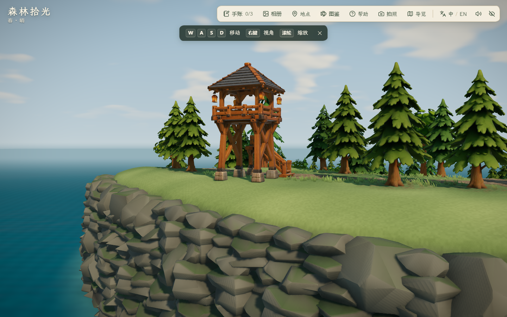

图 1 展示瞭望塔迁至海崖后的实际位置。楼梯朝向内陆，登塔初始视线朝西北海面；正西沿岸仍有部分树木遮挡。[选址与验证](../evidence/2026-10-28-cliff-lookout/evidence.md)

## 2. 场景与核心玩法

### 2.1 一座相互连通的小岛

小岛包含针叶林、淡水池塘、高地、溪谷、海崖和南侧月牙湾。自然小路连接工坊、牧场、卧室、营地、码头和崖顶瞭望塔；树木与建筑按实际高程落地，角色、地面与碰撞共用空间规则。

操作以 PC 键鼠为范围：WASD 按镜头朝向移动，Shift 奔跑，右键环顾，滚轮从近景拉到全岛，F 互动。界面支持中英文、隐藏 HUD、音量调整及减少动态效果；工具栏提供约 90 秒、7 站的固定镜头导览，便于首次了解岛上内容。

### 2.2 主要交互与当前状态

“本机验证”表示已有对应代码、测试或浏览器操作证据，不等于跨设备性能或所有动画细节均通过验收。

| 系统 | 当前可体验的闭环 | 状态与边界 |
| --- | --- | --- |
| 钓鱼与渔获 | 池塘/码头抛竿、等待、张力收线、成功或失败；8 种鱼，渔获可入缸、放回或用于烤鱼 | 已实现、本机验证；鱼种会受时段与天气影响 |
| 种树 | 6 处种植地，每天可新种 1 棵；小苗到成树四阶段，刷新和离线后继续成长 | 已实现、本机验证；按 45/120/240 秒切阶段，没有浇水或连续枝条生长 |
| 划船 | 码头上船、前进/倒船/转向、绕岛、靠岸下船；划桨涟漪和尾流 | 已实现、本机验证；跨舷使用短转场，没有专用跨舷动作或浮力物理 |
| 牧场与采集 | 喂鸡羊、捡鸡蛋、梳羊毛；采集蘑菇、浆果、贝壳、松果进入背包 | 已实现、本机验证；无繁殖或完整经营系统 |
| 工坊与家具 | 取木料、互动制作；小木桌、鸟屋、钓竿架、路牌出现在固定展示位并参与碰撞 | 已实现、本机验证；家具暂不支持自由摆放 |
| 卧室与营地 | 渔获入缸、床边休息观看日出/日落；点火、坐下、烤鱼、看星空 | 已实现、本机验证；休息没有上下床动画，部分衣袖变形仍待细化 |
| 瞭望塔 | 楼梯脚触发登塔、平台环顾、返回原位 | 已实现、本机验证；平台不是自由行走区，不做逐级爬楼 |
| 手账与相册 | 活动完成今日小事、积累手账页、解锁拍照效果、保存照片、布置照片墙 | 已实现、本机验证；相册保留最近 12 张 |
| 天气、季节与探索 | 手动或按天数选天气、季节回顾、放河灯、发现 6 处隐藏角落 | 已实现、本机验证；新扩展仍待用户体验 |
| 南沙滩玩沙 | 爪印、沙堡、小河、沙坑、浣熊印；作品当天保存，睡醒被潮水抹平 | 已实现、本机验证；沙堡拍照主体与手账任务尚未接入 |

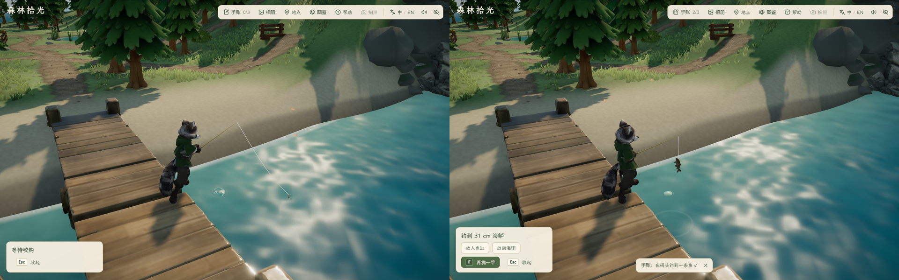

码头南沿用于钓鱼，北侧用于系船，避免两个互动争用同一站位。图 2 是多张实机画面汇总，并非同机位前后对比。[钓鱼与家具等扩展证据](../evidence/2026-10-27-expansion/evidence.md)

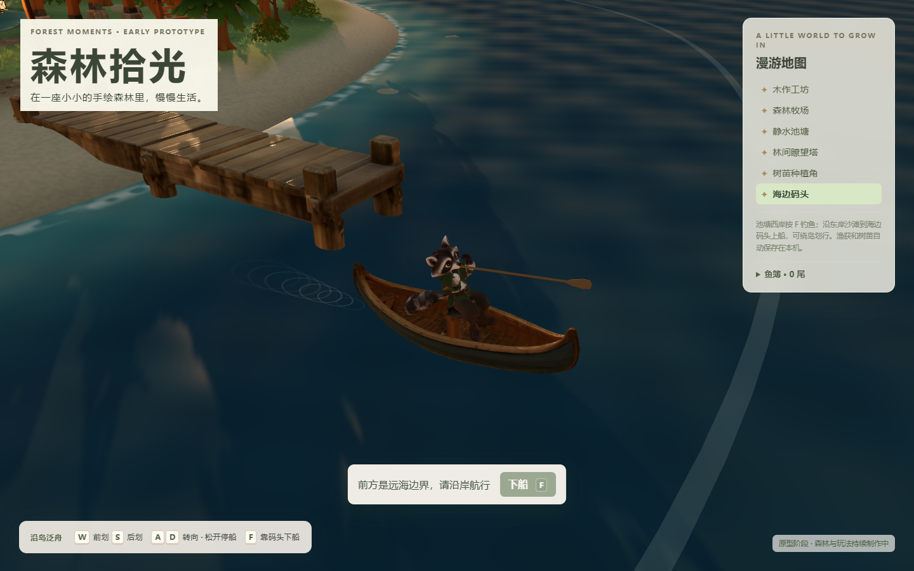

图 3 保留当时的场景和界面，用于说明已接入的划桨、水面与尾流效果，不代表最新全岛布局。[划船验证](../evidence/rowing-polish/2026-10-24/evidence.md)

### 2.3 玩沙：让动作改变地形

在南侧沙滩按 B 进入堆沙模式，选沙堡、小河、沙坑或浣熊印，再用 R 调整方向、F 动手。先显示摆放轮廓，遇障碍或越界会拒绝并说明原因；浣熊沿用互动动作，作品约 3 秒逐步成形，中途可取消。沙堡有碰撞，沙坑改变落脚高度，小河挖到潮线后有海水流入。最多保留 12 件作品，跨天清空。

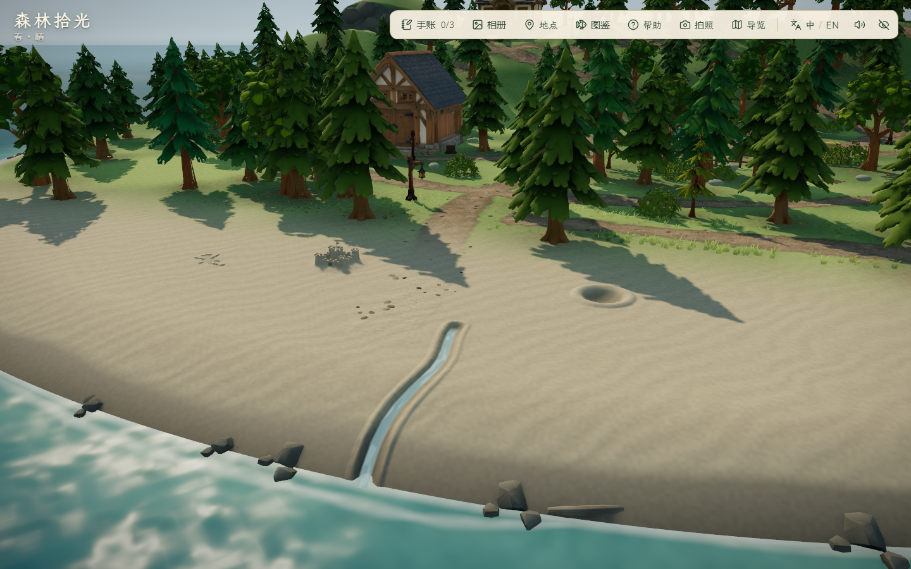

图 4 显示作品实际改变沙面；远处沙堡与浣熊印对比度偏低，仍是画面上的改进点。脚印约 40 秒消失的逻辑已实现，但尚未在浏览器里完整等待该时长验收。[玩沙过程与 9 组交互检查](../evidence/2026-10-28-sandplay/evidence.md)

### 2.4 天气、季节与隐藏角落

春、夏、秋每 4 晚轮换，天气按睡过的天数生成，也可在工具栏手动选择晴、多云、小雨、薄雾并保存到本浏览器。选回“跟随天数”即可恢复。天气会影响画面、声音、雾鱼、蘑菇数量和手账任务；彩虹仍要求按天数的前一天下过雨，不能仅靠切换天气强制产生。

春季花量增加，夏季萤火虫更活跃，秋季阔叶变暖、地面出现落叶。下雨时海面、池塘、溪流出现雨点，路面出现带反射的水坑和溅点；低画质关闭水坑反射。黄昏或夜间可在溪源放河灯，灯沿溪流漂向外海约 80 秒后淡去，同时最多 6 盏。跨季节时，手账展示上一季的活动统计与仍在相册中的照片。

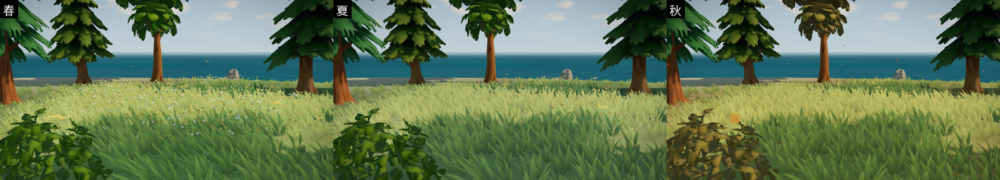

探索内容包括漂流瓶、夜光水母、浣熊星座、狐狸洞、心形石和塔梁刻字，通过互动或拍照发现。狐狸洞白天显示睡狐、黄昏显示探头狐狸、夜里只露眼睛；当前是静态模型切换及轻微起伏，没有狐狸骨骼动画。

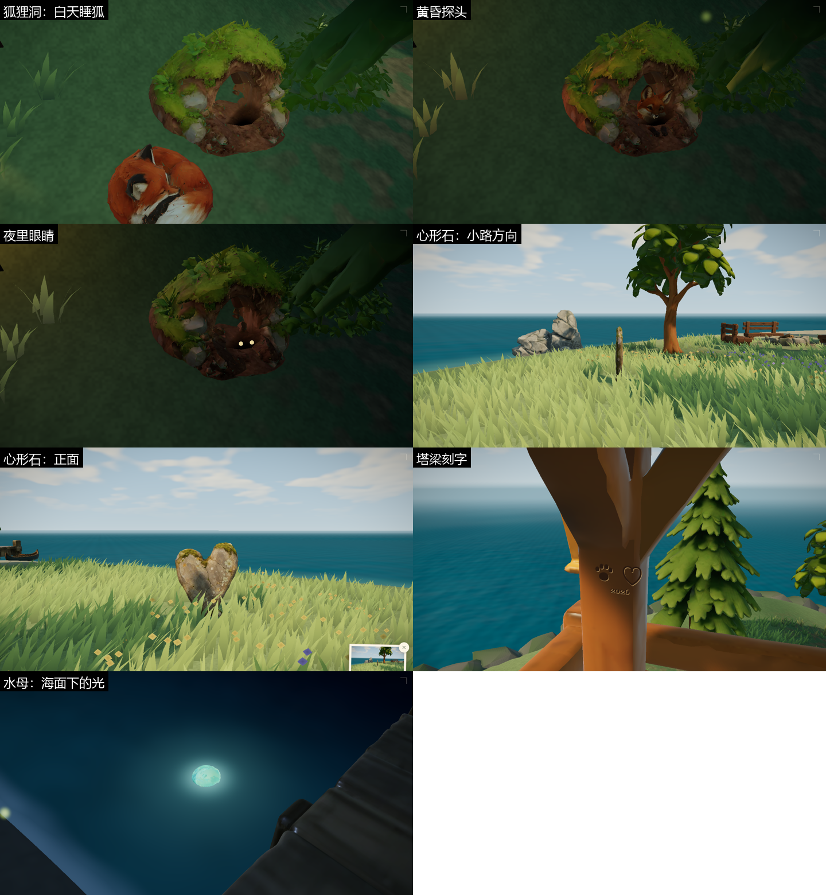

图 6 为不同机位和时段的功能汇总。季节、雨天与角落的制作问题见[环境细节证据](../evidence/2026-10-28-details/evidence.md)；河灯、多处种树、季节回顾及导览见[第一档扩展证据](../evidence/2026-10-28-tier1/evidence.md)。

### 2.5 拍照与生活记录

按 P 进入拍照，可环绕角色或自由取景；快门保存 PNG 到本地相册，可下载、筛选，并选择照片挂到卧室墙上。取景器采用墨绿半透明工具条，滤镜与相框按需展开，减少对画面的遮挡。

手账写满页数决定解锁：景深 1 页、胶片 2 页、黑白 3 页、夜灯 4 页，纸边相框 2 页、印章相框 5 页；原色、暖阳和无相框默认可用。未解锁时悬浮立即说明条件，低画质仍禁用景深并解释原因。

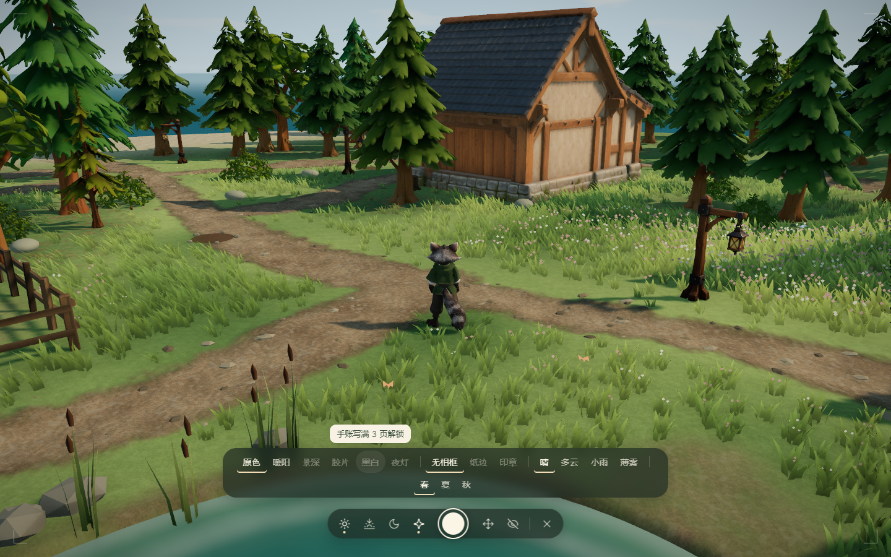

拍照任务按画面主体与遮挡判定；季节回顾把钓鱼、种树、家具等计数和照片组织成生活记录。[拍照证据](../evidence/2026-10-27-photo/evidence.md)与[当前解锁回归](../evidence/2026-10-28-report-sync/evidence.md)

## 3. 美术方向与模型制作

### 3.1 从参考到浏览器资产

视觉方向是成熟、克制的温暖童话森林：深绿针叶树、少量阔叶、暖木、暖灰岩石和琥珀灯光。流程为：确认参考图与用途，调用 Lux3D 生成，保留原始产物，在 Blender 统一尺度、原点、材质并修整结构，导出 GLB，最后在游戏里检查位置、动作、碰撞和画面。

AI 参考插画、Blender 渲染和浏览器截图分别标注；原始候选、失败试稿、采用版本与生成台账分开保存。模型优化以外观和实际加载体验为依据，资源体积是参考指标，不强制用减面达到固定 MB 数。

| 资产组 | Lux3D 参与与主要证据 | 当前采用方式 |
| --- | --- | --- |
| 浣熊、工坊、瞭望塔、独木舟 | 首轮任务 4266109 / 4266166 / 4266456 / 4266578；浣熊按四视图另生成 4268120 | 首轮浣熊不采用；运行角色使用后续 v6。工坊、木塔、船经结构与尺度修整后接入 |
| 四阶段树苗 | 4323002 / 4322894 / 4322899 / 4322904 | 四个独立模型，统一根部原点、阶段高度及材质 |
| 生活扩展模型 | 木工刨、卧室、床、桥、礁石、篝火、鱼缸，共 7 件 | Blender 归一化和运行文件编码；卧室部分墙地结构另由 Blender 制作 |
| 采集物、家具与探索道具 | X3 共 12 件成功生成，任务清单见资产证据 | 按用途调整面数与贴图，接入背包、制作、展示与隐藏角落 |
| 狐狸洞、睡狐、心形石、探头狐狸 | 4434100 / 4434115 / 4434124 / 4434132 | 4 件完成优化和场景接入；狐狸按时段切换静态造型 |

其他树木、路灯、牧场、室内家具及部分动作来自既有资源复用；海岸岩块套件由 Blender 制作。它们与本轮 Lux3D 生成资产明确区分，不重复计作新生成成果。

生成记录：[首轮清单](../evidence/assets/2026-10-22-round-01/manifest.json)、[浣熊四视图](../evidence/assets/2026-10-22-raccoon-multiview/evidence.md)、[树苗](../evidence/assets/2026-10-24-tree-growth/evidence.md)、[生活扩展](../evidence/2026-10-25-expansion/evidence.md)、[X3 道具](../evidence/assets/2026-10-27-x3-lux3d/evidence.md)、[X5 角落模型](../evidence/assets/2026-10-28-x5-lux3d/evidence.md)。

积分记录中，首轮前两笔各 20 积分有用户账单截图；X3 约 240、X5 约 80 均为按单价估算，尚未核账，创建状态不明的失败请求另有记录。用户授权调用与复用不等于第三方商用许可确认，具体来源和授权凭据仍需逐件归档。赛事 API 使用方式目前依据用户提供的回复转录，缺少官方原始消息凭据，见[规则沟通记录](../evidence/hackathon/2026-10-22-lux3d-api-rule-confirmation.md)。

### 3.2 浣熊与划桨：保留形体，解决实际适配

最初的浣熊候选尾根与衣摆贴连，改用四张独立参考图生成新候选，再在 Blender 局部修整。后续衣摆权重试验出现破面，已弃用；用户确认保留角色 v6，继续适配现有 19 个动作、38 根骨骼与 5 节尾骨。完整足底、衣袖和所有动作衔接仍不能宣称无瑕疵。

划船曾尝试修改手臂 IK 来匹配独木舟，虽然部分采样数值改善，实际姿态出现问题，因此整套试稿弃用。最终保留原划桨动作，通过独立桨的尺寸、握点、随动与中央座位布局完成适配，再验证上船、航行、靠岸和下船闭环。

这个过程决定了后续原则：动画轨迹与碰撞数字用于定位问题，最终选择仍需结合连续画面；较小文件或局部误差达标，不能直接当作角色或玩法完成。[尾根修整](../evidence/assets/2026-10-22-raccoon-tail-repair/evidence.md)、[动作适配](../evidence/assets/2026-10-22-raccoon-animation/evidence.md)、[采用的划桨方案](../evidence/assets/2026-10-23-paddle-final/evidence.md)

### 3.3 四阶段树苗：把参考造型接成成长玩法

四阶段分别为单茎小苗、分叉树苗、幼树和成树，目标高度约 0.22、0.55、1.5、3 m。采用独立模型切换，使成长阶段在近景和漫游距离下都有明确差别。

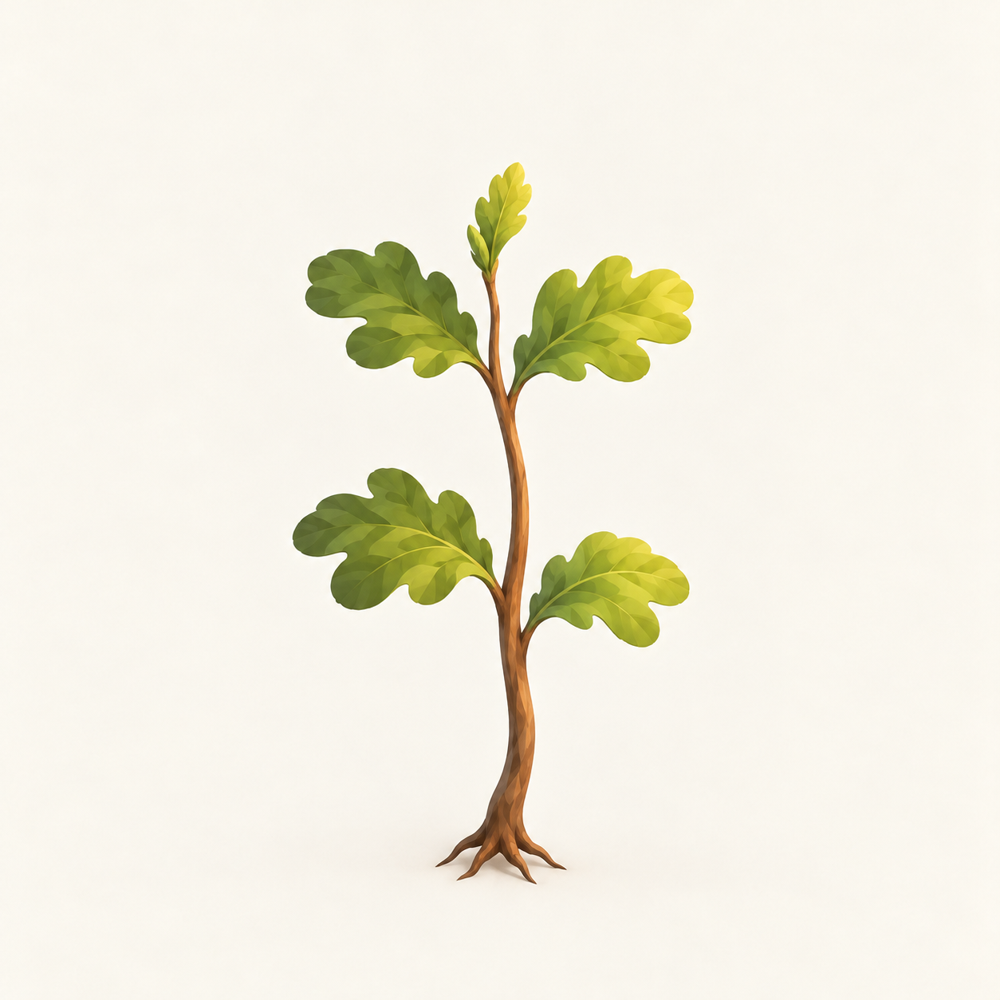

生成的小苗顶芽与茎断开，Blender 在断口增加短细茎；成树调整朝向以统一阶段轮廓。材质初版叶面偏亮，修正金属/粗糙度贴图覆盖后改为哑光。原始模型、贴图和处理记录保留，不把结构修补说成平台原生生成质量。

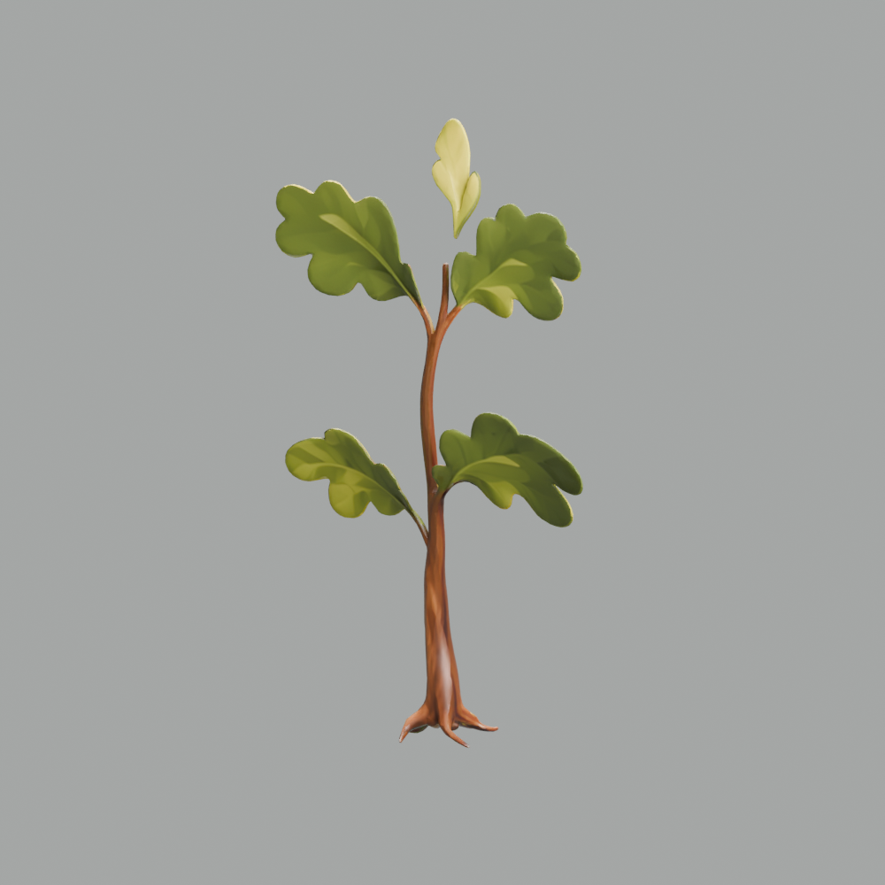

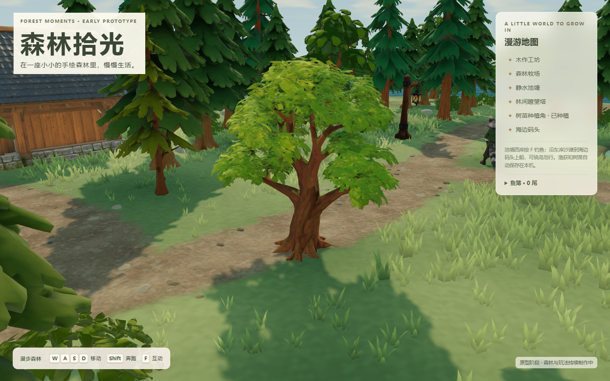

图 9–10 为局部修整前后对比，图 11 为独立的运行时效果。真实等待成长、刷新、离线时间和旧档迁移已有检查；当前玩法已由当时的单点种植扩为 6 处。[完整过程与阶段对照](../evidence/assets/2026-10-24-tree-growth/evidence.md)

### 3.4 小道具与狐狸：按轮廓质量调整优化力度

12 件 X3 道具从原始约 60 MB 优化为运行时约 5.5 MB。初次把小件压到 4 千面时出现边缘锯齿和 UV 接缝拉扯，最终提高到小件约 8 千面、家具约 1.6 万面、水母约 1.4 万面，并按用途采用 512/1024 贴图。草窝实机出现不合理金属亮斑，另行修正材质。

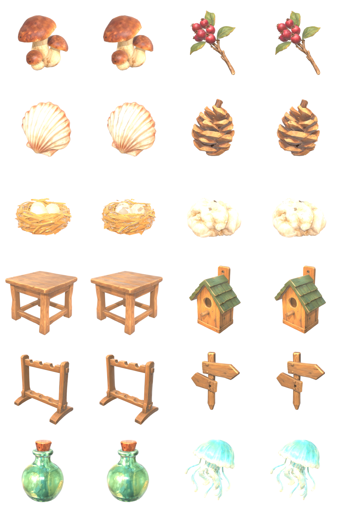

狐狸也经历了相同取舍：首版减面导致皮毛折面明显，睡狐与探头狐狸分别提高到约 1.6 万、1.4 万面；心形石在 Blender 压薄到 0.18 m。四件 X5 模型合计约 2.8 MB，狐狸洞顺坡放在坡脚，睡狐挪出遮挡灌木。

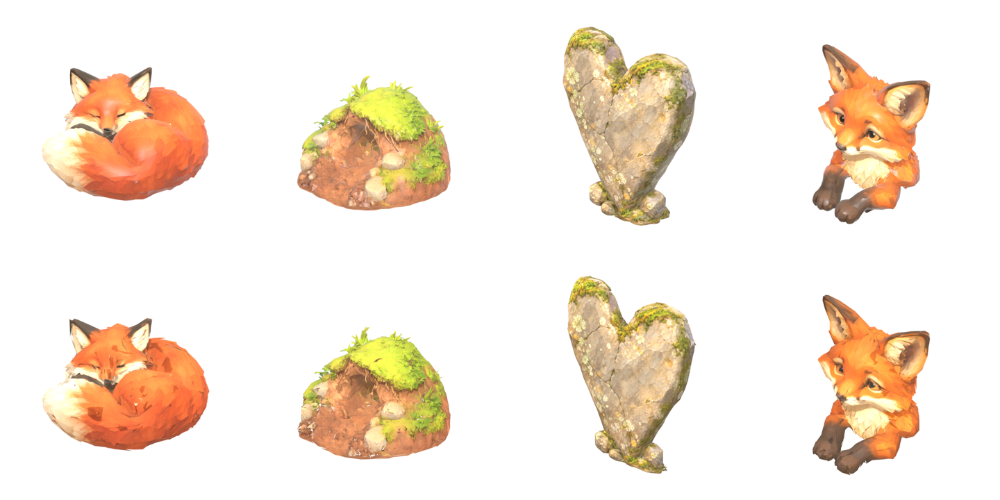

图 13 是造型参考，图 14 是模型处理结果，图 6 是场景接入效果，三者共同说明从参考到运行资产的过程。[道具生成与优化](../evidence/assets/2026-10-27-x3-lux3d/evidence.md)、[狐狸与洞口优化](../evidence/assets/2026-10-28-x5-lux3d/evidence.md)

### 3.5 海岸环境：从光滑墙面到岩层

早期海崖是大面积光滑坡墙，缺少岩层与尺度变化。为此在 Blender 制作层岩、高岩、巨石、碎石和漂流木模块，再实例化铺在不可行走的崖面与潮间带。首版竖列排列露出墙缝，调整为错缝铺排；随后修正沙色遮罩，去掉崖脚不自然的浅色带。

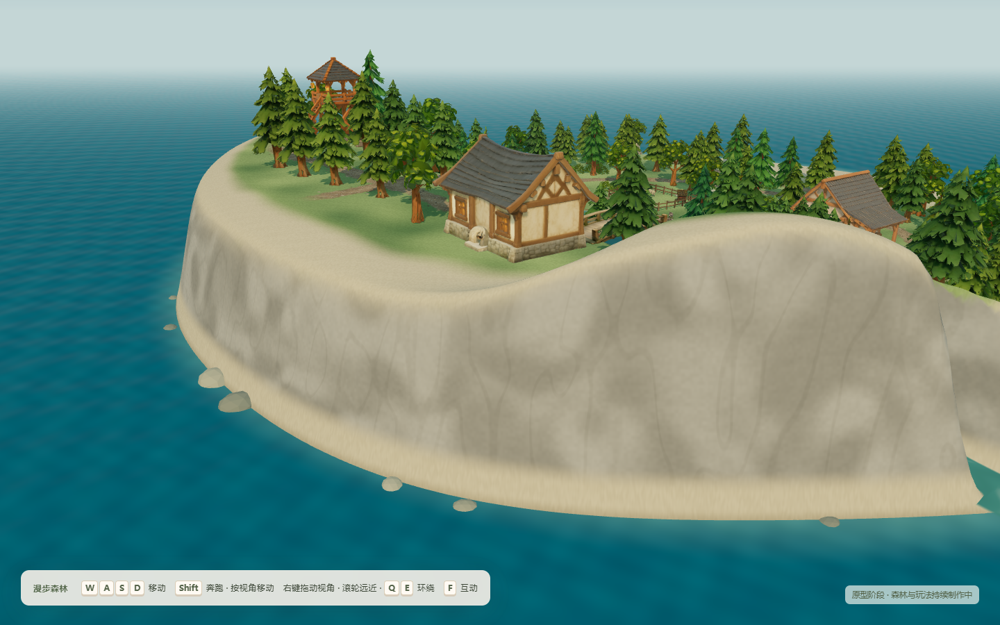

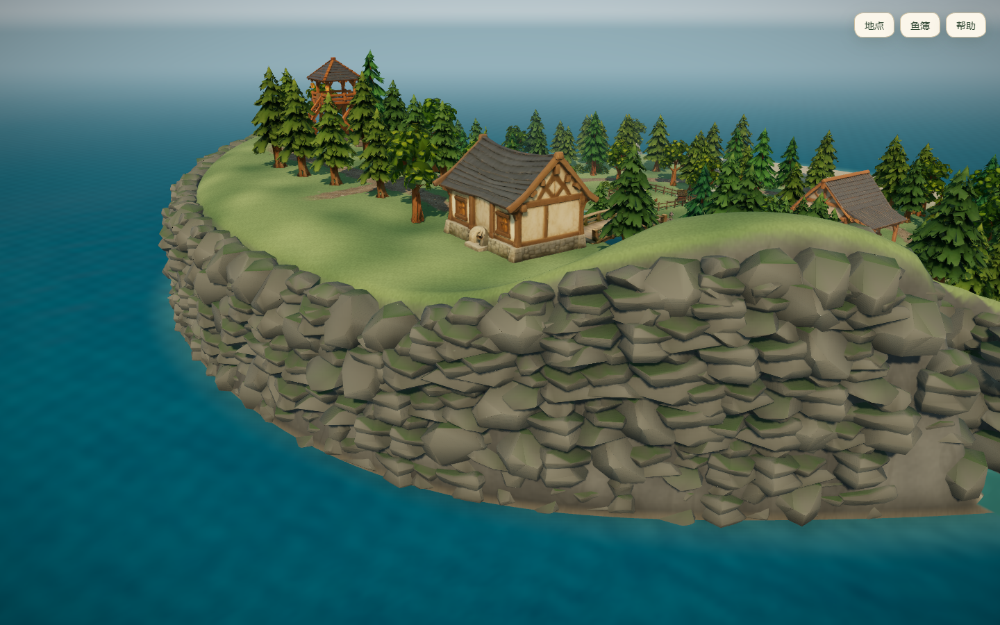

图 15–16 是该阶段受控对比，不代表之后的瞭望塔位置。可走坡道和航行边界保持原有规则，不能为了覆盖裸露地面而把岩块塞进通行区。[Blender 套件与失败试验](../evidence/2026-10-25-visual-v3/evidence.md)

## 4. 技术架构与关键改进

### 4.1 纯前端运行与本地记录

项目使用 React、TypeScript、Vite、React Three Fiber、Three.js 与 Zustand。界面和游戏状态分离，3D 场景按状态反馈；构建后为静态文件，不需要业务服务器。日常进度保存在本浏览器，照片存入 IndexedDB；存档迁移、坏档回退和存储失败提示均有对应处理。

地形高度、坡度、建筑与植被碰撞共同约束角色、船、镜头和物体摆放。渲染采用实例化植被、模型缓存、草花风动、程序天空与水面，以及环境遮蔽、泛光和色调映射；减少动态效果和低画质档对昂贵效果做降级。

音频使用 WebAudio，区分音乐、环境和动作音效；昼夜、海岸距离与室内状态影响混音。46 个复用音频素材的记录标为 CC0，来源台账保留。基础音频已有用户试听确认，后来加入的雨声、强制天气声音与快门声仍待单独听验。[音频证据](../evidence/2026-10-26-audio/evidence.md)

### 4.2 坡地相机与可达性

固定俯角在下坡时会让相机陷进身后的草丛。当前按视线前后地面高差调整俯角，上坡放平、下坡俯视，并平滑过渡；拉远到全岛视角时逐渐取消，室内、钓鱼和划船保持各自镜头。

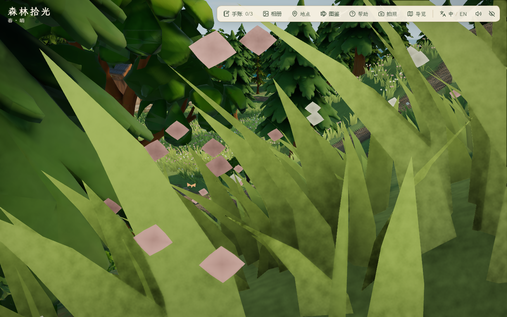

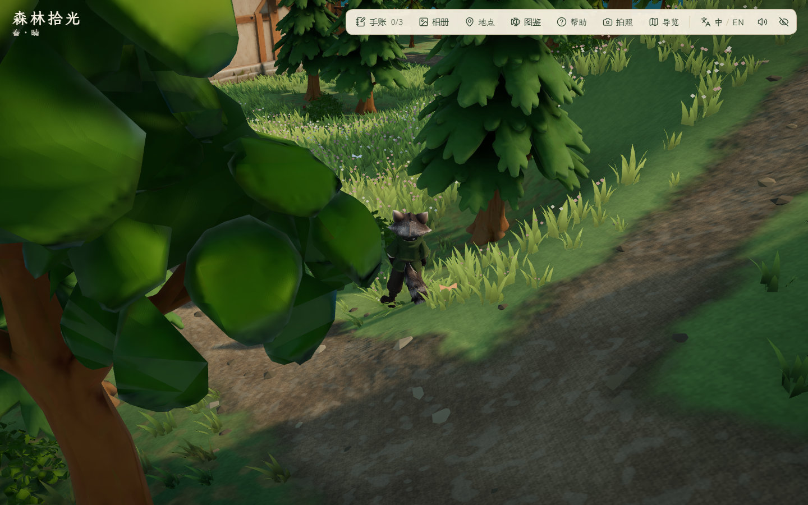

两图俯角本身就是调整对象，因此用来比较可见性，不作为固定相机的美术对比。镜头左侧仍有树冠遮挡；当前避让主要处理相机落入树冠的情形。[坡地镜头证据](../evidence/2026-10-28-slope-camera/evidence.md)

碰撞也存在取舍：松树由圆形范围改为按高度和方向测得的枝叶范围后，历史审计中空气墙边长从 235.5 m 降为 55.9 m，但明显穿模面积由 3.36 增到 5.19 m²。采用方案改善了可通过空隙，并未消除所有针叶尖接触问题；不能把审计数值概括成“无穿模”。详细采样口径保留在历史附录 5.65。

### 4.3 点火卡顿与重复动作

点燃篝火时曾出现约 2.5 秒长帧。原因是灯数量变化触发受光材质重新编译，火焰和火星也首次进入渲染。改为火焰、火星和灯常驻，熄灭时灯强度为 0、着色器丢弃像素，并在加载时预编译，既有同机样本中的点火帧由 2535 ms 降至 7 ms。只预编译而仍切换可见性的中间方案为 93 ms，因而进一步采用常驻方案。

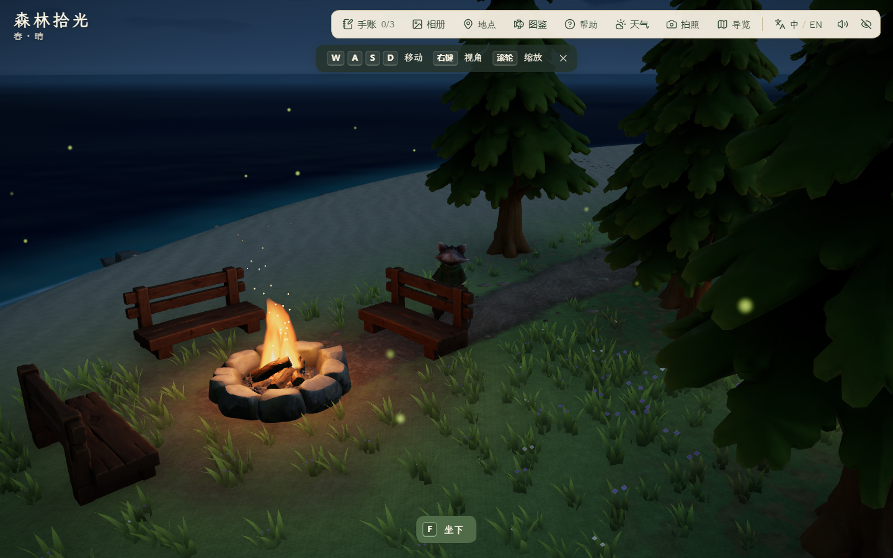

图 19 仅展示视觉结果，性能结论来自帧采样。常驻方案增加一个始终存在的点光源，关闭时强度为 0；结果不外推为其他设备的耗时。[点火定位与测量](../evidence/2026-10-28-campfire-hitch/evidence.md)

座位动作曾在淡出时循环回首帧，造成坐下、起身各出现两次。现从座位片段切出时直接停止旧动作，其他动作继续淡入淡出。制作结束后增加 1.5 秒 F 键保护，避免最后一次敲击接着触发坐凳。小河路径增加缓存，沙面计算收缩到河道包围盒，减少挖河期间的重复计算。小河旧耗时记录缺少独立摘要，本文不采用其数字作为性能成果。

### 4.4 验证驱动的资源优化

大模型的早期减面稿出现裂片和色块，全部弃用；之后优先采用文件编码、贴图处理和实例化，并逐件检查外观。小道具允许减面，但出现轮廓或接缝问题就提高面数。源文件、运行文件及必要的哈希对照保存在资产台账，避免把文件变小误写成视觉质量提升。

同样的原则用于界面与脚本：拍照提示从延迟的原生提示改为即时悬浮提示后，回归检查也要更新到新的属性和解锁门槛；测试通过必须说明检查对象与版本，不能沿用旧截图或旧断言宣称最新功能已验收。

## 5. 验证结果与当前限制

### 5.1 当前检查结果

2026-10-29 群岛设计资料提交前重新检查，`pnpm lint`、47 个文件共 215/215 单测、`pnpm build` 通过。主 JS 为 1,866.86 kB，gzip 575.72 kB；现有大于 500 kB 的构建提示仍保留。这是代码检查与构建结果，不是公网加载或跨设备性能结论。

以下浏览器结果为此前对应功能版本的验证记录，本次设计资料更新没有重跑场景或采集新实机截图。拍照最近一次验证使用 Edge 156.0.4314.50、1440×900；其他环境以各证据说明为准。

| 验证对象 | 已有结果 | 证据与覆盖范围 |
| --- | --- | --- |
| 当前拍照门槛与提示 | 6 组通过，控制台错误 0 | 0–5 页解锁、真实鼠标悬浮、滤镜差异、相框/相册、退出重置、低画质景深禁用；[摘要](../evidence/2026-10-28-report-sync/validation-summary.json) |
| 多处种树、季节回顾、天气联动、河灯、导览 | 9 组通过 | 真实按键与点击闭环、旧档迁移及导览退出还原；[证据](../evidence/2026-10-28-tier1/evidence.md) |
| 南沙滩玩沙 | 9 组通过，控制台错误 0 | 摆放/拒绝、取消、地形变化、刷新、跨天清空和英文界面；[证据](../evidence/2026-10-28-sandplay/evidence.md) |
| 崖顶瞭望塔 | 三时段观景及相关回归通过 | 进出塔、环顾、平台范围、导览与地点任务；[证据](../evidence/2026-10-28-cliff-lookout/evidence.md) |
| 种树与沿海导航 | 生产包成长/刷新/离线及 7 组沿海检查通过 | 真实种植、航行边界、靠岸、重复上下船；[记录](../evidence/2026-10-28-tier1/legacy-scripts/coastal-gameplay.json) |

### 5.2 有边界的性能测量

下表均来自既有无头浏览器同机采样，不是显示器呈现 FPS，也不能把不同场景的数值相互排名。本次没有重新测量。

| 场景与口径 | 对比结果 | 结论边界 |
| --- | --- | --- |
| 夜间营地点火，点火帧 | 2535 ms → 7 ms | 修复特定首次编译卡顿；见第 4.3 节 |
| 导览俯瞰，帧时间中位数 | 空种植地 6.4 ms；6 棵成树 7.8 ms | 只说明该机位增加树后的开销 |
| 沙滩固定机位，帧时间中位数/P95 | 空场 3.5/15.8 ms；12 件作品 3.8/16.1 ms | 不包含所有建造过程或其他视角 |
| 天气细节加入倒影后，帧时间中位数 | 晴天 5.2 ms；雨天 6.4 ms | 是整体天气差异，不能单独归因于倒影 |

### 5.3 尚存问题

- **体验验收：** 最新多树、河灯、导览、坡地镜头、崖顶塔、玩沙和手动天气仍需用户实际体验；基础音频已确认，雨声与快门声等补充声音待听验。
- **动作与接触：** 部分衣袖、足底、细小遮挡和碰撞尚未全面验收；狐狸无骨骼动画，跨舷、种植、喂食等没有完整专用动作。
- **玩法边界：** 沙堡拍照/手账联动未做；脚印完整淡出时长未在浏览器等待验证；季节回顾只统计上线后的数据，历史照片受最近 12 张限制。
- **性能与交付：** 缺少跨 PC 配置、公网冷加载与整场景长时运行测量；主 JS 大分块提示待按实际加载瓶颈处理。
- **素材凭据：** 部分生成积分尚未核账，授权和赛事沟通原始凭据仍需补齐。

仅 PC 浏览器属于交付范围，不将手机布局、触屏控制或移动端验收列入待办。

## 6. 展示材料与后续计划

### 6.1 当前交付状态

| 材料 | 状态 |
| --- | --- |
| 可运行静态构建 | 本地构建通过，尚未部署公开 Demo |
| 公开托管 | 计划使用 ModelScope 国际站；尚无公开作品地址 |
| 项目报告 | 本文为当前事实主稿，含精选图片与证据链接 |
| 完整过程 | [v0.83 历史附录](HISTORY_V083.md)，保留原章节、失败过程与修订日志 |
| 演示视频、参赛 PDF/PPT | 尚未制作或导出 |

后续发布只上传编译后的静态产物，模型工作文件、完整开发源码和密钥不作为站点公开内容；创建远程空间、上传和部署需另有明确授权。

### 6.2 下一步

先完成最新玩法的人工体验与声音检查，处理影响角色可见性、动作连续性和操作闭环的问题；再在目标 PC 环境测量冷加载和长时运行，依据实际瓶颈优化。随后录制包含漫游、种树、钓鱼、划船、玩沙与夜景的短演示，并从本文导出带图 PDF，逐页核验中文字体、图片清晰度、图注和分页。

PDF 正文以本稿为源，完整历史按需作为独立附录；正式导出前按实际排版调整图幅和页数，不把预期页数当作已完成成果。

另已形成**后续群岛扩展设计，待用户审阅，尚未实施**：主岛向西增加更茂密的混合森林，邻岛扩为雾松岛、秋岚岛、潮汐岛，共四岛；保留原生活区与旧档。深林强调连续树冠、不同树龄和蕨丛，新增云杉、白桦、枫树、赤杨及海风松造型。主岛可行走面积增加约 40%–60%、相邻岛单段航行 30–50 秒均是待测目标。秋岚岛跟随季节换叶色，潮汐岛首版采用固定浅池，不含潮汐模拟。

现有码头、船、岩石优先复用；九件单体建模参考之外，三岛分别配有独立场景和地形造型图，便于先验证地形与泊位，再制作树木和布景。技术上需多岛地形、多泊位、旧档迁移和区域加载；详见[规划方案](../ISLAND_EXPANSION_PLAN.md)、[单体图册](../ISLAND_EXPANSION_REFERENCES.md)与[邻岛图册](../ISLAND_NEIGHBOR_REFERENCES.md)。

图 20 表达空间与美术方向，不是坐标复刻或功能完成证明；单岛灰模风格图同样是 AI 插画，不是已制作的地形模型。此前双岛稿与本轮修订、树形修正及完整提示词保留在[制作证据](../evidence/2026-10-29-island-expansion-v2/evidence.md)。尚无新模型或新场景验收结果。

**本版修订（2026-10-29，v0.86）：** 按反馈增加树类与深林密度、两座邻岛，并补齐逐岛场景/地形图和五件新增树形参考。运行时、既有模型和功能验收状态不变；历史附录保持封存。设计资料已完成提交前检查；未部署或导出 PDF/PPT。
