# 森林拾光 Forest Moments · 项目报告书

**v0.98｜2026-10-29｜参赛图文主稿，持续更新**

一座可以留下生活痕迹的海上森林小岛。玩家化身浣熊，在林间漫步、钓鱼、种树、划船、制作家具，把日常收获留在手账和照片中。

**当前状态：** PC 浏览器版本已实现主要生活交互，并取得本机浏览器验证与截图。主岛西扩地形、环线、湿地浅水与 Blender 木栈道已接入，参考图生成的古松和云杉已进入西林；雾松岛与秋岚岛首版已接入独立地形、林路、到访/发现记录和三泊位旅行；秋岚已用 AHOLO 白桦/枫树替换布局阔叶树，并接入春夏秋叶色。潮汐岛与其余树种仍待制作，新林区与邻岛美术仍待完善与用户体验。公开 Demo、演示视频及 PDF 尚未发布。

本文按作品主题介绍当前成果和代表性制作过程。完整迭代、失败试验、旧测试与维护记录收在[历史附录（截至 v0.83）](HISTORY_V083.md)；旧文档中的“报告 5.x”指该附录。现状以本文为准，原始证据按日期保留。

## 1. 作品概述与特色

森林拾光面向希望短暂放松、喜欢自然探索的 PC 玩家。体验以小岛上的生活活动展开：走进工坊、在池塘边等待鱼咬钩、看种下的树长大，最后乘船绕岸或登塔看海。项目不设复杂货币与经营系统，建筑保持少而精，让树林、海岸和生活痕迹成为主要内容。

三个重点贯穿设计：

- **可感知的交互结果。** 渔获能进入鱼缸，家具制作后出现在场景中，种下的树会成长，挖出的沙沟能引入海水。
- **随日常活动变化的环境。** 睡觉推进季节与天气；雾鱼、雨后彩虹、雨天蘑菇与手账任务把环境变化和玩法连接起来。
- **有制作过程可追溯的 3D 森林。** Lux3D 生成主要模型，Blender 修整结构、尺寸、材质与动作适配，再在浏览器里验证外观、碰撞和交互。

图 1 展示瞭望塔迁至海崖后的实际位置。楼梯朝向内陆，登塔初始视线朝西北海面；正西沿岸仍有部分树木遮挡。[选址与验证](../evidence/2026-10-28-cliff-lookout/evidence.md)

## 2. 场景与核心玩法

### 2.1 主岛生活区与邻岛探索

小岛包含针叶林、淡水池塘、高地、溪谷、海崖和南侧月牙湾。自然小路连接工坊、牧场、卧室、营地、码头和崖顶瞭望塔；树木与建筑按实际高程落地，角色、地面与碰撞共用空间规则。

操作以 PC 键鼠为范围：WASD 按镜头朝向移动，Shift 奔跑，右键环顾，滚轮从近景拉到全岛，F 互动。界面支持中英文、隐藏 HUD、音量调整及减少动态效果；工具栏提供约 90 秒、7 站的固定镜头导览，便于首次了解岛上内容。

西侧新增陆地与原主岛相连，保留生活区、原植被、路灯和泊位坐标。新增路径长约 134 m，按正常速度推算约 122 秒，不包含停留与绕行；完整路径已有双向规则检查，湿地栈道另有真实键鼠通行记录。本轮补岸后陆地采样增加约 38.6%，含碰撞的可站立面积约增加 37.0%，略低于原 40%–60% 目标。湿地已由硬边椭圆和平板灰盒改为不规则浅池、闭合缓坡泥岸、香蒲状水草、零散岸石及 5 段 Blender 栈道。板顶 0.9 m、板宽 1.9 m 保持，板缝不参与逐块碰撞；水面共享天气与减少动态效果设置。

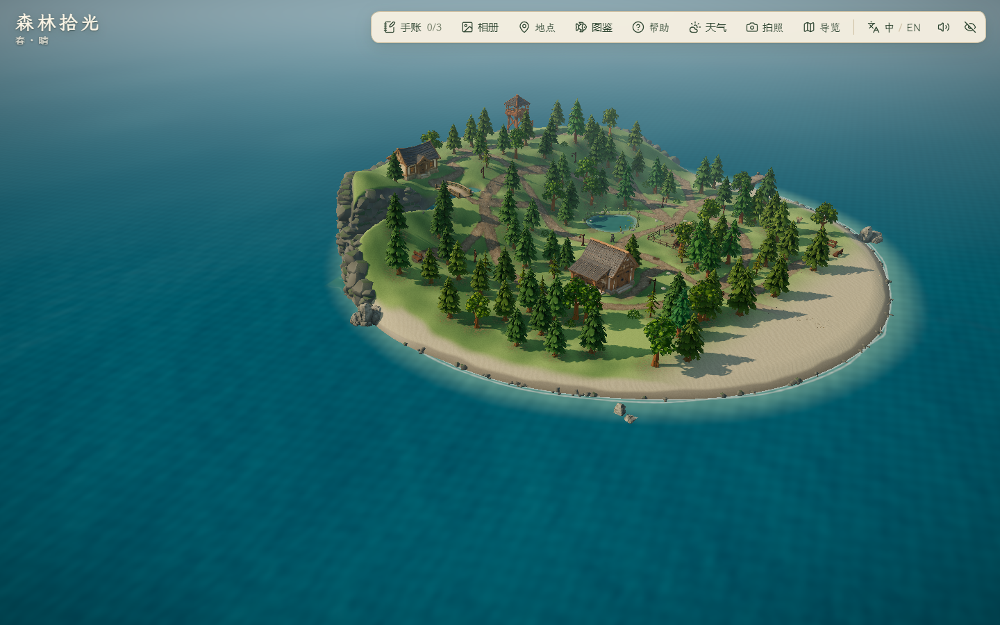

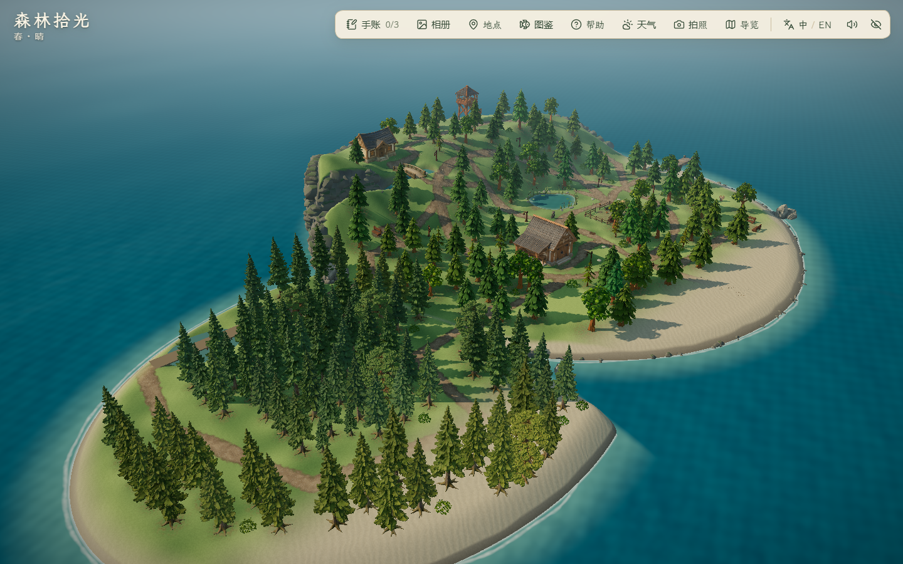

两图沿用同一概览机位与白天设置；地形和植被均有变化，用于说明扩建范围，不作单一因素性能对比。西林当前包含 5 棵古松、91 个云杉实例及 19 丛复用灌木；小云杉只是缩放实例，尚未制作独立树龄枝形。[实施、面积与浏览器证据](../evidence/2026-10-29-west-expansion/evidence.md)

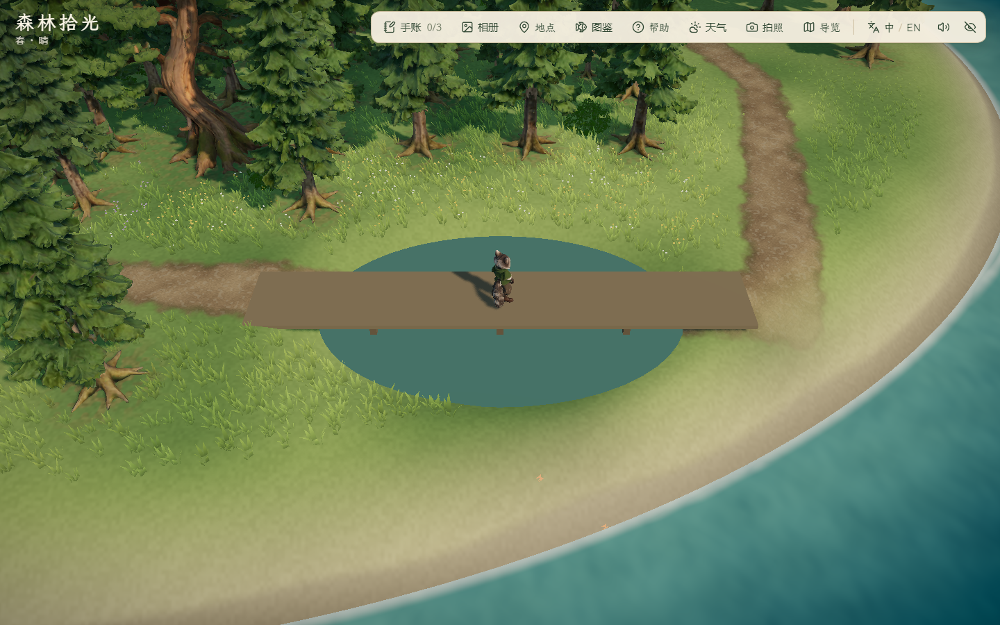

图 25 对比岸线、水草与板面结构的变化；阴影、草丛和昆虫存在运行时变化，不用于逐像素差分或性能归因。首稿发生水面溢到邻近海岸，先限制水域范围，再补齐低岸缓坡；失败图保留在[制作与检查记录](../evidence/2026-10-29-wetland/evidence.md)。

雾松岛位于主岛东偏北，由独立海峡分隔。加入 8 株幼态云杉后，含碰撞可站立面积 823.75 m²，为扩建前主岛 3695 m² 的 22.29%；不能用透视图判断面积比例。岛上保留 1 棵古松、32 株成树云杉，另加入 8 株 Blender 派生幼态云杉，均为完整几何，西湾码头通向古松林窗与环路。第一次实际下船记录到访，接近古松记录发现，地点面板可查看状态；本机真实键鼠已完成往返与两泊位刷新，前一阶段出海含转向/减速约 44.9 秒。已加入 Blender 自制蕨丛与倒木、林缘灌木、6 组局部岩脊、不规则岸湾和柔边薄雾；北/东岸等外沿又补入 16 处复用岩块及克制的坡面矿物色差，完整岩岸与最终美术尚未验收，当前是可玩的首版，非最终概念图美术。

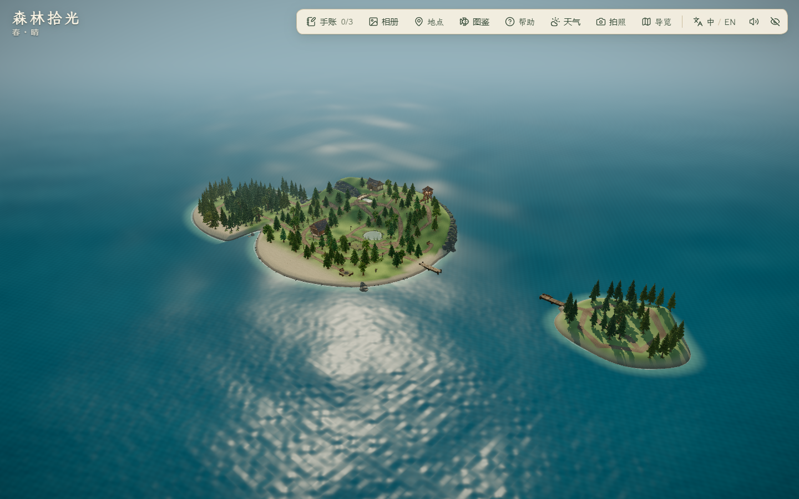

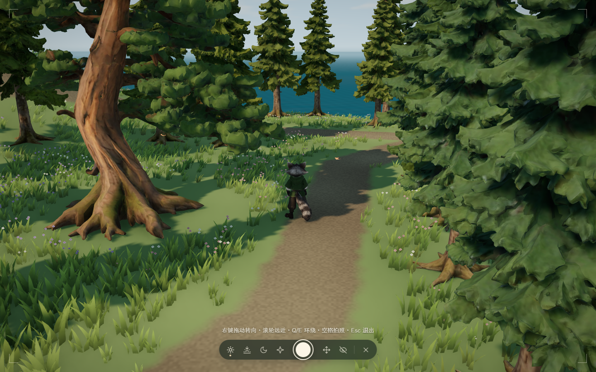

图 27 用于观察空间分隔，比例来自数值采样；图 28 展示角色与林路，不代表整岛树冠遮挡均已解决。固定古松近景仍被前排云杉遮挡，问题图保留于[雾松岛证据](../evidence/2026-10-29-mist-island/evidence.md)。

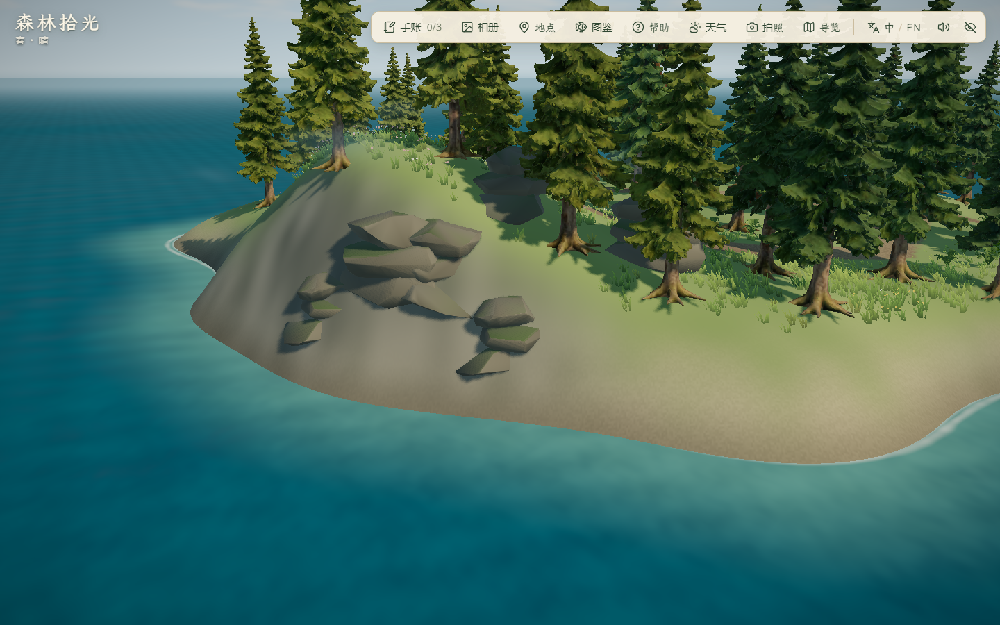

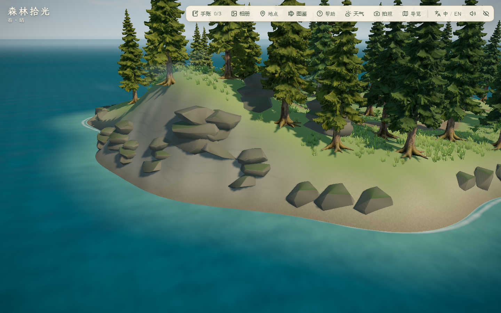

图 34 展示已有 Blender 岩石套件的复用布景。首稿层叠岩块重复偏强，后降低占比、加深嵌入；坡面纹理又降低对比并打断连续条带。地形和林路保持，岩石足迹与实际加载的 5,108 个顶点已检查不进入可航行水域；规则岩块轮廓仍可见，不作为最终自然岩岸验收。[过程与复核](../evidence/2026-10-29-mist-rock-coast/evidence.md)

秋岚岛位于雾松岛南侧略偏东，首版包含西南湾泊位、林窗与东北观景丘。原先 15 株布局树中的 11 株圆冠阔叶，已替换为参考图生成的 8 株白桦和 3 株枫树，保留 4 株松树；位置与东北观景林窗保持。按新树根尺寸更新碰撞后，可站立面积为 901 m²，占原主岛 24.38%（替换前 922.5 m²、24.97%）。白桦形成入口林径，枫树在北侧林窗旁形成较宽树冠，春夏为绿叶、秋季转暖色。

用户指出两岛过近后，秋岚整体东移 4 m、南移 18 m，最近岸距由约 6.06 m 增至 24.37 m；同岛地形、路径、树与泊位整体平移，面积保持。实际雾松至秋岚航程为 67.722 秒，超出原 30–50 秒设计目标，本轮选择保留海峡空间，不提高船速或压缩间距。步行发现、返航与两处刷新均有真实键鼠证据，存档仍只保存安全泊位。

图 36 是替换专用树形前的空间分隔对比，海浪与角色状态未逐帧同步。秋岚仍为可玩首版，地形、林下层次和岸岩尚未达到概念图最终美术。[间距制作与验证](../evidence/2026-10-29-autumn-island/evidence.md)

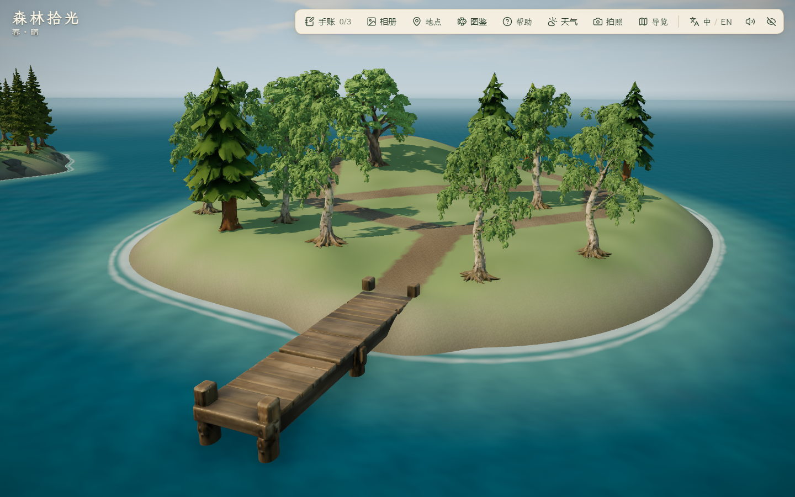

### 2.2 主要交互与当前状态

“本机验证”表示已有对应代码、测试或浏览器操作证据，不等于跨设备性能或所有动画细节均通过验收。

| 系统 | 当前可体验的闭环 | 状态与边界 |
| --- | --- | --- |
| 钓鱼与渔获 | 池塘/码头抛竿、等待、张力收线、成功或失败；8 种鱼，渔获可入缸、放回或用于烤鱼 | 已实现、本机验证；鱼种会受时段与天气影响 |
| 种树 | 6 处种植地，每天可新种 1 棵；小苗到成树四阶段，刷新和离线后继续成长 | 已实现、本机验证；按 45/120/240 秒切阶段，没有浇水或连续枝条生长 |
| 划船 | 三泊位宽容停靠、过渡内系泊朝外、上下船与离泊；船体按朝向碰撞、跨岛往返、划桨涟漪和尾流 | 已实现、本机验证；跨舷使用短转场，没有专用跨舷动作或浮力物理 |
| 牧场与采集 | 喂鸡羊、捡鸡蛋、梳羊毛；采集蘑菇、浆果、贝壳、松果进入背包 | 已实现、本机验证；无繁殖或完整经营系统 |
| 工坊与家具 | 取木料、互动制作；小木桌、鸟屋、钓竿架、路牌出现在固定展示位并参与碰撞 | 已实现、本机验证；家具暂不支持自由摆放 |
| 卧室与营地 | 渔获入缸、床边休息观看日出/日落；点火、坐下、烤鱼、看星空 | 已实现、本机验证；休息没有上下床动画，部分衣袖变形仍待细化 |
| 瞭望塔 | 楼梯脚触发登塔、平台环顾、返回原位 | 已实现、本机验证；平台不是自由行走区，不做逐级爬楼 |
| 手账与相册 | 活动完成今日小事、积累手账页、自由使用拍照效果、保存照片、布置照片墙 | 已实现、本机验证；相册保留最近 12 张 |
| 天气、季节与探索 | 手动或按天数选天气、季节回顾、放河灯、发现 6 处隐藏角落 | 已实现、本机验证；新扩展仍待用户体验 |
| 南沙滩玩沙 | 爪印、沙堡、小河、沙坑、浣熊印；作品当天保存，睡醒被潮水抹平 | 已实现、本机验证；沙堡拍照主体与手账任务尚未接入 |

主岛码头北沿用于钓鱼，南侧用于系船，避免两个互动争用同一站位。图 2 是多张实机画面汇总，并非同机位前后对比。[钓鱼与家具等扩展证据](../evidence/2026-10-27-expansion/evidence.md)

图 3 保留当时的场景和界面，用于说明已接入的划桨、水面与尾流效果，不代表最新全岛布局。[划船验证](../evidence/rowing-polish/2026-10-24/evidence.md)

用户实玩发现雾松岛难以下船及转向空气墙后，停靠由小圆与平行角限制改为码头上船侧局部区域，停稳按 F 后在既有遮罩内系泊朝外；同时改用随船体转动的碰撞矩形，去除世界轴外包矩形空角的误挡。主岛与雾松岛的正面、斜向、偏移靠近以及绕角转向均已有静音实机回归；这是局部容错修复，不是新增跨舷动画。[修复前后与验证](../evidence/2026-10-29-berth-docking/evidence.md)

### 2.3 玩沙：让动作改变地形

在南侧沙滩按 B 进入堆沙模式，选沙堡、小河、沙坑或浣熊印，再用 R 调整方向、F 动手。先显示摆放轮廓，遇障碍或越界会拒绝并说明原因；浣熊沿用互动动作，作品约 3 秒逐步成形，中途可取消。沙堡有碰撞，沙坑改变落脚高度，小河挖到潮线后有海水流入。最多保留 12 件作品，跨天清空。

图 4 显示作品实际改变沙面；远处沙堡与浣熊印对比度偏低，仍是画面上的改进点。脚印约 40 秒消失的逻辑已实现，但尚未在浏览器里完整等待该时长验收。[玩沙过程与 9 组交互检查](../evidence/2026-10-28-sandplay/evidence.md)

### 2.4 天气、季节与隐藏角落

春、夏、秋每 4 晚轮换，天气按睡过的天数生成，也可在工具栏手动选择晴、多云、小雨、薄雾并保存到本浏览器。选回“跟随天数”即可恢复。天气会影响画面、声音、雾鱼、蘑菇数量和手账任务；彩虹仍要求按天数的前一天下过雨，不能仅靠切换天气强制产生。

春季花量增加，夏季萤火虫更活跃，秋季阔叶变暖、地面出现落叶。下雨时海面、池塘、溪流出现雨点，路面出现带反射的水坑和溅点；低画质关闭水坑反射。黄昏或夜间可在溪源放河灯，灯沿溪流漂向外海约 80 秒后淡去，同时最多 6 盏。跨季节时，手账展示上一季的活动统计与仍在相册中的照片。

探索内容包括漂流瓶、夜光水母、浣熊星座、狐狸洞、心形石和塔梁刻字，通过互动或拍照发现。狐狸洞白天显示睡狐、黄昏显示探头狐狸、夜里只露眼睛；当前是静态模型切换及轻微起伏，没有狐狸骨骼动画。

图 6 为不同机位和时段的功能汇总。季节、雨天与角落的制作问题见[环境细节证据](../evidence/2026-10-28-details/evidence.md)；河灯、多处种树、季节回顾及导览见[第一档扩展证据](../evidence/2026-10-28-tier1/evidence.md)。

### 2.5 拍照与生活记录

按 P 进入拍照，可环绕角色或自由取景；快门保存 PNG 到本地相册，可下载、筛选，并选择照片挂到卧室墙上。取景器采用墨绿半透明工具条，滤镜与相框按需展开，减少对画面的遮挡。

所有滤镜与相框默认开放，不再要求手账完成页数，新旧存档均可直接选择。低画质仍禁用景深并解释原因；印章相框中的印章图案仍来自实际获得的手账印章。

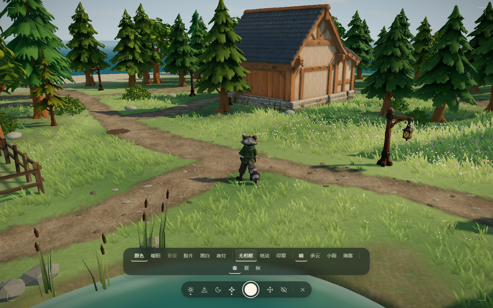

拍照任务按画面主体与遮挡判定；季节回顾把钓鱼、种树、家具等计数和照片组织成生活记录。[拍照证据](../evidence/2026-10-27-photo/evidence.md)与[默认开放回归](../evidence/2026-10-29-photo-unlocked/evidence.md)

## 3. 美术方向与模型制作

### 3.1 从参考到浏览器资产

视觉方向是成熟、克制的温暖童话森林：深绿针叶树、少量阔叶、暖木、暖灰岩石和琥珀灯光。流程为：确认参考图与用途，调用 Lux3D 生成，保留原始产物，在 Blender 统一尺度、原点、材质并修整结构，导出 GLB，最后在游戏里检查位置、动作、碰撞和画面。

AI 参考插画、Blender 渲染和浏览器截图分别标注；原始候选、失败试稿、采用版本与生成台账分开保存。模型优化以外观和实际加载体验为依据，资源体积是参考指标，不强制用减面达到固定 MB 数。

| 资产组 | Lux3D 参与与主要证据 | 当前采用方式 |
| --- | --- | --- |
| 浣熊、工坊、瞭望塔、独木舟 | 首轮任务 4266109 / 4266166 / 4266456 / 4266578；浣熊按四视图另生成 4268120 | 首轮浣熊不采用；运行角色使用后续 v6。工坊、木塔、船经结构与尺度修整后接入 |
| 四阶段树苗 | 4323002 / 4322894 / 4322899 / 4322904 | 四个独立模型，统一根部原点、阶段高度及材质 |
| 生活扩展模型 | 木工刨、卧室、床、桥、礁石、篝火、鱼缸，共 7 件 | Blender 归一化和运行文件编码；卧室部分墙地结构另由 Blender 制作 |
| 采集物、家具与探索道具 | X3 共 12 件成功生成，任务清单见资产证据 | 按用途调整面数与贴图，接入背包、制作、展示与隐藏角落 |
| 狐狸洞、睡狐、心形石、探头狐狸 | 4434100 / 4434115 / 4434124 / 4434132 | 4 件完成优化和场景接入；狐狸按时段切换静态造型 |
| 湿地木栈道、水草 | 本地 Blender 自制，无新增 Lux3D 任务 | IE-04 栈道 2,288 三角形、水草 684 三角形；一个 955,624 字节 GLB、512×1024 原创木纹，实例化接入，无减面 |
| 西林古松、云杉 | 4461967 / 4461973 | AHOLO Lux3D G1 依据独立参考图生成，Blender 规范尺寸、根部原点和材质；保留完整几何接入 |

其他树木、路灯、牧场、室内家具及部分动作来自既有资源复用；海岸岩块套件由 Blender 制作。它们与本轮 Lux3D 生成资产明确区分，不重复计作新生成成果。

生成记录：[首轮清单](../evidence/assets/2026-10-22-round-01/manifest.json)、[浣熊四视图](../evidence/assets/2026-10-22-raccoon-multiview/evidence.md)、[树苗](../evidence/assets/2026-10-24-tree-growth/evidence.md)、[生活扩展](../evidence/2026-10-25-expansion/evidence.md)、[X3 道具](../evidence/assets/2026-10-27-x3-lux3d/evidence.md)、[X5 角落模型](../evidence/assets/2026-10-28-x5-lux3d/evidence.md)。

积分记录中，首轮前两笔各 20 积分有用户账单截图；X3 约 240、X5 约 80 均为按单价估算，尚未核账，创建状态不明的失败请求另有记录。用户授权调用与复用不等于第三方商用许可确认，具体来源和授权凭据仍需逐件归档。赛事 API 使用方式目前依据用户提供的回复转录，缺少官方原始消息凭据，见[规则沟通记录](../evidence/hackathon/2026-10-22-lux3d-api-rule-confirmation.md)。

### 3.2 浣熊与划桨：保留形体，解决实际适配

最初的浣熊候选尾根与衣摆贴连，改用四张独立参考图生成新候选，再在 Blender 局部修整。后续衣摆权重试验出现破面，已弃用；用户确认保留角色 v6，继续适配现有 19 个动作、38 根骨骼与 5 节尾骨。完整足底、衣袖和所有动作衔接仍不能宣称无瑕疵。

划船曾尝试修改手臂 IK 来匹配独木舟，虽然部分采样数值改善，实际姿态出现问题，因此整套试稿弃用。最终保留原划桨动作，通过独立桨的尺寸、握点、随动与中央座位布局完成适配，再验证上船、航行、靠岸和下船闭环。

这个过程决定了后续原则：动画轨迹与碰撞数字用于定位问题，最终选择仍需结合连续画面；较小文件或局部误差达标，不能直接当作角色或玩法完成。[尾根修整](../evidence/assets/2026-10-22-raccoon-tail-repair/evidence.md)、[动作适配](../evidence/assets/2026-10-22-raccoon-animation/evidence.md)、[采用的划桨方案](../evidence/assets/2026-10-23-paddle-final/evidence.md)

### 3.3 四阶段树苗：把参考造型接成成长玩法

四阶段分别为单茎小苗、分叉树苗、幼树和成树，目标高度约 0.22、0.55、1.5、3 m。采用独立模型切换，使成长阶段在近景和漫游距离下都有明确差别。

生成的小苗顶芽与茎断开，Blender 在断口增加短细茎；成树调整朝向以统一阶段轮廓。材质初版叶面偏亮，修正金属/粗糙度贴图覆盖后改为哑光。原始模型、贴图和处理记录保留，不把结构修补说成平台原生生成质量。

图 9–10 为局部修整前后对比，图 11 为独立的运行时效果。真实等待成长、刷新、离线时间和旧档迁移已有检查；当前玩法已由当时的单点种植扩为 6 处。[完整过程与阶段对照](../evidence/assets/2026-10-24-tree-growth/evidence.md)

### 3.4 小道具与狐狸：按轮廓质量调整优化力度

12 件 X3 道具从原始约 60 MB 优化为运行时约 5.5 MB。初次把小件压到 4 千面时出现边缘锯齿和 UV 接缝拉扯，最终提高到小件约 8 千面、家具约 1.6 万面、水母约 1.4 万面，并按用途采用 512/1024 贴图。草窝实机出现不合理金属亮斑，另行修正材质。

狐狸也经历了相同取舍：首版减面导致皮毛折面明显，睡狐与探头狐狸分别提高到约 1.6 万、1.4 万面；心形石在 Blender 压薄到 0.18 m。四件 X5 模型合计约 2.8 MB，狐狸洞顺坡放在坡脚，睡狐挪出遮挡灌木。

图 13 是造型参考，图 14 是模型处理结果，图 6 是场景接入效果，三者共同说明从参考到运行资产的过程。[道具生成与优化](../evidence/assets/2026-10-27-x3-lux3d/evidence.md)、[狐狸与洞口优化](../evidence/assets/2026-10-28-x5-lux3d/evidence.md)

### 3.5 海岸环境：从光滑墙面到岩层

早期海崖是大面积光滑坡墙，缺少岩层与尺度变化。为此在 Blender 制作层岩、高岩、巨石、碎石和漂流木模块，再实例化铺在不可行走的崖面与潮间带。首版竖列排列露出墙缝，调整为错缝铺排；随后修正沙色遮罩，去掉崖脚不自然的浅色带。

图 15–16 是该阶段受控对比，不代表之后的瞭望塔位置。可走坡道和航行边界保持原有规则，不能为了覆盖裸露地面而把岩块塞进通行区。[Blender 套件与失败试验](../evidence/2026-10-25-visual-v3/evidence.md)

### 3.6 西林树形：按参考生成，保留实际叶团

西扩初版复用旧树试排，用户指出树形不符合参考，因此提前制作 IE-01 古松、IE-05 云杉。两件由 AHOLO API 实际生成，任务、原始 GLB/ZIP 和 Blender 工作文件均保留；额度接口返回 500，实际积分尚不能核账。

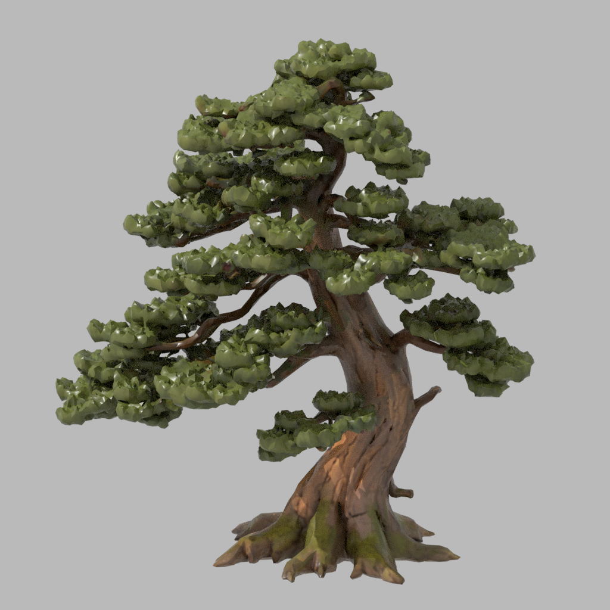

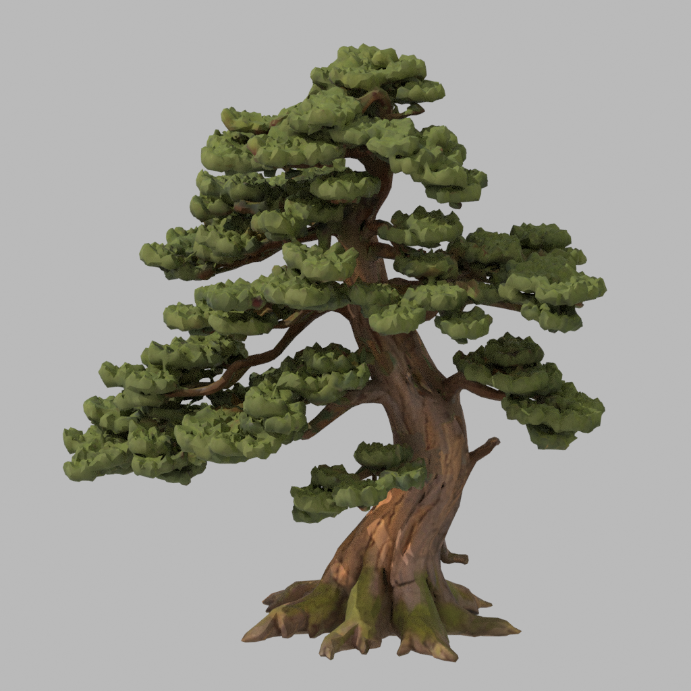

首轮尝试将近景减到 5 万面、远景减到 1.4 万面，叶团出现尖刺与破碎，未采用。最终古松保留 119,684 面、云杉保留 97,828 面，近远景均使用完整几何；仅共享材质并按小区域实例化。模型下载后不默认减面，只有实测瓶颈和视觉对照支持时才调整。当前叶片细节仍比参考插画概括，不能声称逐叶复刻；木栈道、独立蕨丛与倒木已完成首版；白桦与枫树见后续制作，赤杨与海风松尚待制作。[完整过程与失败候选](../evidence/assets/2026-10-29-island-trees/evidence.md)

云杉随后在 Blender 中派生一款 3.8 m 幼态枝冠：细化树干与根盘、缩短下层枝冠、调整中上层比例并加入轻微非对称和偏斜；完整保留 97,828 面、UV 与贴图字节，重新计算变形后的法线。原成树不变，派生另存 4,562,028 字节 GLB；不是新树种，也不是仅均匀缩放。雾松岛新增 8 株，补中层植被，不计入九件基础清单的新完成项；白桦、枫树已在后续制作，赤杨和海风松仍待制作。

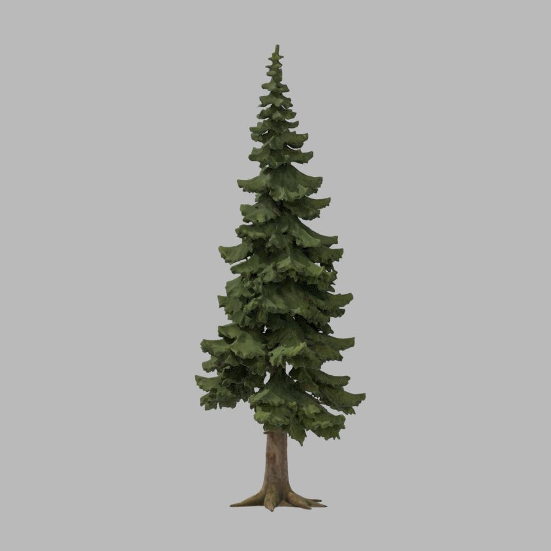

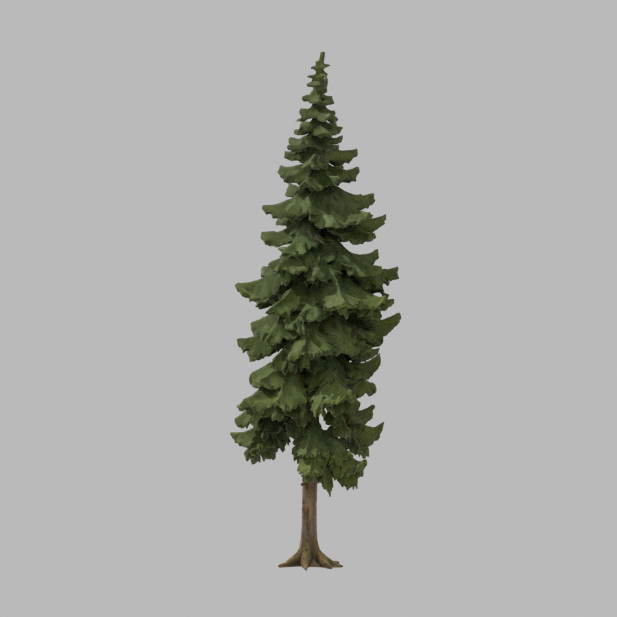

图 35 比较形状，实机接入与林路检查见[制作证据](../evidence/2026-10-29-spruce-sapling/evidence.md)。这是连续网格形变，未重新生成枝条拓扑，叶团层叠感仍在；完整树龄系列和最终密林美术仍未验收。新增模型有额外加载成本，尚无公网测量，不以固定包体数字触发减面。

秋岚继续按单体参考调用 AHOLO Lux3D G1：白桦任务 4480409、枫树任务 4480412，每件一次创建请求。Blender 统一高度为 6.5 m / 6 m，保留 97,792 / 119,142 面和 UV，将材质规范为非金属、粗糙度 0.88，运行 GLB 分别约 6.46 / 8.45 MB。两件均不减面，树根身体高度范围的实际顶点决定保守碰撞半径，树冠另用于镜头避让与地表遮阴；基础单体清单推进至 7/9。

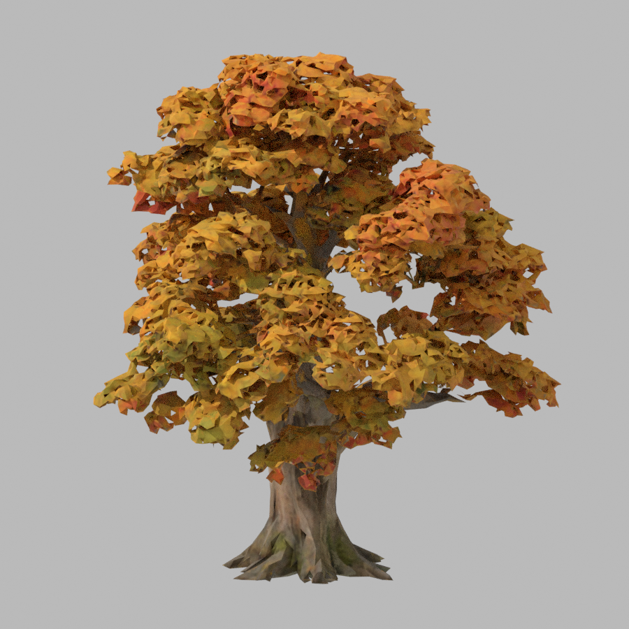

枫树输入是秋色，直接使用原贴图会让春夏也呈橙红。因此用近似感知色空间的饱和度、归一化绿蓝差和高度约束识别叶部，再保留原纹理明暗、随现有季节调色；低部树干不参与。首轮残留红斑，近景再发现枝干误调色；改为近似感知色空间，并对淡色白桦叶与浓色枫叶采用不同识别范围，低垂叶片也纳入。此为两件资产的局部颜色识别，不声称精确人工叶片分区；树冠仍较厚、白桦与枫树尚无独立树龄变体。额度接口仍返回 500，实扣积分未知，未新增商用许可凭据。[输入、原件、前后图与实机证据](../evidence/2026-10-29-autumn-trees/evidence.md)

### 3.7 湿地木栈道：从平板到模块结构

模块用独立木板、倒角、纵梁与支脚取代平板。运行时五段共享模型、连续碰撞面，28 丛水草和 12 组小岸石避开栈道及入口；岸石复用现有 Blender 套件。新模型由项目脚本原创制作，既有古松/云杉的完整几何没有调整。[模型检查](../evidence/2026-10-29-wetland/asset-validation.json)

### 3.8 雾松林下：蕨叶、倒木与局部气氛

按 IE-03 参考在 Blender 原创制作 9 枝羽状叶，单丛 3,240 三角形、约 0.66 m 高，使用双面实叶几何和顶点色，无透明卡片、无新付费任务或减面。初稿叶片折痕过深、排列像水平层片，最终降低折度并沿弯曲叶轴摆放小叶；原稿与过程保留。它是按轮廓制作的首版，不宣称逐叶复刻参考插画。

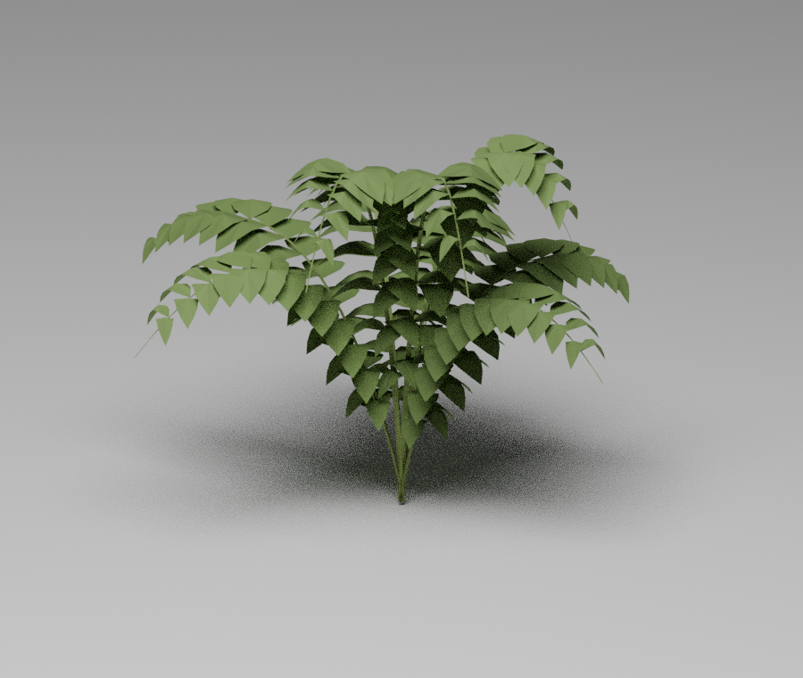

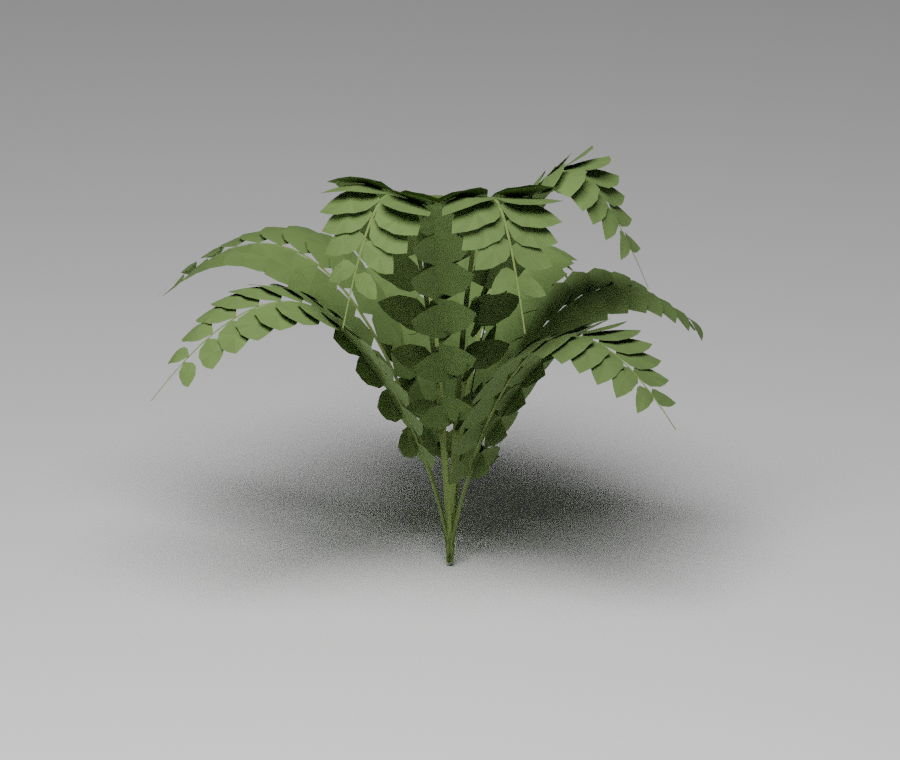

东北坡复用 6 组既有岩石，并接入地形相关碰撞。首轮放大后有外沿伸到可航行水域，新增完整足迹采样后剔除越界位置；林路与树根保留净空。首版 67 丛蕨叶实例化放在林路两侧，后续随林缘布景调整为 78 丛，作为可穿过的柔软植物。

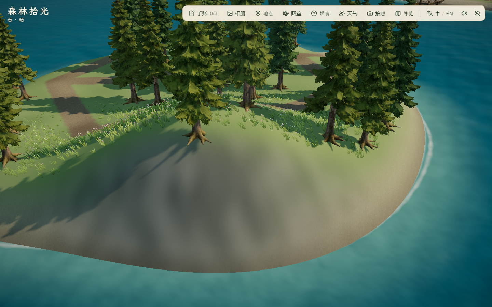

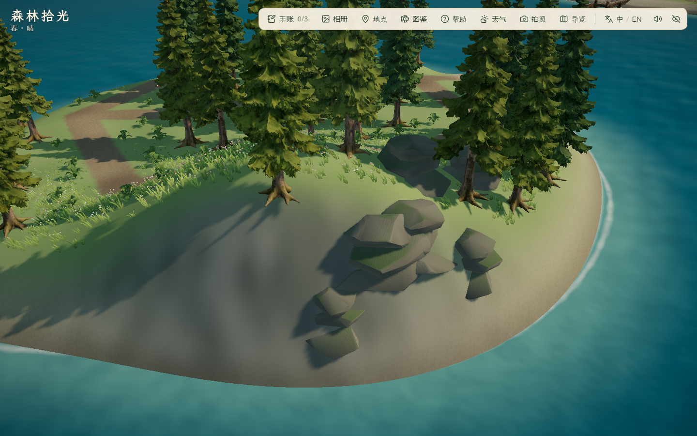

图 30 是前一阶段空间布景对比，不作为性能提升证据；草叶和角色待机有运行时变化。[来源、模型检查、失败稿与实机证据](../evidence/2026-10-29-mist-detail/evidence.md)

岸线随后加入局部海湾与岬角，CPU 地形和海面泡沫共享边界参数，西湾码头衔接保持。第一版箱体雾在坡面上露出硬边，弃用后改为六片低透明度柔边雾，集中东北岩脊，保留深度遮挡；颜色随昼夜变化，减少动态效果时停止飘动。它是局部气氛近似，不是完整体积散射；完整岩岸仍待补齐。

薄雾限定于岛内，西侧码头与返航海面保持清楚；[初稿硬边、采用版与复测证据](../evidence/2026-10-29-mist-shore/evidence.md)保留完整过程。岸线变化后重新筛选植被位置，当时为 1 棵古松、32 株云杉，成树模型几何未修改；随后另加 8 株幼态枝冠派生。

倒木依据 IE-02 在 Blender 原创制作，贯通空洞、厚木壁与断枝先完成结构，再补树皮和苔藓。第一版苔藓像碎石、树皮过齐；采用版改为较薄错落树皮与贴附木面的小苔片。长约 3.19 m、14,852 三角形、759,152 字节，单材质/顶点色，无新付费调用或减面；不记作 AHOLO 生成物。

两处倒木避开古松根部与林路，窄空洞供观察，实体阻挡不允许玩家钻入；四周可绕行。西、南、东侧补 7 簇既有低灌木，蕨叶共 78 丛，6 组岩石保留。首选倒木位置净空不足、北侧灌木挤掉岩脊的候选均已修正；[结构、来源与场景复核](../evidence/2026-10-29-mist-logs/evidence.md)保留过程。

倒木树皮仍有程序排列感，林缘为局部细化，不等于完整参考图或最终美术验收。没有新增倒木互动、穿洞功能或树龄模型变体。

## 4. 技术架构与关键改进

### 4.1 纯前端运行与本地记录

项目使用 React、TypeScript、Vite、React Three Fiber、Three.js 与 Zustand。界面和游戏状态分离，3D 场景按状态反馈；构建后为静态文件，不需要业务服务器。日常进度保存在本浏览器，照片存入 IndexedDB；存档迁移、坏档回退和存储失败提示均有对应处理。跨岛新增独立版本化记录，保存 main/mist 最近安全靠岸点、到访和古松发现，不改原种植、鱼簿和手账格式。刷新后人物与船恢复到同一泊位；海上刷新回最近出发泊位，旧档缺少新记录仍在原主岛出生。

地形高度、坡度、建筑与植被碰撞共同约束角色、船、镜头和物体摆放。渲染采用实例化植被、模型缓存、草花风动、程序天空与水面，以及环境遮蔽、泛光和色调映射；减少动态效果和低画质档对昂贵效果做降级。

音频使用 WebAudio，区分音乐、环境和动作音效；昼夜、海岸距离与室内状态影响混音。46 个复用音频素材的记录标为 CC0，来源台账保留。基础音频已有用户试听确认，后来加入的雨声、强制天气声音与快门声仍待单独听验。[音频证据](../evidence/2026-10-26-audio/evidence.md)

### 4.2 坡地相机与可达性

固定俯角在下坡时会让相机陷进身后的草丛。当前按视线前后地面高差调整俯角，上坡放平、下坡俯视，并平滑过渡；拉远到全岛视角时逐渐取消，室内、钓鱼和划船保持各自镜头。

两图俯角本身就是调整对象，因此用来比较可见性，不作为固定相机的美术对比。镜头左侧仍有树冠遮挡；当前避让主要处理相机落入树冠的情形。[坡地镜头证据](../evidence/2026-10-28-slope-camera/evidence.md)

碰撞也存在取舍：松树由圆形范围改为按高度和方向测得的枝叶范围后，历史审计中空气墙边长从 235.5 m 降为 55.9 m，但明显穿模面积由 3.36 增到 5.19 m²。采用方案改善了可通过空隙，并未消除所有针叶尖接触问题；不能把审计数值概括成“无穿模”。详细采样口径保留在历史附录 5.65。

### 4.3 点火卡顿与重复动作

点燃篝火时曾出现约 2.5 秒长帧。原因是灯数量变化触发受光材质重新编译，火焰和火星也首次进入渲染。改为火焰、火星和灯常驻，熄灭时灯强度为 0、着色器丢弃像素，并在加载时预编译，既有同机样本中的点火帧由 2535 ms 降至 7 ms。只预编译而仍切换可见性的中间方案为 93 ms，因而进一步采用常驻方案。

图 19 仅展示视觉结果，性能结论来自帧采样。常驻方案增加一个始终存在的点光源，关闭时强度为 0；结果不外推为其他设备的耗时。[点火定位与测量](../evidence/2026-10-28-campfire-hitch/evidence.md)

座位动作曾在淡出时循环回首帧，造成坐下、起身各出现两次。现从座位片段切出时直接停止旧动作，其他动作继续淡入淡出。制作结束后增加 1.5 秒 F 键保护，避免最后一次敲击接着触发坐凳。小河路径增加缓存，沙面计算收缩到河道包围盒，减少挖河期间的重复计算。小河旧耗时记录缺少独立摘要，本文不采用其数字作为性能成果。

### 4.4 验证驱动的资源优化

大模型的早期减面稿出现裂片和色块，全部弃用；之后优先采用文件编码、贴图处理和实例化，并逐件检查外观。小道具允许减面，但出现轮廓或接缝问题就提高面数。源文件、运行文件及必要的哈希对照保存在资产台账，避免把文件变小误写成视觉质量提升。

同样的原则用于界面与脚本：拍照由手账解锁改为默认开放后，回归检查也更新为零页和旧档可直接选用；测试通过必须说明检查对象与版本，不能沿用旧截图或旧断言宣称最新功能已验收。

## 5. 验证结果与当前限制

### 5.1 当前检查结果

2026-10-29 白桦/枫树接入后，`pnpm lint`、51 个文件共 239/239 单测、`pnpm build` 通过。主 JS 为 1,901.41 kB，gzip 585.59 kB；保留既有大分块提示。新增专用树种实体、相机冠层与地表遮阴检查；旧布局保持、面积/双向环路/路肩、泊位旧档与保存失败、最小岸距和邻岛宽镜头检查继续通过。这是本机代码与构建结果，不是公网加载或跨设备性能结论。

本轮静音 Edge 156.0.4314.50、1440×900：采用稿树形三时段五机位、完整加载几何/法线、三季总览与两树种近景共 3 组/24 图通过，控制台错误 0；已查看前后图。新树接入后的真实往返、登丘、全环路/支路、刷新、拍照入口与三档 PC 面板 8 组/25 图通过，错误 0，出海 67.533 秒；同轮主岛昼夕夜六机位 18 图已抽查；之后只修订两件秋岚树材质，独立白桦阈值的三季近景也已通过并查看。上一阶段三泊位绕角/划离与秋岚实际滚轮拉远 4 组/7 图通过，未因换树伪称本轮重测。声音、照片保存、全旧玩法及主岛起步的完整三岛连续航行未在本轮复测。

| 验证对象 | 已有结果 | 证据与覆盖范围 |
| --- | --- | --- |
| 秋岚专用白桦/枫树 | 采用稿 3 组/24 图、往返 8 组/25 图，错误 0 | 完整几何/法线、三季总览与近景、身体/冠层/林路、刷新；面积 24.38%；[证据](../evidence/2026-10-29-autumn-trees/evidence.md) |
| 秋岚首版及开阔海峡（替换树形前） | 往返 8 组、绕角/宽镜头 4 组，错误 0 | 航程 67.722 秒；0.5 m 网格面积 24.97%，最近岸距 24.37 m；[摘要与限制](../evidence/2026-10-29-autumn-island/evidence.md) |
| 原主岛关键机位（间距调整阶段） | 1 组、18 图，错误 0 | 昼夕夜概览、角色、工坊、池塘、牧场、塔；截图复核不替代玩法回归；[摘要](../evidence/2026-10-29-autumn-island/final-main-views/report.json) |
| 停靠容错与码头空气墙 | 2 组绕角 + 7 组停靠通过，错误 0 | 静音双泊位实际按键、正面/偏移/斜向靠近、下船/再上船/向前离泊、刷新；16 图；[证据](../evidence/2026-10-29-berth-docking/evidence.md) |
| 幼态云杉与林下层次 | 8 组通过，控制台错误 0 | 8 株、每株完整 97828 面；原区域、823.75 m² 面积、6+16 岩石保持、全林路、古松、倒木与薄雾回归；20 图；[摘要](../evidence/2026-10-29-spruce-sapling/final/report.json) |
| 岩岸采用版跨岛往返（前一阶段） | 8 组通过，控制台错误 0 | 真实键鼠出海 44.852 秒、古松发现、返航、双泊位刷新及三档 PC 窗口；19 图；[摘要](../evidence/2026-10-29-mist-rock-coast/roundtrip/report.json) |
| 原主岛关键机位（幼态云杉阶段） | 1 组截图检查通过，控制台错误 0 | 昼/夕/夜总览、角色、工坊、池塘、牧场、崖顶塔，共 18 图，已抽查；不替代各玩法操作回归；[摘要](../evidence/2026-10-29-spruce-sapling/main-views/report.json) |
| 外沿岩岸布局与交互 | 7 组通过，控制台错误 0 | 16 处新增岩块、5108 个加载顶点无可划船水域侵入；原区域保留、面积、完整林路、古松、倒木绕行/阻挡、雨天薄雾与减少动态效果；26 图；[摘要](../evidence/2026-10-29-mist-rock-coast/final/report.json) |
| 岩岸纹理采用版 | 2 组通过，控制台错误 0 | 只降低坡面纹理对比，不改布局与碰撞；三时段五机位 15 图，复核岩石顶点；已抽查日/夜岸面与整岛；[摘要](../evidence/2026-10-29-mist-rock-coast/reviewed/report.json) |
| 雾松岛倒木与林缘 | 6 组通过，控制台错误 0 | 真实键鼠走完整林路、绕第一段倒木及侧面阻挡；三时段近景、雨天/减少动态效果、面积与原区域保留；[摘要](../evidence/2026-10-29-mist-logs/final/report.json) |
| 岸线细化后跨岛往返（前一阶段） | 8 组通过，控制台错误 0 | 实际出海 44.9 秒、古松发现、返航、双泊位刷新及三档 PC 窗口；[摘要](../evidence/2026-10-29-mist-shore/roundtrip/report.json) |
| 雾松岛岸线与薄雾（前一阶段） | 5 组通过，控制台错误 0 | 1440×900 三时段四机位、雨天预览、雾时钟冻结/恢复、完整林路与古松发现、面积及原主岛保留；[摘要](../evidence/2026-10-29-mist-shore/final/report.json) |
| 雾松岛蕨丛与局部岩脊（前一阶段） | 3 组通过，控制台错误 0 | 1440×900 三时段四机位、蕨丛实际加载、键鼠走完整林间环路与古松发现；未重测航行/刷新；[摘要](../evidence/2026-10-29-mist-detail/final-v2/report.json) |
| 雾松岛首版（细化前） | 8 组通过，控制台错误 0 | Edge 156.0.4314.42，实际键鼠出海约 44.8 秒、林间发现、返航与两泊位刷新；19 张截图，PC 1920×1080/1280×720/1024×768；[摘要](../evidence/2026-10-29-mist-island/final/report.json) |
| 湿地与 Blender 栈道（此前） | 6 组通过，控制台错误 0 | 完整模型加载、原区域保留、实际键鼠通行、减少动态效果、拍照/刷新与 PC 窗口；三时段六机位及雨天；[摘要](../evidence/2026-10-29-wetland/reviewed-final/report.json) |
| 主岛西扩与新树（细化前） | 4 组通过，控制台错误 0 | 原坐标对照、实际键鼠穿越栈道、拍照/刷新安全出生点、三档 PC 窗口；三时段 5 机位；[摘要](../evidence/2026-10-29-west-expansion/final-full-detail/report.json) |
| 拍照效果默认开放 | 5 组通过，控制台错误 0 | 0/2/5 页直接选择、滤镜差异、相框/相册、退出重置、低画质景深禁用；本轮未测高画质景深效果；[摘要](../evidence/2026-10-29-photo-unlocked/report.json) |
| 多处种树、季节回顾、天气联动、河灯、导览 | 9 组通过 | 真实按键与点击闭环、旧档迁移及导览退出还原；[证据](../evidence/2026-10-28-tier1/evidence.md) |
| 南沙滩玩沙 | 9 组通过，控制台错误 0 | 摆放/拒绝、取消、地形变化、刷新、跨天清空和英文界面；[证据](../evidence/2026-10-28-sandplay/evidence.md) |
| 崖顶瞭望塔 | 三时段观景及相关回归通过 | 进出塔、环顾、平台范围、导览与地点任务；[证据](../evidence/2026-10-28-cliff-lookout/evidence.md) |
| 种树与扩建后沿海导航 | 同日湿地细化前开发版 7 组通过，控制台错误 0 | 实际键鼠种植、走到工坊/塔/码头、绕岛整圈、船体边界、倒船靠岸/重复上下船和刷新保持；[记录](../evidence/2026-10-29-west-expansion/coastal-summary.json) |

### 5.2 有边界的性能测量

下表保留各阶段无头浏览器同机采样，各自对应当时的场景；本轮外沿岩岸数据另列。均不是显示器呈现 FPS，也不能把不同场景的数值相互排名。

| 场景与口径 | 对比结果 | 结论边界 |
| --- | --- | --- |
| 幼态云杉加入后，夜间林缘 RAF 中位数 / P95 | 基线 1.5/8.0 ms；采用版 1.8/6.7 ms | 2026-10-29，Edge .50，本机低画质、取消帧率限制、180 帧；中位数与尾部变化不一致，不声称性能提升 |
| 外沿岩岸采用版，夜泊位 RAF 中位数 / P95 | 基线 1.7/3.6 ms；采用版 1.5/3.5 ms | 2026-10-29，Edge .50，本机低画质、取消帧率限制、180 帧；不据短样本声称提升，不与旧 .42 浏览器结果作严格对比 |
| 夜间营地点火，点火帧 | 2535 ms → 7 ms | 修复特定首次编译卡顿；见第 4.3 节 |
| 导览俯瞰，帧时间中位数 | 空种植地 6.4 ms；6 棵成树 7.8 ms | 只说明该机位增加树后的开销 |
| 沙滩固定机位，帧时间中位数/P95 | 空场 3.5/15.8 ms；12 件作品 3.8/16.1 ms | 不包含所有建造过程或其他视角 |
| 天气细节加入倒影后，帧时间中位数 | 晴天 5.2 ms；雨天 6.4 ms | 是整体天气差异，不能单独归因于倒影 |
| 西扩完整树模型，概览 / 湿地近景 RAF 中位数、P95 | 概览 8.4/12.6 ms；湿地 8.0/17.5 ms | 2026-10-29，本机 1440×900、低画质、取消帧率限制、各 180 帧；不证明其他 PC 性能，也未据此启用减面 |
| 湿地细化后，湿地 / 栈道近景 RAF 中位数、P95 | 湿地 7.4/17.3 ms；栈道 6.9/13.8 ms | 2026-10-29，本机 1440×900、低画质、取消帧率限制、各 180 帧；无受控前后性能对照，不作为显示器 FPS 或其他 PC 结论 |
| 双岛夜景概览 RAF 中位数 / P95 | 9.4 / 14.5 ms | 2026-10-29，本机 1440×900、未降为低画质、取消帧率限制、180 帧；机位与画质不同，不与前列数据作性能提升比较 |
| 倒木与林缘，夜间林缘 RAF 中位数 / P95 | 2.4 / 6.8 ms | 2026-10-29，本机 1440×900、低画质、取消帧率限制、180 帧；机位调整后不与初始林缘数据比较 |
| 雾松岛岸线与薄雾（前一阶段），夜间泊位 RAF 中位数 / P95 | 2.9 / 8.3 ms | 2026-10-29，本机 1440×900、低画质、取消帧率限制、180 帧；本轮基线同机位 3.2/6.1 ms，不据此声称提升 |

### 5.3 尚存问题

- **体验验收：** 最新多树、河灯、导览、坡地镜头、崖顶塔、玩沙和手动天气仍需用户实际体验；基础音频已确认，雨声与快门声等补充声音待听验。
- **动作与接触：** 部分衣袖、足底、细小遮挡和碰撞尚未全面验收；狐狸无骨骼动画，跨舷、种植、喂食等没有完整专用动作。
- **玩法边界：** 沙堡拍照/手账联动未做；脚印完整淡出时长未在浏览器等待验证；季节回顾只统计上线后的数据，历史照片受最近 12 张限制。
- **性能与交付：** 缺少跨 PC 配置、公网冷加载与整场景长时运行测量；主 JS 大分块提示待按实际加载瓶颈处理。
- **素材凭据：** 部分生成积分尚未核账，授权和赛事沟通原始凭据仍需补齐。
- **群岛扩展：** 湿地与栈道已细化；西扩仍有局部规整海岸和重复树形，树冠覆盖率与林下层次未达成最终美术验收；雾松岛首版多泊位与跨岛存档已接入，蕨丛、倒木、林缘灌木、局部岩脊、岸湾与薄雾已有首版，外沿已补 16 处复用岩块，完整岩岸与其余树龄变体未完成，首个幼态云杉枝冠已接入；秋岚首版可玩闭环已接入，白桦/枫树已接入，但岸岩和林下层次仍待完善；潮汐岛及按需区域预载仍待实现。

仅 PC 浏览器属于交付范围，不将手机布局、触屏控制或移动端验收列入待办。

## 6. 展示材料与后续计划

### 6.1 当前交付状态

| 材料 | 状态 |
| --- | --- |
| 可运行静态构建 | 本地构建通过，尚未部署公开 Demo |
| 公开托管 | 计划使用 ModelScope 国际站；尚无公开作品地址 |
| 项目报告 | 本文为当前事实主稿，含精选图片与证据链接 |
| 完整过程 | [v0.83 历史附录](HISTORY_V083.md)，保留原章节、失败过程与修订日志 |
| 演示视频、参赛 PDF/PPT | 尚未制作或导出 |

后续发布只上传编译后的静态产物，模型工作文件、完整开发源码和密钥不作为站点公开内容；创建远程空间、上传和部署需另有明确授权。

### 6.2 下一步

先完成最新玩法的人工体验与声音检查，处理影响角色可见性、动作连续性和操作闭环的问题；再在目标 PC 环境测量冷加载和长时运行，依据实际瓶颈优化。随后录制包含漫游、种树、钓鱼、划船、玩沙与夜景的短演示，并从本文导出带图 PDF，逐页核验中文字体、图片清晰度、图注和分页。

PDF 正文以本稿为源，完整历史按需作为独立附录；正式导出前按实际排版调整图幅和页数，不把预期页数当作已完成成果。

用户已确认**保留主岛西扩，另外新增三座较小邻岛**。主岛西扩和四种参考树形已进入运行时；雾松岛首版已打通出海—停靠—古松发现—返航与泊位刷新恢复，秋岚首版亦已接入并按用户反馈拉开海峡，后续补齐两岛美术并推进潮汐岛。三岛可行走面积以扩建前主岛为基准：雾松与秋岚各 20%–25%，潮汐 12%–18%，由海水分隔，不能做成三个接近主岛大小的陆块。白桦、枫树已接入秋岚，赤杨和海风松仍待制作；秋岚岛跟随季节换叶色，潮汐岛采用固定浅池，不含潮汐模拟。相邻岛 30–50 秒为原设计目标；本轮优先用户要求的海峡分隔，雾松至秋岚实测约 67.7 秒，范围见第 5 节。

现有码头、船、岩石优先复用；九件单体建模参考之外，三岛分别配有独立场景和地形造型图，便于先验证地形与泊位，再制作树木和布景。技术上已接入两个邻岛独立地形、三泊位与旧档兼容，按需区域加载仍待实现；详见[规划方案](../ISLAND_EXPANSION_PLAN.md)、[单体图册](../ISLAND_EXPANSION_REFERENCES.md)与[邻岛图册](../ISLAND_NEIGHBOR_REFERENCES.md)。

图 20 表达空间与美术方向，不是坐标复刻或功能完成证明；单岛灰模风格图同样是 AI 插画，不是已制作的地形模型。此前双岛稿与设计修订、树形修正及完整提示词保留在[制作证据](../evidence/2026-10-29-island-expansion-v2/evidence.md)。新增场景目前为第 2.1 节主岛西扩、雾松与秋岚首版；潮汐岛未实施，秋岚专用白桦/枫树已接入，最终美术未完成。

**本版修订（2026-10-29，v0.98）：** 按参考经 AHOLO 生成白桦/枫树并保留完整几何，秋岚用 8 株白桦、3 株枫树替换布局阔叶树，基础资产 7/9。春夏秋叶色及实体/冠层接入，可站立面积 24.38%，开阔海峡保持。239 项单测、lint/build 与本机静音树形复核通过；往返/林路/刷新 8 组已通过，主岛昼夕夜视角已复核，独立白桦阈值的三季近景也已通过并查看。额度接口失败，实际积分未知；未提交、推送、部署或导出。

**交付记录（2026-10-30）：** 用户要求将本版及对应群岛代码、运行模型、精选证据提交并推送到项目 Git 仓库。本次仅归档，功能和验证范围沿用 v0.98；具体提交与远端同步状态以 Git 记录为准，不包含部署或 PDF/PPT 导出。
